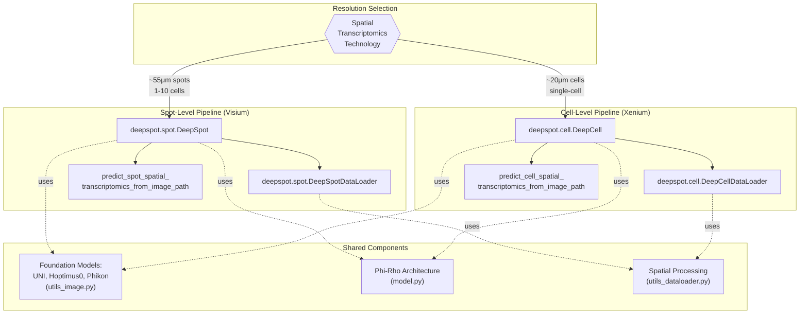
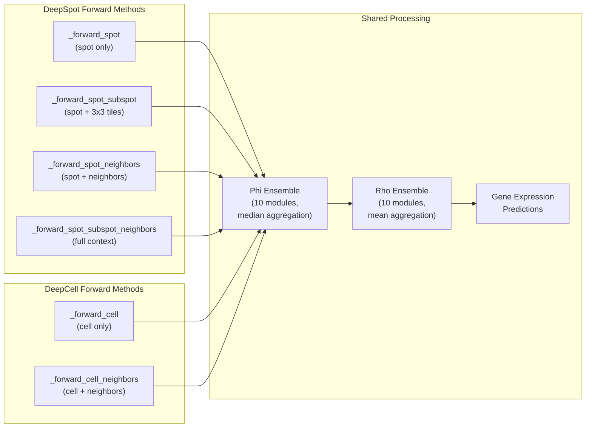
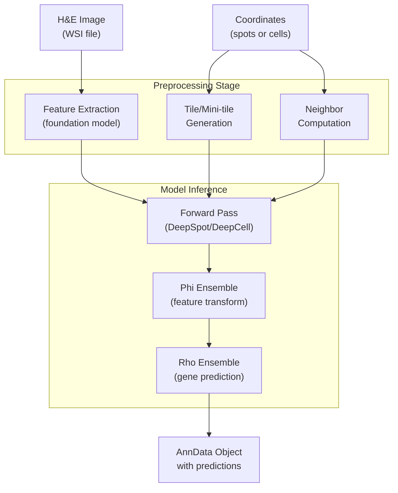

# What is DeepSpot?

Relevant source files

The following files were used as context for generating this wiki page:

- [.codeboarding/on_boarding.md](.codeboarding/on_boarding.md)
- [README.md](README.md)

## Purpose and Scope

This page introduces the core concept and functionality of the DeepSpot system: using deep learning to predict spatial transcriptomics from standard H&E histology images. It covers both **DeepSpot** (spot-level predictions for Visium technology) and **DeepCell** (single-cell predictions for Xenium technology). For detailed architectural components, see [System Architecture](#1.2). For complete workflows, see [Visium Spot Workflow](#7.1) and [Xenium Cell Workflow](#7.2).

**Sources**: [README.md:1-189]()

---

## The Core Problem and Solution

DeepSpot addresses a fundamental challenge in spatial biology: **generating spatial transcriptomics data from standard H&E histology images**. Traditional spatial transcriptomics technologies like Visium and Xenium require specialized, expensive protocols. DeepSpot enables virtual spatial transcriptomics prediction using only H&E slides, which are ubiquitously available in clinical and research settings.

The system leverages:
- **Pathology foundation models** (UNI, Hoptimus0, Phikon) to extract morphological features from tissue images
- **Deep-set neural networks** to model spatial units (spots or cells) as bags of sub-units
- **Spatial context integration** by incorporating neighbor information for improved predictions

**Key Insight**: The system models the hierarchical structure of tissue by treating a spot as a "bag of sub-spots" (for Visium) or incorporating neighboring cells/spots, capturing both local morphology and global spatial context.

**Sources**: [README.md:31-38]()

---

## Two Resolution Levels: DeepSpot and DeepCell

The system provides parallel implementations for two spatial transcriptomics technologies, each with distinct resolution characteristics:

| Aspect | DeepSpot (Spot-Level) | DeepCell (Cell-Level) |
|--------|----------------------|----------------------|
| **Technology** | Visium | Xenium |
| **Resolution** | ~55μm diameter spots | ~20μm diameter cells |
| **Granularity** | 1-10 cells per spot | Single-cell precision |
| **Model Class** | `deepspot.spot.DeepSpot` | `deepspot.cell.DeepCell` |
| **Data Loader** | `deepspot.spot.DeepSpotDataLoader` | `deepspot.cell.DeepCellDataLoader` |
| **Typical Gene Count** | 300-800 highly variable genes | 500 highly variable genes |
| **Spatial Context** | Sub-spots (3×3 tiles) + neighbors | Neighbors only |
| **Forward Methods** | 4 modes (spot, subspot, neighbors, full) | 2 modes (cell, neighbors) |

**Diagram: DeepSpot System - Resolution-Specific Pipelines**

**Sources**: [README.md:17-28](), [README.md:64-73](), [.codeboarding/on_boarding.md:50-76]()

---

## Spatial Context Integration

DeepSpot's key innovation is **hierarchical spatial context modeling**. Unlike methods that treat spots or cells as isolated units, DeepSpot captures multiple levels of tissue organization:

### DeepSpot Context Modes

The `DeepSpot` model supports four spatial context configurations via distinct forward methods:

1. **`_forward_spot`** - Individual spot features only
2. **`_forward_spot_subspot`** - Spot divided into 3×3 sub-tiles (mini-tiles)
3. **`_forward_spot_neighbors`** - Spot plus neighboring spots
4. **`_forward_spot_subspot_neighbors`** - Full context (sub-tiles + neighbors)

### DeepCell Context Modes

The `DeepCell` model supports two configurations:

1. **`_forward_cell`** - Individual cell features
2. **`_forward_cell_neighbors`** - Cell plus neighboring cells (typically 45 neighbors)

**Diagram: Spatial Context Modes and Neural Processing Pipeline**

**Sources**: [deepspot/spot/model.py:163-187](), [deepspot/cell/model.py:179-188](), [.codeboarding/on_boarding.md:64-76]()

---

## Architecture Components

### Foundation Models for Feature Extraction

DeepSpot uses pre-trained pathology foundation models to extract morphological features from H&E images. These models are loaded via `get_morphology_model_and_preprocess()`:

| Model | Embedding Dimension | Source |
|-------|-------------------|--------|
| **UNI** | 1024 | HuggingFace (MahmoodLab) |
| **Hoptimus0** | 1536 | HuggingFace (bioptimus) |
| **Phikon** | 768 | HuggingFace (owkin) |
| **Inception** | 2048 | torchvision |

These models transform raw image tiles into feature vectors that capture tissue morphology patterns.

**Sources**: [README.md:80-86](), [deepspot/utils/utils_image.py:36-177]()

### Phi-Rho Ensemble Architecture

Both `DeepSpot` and `DeepCell` share the same two-stage neural architecture:

1. **Phi Modules** (`deepspot.spot.model.Phi` / `deepspot.cell.model.Phi`)
   - Ensemble of 10 parallel networks
   - Structure: Linear → Dropout → ReLU
   - Aggregation: Median across ensemble members
   - Purpose: Transform and normalize features

2. **Rho Modules** (`deepspot.spot.model.Rho` / `deepspot.cell.model.Rho`)
   - Ensemble of 10 parallel networks
   - Structure: Dropout → ReLU → Linear
   - Aggregation: Mean across ensemble members
   - Purpose: Generate final gene expression predictions

**Sources**: [deepspot/spot/model.py:31-55](), [deepspot/cell/model.py:36-60](), [.codeboarding/on_boarding.md:64-66]()

---

## Input and Output Format

### Input Requirements

**For DeepSpot (Visium):**
- H&E whole-slide image (`.svs`, `.tiff` formats)
- Spot coordinates (x, y positions)
- Spot diameter parameter (default: 112 pixels at working resolution)

**For DeepCell (Xenium):**
- H&E image
- Cell coordinates and boundaries
- Cell diameter parameter (default: 40 pixels)

### Output Format

Both models produce **AnnData objects** compatible with scanpy/squidpy:
- `.X`: Predicted gene expression matrix (spots/cells × genes)
- `.var`: Gene metadata
- `.obs`: Spot/cell metadata (coordinates, predictions)
- `.obsm['spatial']`: Spatial coordinates

The prediction functions return ready-to-visualize objects:
- `predict_spot_spatial_transcriptomics_from_image_path()` for spots
- `predict_cell_spatial_transcriptomics_from_image_path()` for cells

**Sources**: [deepspot/utils/utils_image.py:241-292](), [deepspot/utils/utils_image.py:295-356](), [README.md:145-149]()

---

## Simplified Prediction Workflow

**Diagram: High-Level Prediction Workflow**

**Sources**: [README.md:35-38](), [.codeboarding/on_boarding.md:24]()

---

## Key Design Principles

1. **Resolution Flexibility**: Separate implementations for spot-level (DeepSpot) and cell-level (DeepCell) predictions accommodate different spatial transcriptomics technologies

2. **Hierarchical Context**: Deep-set architecture captures both local morphology (sub-tiles) and global context (neighbors)

3. **Foundation Model Integration**: Leverages state-of-the-art pathology models for feature extraction rather than training from scratch

4. **Ensemble Robustness**: Both Phi and Rho stages use 10-member ensembles with different aggregation strategies for stable predictions

5. **Modular Design**: Shared utilities (`utils_dataloader.py`, `utils_image.py`) and consistent API across spot and cell pipelines

6. **Production Scale**: Pre-computed predictions for 3,780 TCGA samples (56M+ spots, ~8TB) demonstrate deployment capability

**Sources**: [README.md:23-27](), [README.md:89-90](), [.codeboarding/on_boarding.md:24]()

---

## Relationship to Other Concepts

- For installation and setup instructions, see [Installation](#2.1)
- For detailed model architecture documentation, see [DeepCell Model](#5.1) and [DeepSpot Model](#5.2)
- For understanding the deep-set approach, see [Deep-Set Architecture](#3.2)
- For foundation model details, see [Foundation Models](#3.3)
- For complete usage workflows, see [Visium Spot Workflow](#7.1) and [Xenium Cell Workflow](#7.2)

**Sources**: All citations from previous sections

---