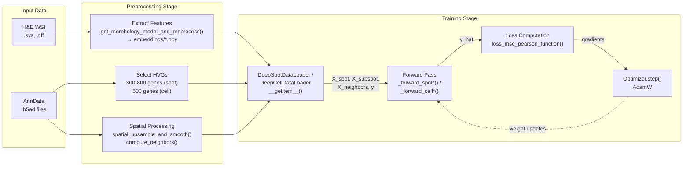
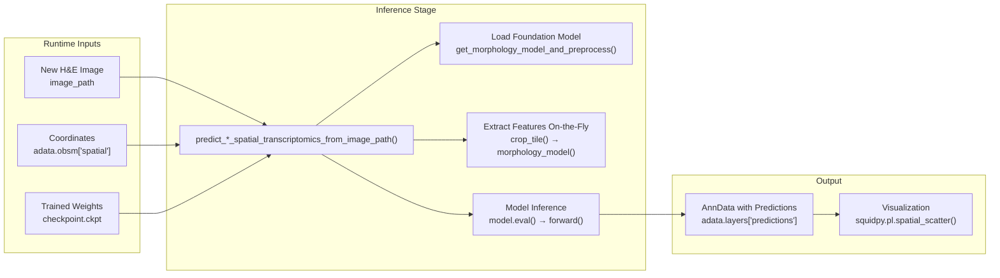
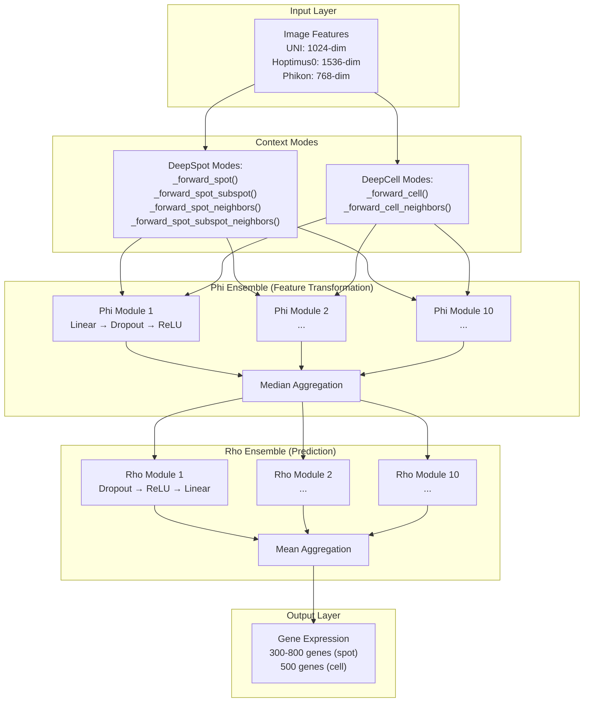

# System Architecture

<details>
<summary>Relevant source files</summary>

The following files were used as context for generating this wiki page:

- [.codeboarding/DeepSpot Models.md](.codeboarding/DeepSpot Models.md)
- [.codeboarding/on_boarding.md](.codeboarding/on_boarding.md)
- [README.md](README.md)

</details>


## Purpose and Scope

This page provides a high-level overview of the DeepSpot system architecture, describing the major components and how they interact to predict spatial transcriptomics from H&E histology images. It covers the module organization, core abstractions, data flow patterns, and key interfaces between components.

For conceptual explanations of the deep-set architecture and foundation models, see [Core Concepts](#3). For detailed implementation of specific components, see [Data Management & Preprocessing](#4), [Model Architecture](#5), and [Image Processing](#6).

**Sources**: [README.md:1-189]()

---

## System Overview

DeepSpot is a dual-resolution spatial transcriptomics prediction system that operates at two scales:

- **Spot-level**: `DeepSpot` model for Visium data (~55μm spots, capturing multiple cells)
- **Cell-level**: `DeepCell` model for Xenium data (~20μm single cells)

Both models share a common architectural pattern but operate on different spatial resolutions and employ distinct data preprocessing strategies. The system follows a three-stage pipeline: **preprocessing** (feature extraction and data preparation), **training** (model optimization), and **inference** (prediction on new images).

**Sources**: [README.md:17-73](), [.codeboarding/on_boarding.md:1-125]()

---

## Module Organization

The codebase is organized into resolution-specific modules with shared utilities:

```
deepspot/
├── spot/                  # Spot-level components (Visium)
│   ├── model.py          # DeepSpot, Phi, Rho
│   ├── dataloader.py     # DeepSpotDataLoader
│   └── loss.py           # Spot-specific loss functions
├── cell/                  # Cell-level components (Xenium)
│   ├── model.py          # DeepCell, Phi, Rho
│   ├── dataloader.py     # DeepCellDataLoader
│   └── loss.py           # Cell-specific loss functions
└── utils/                 # Shared utilities
    ├── utils_dataloader.py  # Spatial processing, data loading
    ├── utils_image.py       # Image processing, feature extraction
    └── utils.py             # General utilities (seeding, etc.)
```

### Import Conventions

Users interact with the system through module-level imports:

```python
from deepspot.spot import DeepSpot, DeepSpotDataLoader
from deepspot.cell import DeepCell, DeepCellDataLoader
```

**Sources**: [README.md:20-22](), [.codeboarding/on_boarding.md:14-18]()

---

## Core Component Architecture

The following diagram maps the system's functional components to their code implementations:

```mermaid
graph TB
    subgraph "User Entry Points"
        VisiumNB["Visium Notebooks<br/>example_notebook/Visium_spot_example/"]
        XeniumNB["Xenium Notebooks<br/>example_notebook/Xenium_single-cell_example/"]
    end
    
    subgraph "Spot-Level Pipeline"
        DeepSpotModel["DeepSpot<br/>deepspot.spot.model.DeepSpot"]
        DeepSpotLoader["DeepSpotDataLoader<br/>deepspot.spot.dataloader.DeepSpotDataLoader"]
        SpotLoss["loss_mse_pearson_function<br/>deepspot.spot.loss"]
    end
    
    subgraph "Cell-Level Pipeline"
        DeepCellModel["DeepCell<br/>deepspot.cell.model.DeepCell"]
        DeepCellLoader["DeepCellDataLoader<br/>deepspot.cell.dataloader.DeepCellDataLoader"]
        CellLoss["loss_mse_pearson_function<br/>deepspot.cell.loss"]
    end
    
    subgraph "Shared Processing Layer"
        LoadData["load_data()<br/>utils_dataloader.py:136-178"]
        SpatialProc["spatial_upsample_and_smooth()<br/>utils_dataloader.py:68-101"]
        ComputeNeighbors["compute_neighbors()<br/>utils_dataloader.py:115-124"]
        GetModel["get_morphology_model_and_preprocess()<br/>utils_image.py:36-177"]
        PredictSpot["predict_spot_spatial_transcriptomics_from_image_path()<br/>utils_image.py:241-292"]
        PredictCell["predict_cell_spatial_transcriptomics_from_image_path()<br/>utils_image.py:295-356"]
    end
    
    subgraph "Neural Architecture"
        PhiLayers["Phi Ensemble<br/>n=10 modules<br/>model.Phi"]
        RhoLayers["Rho Ensemble<br/>n=10 modules<br/>model.Rho"]
    end
    
    VisiumNB --> DeepSpotModel
    VisiumNB --> DeepSpotLoader
    XeniumNB --> DeepCellModel
    XeniumNB --> DeepCellLoader
    
    DeepSpotLoader --> LoadData
    DeepSpotLoader --> SpatialProc
    DeepSpotLoader --> ComputeNeighbors
    DeepCellLoader --> LoadData
    DeepCellLoader --> ComputeNeighbors
    
    DeepSpotModel --> PhiLayers
    DeepSpotModel --> RhoLayers
    DeepSpotModel --> SpotLoss
    DeepCellModel --> PhiLayers
    DeepCellModel --> RhoLayers
    DeepCellModel --> CellLoss
    
    PredictSpot --> GetModel
    PredictSpot --> DeepSpotModel
    PredictCell --> GetModel
    PredictCell --> DeepCellModel
```



**Sources**: [.codeboarding/on_boarding.md:27-47](), [.codeboarding/DeepSpot Models.md:19-109](), [deepspot/spot/model.py:58-217](), [deepspot/cell/model.py:63-281](), [deepspot/utils/utils_dataloader.py:136-178](), [deepspot/utils/utils_image.py:36-177]()

---

## Component Responsibilities

| Component | Primary Classes/Functions | Responsibility |
|-----------|--------------------------|----------------|
| **Spot Model** | `DeepSpot` | Spot-level prediction with four context modes: spot-only, spot+subspot, spot+neighbors, spot+subspot+neighbors |
| **Cell Model** | `DeepCell` | Cell-level prediction with two context modes: cell-only, cell+neighbors |
| **Spot Data Loader** | `DeepSpotDataLoader` | Batches spot features, mini-tiles (3×3 sub-tiles), neighbor features, gene counts |
| **Cell Data Loader** | `DeepCellDataLoader` | Batches cell features, neighbor features (context=45), gene counts; applies spatial upsampling/smoothing |
| **Spatial Processing** | `spatial_upsample_and_smooth()`, `compute_neighbors()` | Upsamples gene expression spatially, computes neighbor graphs (k-NN or radius-based) |
| **Image Processing** | `get_morphology_model_and_preprocess()`, `crop_tile()`, `compute_mini_tiles()` | Loads foundation models (UNI, Hoptimus0, Phikon), extracts tile features, generates mini-tiles |
| **Data Loading** | `load_data()`, `load_multiple_pickles()` | Loads gene expression (AnnData) and image features (.npy files) |
| **Prediction API** | `predict_spot_spatial_transcriptomics_from_image_path()`, `predict_cell_spatial_transcriptomics_from_image_path()` | End-to-end inference from image path to AnnData predictions |
| **Loss Functions** | `loss_mse_pearson_function()`, `loss_mse_cosine_function()` | Composite losses combining MSE with correlation metrics |
| **Neural Layers** | `Phi` (10 modules), `Rho` (10 modules) | Feature transformation (Phi: median aggregation) and final prediction (Rho: mean aggregation) |

**Sources**: [deepspot/spot/model.py:58-217](), [deepspot/cell/model.py:63-281](), [deepspot/spot/dataloader.py:21-186](), [deepspot/cell/dataloader.py:22-208](), [deepspot/utils/utils_dataloader.py:68-124](), [deepspot/utils/utils_image.py:36-356]()

---

## Data Flow Architecture

### Training Pipeline



**Sources**: [deepspot/spot/dataloader.py:128-186](), [deepspot/cell/dataloader.py:180-208](), [deepspot/spot/model.py:163-187](), [deepspot/cell/model.py:179-188](), [deepspot/spot/loss.py:31-35](), [deepspot/cell/loss.py:73-77]()

### Inference Pipeline



**Sources**: [deepspot/utils/utils_image.py:241-292](), [deepspot/utils/utils_image.py:295-356](), [deepspot/utils/utils_image.py:190-234]()

---

## Model Architecture Pattern

Both `DeepSpot` and `DeepCell` follow the same neural architecture pattern with resolution-specific variations:



### Key Architectural Features

1. **Ensemble Architecture**: Both Phi and Rho stages use 10 parallel modules for robustness
2. **Aggregation Strategy**: Phi uses median (robust to outliers), Rho uses mean (smooth predictions)
3. **Context Flexibility**: Models can incorporate spatial context (neighbors, sub-tiles) through different forward functions
4. **Foundation Model Agnostic**: Input layer accepts varying feature dimensions from different foundation models

**Sources**: [deepspot/spot/model.py:31-55](), [deepspot/cell/model.py:36-60](), [deepspot/spot/model.py:189-213](), [deepspot/cell/model.py:190-214](), [.codeboarding/DeepSpot Models.md:64-82]()

---

## External Dependencies and Resources

The system integrates with several external resources:

| Resource Type | Source | Purpose | Access Method |
|--------------|--------|---------|---------------|
| **Foundation Model Weights** | HuggingFace | UNI, Hoptimus0, Phikon pretrained models | Manual download, path configuration in `utils_image.py` |
| **DeepSpot Pretrained Weights** | Zenodo (record 15322099) | Trained DeepSpot/DeepCell checkpoints | Download for inference |
| **TCGA Predictions** | HuggingFace Datasets (nonchev/TCGA_digital_spatial_transcriptomics) | 56M+ spots, 3,780 patients, ~8TB | `datasets` library, HF authentication |
| **Scientific Stack** | PyPI/conda | PyTorch, Lightning, scanpy, squidpy, pyvips, openslide | conda environment |

### Foundation Model Configuration

Foundation models must be manually downloaded and their paths updated in [deepspot/utils/utils_image.py:36-177](). The `get_morphology_model_and_preprocess()` function supports:

- **UNI**: 1024-dimensional embeddings, timm-based ViT
- **Hoptimus0**: 1536-dimensional embeddings, timm-based ViT
- **Phikon**: 768-dimensional embeddings, HuggingFace transformers
- **Inception-v3**: 2048-dimensional embeddings (legacy support)

**Sources**: [README.md:80-90](), [deepspot/utils/utils_image.py:36-177]()

---

## Resolution-Specific Differences

| Aspect | DeepSpot (Spot-Level) | DeepCell (Cell-Level) |
|--------|----------------------|----------------------|
| **Target Technology** | Visium | Xenium |
| **Spatial Resolution** | ~55μm spots (~1-10 cells) | ~20μm single cells |
| **Gene Count** | 300-800 HVGs | 500 HVGs |
| **Mini-Tiling** | Yes (3×3 sub-tiles per spot) | No (cells smaller than tiles) |
| **Neighbor Context** | Default radius=1 (6-8 neighbors) | Default context=45 neighbors |
| **Spatial Processing** | Optional upsampling | Required upsampling + smoothing |
| **Context Modes** | 4 modes (spot, subspot, neighbors, combined) | 2 modes (cell, neighbors) |
| **Data Loader** | `DeepSpotDataLoader` | `DeepCellDataLoader` |
| **Preprocessing Notebook** | `GettingStartedWithDeepSpot_1_preprocessing.ipynb` | `GettingStartedWithDeepCell_1_preprocessing.ipynb` |

**Sources**: [deepspot/spot/dataloader.py:21-186](), [deepspot/cell/dataloader.py:22-208](), [README.md:64-73]()

---

## Key Abstractions and Interfaces

### Data Loader Interface

Both `DeepSpotDataLoader` and `DeepCellDataLoader` implement PyTorch `Dataset` interface:

- **`__init__(...)`**: Configures preprocessing (normalization, upsampling, neighbor computation)
- **`__len__()`**: Returns dataset size
- **`__getitem__(idx)`**: Returns batch dictionary with keys:
  - `X_spot/X_cell`: Primary tile features
  - `X_subspot`: Mini-tile features (spot only)
  - `X_neighbors`: Neighbor tile features
  - `y_spot/y_cell`: Gene expression ground truth

**Sources**: [deepspot/spot/dataloader.py:128-186](), [deepspot/cell/dataloader.py:180-208]()

### Model Interface

Both `DeepSpot` and `DeepCell` inherit from `pytorch_lightning.LightningModule`:

- **`__init__(...)`**: Initializes Phi/Rho ensembles, configures loss functions
- **`forward(batch)`**: Dynamically routes to context-specific forward function
- **`training_step(batch, batch_idx)`**: Computes loss for training
- **`validation_step(batch, batch_idx)`**: Computes loss for validation
- **`configure_optimizers()`**: Sets up AdamW optimizer

**Sources**: [deepspot/spot/model.py:58-217](), [deepspot/cell/model.py:63-281]()

### Prediction Interface

High-level prediction functions abstract away model complexities:

```python
predict_spot_spatial_transcriptomics_from_image_path(
    adata, image_path, model_or_checkpoint_path,
    morphology_model_name, spot_diameter, mini_tile=False
)

predict_cell_spatial_transcriptomics_from_image_path(
    adata, image_path, model_or_checkpoint_path,
    morphology_model_name, cell_diameter
)
```

These functions:
1. Load foundation model and preprocessing transforms
2. Extract features for coordinates in `adata.obsm['spatial']`
3. Run model inference
4. Store predictions in `adata.layers['predictions']`

**Sources**: [deepspot/utils/utils_image.py:241-292](), [deepspot/utils/utils_image.py:295-356]()

---

## Next Steps

- For detailed data preprocessing workflows, see [Data Management & Preprocessing](#4)
- For neural architecture implementation details, see [Model Architecture](#5)
- For image processing and feature extraction, see [Image Processing](#6)
- For complete end-to-end workflows, see [Visium Spot Workflow](#7.1) and [Xenium Cell Workflow](#7.2)

---