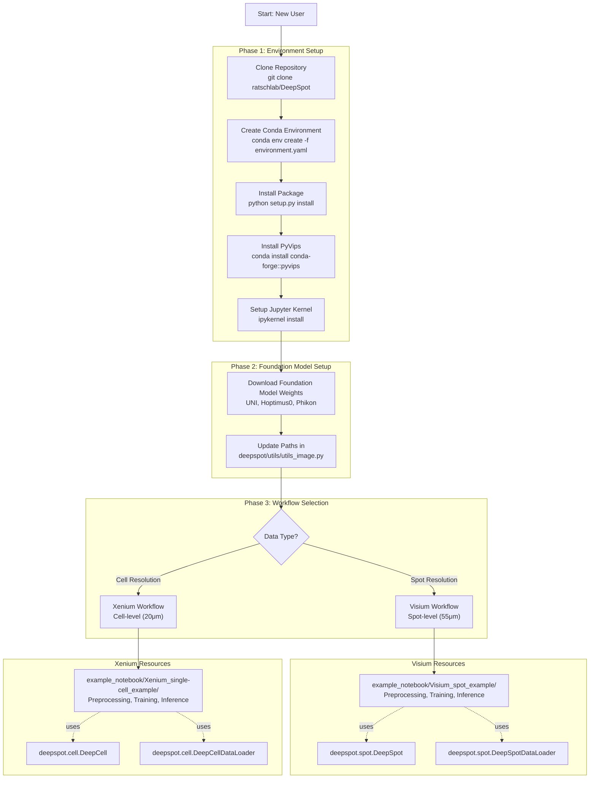
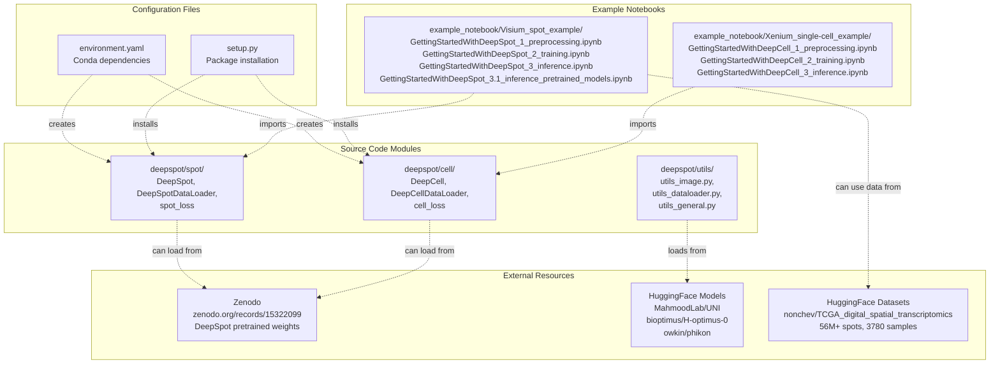
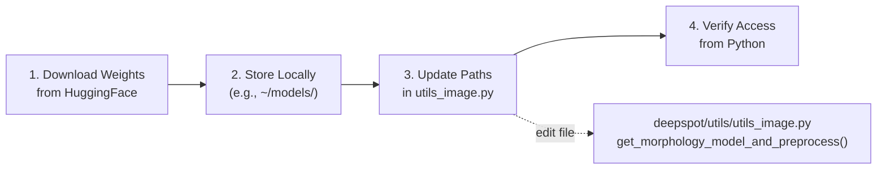

# Getting Started

<details>
<summary>Relevant source files</summary>

The following files were used as context for generating this wiki page:

- [README.md](README.md)

</details>


This page provides an overview of the steps needed to install DeepSpot and run your first predictions. It covers the essential prerequisites, installation process, and initial verification steps. 

**Scope**: This page gives a high-level guide to getting the DeepSpot system operational on your machine. For detailed installation instructions, see [Installation](#2.1). For a fast-track guide to making predictions with pre-trained models, see [Quick Start with Pre-trained Models](#2.2). For complete workflows including preprocessing and training, see [Visium Spot Workflow](#7.1) or [Xenium Cell Workflow](#7.2).

## Overview of the Getting Started Process

Getting DeepSpot operational involves three main phases: environment setup, foundation model configuration, and workflow selection. The following diagram illustrates the complete setup flow:



**Sources**: [README.md:40-73]()

## Prerequisites

Before installing DeepSpot, ensure your system meets the following requirements:

| Requirement | Description | Notes |
|-------------|-------------|-------|
| **Operating System** | Linux or macOS | Windows may work but is untested |
| **Python** | 3.8+ | Specified in `environment.yaml` |
| **Conda** | Anaconda or Miniconda | Required for environment management |
| **GPU** | CUDA-compatible GPU | Optional but strongly recommended for training |
| **Storage** | 50+ GB free space | For foundation models, datasets, and outputs |
| **Memory** | 16+ GB RAM | 32+ GB recommended for large images |

**Sources**: [README.md:40-58]()

## Core Resources and File Locations

Understanding where key resources are located in the codebase helps navigate the system. The following diagram maps conceptual components to their actual file paths:



**Sources**: [README.md:1-189]()

## Installation Quick Reference

The installation process consists of five commands executed in sequence:

```bash
# 1. Clone the repository
git clone https://github.com/ratschlab/DeepSpot
cd DeepSpot

# 2. Create conda environment from specification
conda env create --file=environment.yaml

# 3. Activate the environment
conda activate deepspot

# 4. Install the package
python setup.py install

# 5. Install pyvips (required for efficient image I/O)
conda install conda-forge::pyvips

# 6. (Optional) Setup Jupyter kernel for notebooks
python -m ipykernel install --user --name deepspot --display-name "deepspot"
```

**Note**: PyVips requires platform-specific installation. If the conda installation fails, refer to the [pyvips documentation](https://github.com/libvips/pyvips) for alternative installation methods.

For comprehensive installation details including troubleshooting, see [Installation](#2.1).

**Sources**: [README.md:42-58]()

## Foundation Model Configuration

DeepSpot relies on pretrained pathology foundation models for feature extraction. These models must be downloaded separately and their paths configured before use:

### Required Foundation Models

| Model | Output Dimension | HuggingFace Repository | Purpose |
|-------|------------------|------------------------|---------|
| **UNI** | 1024 | `MahmoodLab/UNI` | General-purpose pathology features |
| **Hoptimus0** | 1536 | `bioptimus/H-optimus-0` | Advanced pathology transformer |
| **Phikon** | 768 | `owkin/phikon` | Compact pathology features |

### Configuration Steps



After downloading weights from HuggingFace (which may require accepting terms and conditions), update the file paths in [deepspot/utils/utils_image.py]() where the `get_morphology_model_and_preprocess` function loads model weights. Look for path strings pointing to model checkpoint files and update them to match your local storage locations.

**Sources**: [README.md:80-86]()

## Available Example Notebooks

DeepSpot provides comprehensive Jupyter notebooks demonstrating complete workflows. Choose the notebook collection that matches your spatial transcriptomics technology:

### Spot-Level Spatial Transcriptomics (Visium)

Located in [example_notebook/Visium_spot_example/]():

| Notebook | Purpose | Key Components |
|----------|---------|----------------|
| `GettingStartedWithDeepSpot_1_preprocessing.ipynb` | Data preprocessing: gene selection, feature extraction, coordinate generation | Uses `load_data`, image utilities |
| `GettingStartedWithDeepSpot_2_training.ipynb` | Model training: dataloader setup, training loop, checkpointing | Uses `DeepSpotDataLoader`, `DeepSpot` |
| `GettingStartedWithDeepSpot_3_inference.ipynb` | Inference on new data: prediction generation, AnnData output | Uses `predict_spot_spatial_transcriptomics_from_image_path` |
| `GettingStartedWithDeepSpot_3.1_inference_pretrained_models.ipynb` | Using pre-trained weights from Zenodo | Loads weights without training |

### Cell-Level Spatial Transcriptomics (Xenium)

Located in [example_notebook/Xenium_single-cell_example/]():

| Notebook | Purpose | Key Components |
|----------|---------|----------------|
| `GettingStartedWithDeepCell_1_preprocessing.ipynb` | Single-cell preprocessing: HVG selection, cell feature extraction | Uses `load_data`, neighbor computation |
| `GettingStartedWithDeepCell_2_training.ipynb` | DeepCell training with neighbor context | Uses `DeepCellDataLoader`, `DeepCell` |
| `GettingStartedWithDeepCell_3_inference.ipynb` | Cell-level predictions from H&E images | Uses `predict_cell_spatial_transcriptomics_from_image_path` |

**Sources**: [README.md:60-73]()

## Verification Steps

After installation, verify your setup with these quick checks:

### 1. Import Core Modules

```python
# Test spot-level components
from deepspot.spot import DeepSpot, DeepSpotDataLoader

# Test cell-level components
from deepspot.cell import DeepCell, DeepCellDataLoader

# Test utilities
from deepspot.utils.utils_image import get_morphology_model_and_preprocess
from deepspot.utils.utils_dataloader import load_data
```

### 2. Check Foundation Model Access

```python
# Attempt to load a foundation model
# This will fail gracefully if paths are not configured
model, preprocess = get_morphology_model_and_preprocess(
    morphology_model_name="UNI",
    device="cpu"
)
```

### 3. Run a Simple Notebook Cell

Open one of the example notebooks in Jupyter and execute the first few cells to ensure the environment is properly configured.

**Sources**: [README.md:64-73]()

## Next Steps

Once installation is complete, proceed based on your goal:

### For Quick Predictions with Pre-trained Models

Go to [Quick Start with Pre-trained Models](#2.2) to immediately start making predictions using pre-trained DeepSpot weights from Zenodo.

### For Complete Training Workflows

Choose your spatial transcriptomics resolution:

- **Spot-level (Visium)**: Follow [Visium Spot Workflow](#7.1) for the complete preprocessing → training → inference pipeline
- **Cell-level (Xenium)**: Follow [Xenium Cell Workflow](#7.2) for single-cell spatial transcriptomics

### For Understanding the System

Before diving into workflows, you may want to review:

- [Core Concepts](#3) - Understand spatial transcriptomics technologies and the deep-set architecture
- [Foundation Models](#3.3) - Learn how pathology foundation models extract morphological features
- [Model Architecture](#5) - Explore the DeepSpot/DeepCell neural network design

### For Using Pre-computed TCGA Data

If you want to explore the 56M+ spot predictions across 3,780 TCGA samples:

```python
from huggingface_hub import login, snapshot_download
import scanpy as sc

# Login to HuggingFace
login(token="YOUR_HUGGINGFACE_TOKEN")

# Download a sample
snapshot_download(
    "nonchev/TCGA_digital_spatial_transcriptomics",
    local_dir="TCGA_data",
    allow_patterns="TCGA_SKCM/FFPE/*.h5ad.gz"
)

# Load and visualize
adata = sc.read_h5ad("TCGA_data/TCGA_SKCM/FFPE/sample.h5ad.gz")
```

For detailed guidance on accessing this 8TB dataset, see [TCGA Spatial Transcriptomics Dataset](#8.2).

**Sources**: [README.md:75-162]()

## Common Setup Issues

| Issue | Solution |
|-------|----------|
| **PyVips installation fails** | Try platform-specific installation from [pyvips GitHub](https://github.com/libvips/pyvips), or install libvips system library first |
| **Foundation model loading errors** | Verify paths in [deepspot/utils/utils_image.py]() point to downloaded weights; check HuggingFace login credentials |
| **CUDA/GPU not detected** | Ensure PyTorch is installed with CUDA support; check `conda list torch` output |
| **Out of memory during preprocessing** | Reduce batch size in dataloaders or use smaller image tiles |
| **Import errors** | Verify `python setup.py install` completed successfully; try `pip install -e .` instead |

**Sources**: [README.md:40-58]()

---