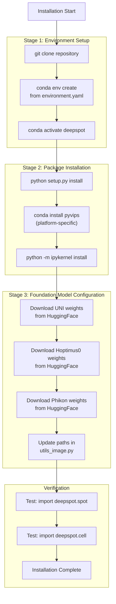
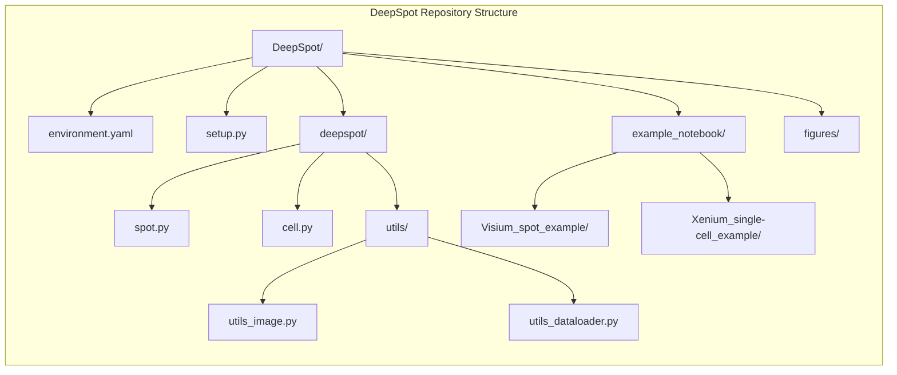
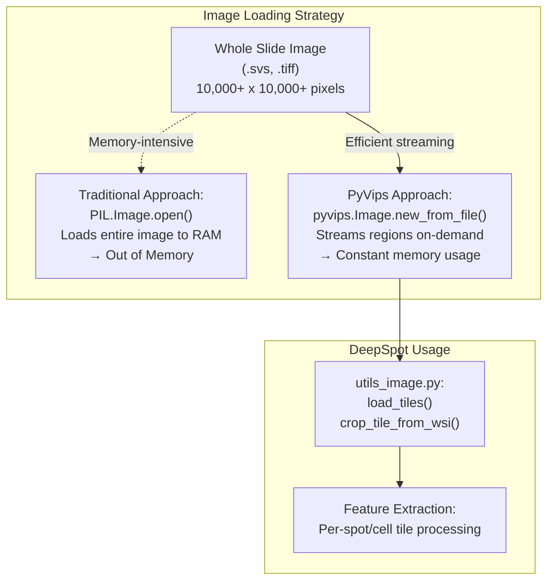
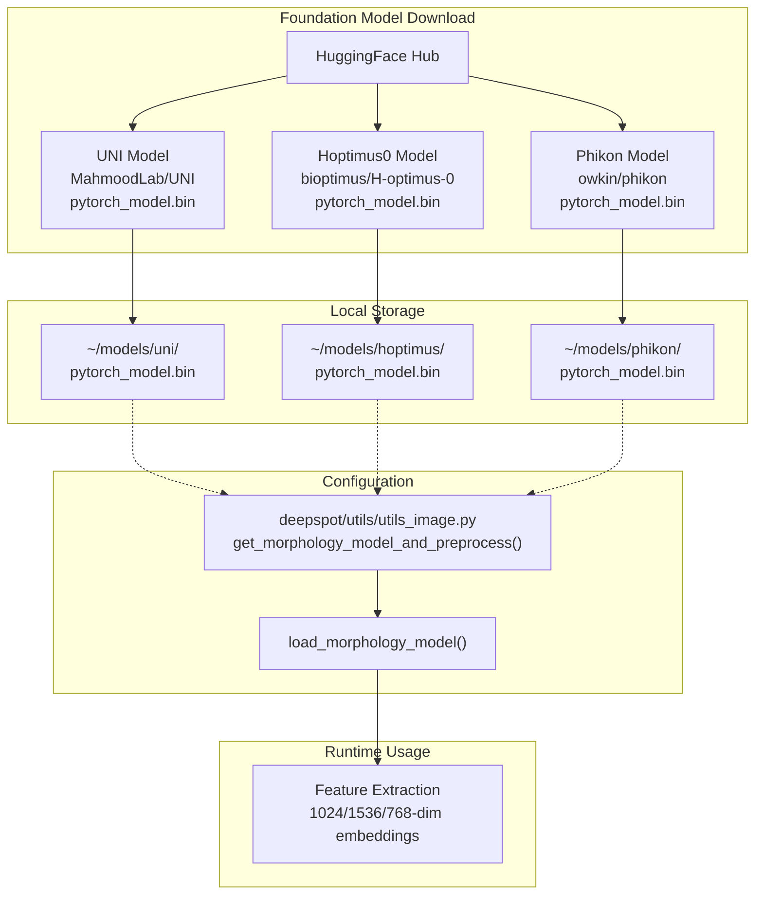
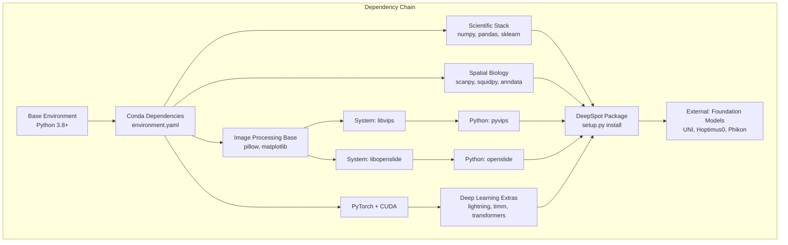

# Installation

<details>
<summary>Relevant source files</summary>

The following files were used as context for generating this wiki page:

- [README.md](README.md)

</details>


## Purpose and Scope

This page provides complete installation instructions for the DeepSpot system, including environment setup, dependency installation, and configuration of external foundation model weights. The installation process prepares your system for both spot-level (Visium) and cell-level (Xenium) spatial transcriptomics prediction workflows.

For information about using pre-trained models after installation, see [Quick Start with Pre-trained Models](#2.2). For detailed workflow instructions, see [Visium Spot Workflow](#7.1) and [Xenium Cell Workflow](#7.2).

---

## Installation Overview

The DeepSpot installation consists of three main stages: environment setup, package installation, and foundation model configuration. The system requires a conda-based Python environment with specialized image processing libraries and deep learning dependencies.



**Installation Stages**: The process moves from basic environment setup through package installation to external model configuration, ensuring all dependencies are satisfied before training or inference.

Sources: [README.md:40-87]()

---

## Prerequisites

Before installing DeepSpot, ensure you have:

| Requirement | Version | Purpose |
|------------|---------|---------|
| **conda** | ≥4.10 | Environment and dependency management |
| **git** | Any recent | Repository cloning |
| **CUDA** (optional) | ≥11.0 | GPU acceleration for training/inference |
| **Disk space** | ≥10 GB | Source code, environment, and foundation model weights |

Sources: [README.md:42-48]()

---

## Stage 1: Repository Setup

### Clone the Repository

```bash
git clone https://github.com/ratschlab/DeepSpot
cd DeepSpot
```

This creates a local copy of the DeepSpot codebase with the following key directories:



**Repository Structure**: Core prediction modules (`spot.py`, `cell.py`), utilities for image processing and data loading, and example notebooks for both Visium and Xenium workflows.

Sources: [README.md:43-44]()

---

## Stage 2: Environment and Package Installation

### Create Conda Environment

The `environment.yaml` file specifies all Python dependencies and their versions:

```bash
conda env create --file=environment.yaml
```

This creates a new conda environment named `deepspot` with the following dependency categories:

| Category | Key Packages | Purpose |
|----------|--------------|---------|
| **Deep Learning** | `pytorch`, `lightning`, `torchvision`, `timm`, `transformers` | Model training, vision transformers, HuggingFace integration |
| **Scientific Python** | `numpy`, `pandas`, `scikit-learn` | Array operations, data manipulation, preprocessing |
| **Spatial Biology** | `scanpy`, `squidpy`, `anndata` | Single-cell/spatial transcriptomics data structures |
| **Image Processing** | `pyvips`, `openslide`, `pillow` | Whole-slide image I/O and manipulation |
| **Visualization** | `matplotlib`, `seaborn` | Plotting and visualization |

Sources: [README.md:45]()

### Activate Environment

```bash
conda activate deepspot
```

After activation, your shell prompt should show `(deepspot)` prefix, indicating the environment is active.

Sources: [README.md:46]()

### Install DeepSpot Package

```bash
python setup.py install
```

This command installs the DeepSpot package in the active environment, making the following imports available:

```python
from deepspot.spot import DeepSpot, DeepSpotDataLoader
from deepspot.cell import DeepCell, DeepCellDataLoader
from deepspot.utils import utils_image, utils_dataloader
```

The `setup.py` file defines the package structure and entry points.

Sources: [README.md:47](), [README.md:21-22]()

---

## Platform-Specific: PyVips Installation

The `pyvips` library enables memory-efficient streaming of large whole-slide images (WSI) and may require platform-specific installation steps. While `environment.yaml` includes `pyvips`, some systems benefit from explicit conda-forge installation:

```bash
conda install conda-forge::pyvips
```

### Why PyVips Matters



**PyVips Memory Efficiency**: Enables processing of multi-gigabyte histology images by streaming requested regions instead of loading entire images into memory.

The library is used extensively in [deepspot/utils/utils_image.py]() for tile extraction and preprocessing. See [Image Utilities](#6.1) for detailed usage.

Sources: [README.md:50-53]()

---

## Jupyter Kernel Installation

To use DeepSpot in Jupyter notebooks (required for the example workflows in [Visium Spot Workflow](#7.1) and [Xenium Cell Workflow](#7.2)):

```bash
python -m ipykernel install --user --name deepspot --display-name "deepspot"
```

This creates a Jupyter kernel that:
- Appears as "deepspot" in Jupyter's kernel selector
- Automatically activates the conda environment
- Provides access to all installed DeepSpot modules

After installation, the kernel is available in:
- [example_notebook/Visium_spot_example/]() notebooks
- [example_notebook/Xenium_single-cell_example/]() notebooks

Sources: [README.md:55-58]()

---

## Stage 3: Foundation Model Configuration

DeepSpot relies on three pre-trained pathology foundation models for extracting morphological features from H&E images. These models must be downloaded separately and their paths configured in the codebase.

### Required Foundation Models

| Model | Source | Output Dimensions | Configuration Location |
|-------|--------|-------------------|------------------------|
| **UNI** | [HuggingFace MahmoodLab/UNI](https://huggingface.co/MahmoodLab/UNI) | 1024-dim | [deepspot/utils/utils_image.py]() |
| **Hoptimus0** | [HuggingFace bioptimus/H-optimus-0](https://huggingface.co/bioptimus/H-optimus-0) | 1536-dim | [deepspot/utils/utils_image.py]() |
| **Phikon** | [HuggingFace owkin/phikon](https://huggingface.co/owkin/phikon) | 768-dim | [deepspot/utils/utils_image.py]() |



**Foundation Model Integration**: Models are downloaded from HuggingFace, stored locally, and accessed via path configuration in `utils_image.py`. The `get_morphology_model_and_preprocess()` function loads the appropriate model based on user selection.

Sources: [README.md:80-86]()

### Download Instructions

Each foundation model may require accepting terms of use on HuggingFace. Follow these steps:

1. **Create HuggingFace Account** (if needed):
   - Visit https://huggingface.co
   - Sign up for a free account

2. **Access Model Repositories**:
   - Navigate to each model's page (links in table above)
   - Review and accept any license agreements
   - Generate an access token if required

3. **Download Model Weights**:

```bash
# Option 1: Using huggingface_hub CLI
pip install huggingface_hub
huggingface-cli login  # Enter your token

# Download UNI
huggingface-cli download MahmoodLab/UNI --local-dir ~/models/uni

# Download Hoptimus0
huggingface-cli download bioptimus/H-optimus-0 --local-dir ~/models/hoptimus

# Download Phikon
huggingface-cli download owkin/phikon --local-dir ~/models/phikon
```

```bash
# Option 2: Manual download from web UI
# Visit each model page and download pytorch_model.bin
# Place in organized directory structure
```

Sources: [README.md:80-86]()

### Update Configuration Paths

After downloading, update the model paths in [deepspot/utils/utils_image.py](). Locate the `get_morphology_model_and_preprocess()` function and modify the path variables:

```python
# Example path structure in utils_image.py
# Update these paths to match your local storage:

UNI_MODEL_PATH = "/path/to/your/models/uni/pytorch_model.bin"
HOPTIMUS_MODEL_PATH = "/path/to/your/models/hoptimus/pytorch_model.bin"
PHIKON_MODEL_PATH = "/path/to/your/models/phikon/pytorch_model.bin"
```

**Important**: The exact variable names and structure in [deepspot/utils/utils_image.py]() may differ. Search for model loading functions and update the hardcoded paths accordingly. For detailed information about morphology model loading, see [Morphology Model Loading](#6.2).

Sources: [README.md:82]()

---

## Installation Verification

After completing all installation stages, verify the setup:

### Test 1: Import Core Modules

```python
# Test spot-level components
from deepspot.spot import DeepSpot, DeepSpotDataLoader
print("DeepSpot imports successful")

# Test cell-level components
from deepspot.cell import DeepCell, DeepCellDataLoader
print("DeepCell imports successful")

# Test utilities
from deepspot.utils import utils_image, utils_dataloader
print("Utility imports successful")
```

Expected output:
```
DeepSpot imports successful
DeepCell imports successful
Utility imports successful
```

### Test 2: Check PyVips

```python
import pyvips

# Test image loading capability
test_image = pyvips.Image.black(100, 100)
print(f"PyVips working: {test_image.width}x{test_image.height}")
```

Expected output:
```
PyVips working: 100x100
```

### Test 3: Verify Foundation Model Paths

```python
from deepspot.utils.utils_image import get_morphology_model_and_preprocess

# This will fail if paths are not configured correctly
try:
    model, preprocess = get_morphology_model_and_preprocess('uni')
    print("Foundation model loading successful")
except Exception as e:
    print(f"Foundation model configuration needed: {e}")
```

If this test fails, revisit the foundation model configuration steps above.

Sources: [README.md:21-22](), [README.md:80-86]()

---

## Dependency Resolution and Troubleshooting

### Common Installation Issues

| Issue | Symptom | Solution |
|-------|---------|----------|
| **CUDA mismatch** | `RuntimeError: CUDA error` | Reinstall PyTorch with matching CUDA version: `conda install pytorch torchvision -c pytorch -c nvidia` |
| **PyVips compilation** | `ModuleNotFoundError: pyvips` | Install via conda-forge: `conda install conda-forge::pyvips` |
| **OpenSlide missing** | `OSError: cannot load library 'libopenslide.so'` | Install system library: `sudo apt-get install openslide-tools` (Linux) or `brew install openslide` (macOS) |
| **Foundation model 404** | `HTTPError: 401 Client Error` | Authenticate with HuggingFace: `huggingface-cli login` |
| **Out of memory** | `torch.cuda.OutOfMemoryError` | Reduce batch size in data loaders or use CPU-only mode |



**Dependency Hierarchy**: System libraries (libvips, libopenslide) must be installed before Python packages. Foundation models are external to the pip/conda ecosystem and require separate download.

Sources: [README.md:50-53](), [README.md:80-86]()

### Environment Variables

Some systems may require environment variables for GPU detection or library paths:

```bash
# CUDA configuration
export CUDA_VISIBLE_DEVICES=0  # Use GPU 0

# OpenSlide library path (if not in system path)
export LD_LIBRARY_PATH=/usr/local/lib:$LD_LIBRARY_PATH

# Disable PyTorch CUDA if GPU not available
export CUDA_VISIBLE_DEVICES=""  # CPU-only mode
```

Sources: Inferred from common deep learning setup requirements

---

## Next Steps

After successful installation:

1. **Explore Example Notebooks**: Navigate to [example_notebook/]() and open preprocessing notebooks for either Visium or Xenium workflows
2. **Download Pre-trained Weights**: See [Downloading Pre-trained Weights](#8.1) for accessing pre-trained DeepSpot models from Zenodo
3. **Run Quick Start**: Follow [Quick Start with Pre-trained Models](#2.2) to make predictions immediately
4. **Understand Architecture**: Review [System Architecture](#1.2) and [Model Architecture](#5) to understand how components interact

For complete workflow tutorials, see:
- [Visium Preprocessing](#7.1.1) for spot-level data preparation
- [Xenium Preprocessing](#7.2.1) for cell-level data preparation

Sources: [README.md:60-73](), [README.md:75-78]()

---