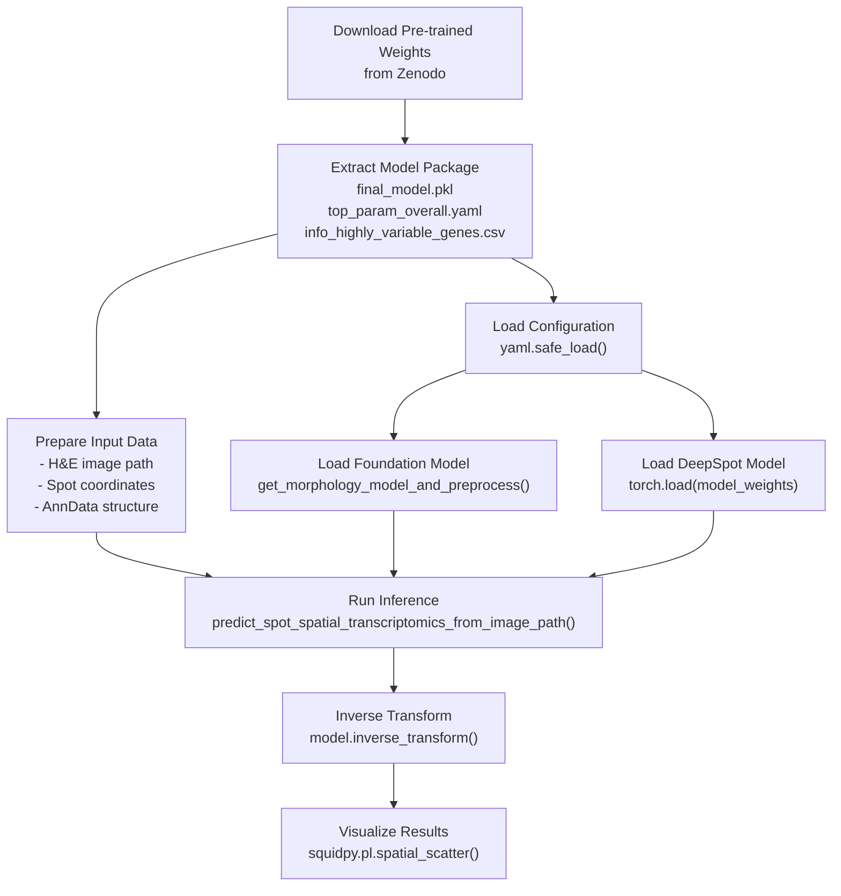
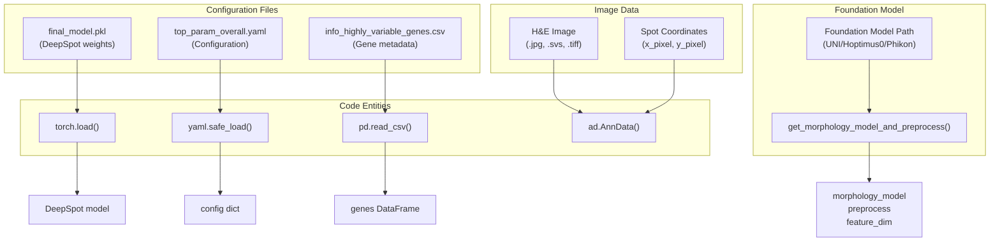
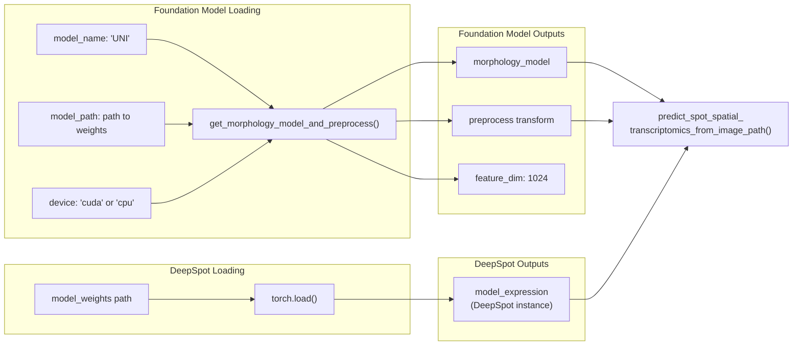
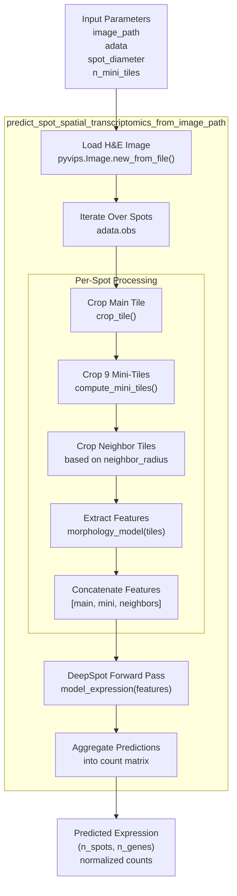

# Quick Start with Pre-trained Models

<details>
<summary>Relevant source files</summary>

The following files were used as context for generating this wiki page:

- [README.md](README.md)
- [example_notebook/Visium_spot_example/GettingStartedWithDeepSpot_3.1_inference_pretrained_models.ipynb](example_notebook/Visium_spot_example/GettingStartedWithDeepSpot_3.1_inference_pretrained_models.ipynb)

</details>


## Purpose and Scope

This page provides a fast-track guide for making spatial transcriptomics predictions using pre-trained DeepSpot model weights. It focuses on the minimal steps needed to generate predictions on Visium spot-level data without training a model from scratch. 

For detailed information on training your own models, see [Visium Training](#7.1.2). For single-cell resolution predictions with Xenium data, see [Xenium Cell Workflow](#7.2). For comprehensive inference options and configurations, see [Visium Inference](#7.1.3).

**Prerequisites**: This guide assumes you have completed the [Installation](#2.1) process, including downloading foundation model weights.

---

## Overview

Pre-trained DeepSpot models enable immediate spatial transcriptomics prediction without the need for training data or computational resources for model training. The DeepSpot team provides weights trained on various tissue types and datasets, hosted on Zenodo.

### Available Pre-trained Models

Pre-trained weights are organized by tissue type and training dataset:

| Model | Tissue Type | Training Data | Genes Predicted | Foundation Model |
|-------|-------------|---------------|-----------------|------------------|
| Colon_HEST1K | Colorectal | HEST-1K Colon samples | 300-800 HVGs | UNI |
| Melanoma_TCGA | Skin melanoma | TCGA-SKCM | 300-800 HVGs | UNI |
| Kidney_TCGA | Kidney cancer | TCGA-KIRC | 300-800 HVGs | UNI |

Each model package includes:
- `final_model.pkl`: Trained DeepSpot weights
- `top_param_overall.yaml`: Model hyperparameters and configuration
- `info_highly_variable_genes.csv`: Gene list with prediction metadata

Sources: [README.md:75-78]()

---

## Quick Start Workflow

The following diagram illustrates the end-to-end inference workflow using pre-trained models:

**Diagram: Pre-trained Model Inference Workflow**



Sources: [example_notebook/Visium_spot_example/GettingStartedWithDeepSpot_3.1_inference_pretrained_models.ipynb:32-455]()

---

## Step 1: Download Pre-trained Weights

Pre-trained DeepSpot weights are hosted on Zenodo and can be downloaded directly:

```bash
wget -c https://zenodo.org/records/15322099/files/DeepSpot_pretrained_model_weights.zip?download=1
unzip DeepSpot_pretrained_model_weights.zip
```

After extraction, the directory structure contains:

```
DeepSpot_pretrained_model_weights/
├── Colon_HEST1K/
│   ├── final_model.pkl
│   ├── top_param_overall.yaml
│   └── info_highly_variable_genes.csv
├── Melanoma_TCGA/
│   └── ...
└── Kidney_TCGA/
    └── ...
```

Sources: [example_notebook/Visium_spot_example/GettingStartedWithDeepSpot_3.1_inference_pretrained_models.ipynb:32-56](), [README.md:75-78]()

---

## Step 2: Prepare Input Components

**Diagram: Input Components and Code Entities**



Sources: [example_notebook/Visium_spot_example/GettingStartedWithDeepSpot_3.1_inference_pretrained_models.ipynb:115-171]()

### Required Input Parameters

The following parameters must be specified before running inference:

| Parameter | Description | Source | Example |
|-----------|-------------|--------|---------|
| `model_weights` | Path to `.pkl` file | Zenodo download | `'DeepSpot_pretrained_model_weights/Colon_HEST1K/final_model.pkl'` |
| `model_hparam` | Path to YAML configuration | Zenodo download | `'DeepSpot_pretrained_model_weights/Colon_HEST1K/top_param_overall.yaml'` |
| `gene_path` | Path to gene CSV | Zenodo download | `'DeepSpot_pretrained_model_weights/Colon_HEST1K/info_highly_variable_genes.csv'` |
| `image_path` | Path to H&E image | User data | `'example_data/data/image/sample.jpg'` |
| `spot_diameter` | Spot size in pixels | YAML config or user | `100` |
| `spot_distance` | Distance between spots | YAML config or user | `100` |
| `n_mini_tiles` | Number of sub-spots | Fixed | `9` |
| `image_feature_model` | Foundation model name | YAML config | `'UNI'` |
| `image_feature_model_path` | Path to foundation weights | User installation | Path to downloaded weights |

Sources: [example_notebook/Visium_spot_example/GettingStartedWithDeepSpot_3.1_inference_pretrained_models.ipynb:115-171]()

### Loading Configuration

The YAML configuration file contains critical hyperparameters used during model training:

```python
import yaml

with open(model_hparam, "r") as stream:
    config = yaml.safe_load(stream)

# Extract key parameters
spot_diameter = config['spot_diameter']
spot_distance = config['spot_distance']
image_feature_model = config['image_feature_model']
```

**Note**: The `spot_diameter` and `spot_distance` parameters depend on your H&E image resolution and must match the tissue area covered. For Visium trained at 20x magnification covering ~55μm tissue area, typical values are 100 pixels for both parameters at 0.5 μm/pixel resolution.

Sources: [example_notebook/Visium_spot_example/GettingStartedWithDeepSpot_3.1_inference_pretrained_models.ipynb:132-161]()

---

## Step 3: Generate Spot Coordinates

For inference on new images without existing spatial transcriptomics data, spot coordinates must be generated to create a regular grid:

```python
import pyvips
import pandas as pd

image = pyvips.Image.new_from_file(image_path)

coord = []
for i, x in enumerate(range(spot_diameter + 1, image.height - spot_diameter - 1, spot_distance)):
    for j, y in enumerate(range(spot_diameter + 1, image.width - spot_diameter - 1, spot_distance)):
        coord.append([i, j, x, y])

coord = pd.DataFrame(coord, columns=['x_array', 'y_array', 'x_pixel', 'y_pixel'])
coord.index = coord.index.astype(str)
```

The function [`crop_tile`](deepspot/utils/utils_image.py) is then used to filter spots based on tissue presence (excluding white background):

```python
from deepspot.utils.utils_image import crop_tile

is_white = []
for _, row in coord.iterrows():
    x = row.x_pixel - int(spot_diameter // 2)
    y = row.y_pixel - int(spot_diameter // 2)
    
    main_tile = crop_tile(image, x, y, spot_diameter)
    main_tile = main_tile[:,:,:3]
    white = np.mean(main_tile)
    is_white.append(white)

coord['is_white'] = is_white
# Filter spots with mean RGB > 200 (near white background)
coord_filtered = coord[coord['is_white'] <= 200]
```

Sources: [example_notebook/Visium_spot_example/GettingStartedWithDeepSpot_3.1_inference_pretrained_models.ipynb:218-257]()

---

## Step 4: Create AnnData Structure

An `AnnData` object is created to hold the spatial coordinates and predicted gene expression:

```python
import anndata as ad
import numpy as np

# Create empty count matrix
n_spots = len(coord_filtered)
n_genes = genes[genes.isPredicted].shape[0]
counts = np.empty((n_spots, n_genes))

# Initialize AnnData
adata = ad.AnnData(counts)
adata.var.index = genes[genes.isPredicted].gene_name.values
adata.obs = coord_filtered.copy()
adata.obs['barcode'] = adata.obs.index

# Add spatial coordinates for visualization
adata.obsm['spatial'] = adata.obs[["y_pixel", "x_pixel"]].values / downsample_factor
```

The `AnnData` structure follows scanpy/squidpy conventions with:
- `.X`: Gene expression matrix (initially empty)
- `.obs`: Spot metadata including coordinates
- `.var`: Gene metadata
- `.obsm['spatial']`: Coordinates for spatial plotting
- `.uns['spatial']`: Image data for visualization

Sources: [example_notebook/Visium_spot_example/GettingStartedWithDeepSpot_3.1_inference_pretrained_models.ipynb:269-314]()

---

## Step 5: Initialize Models

**Diagram: Model Initialization Components**



Sources: [example_notebook/Visium_spot_example/GettingStartedWithDeepSpot_3.1_inference_pretrained_models.ipynb:339-360]()

### Load Foundation Model

The foundation model extracts morphological features from H&E tiles. The function `get_morphology_model_and_preprocess` returns three components:

```python
from deepspot.utils.utils_image import get_morphology_model_and_preprocess

morphology_model, preprocess, feature_dim = get_morphology_model_and_preprocess(
    model_name=image_feature_model,  # 'UNI', 'Hoptimus0', or 'Phikon'
    device=device,
    model_path=image_feature_model_path
)

morphology_model.to(device)
morphology_model.eval()
```

The returned components:
- `morphology_model`: Pretrained vision model (e.g., ViT for UNI)
- `preprocess`: Image transformation pipeline for the specific model
- `feature_dim`: Output feature dimension (1024 for UNI, 1536 for Hoptimus0, 768 for Phikon)

Sources: [example_notebook/Visium_spot_example/GettingStartedWithDeepSpot_3.1_inference_pretrained_models.ipynb:356-360](), [README.md:82-86]()

### Load DeepSpot Model

The pre-trained DeepSpot model is loaded from the `.pkl` file:

```python
import torch

device = torch.device('cuda' if torch.cuda.is_available() else 'cpu')

model_expression = torch.load(model_weights, map_location=device)
model_expression.to(device)
model_expression.eval()
```

The loaded `model_expression` is a `DeepSpot` class instance from [deepspot/spot.py]() with the trained Phi and Rho ensemble weights. The model also contains a fitted scaler for inverse transformation.

Sources: [example_notebook/Visium_spot_example/GettingStartedWithDeepSpot_3.1_inference_pretrained_models.ipynb:339-347]()

---

## Step 6: Run Inference

The core inference function `predict_spot_spatial_transcriptomics_from_image_path` orchestrates feature extraction and prediction:

**Diagram: Inference Data Flow**



Sources: [example_notebook/Visium_spot_example/GettingStartedWithDeepSpot_3.1_inference_pretrained_models.ipynb:364-379]()

### Function Call

```python
from deepspot.utils.utils_image import predict_spot_spatial_transcriptomics_from_image_path

counts = predict_spot_spatial_transcriptomics_from_image_path(
    image_path,
    adata,
    spot_diameter,
    n_mini_tiles,
    preprocess,
    morphology_model,
    model_expression,
    device,
    super_resolution=False,
    neighbor_radius=1
)
```

### Key Parameters

| Parameter | Type | Description | Typical Value |
|-----------|------|-------------|---------------|
| `image_path` | str | Path to H&E image | `'data/sample.jpg'` |
| `adata` | AnnData | AnnData with spot coordinates | Created in Step 4 |
| `spot_diameter` | int | Spot diameter in pixels | `100` |
| `n_mini_tiles` | int | Number of sub-spots (fixed) | `9` |
| `preprocess` | transform | Image preprocessing pipeline | From foundation model |
| `morphology_model` | nn.Module | Feature extraction model | From foundation model |
| `model_expression` | DeepSpot | Pre-trained DeepSpot model | Loaded from `.pkl` |
| `device` | torch.device | Computation device | `'cuda'` or `'cpu'` |
| `super_resolution` | bool | Use 3×3 neighborhood context | `False` for basic inference |
| `neighbor_radius` | int | Radius for neighbor spots | `1` (includes 8 neighbors) |

The function returns a normalized gene expression matrix with shape `(n_spots, n_genes)`.

Sources: [example_notebook/Visium_spot_example/GettingStartedWithDeepSpot_3.1_inference_pretrained_models.ipynb:364-379]()

---

## Step 7: Post-process Predictions

### Inverse Transform

DeepSpot models are trained on normalized gene expression data. The predictions must be inverse-transformed to the original scale:

```python
counts = model_expression.inverse_transform(counts)
```

The `inverse_transform` method applies the fitted scaler (typically StandardScaler or RobustScaler) to convert normalized predictions back to count space. This step is **critical** and must not be skipped.

Sources: [example_notebook/Visium_spot_example/GettingStartedWithDeepSpot_3.1_inference_pretrained_models.ipynb:399-406]()

### Clipping Negative Values

Since gene counts cannot be negative, a common post-processing step is:

```python
counts[counts < 0] = 0
```

Additional transformations may improve prediction quality depending on the downstream analysis:
- Applying a floor threshold to reduce noise
- Smoothing predictions spatially
- Log-transforming for visualization

Sources: [example_notebook/Visium_spot_example/GettingStartedWithDeepSpot_3.1_inference_pretrained_models.ipynb:418-424]()

### Create Final AnnData

```python
adata_predicted = ad.AnnData(
    counts,
    var=adata.var,
    obs=adata.obs,
    uns=adata.uns,
    obsm=adata.obsm
).copy()
```

The resulting `adata_predicted` object is compatible with scanpy and squidpy for downstream analysis and visualization.

Sources: [example_notebook/Visium_spot_example/GettingStartedWithDeepSpot_3.1_inference_pretrained_models.ipynb:428-439]()

---

## Step 8: Visualize Results

Squidpy provides spatial plotting capabilities for visualizing predicted gene expression:

```python
import squidpy as sq

sq.pl.spatial_scatter(
    adata_predicted,
    color=['MUC2', 'ITLN1', 'CLCA1', 'FCGBP'],
    wspace=0,
    ncols=2,
    size=5
)
```

The spatial scatter plot overlays gene expression on the H&E image, enabling visual validation of predictions against tissue morphology.

Sources: [example_notebook/Visium_spot_example/GettingStartedWithDeepSpot_3.1_inference_pretrained_models.ipynb:443-454]()

---

## Complete Example Code Reference

The complete workflow is demonstrated in the notebook [example_notebook/Visium_spot_example/GettingStartedWithDeepSpot_3.1_inference_pretrained_models.ipynb:1-510](). Key sections:

| Step | Notebook Cells | Description |
|------|---------------|-------------|
| Download weights | Lines 32-56 | wget and unzip commands |
| Load configuration | Lines 132-161 | YAML parsing and parameter extraction |
| Generate coordinates | Lines 218-257 | Grid generation and white filtering |
| Create AnnData | Lines 269-314 | Structure initialization |
| Load models | Lines 339-360 | Foundation and DeepSpot loading |
| Run inference | Lines 364-379 | Prediction function call |
| Post-process | Lines 399-424 | Inverse transform and clipping |
| Visualize | Lines 443-454 | Squidpy plotting |

---

## Summary

This quick start guide provides the minimal workflow for spatial transcriptomics prediction using pre-trained DeepSpot models. The process involves:

1. Downloading pre-trained weights from Zenodo
2. Loading model configuration and gene lists
3. Generating spot coordinates for your H&E image
4. Initializing foundation and DeepSpot models
5. Running inference with `predict_spot_spatial_transcriptomics_from_image_path`
6. Inverse-transforming predictions to original scale
7. Visualizing results with squidpy

For advanced use cases including custom training, fine-tuning, or cell-level predictions, refer to the relevant workflow sections: [Visium Training](#7.1.2), [Model Fine-tuning](#10.1), or [Xenium Cell Workflow](#7.2).

Sources: [README.md:60-78](), [example_notebook/Visium_spot_example/GettingStartedWithDeepSpot_3.1_inference_pretrained_models.ipynb:1-510]()

---