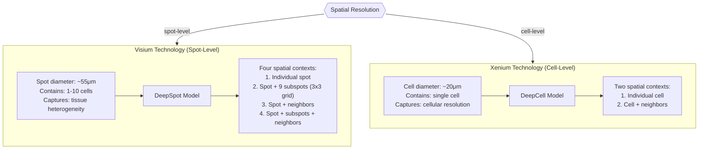
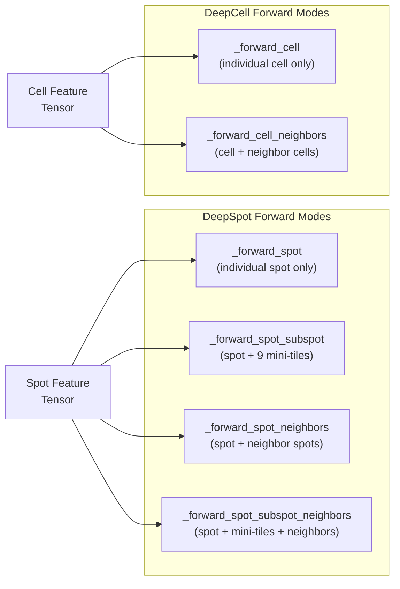
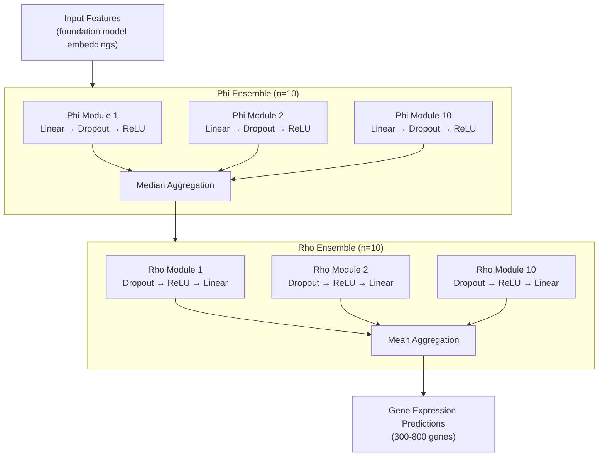
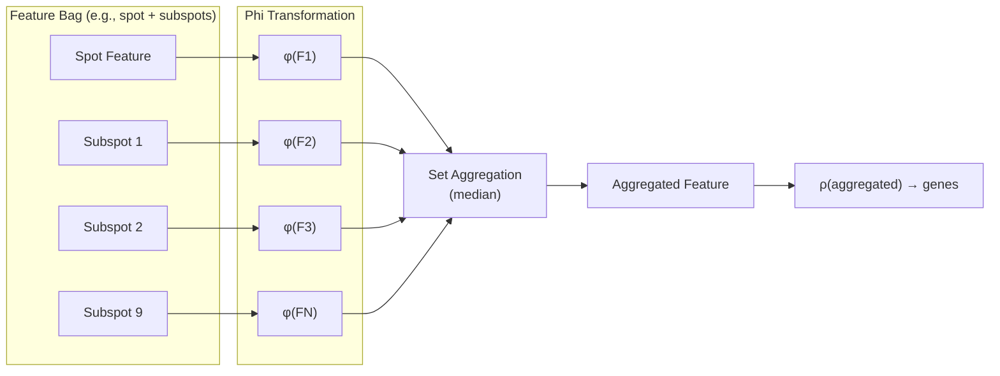
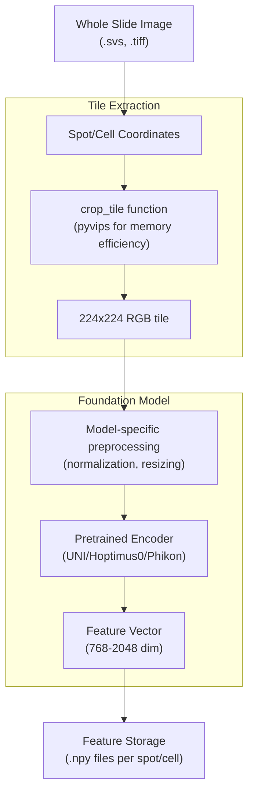
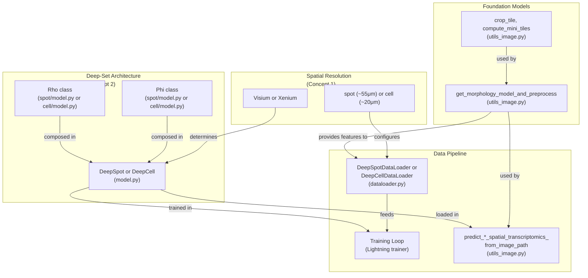

# Core Concepts

Relevant source files

The following files were used as context for generating this wiki page:

- [.codeboarding/on_boarding.md](.codeboarding/on_boarding.md)
- [README.md](README.md)

This page introduces the three fundamental concepts that underpin the DeepSpot system: the spatial transcriptomics technologies it supports, the deep-set neural architecture it employs, and the pathology foundation models it leverages for feature extraction. These concepts are essential to understanding how DeepSpot predicts gene expression from histology images at both spot and cell resolution.

For detailed workflows on using these concepts in practice, see [Visium Spot Workflow](#7.1) and [Xenium Cell Workflow](#7.2). For implementation details of the neural architecture, see [Model Architecture](#5).

---

## Overview: Three Pillars of DeepSpot

DeepSpot is built on three interconnected concepts that enable accurate spatial transcriptomics prediction:

| Concept | Purpose | Key Benefit |
|---------|---------|-------------|
| **Spatial Transcriptomics Technologies** | Define the resolution and spatial organization of predictions | Supports both spot-level (Visium, ~55μm) and single-cell (Xenium, ~20μm) prediction |
| **Deep-Set Architecture** | Model spatial entities as bags of features with permutation invariance | Captures multi-scale tissue structure through sub-spots and neighbor context |
| **Pathology Foundation Models** | Extract morphological features from H&E images | Provides robust, pretrained representations that generalize across tissues |

These three concepts are integrated in the prediction pipeline: foundation models extract features from image tiles, the deep-set architecture aggregates these features across multiple spatial contexts, and the output resolution matches the spatial transcriptomics technology being modeled.

**Sources:** [README.md:31-38](), [.codeboarding/on_boarding.md:22-24]()

---

## Spatial Resolution and Context Modeling

DeepSpot operates at two distinct spatial resolutions, each corresponding to a different spatial transcriptomics technology. The resolution determines not only the size of the spatial unit being predicted, but also the types of spatial context that can be incorporated.

### Resolution Comparison

**Diagram: Spatial resolution determines model choice and available context modes**

The key distinction is that Visium spots are large enough to benefit from **sub-spot decomposition**—dividing each spot into a 3×3 grid of mini-tiles to capture intra-spot heterogeneity. Xenium cells, being smaller and more homogeneous, do not require this decomposition.

**Sources:** [README.md:31-38](), [deepspot/spot/model.py:58-217](), [deepspot/cell/model.py:63-281]()

### Spatial Context Modes

DeepSpot models spatial context through different **forward pass modes** that determine which features are aggregated:

**Diagram: Forward pass methods implement different spatial context strategies**

The `context` parameter in the data loaders (`DeepSpotDataLoader` and `DeepCellDataLoader`) controls which mode is used during training and inference. The `radius` parameter (default=1 for spots) and `neighbor_context` parameter (default=45 for cells) determine the spatial neighborhood size.

**Sources:** [deepspot/spot/model.py:163-187](), [deepspot/cell/model.py:179-188](), [deepspot/spot/dataloader.py:21-186](), [deepspot/cell/dataloader.py:22-208]()

---

## The Deep-Set Architecture: Phi and Rho

DeepSpot employs a **deep-set neural network** architecture that treats each spatial entity (spot or cell) as a **bag of features** and learns permutation-invariant representations. This design enables the model to aggregate information from variable numbers of sub-tiles and neighbors while maintaining consistent predictions regardless of feature ordering.

### Two-Stage Ensemble Architecture

The architecture consists of two sequential stages, each implemented as an **ensemble of 10 parallel neural networks**:

**Diagram: The Phi-Rho ensemble architecture for DeepSpot and DeepCell models**

**Sources:** [deepspot/spot/model.py:31-55](), [deepspot/cell/model.py:36-60]()

### Role of Phi and Rho Modules

| Module | Purpose | Architecture | Aggregation | Dimensions |
|--------|---------|--------------|-------------|------------|
| `Phi` | Feature transformation and normalization | `Linear(input_dim, hidden_size)` → `Dropout` → `ReLU` | Median across 10 modules | Input: 768-2048 (foundation model), Output: hidden_size |
| `Rho` | Gene expression prediction | `Dropout` → `ReLU` → `Linear(hidden_size, n_genes)` | Mean across 10 modules | Input: hidden_size, Output: n_genes |

The `Phi` ensemble normalizes features from different foundation models (which have varying output dimensions: UNI=1024, Hoptimus0=1536, Phikon=768, Inception=2048) into a consistent `hidden_size` representation. The median aggregation in Phi provides robustness to outliers, while the mean aggregation in Rho smooths predictions.

Both `DeepSpot` and `DeepCell` share identical Phi/Rho implementations, differing only in their forward pass logic that determines which features are aggregated.

**Sources:** [deepspot/spot/model.py:31-55](), [deepspot/cell/model.py:36-60](), [deepspot/spot/model.py:59-108](), [deepspot/cell/model.py:64-128]()

### Permutation Invariance Through Set Operations

The deep-set approach ensures that predictions are invariant to the ordering of features in the bag:

**Diagram: Set aggregation ensures permutation invariance**

This design is critical for modeling spots with subspots, where the order of the 9 mini-tiles is arbitrary, and for incorporating neighbor information where the number and arrangement of neighbors varies spatially across the tissue.

**Sources:** [deepspot/spot/model.py:167-172](), [deepspot/spot/model.py:181-187](), [deepspot/cell/model.py:183-188]()

---

## Foundation Models for Morphological Feature Extraction

DeepSpot does not train convolutional or vision transformer backbones from scratch. Instead, it leverages **pretrained pathology foundation models** that have been trained on millions of histology images to extract rich morphological features. These models serve as frozen feature extractors during both training and inference.

### Supported Foundation Models

The system supports four pathology foundation models through the `get_morphology_model_and_preprocess` function:

| Model Name | Output Dimension | Source | Typical Use Case |
|------------|-----------------|--------|------------------|
| `uni` | 1024 | HuggingFace (MahmoodLab/UNI) | General pathology, pretrained on 100M+ images |
| `hoptimus0` | 1536 | HuggingFace (bioptimus/H-optimus-0) | High-resolution tissue analysis |
| `phikon` | 768 | HuggingFace (owkin/phikon) | Compact model for faster inference |
| `inception_v3` | 2048 | torchvision | Classical CNN baseline |

**Sources:** [deepspot/utils/utils_image.py:36-177](), [README.md:80-86]()

### Feature Extraction Pipeline

**Diagram: Feature extraction pipeline from whole-slide images to embeddings**

During **preprocessing**, features are extracted once and saved to disk as `.npy` files (one file per spot or cell). This enables efficient training without repeated feature extraction. During **inference**, features can be computed on-the-fly using `predict_spot_spatial_transcriptomics_from_image_path` or `predict_cell_spatial_transcriptomics_from_image_path`.

**Sources:** [deepspot/utils/utils_image.py:36-177](), [deepspot/utils/utils_image.py:190-198](), [deepspot/utils/utils_image.py:241-292](), [deepspot/utils/utils_image.py:295-356]()

### Integration with DeepSpot Models

Foundation model outputs are **not fine-tuned** during DeepSpot training. The Phi ensemble serves as an adapter layer that maps the frozen foundation model embeddings into a task-specific representation for gene expression prediction:

**Diagram: Foundation models remain frozen; only Phi and Rho are trained**

This design choice enables rapid training (typically 100-1000 epochs) since only the Phi and Rho parameters are updated, while still benefiting from the rich morphological knowledge encoded in the foundation models.

The `morphology_model` parameter in both `DeepSpot` and `DeepCell` constructors accepts one of `["uni", "hoptimus0", "phikon", "inception_v3"]`, which determines the `input_size` for the Phi modules.

**Sources:** [deepspot/spot/model.py:59-108](), [deepspot/cell/model.py:64-128](), [deepspot/utils/utils_image.py:36-177]()

---

## Integration: From Concepts to Code

The three core concepts are implemented through specific Python classes and functions that work together in the prediction pipeline:

**Diagram: Mapping core concepts to implementation classes and functions**

### Key Code Entry Points

For **spot-level prediction** (Visium):
- Model class: [deepspot/spot/model.py:58-217]() (`DeepSpot`)
- Data loader: [deepspot/spot/dataloader.py:21-186]() (`DeepSpotDataLoader`)
- Phi/Rho: [deepspot/spot/model.py:31-55]() (`Phi`, `Rho`)

For **cell-level prediction** (Xenium):
- Model class: [deepspot/cell/model.py:63-281]() (`DeepCell`)
- Data loader: [deepspot/cell/dataloader.py:22-208]() (`DeepCellDataLoader`)
- Phi/Rho: [deepspot/cell/model.py:36-60]() (`Phi`, `Rho`)

For **foundation model integration**:
- Model loading: [deepspot/utils/utils_image.py:36-177]() (`get_morphology_model_and_preprocess`)
- Tile extraction: [deepspot/utils/utils_image.py:190-198]() (`crop_tile`)
- Mini-tile computation: [deepspot/utils/utils_image.py:201-234]() (`compute_mini_tiles`)

For **inference from images**:
- Spot prediction: [deepspot/utils/utils_image.py:241-292]() (`predict_spot_spatial_transcriptomics_from_image_path`)
- Cell prediction: [deepspot/utils/utils_image.py:295-356]() (`predict_cell_spatial_transcriptomics_from_image_path`)

**Sources:** [deepspot/spot/model.py:1-217](), [deepspot/cell/model.py:1-281](), [deepspot/utils/utils_image.py:1-356](), [deepspot/spot/dataloader.py:1-186](), [deepspot/cell/dataloader.py:1-208]()

---

## Summary

The three core concepts work in concert to enable spatial transcriptomics prediction from H&E images:

1. **Spatial resolution** determines whether to use `DeepSpot` (spot-level) or `DeepCell` (cell-level) and which spatial contexts are available for aggregation
2. **Deep-set architecture** through Phi-Rho ensembles enables permutation-invariant feature aggregation across subspots, neighbors, or both
3. **Foundation models** provide frozen, pretrained morphological features that capture tissue structure without requiring task-specific image model training

For detailed explanations of each concept, see:
- [Spatial Transcriptomics Technologies](#3.1)
- [Deep-Set Architecture](#3.2)
- [Foundation Models](#3.3)

For practical usage of these concepts, see:
- [Visium Spot Workflow](#7.1)
- [Xenium Cell Workflow](#7.2)
- [Model Architecture](#5)

**Sources:** [README.md:1-189](), [.codeboarding/on_boarding.md:1-125]()

---