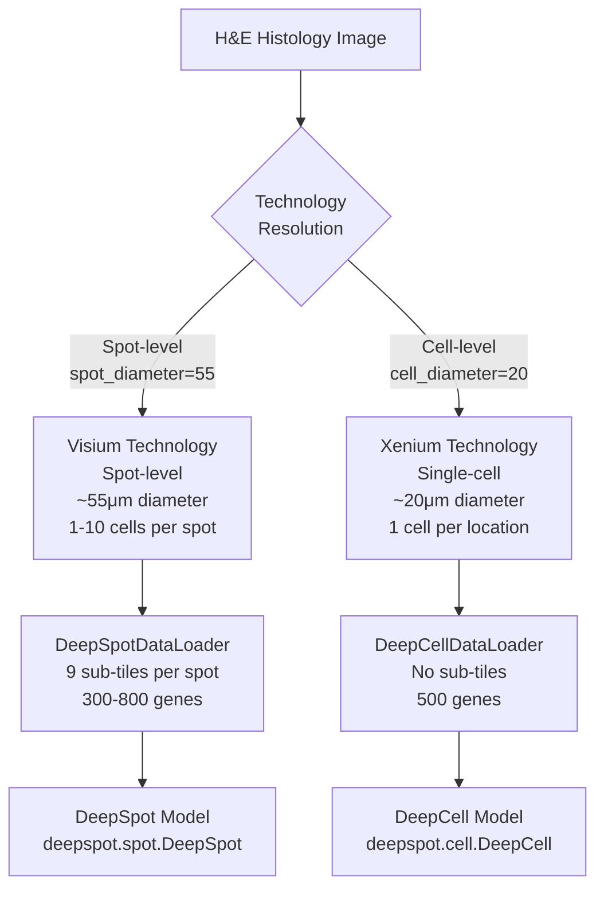
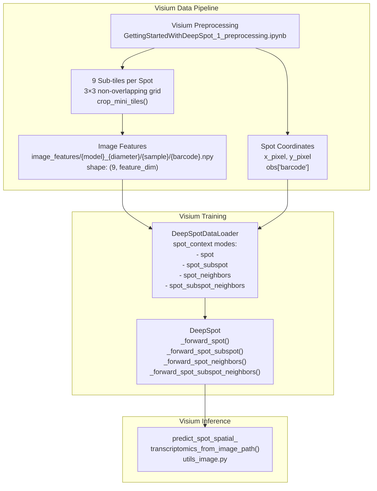
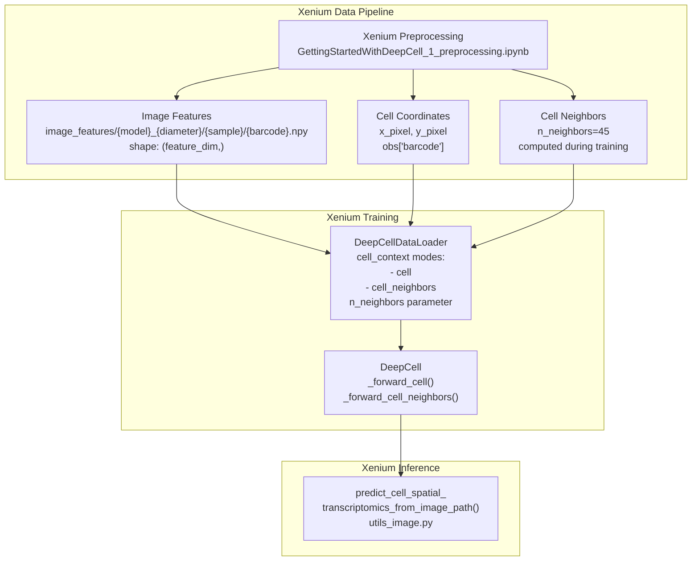
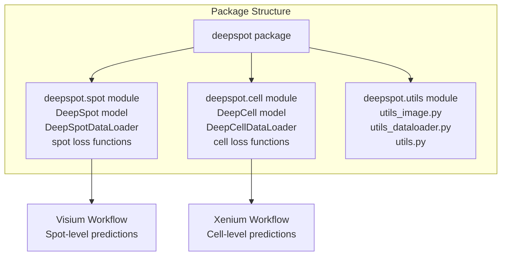
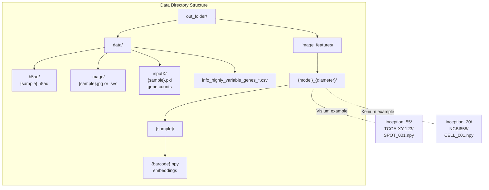

# Spatial Transcriptomics Technologies

<details>
<summary>Relevant source files</summary>

The following files were used as context for generating this wiki page:

- [README.md](README.md)
- [example_notebook/Xenium_single-cell_example/GettingStartedWithDeepCell_1_preprocessing.ipynb](example_notebook/Xenium_single-cell_example/GettingStartedWithDeepCell_1_preprocessing.ipynb)
- [example_notebook/Xenium_single-cell_example/GettingStartedWithDeepCell_2_training_xenium.ipynb](example_notebook/Xenium_single-cell_example/GettingStartedWithDeepCell_2_training_xenium.ipynb)
- [example_notebook/Xenium_single-cell_example/GettingStartedWithDeepCell_3_inference_xenium.ipynb](example_notebook/Xenium_single-cell_example/GettingStartedWithDeepCell_3_inference_xenium.ipynb)

</details>


## Purpose and Scope

This page explains the two primary spatial transcriptomics technologies supported by the DeepSpot system: **Visium** (spot-level resolution) and **Xenium** (single-cell resolution). It covers their technical specifications, biological characteristics, and how each technology maps to specific components in the codebase. For information about the deep-set neural network architecture used to model these technologies, see [Deep-Set Architecture](#3.2). For details on model implementations, see [DeepSpot Model](#5.2) and [DeepCell Model](#5.1).

---

## Overview of Spatial Transcriptomics Technologies

Spatial transcriptomics combines gene expression profiling with spatial location information, enabling researchers to understand where specific genes are expressed within tissue samples. The DeepSpot system predicts spatial transcriptomics data from standard H&E histology images using two different resolution paradigms.



**Sources:** [README.md:1-90](), [example_notebook/Xenium_single-cell_example/GettingStartedWithDeepCell_1_preprocessing.ipynb:1-100]()

---

## Visium: Spot-Level Spatial Transcriptomics

### Technical Specifications

Visium is a commercial spatial transcriptomics platform that captures gene expression at **spot resolution**. Each spot represents a circular region approximately **55 micrometers in diameter**, typically containing **1-10 cells**. This multi-cellular aggregation means spot-level measurements represent averaged gene expression across multiple cells.

| Parameter | Value |
|-----------|-------|
| **Resolution** | Spot-level (~55μm diameter) |
| **Cells per spot** | 1-10 cells |
| **Typical HVG count** | 300-800 highly variable genes |
| **Spatial context** | 4 modes: spot, subspot, neighbors, subspot+neighbors |
| **Sub-tiling** | 3×3 grid (9 mini-tiles per spot) |
| **Model class** | `DeepSpot` |
| **DataLoader class** | `DeepSpotDataLoader` |
| **Primary parameter** | `spot_diameter` |

### Codebase Implementation



The Visium workflow involves dividing each spot into **9 mini-tiles** (3×3 grid) to capture sub-spot morphological heterogeneity. This is critical because multiple cells within a spot may have different morphologies that correlate with different gene expression patterns.

**Sources:** [README.md:64-68](), [example_notebook/Xenium_single-cell_example/GettingStartedWithDeepCell_1_preprocessing.ipynb:98-99]()

---

## Xenium: Single-Cell Spatial Transcriptomics

### Technical Specifications

Xenium is a high-resolution spatial transcriptomics platform that provides **single-cell resolution**. Each measurement location represents a single cell with a diameter of approximately **20 micrometers**. This finer resolution enables cell-type-specific gene expression analysis without the averaging effects present in spot-level technologies.

| Parameter | Value |
|-----------|-------|
| **Resolution** | Single-cell (~20μm diameter) |
| **Cells per location** | 1 cell |
| **Typical HVG count** | 500 highly variable genes |
| **Spatial context** | 2 modes: cell, cell_neighbors |
| **Sub-tiling** | None (cell too small) |
| **Model class** | `DeepCell` |
| **DataLoader class** | `DeepCellDataLoader` |
| **Primary parameter** | `cell_diameter` |
| **Neighbor context** | Typically 45 neighbors |

### Codebase Implementation



Unlike Visium spots, Xenium cells are **not divided into mini-tiles** because the cell diameter (~20μm) is too small to meaningfully subdivide. Instead, the system relies more heavily on **neighbor context**, typically using 45 neighboring cells to provide spatial context.

**Sources:** [example_notebook/Xenium_single-cell_example/GettingStartedWithDeepCell_1_preprocessing.ipynb:1-110](), [example_notebook/Xenium_single-cell_example/GettingStartedWithDeepCell_2_training_xenium.ipynb:88-110]()

---

## Technology Comparison Table

| Feature | Visium (Spot-level) | Xenium (Single-cell) |
|---------|---------------------|----------------------|
| **Diameter** | `spot_diameter = 55` μm | `cell_diameter = 20` μm |
| **Biological Unit** | 1-10 cells (aggregated) | 1 cell (discrete) |
| **Resolution** | Lower (multi-cell) | Higher (single-cell) |
| **Highly Variable Genes** | 300-800 HVGs | 500 HVGs |
| **Sub-tiling Strategy** | 3×3 mini-tiles (9 total) | None (too small) |
| **Spatial Context Modes** | 4 modes (spot, subspot, neighbors, both) | 2 modes (cell, cell_neighbors) |
| **Neighbor Count** | Variable (radius-based) | Typically 45 (k-nearest) |
| **Model Class** | `deepspot.spot.DeepSpot` | `deepspot.cell.DeepCell` |
| **DataLoader Class** | `deepspot.spot.DeepSpotDataLoader` | `deepspot.cell.DeepCellDataLoader` |
| **Feature File Shape** | `(9, feature_dim)` | `(feature_dim,)` |
| **Preprocessing Notebook** | `GettingStartedWithDeepSpot_1_preprocessing.ipynb` | `GettingStartedWithDeepCell_1_preprocessing.ipynb` |
| **Training Notebook** | `GettingStartedWithDeepSpot_2_training.ipynb` | `GettingStartedWithDeepCell_2_training.ipynb` |
| **Inference Notebook** | `GettingStartedWithDeepSpot_3_inference.ipynb` | `GettingStartedWithDeepCell_3_inference.ipynb` |

**Sources:** [README.md:64-73](), [example_notebook/Xenium_single-cell_example/GettingStartedWithDeepCell_2_training_xenium.ipynb:93-110]()

---

## Data Processing Workflow Comparison

```mermaid
flowchart TB
    subgraph "Visium Workflow"
        V1["H&E Image + Spot Coordinates"]
        V2["Extract spot tile<br/>crop_tile(image, x, y, spot_diameter=55)"]
        V3["Divide into 9 mini-tiles<br/>crop_mini_tiles()<br/>3×3 non-overlapping grid"]
        V4["Extract features for each mini-tile<br/>morphology_model(mini_tile)<br/>shape: (9, feature_dim)"]
        V5["Save features<br/>{sample}/{barcode}.npy"]
        V6["DeepSpotDataLoader<br/>loads features + neighbors<br/>spot_context configuration"]
        
        V1 --> V2
        V2 --> V3
        V3 --> V4
        V4 --> V5
        V5 --> V6
    end
    
    subgraph "Xenium Workflow"
        X1["H&E Image + Cell Coordinates"]
        X2["Extract cell tile<br/>crop_tile(image, x, y, cell_diameter=20)"]
        X3["Extract features<br/>morphology_model(cell_tile)<br/>shape: (feature_dim,)"]
        X4["Save features<br/>{sample}/{barcode}.npy"]
        X5["DeepCellDataLoader<br/>loads features + neighbors<br/>cell_context configuration<br/>n_neighbors=45"]
        
        X1 --> X2
        X2 --> X3
        X3 --> X4
        X4 --> X5
    end
```



### Key Processing Differences

**Visium (Spot-level):**
- Extracts a large tile (~55μm) that may contain multiple cells
- Subdivides the spot into 9 mini-tiles to capture intra-spot heterogeneity
- Each mini-tile is processed independently through the foundation model
- Feature file contains 9 embeddings: `np.save(path, array.shape=(9, feature_dim))`
- Neighbor computation is typically radius-based or uses a small neighbor count

**Xenium (Single-cell):**
- Extracts a small tile (~20μm) containing a single cell
- No sub-tiling performed (cell is too small)
- Single tile is processed through the foundation model
- Feature file contains 1 embedding: `np.save(path, array.shape=(feature_dim,))`
- Neighbor computation uses k-nearest neighbors (typically k=45)

**Sources:** [example_notebook/Xenium_single-cell_example/GettingStartedWithDeepCell_1_preprocessing.ipynb:238-308](), [example_notebook/Xenium_single-cell_example/GettingStartedWithDeepCell_2_training_xenium.ipynb:93-110]()

---

## Code Entity Mapping

### Module Organization



### Import Patterns

**For Visium (Spot-level):**
```python
from deepspot.spot import DeepSpot
from deepspot.spot import DeepSpotDataLoader
```

**For Xenium (Cell-level):**
```python
from deepspot.cell import DeepCell
from deepspot.cell import DeepCellDataLoader
```

**Shared Utilities:**
```python
from deepspot.utils.utils_image import get_morphology_model_and_preprocess
from deepspot.utils.utils_image import crop_tile
from deepspot.utils.utils_image import predict_spot_spatial_transcriptomics_from_image_path
from deepspot.utils.utils_image import predict_cell_spatial_transcriptomics_from_image_path
```

**Sources:** [README.md:21-22](), [example_notebook/Xenium_single-cell_example/GettingStartedWithDeepCell_2_training_xenium.ipynb:38-44](), [example_notebook/Xenium_single-cell_example/GettingStartedWithDeepCell_3_inference_xenium.ipynb:39-43]()

---

## Parameter Configuration Examples

### Visium Configuration Example

```python
# From GettingStartedWithDeepSpot notebooks
dataloader_param = {
    "morphology_model_name": "uni",  # or "inception", "phikon", etc.
    "batch_size": 1024,
    "spot_context": "spot_subspot_neighbors",  # uses all available context
    "spot_diameter": 55,  # standard Visium spot size
    "resolution": 1,  # spatial upsampling factor
    "normalize": "standard",  # StandardScaler normalization
    "augmentation": "default"
}
```

### Xenium Configuration Example

```python
# From GettingStartedWithDeepCell notebooks
dataloader_param = {
    "morphology_model_name": "inception",  # foundation model
    "batch_size": 1024,
    "cell_context": "cell_neighbors",  # uses cell + neighbor context
    "cell_diameter": 20,  # standard Xenium cell size
    "n_neighbors": 45,  # number of neighbors to include
    "resolution": 1,  # spatial oversampling
    "normalize": "standard",  # StandardScaler normalization
    "augmentation": "default"
}
```

**Sources:** [example_notebook/Xenium_single-cell_example/GettingStartedWithDeepCell_2_training_xenium.ipynb:93-116](), [example_notebook/Xenium_single-cell_example/GettingStartedWithDeepCell_3_inference_xenium.ipynb:83-96]()

---

## File Organization Structure



### Directory Naming Conventions

- **Visium:** `image_features/inception_55/` (diameter = 55μm)
- **Xenium:** `image_features/inception_20/` (diameter = 20μm)

The diameter value in the directory name distinguishes between spot-level and cell-level preprocessed features, enabling the same codebase to handle both technologies with different resolutions.

**Sources:** [example_notebook/Xenium_single-cell_example/GettingStartedWithDeepCell_1_preprocessing.ipynb:83-114]()

---

## Technology-Specific Considerations

### When to Use Visium (DeepSpot)

- Working with **multi-cellular regions** where cell boundaries are unclear
- Need to analyze **tissue architecture** at a coarser scale
- Have limited single-cell segmentation capabilities
- Want to predict 300-800 highly variable genes
- Benefit from sub-spot morphological heterogeneity analysis

### When to Use Xenium (DeepCell)

- Require **single-cell resolution** for cell-type-specific analysis
- Have accurate cell segmentation data
- Need to distinguish individual cell contributions
- Want to predict ~500 highly variable genes
- Benefit from larger neighborhood context (45 neighbors)

**Sources:** [README.md:31-38](), [README.md:60-73]()

---