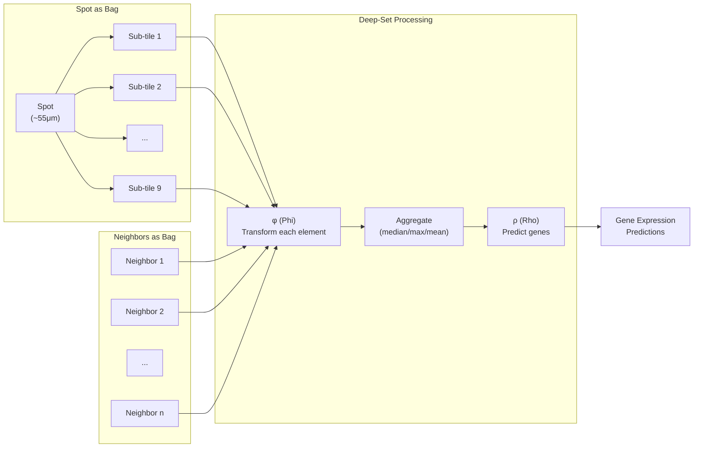
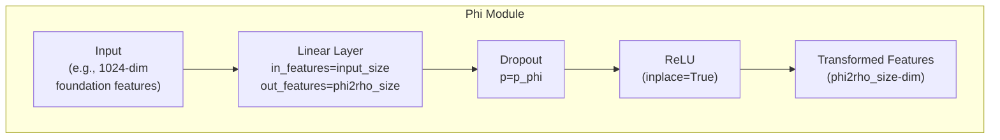
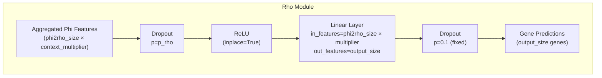
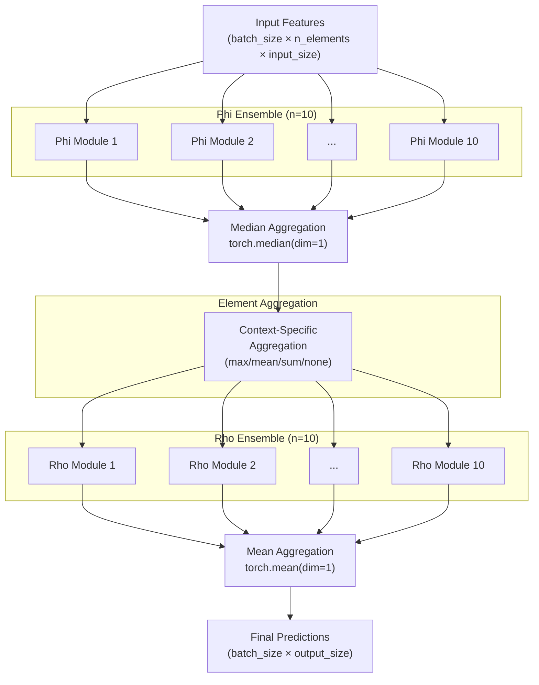
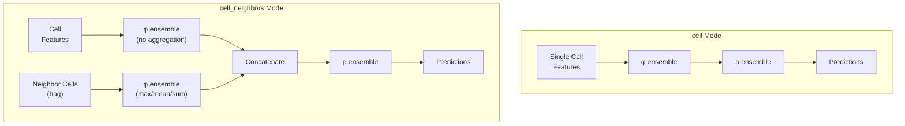
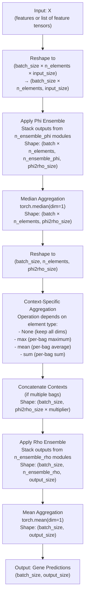

# Deep-Set Architecture

<details>
<summary>Relevant source files</summary>

The following files were used as context for generating this wiki page:

- [.codeboarding/DeepSpot Models.md](.codeboarding/DeepSpot Models.md)
- [README.md](README.md)
- [deepspot/cell/model.py](deepspot/cell/model.py)

</details>


## Purpose and Scope

This page explains the deep-set neural network architecture that forms the foundation of both DeepSpot and DeepCell models. The deep-set approach treats spots or cells as **bags of sub-elements** (sub-tiles, neighboring spots/cells) and uses permutation-invariant operations to aggregate spatial context. This design enables the models to incorporate multi-scale morphological information and spatial relationships while remaining invariant to the ordering of input elements.

For implementation details of the complete model classes, see [DeepCell Model](#5.1) and [DeepSpot Model](#5.2). For detailed API documentation of the Phi and Rho layers, see [Phi and Rho Neural Layers](#5.3).

---

## Deep-Set Theory

A deep-set is a neural network architecture designed to process **unordered sets** of inputs. Traditional neural networks require fixed-order inputs, but spatial transcriptomics data naturally consists of sets: a spot contains multiple sub-tiles, and each spot has neighboring spots. The order of these elements should not affect predictions.

### Mathematical Formulation

The deep-set architecture implements the following transformation:

```
f(X) = ρ(∑ φ(x_i))
```

Where:
- `X = {x_1, x_2, ..., x_n}` is a set of input features
- `φ` (Phi) transforms individual elements
- `∑` aggregates transformed elements (permutation-invariant operation)
- `ρ` (Rho) maps the aggregated representation to output predictions

This formulation guarantees **permutation invariance**: changing the order of elements in the set does not change the output.

### Application to Spatial Transcriptomics



**Diagram: Deep-Set Architecture Applied to Spatial Context**

In DeepSpot, each **spot** is decomposed into a 3×3 grid of sub-tiles (9 elements), treating the spot as a bag of morphological features. Each **spot's neighborhood** is also treated as a bag of neighboring spots. Both bags are processed through the same deep-set transformation.

Sources: [README.md:33-38](), [deepspot/cell/model.py:36-60](), [deepspot/spot/model.py:31-55]()

---

## Phi-Rho Architecture

The DeepSpot system implements the deep-set architecture through two distinct neural network stages: **Phi modules** for feature transformation and **Rho modules** for final prediction.

### Phi Layer: Feature Transformation

The Phi layer transforms raw input features into a common representation space. Each input element (sub-tile, neighbor) is independently processed.

**Architecture:**
```
Linear(input_size → phi2rho_size) → Dropout(p) → ReLU
```

**Code Implementation:**



**Diagram: Phi Module Architecture**

The Phi layer is instantiated as:
- **DeepCell**: `Phi(input_size, phi2rho_size, self.p_phi)` at [deepspot/cell/model.py:125]()
- **DeepSpot**: `Phi(input_size, phi2rho_size, self.p_phi)` at [deepspot/spot/model.py:103]()

Default `phi2rho_size=1024` creates a 1024-dimensional bottleneck representation.

Sources: [deepspot/cell/model.py:36-46](), [deepspot/spot/model.py:31-41]()

### Rho Layer: Prediction Head

The Rho layer takes the aggregated Phi representations and predicts gene expression values for each gene.

**Architecture:**
```
Dropout(p) → ReLU → Linear(phi2rho_size × multiplier → output_size) → Dropout(0.1)
```

**Code Implementation:**



**Diagram: Rho Module Architecture**

The `context_multiplier` depends on spatial context mode:
- **DeepCell `cell` mode**: multiplier=1 (single cell only)
- **DeepCell `cell_neighbors` mode**: multiplier=2 (cell + neighbors)
- **DeepSpot `spot` mode**: multiplier=1
- **DeepSpot `spot_subspot` mode**: multiplier=2
- **DeepSpot `spot_neighbors` mode**: multiplier=2
- **DeepSpot `spot_subspot_neighbors` mode**: multiplier=3

Sources: [deepspot/cell/model.py:49-60](), [deepspot/spot/model.py:44-55](), [deepspot/cell/model.py:130-135](), [deepspot/spot/model.py:110-117]()

---

## Ensemble Design

Both Phi and Rho stages use **ensemble learning** to improve prediction robustness and reduce overfitting. Multiple independent networks are trained in parallel, and their outputs are aggregated.

### Architecture Overview



**Diagram: Complete Ensemble Architecture with Dual Aggregation**

### Ensemble Configuration

| Parameter | Default | Description |
|-----------|---------|-------------|
| `n_ensemble` | 10 | Number of Phi and Rho modules in ensemble |
| `n_ensemble_phi` | `n_ensemble` | Can be set independently for Phi |
| `n_ensemble_rho` | `n_ensemble` | Can be set independently for Rho |

**Phi Aggregation Strategy**: `median`
- **Rationale**: Median is robust to outliers in feature transformations
- **Implementation**: `torch.median(x_phi, dim=1)` at [deepspot/cell/model.py:196]() and [deepspot/spot/model.py:195]()

**Rho Aggregation Strategy**: `mean`
- **Rationale**: Mean smooths predictions across ensemble members
- **Implementation**: `torch.mean(x_rho, dim=1)` at [deepspot/cell/model.py:213]() and [deepspot/spot/model.py:212]()

### Code Instantiation

**DeepCell:**
```python
self.phi_cell = nn.ModuleList([Phi(input_size, phi2rho_size, self.p_phi) 
                               for _ in range(self.n_ensemble_phi)])
self.rho = nn.ModuleList([Rho(phi2rho_size * multiplier, output_size, self.p_rho) 
                          for _ in range(self.n_ensemble_rho)])
```

**DeepSpot:**
```python
self.phi_spot = nn.ModuleList([Phi(input_size, phi2rho_size, self.p_phi) 
                               for _ in range(self.n_ensemble_phi)])
self.phi_subspot = nn.ModuleList([Phi(input_size, phi2rho_size, self.p_phi) 
                                  for _ in range(self.n_ensemble_phi)])
self.rho = nn.ModuleList([Rho(phi2rho_size * multiplier, output_size, self.p_rho) 
                          for _ in range(self.n_ensemble_rho)])
```

Sources: [deepspot/cell/model.py:125-127](), [deepspot/spot/model.py:103-106](), [deepspot/cell/model.py:190-214](), [deepspot/spot/model.py:189-213]()

---

## Spatial Context Modes

The deep-set architecture supports multiple spatial context configurations, determining which bags of elements are processed.

### DeepCell Context Modes



**Diagram: DeepCell Spatial Context Modes**

| Mode | Bags Processed | Phi Multiplier | Implementation |
|------|----------------|----------------|----------------|
| `cell` | Single cell only | 1 | [deepspot/cell/model.py:179-181]() |
| `cell_neighbors` | Cell + neighbor bag | 2 | [deepspot/cell/model.py:183-188]() |

**Neighbor Aggregation**: Controlled by `agg_neighbors` parameter (`max`, `mean`, `sum`)
- Default: `max` ([deepspot/cell/model.py:109-114]())
- Applied at [deepspot/cell/model.py:186]()

Sources: [deepspot/cell/model.py:130-142](), [deepspot/cell/model.py:179-188]()

### DeepSpot Context Modes

```mermaid
graph TB
    subgraph "spot Mode"
        S1["Spot Features"]
        S1 --> PS1["φ_spot ensemble"]
        PS1 --> RS1["ρ ensemble"]
        RS1 --> OS1["Predictions"]
    end
    
    subgraph "spot_subspot Mode"
        S2["Spot Features"]
        SS2["Sub-spot Bag<br/>(9 tiles)"]
        S2 --> PS2["φ_spot ensemble<br/>(no aggregation)"]
        SS2 --> PSS2["φ_subspot ensemble<br/>(max/mean/sum)"]
        PS2 --> C2["Concatenate"]
        PSS2 --> C2
        C2 --> RS2["ρ ensemble"]
        RS2 --> OS2["Predictions"]
    end
    
    subgraph "spot_neighbors Mode"
        S3["Spot Features"]
        N3["Neighbor Spots<br/>(bag)"]
        S3 --> PS3["φ_spot ensemble<br/>(no aggregation)"]
        N3 --> PN3["φ_spot ensemble<br/>(max/mean/sum)"]
        PS3 --> C3["Concatenate"]
        PN3 --> C3
        C3 --> RS3["ρ ensemble"]
        RS3 --> OS3["Predictions"]
    end
    
    subgraph "spot_subspot_neighbors Mode"
        S4["Spot Features"]
        SS4["Sub-spot Bag"]
        N4["Neighbor Spots Bag"]
        S4 --> PS4["φ_spot ensemble<br/>(no aggregation)"]
        SS4 --> PSS4["φ_subspot ensemble<br/>(max/mean/sum)"]
        N4 --> PN4["φ_spot ensemble<br/>(max/mean/sum)"]
        PS4 --> C4["Concatenate"]
        PSS4 --> C4
        PN4 --> C4
        C4 --> RS4["ρ ensemble"]
        RS4 --> OS4["Predictions"]
    end
```



**Diagram: DeepSpot Spatial Context Modes**

| Mode | Bags Processed | Phi Multiplier | Implementation |
|------|----------------|----------------|----------------|
| `spot` | Single spot only | 1 | [deepspot/spot/model.py:163-165]() |
| `spot_subspot` | Spot + sub-spot bag | 2 | [deepspot/spot/model.py:167-172]() |
| `spot_neighbors` | Spot + neighbor bag | 2 | [deepspot/spot/model.py:174-179]() |
| `spot_subspot_neighbors` | Spot + sub-spots + neighbors | 3 | [deepspot/spot/model.py:181-187]() |

**Key Difference**: DeepSpot uses **two separate Phi ensembles**:
- `phi_spot` for spot-level features
- `phi_subspot` for sub-spot features

This allows different transformation strategies for different spatial scales.

Sources: [deepspot/spot/model.py:110-126](), [deepspot/spot/model.py:163-187]()

---

## Implementation Details

### Forward Pass Workflow



**Diagram: Complete Forward Pass Data Flow**

### Element Aggregation Operations

The `_apply_phi` method supports four aggregation operations via the `Operation` enum:

| Operation | Enum Value | PyTorch Implementation | Use Case |
|-----------|-----------|------------------------|----------|
| `NONE` | `"none"` | `x_phi.view(batch_size, -1)` | Main element (spot/cell) - keep all dimensions |
| `MAX` | `"max"` | `x_phi.max(dim=1)` | Bag aggregation - capture strongest signal |
| `MEAN` | `"mean"` | `x_phi.mean(dim=1)` | Bag aggregation - average representation |
| `SUM` | `"sum"` | `x_phi.sum(dim=1)` | Bag aggregation - accumulate features |

**Code Location**: [deepspot/cell/model.py:29-33](), [deepspot/spot/model.py:24-28]()

**Application in `_apply_phi`**: [deepspot/cell/model.py:200-207](), [deepspot/spot/model.py:199-206]()

Sources: [deepspot/cell/model.py:190-209](), [deepspot/spot/model.py:189-208]()

### Hyperparameter Configuration

| Hyperparameter | Default | Description | Configurable in |
|----------------|---------|-------------|-----------------|
| `input_size` | Model-dependent | Dimension of foundation model features | `__init__` |
| `output_size` | Model-dependent | Number of genes to predict | `__init__` |
| `phi2rho_size` | 1024 | Bottleneck dimension between Phi and Rho | `__init__` |
| `n_ensemble` | 10 | Number of ensemble members | `__init__` |
| `p` | 0.2 | Global dropout rate | `__init__` |
| `p_phi` | `p` | Dropout in Phi layers (overrides `p`) | `__init__` |
| `p_rho` | `p` | Dropout in Rho layers (overrides `p`) | `__init__` |
| `agg_neighbors` | `"max"` | Aggregation for neighbor bags | `__init__` (DeepCell), `__init__` (DeepSpot) |

**Initialization**:
- DeepCell: [deepspot/cell/model.py:64-81]()
- DeepSpot: [deepspot/spot/model.py:59-87]()

### Permutation Invariance Verification

The architecture guarantees permutation invariance through:

1. **Independent Phi transformation**: Each element processed separately
2. **Commutative aggregation**: `median`, `max`, `mean`, `sum` are order-independent
3. **No positional encoding**: Element order not used

**Testing**: Swapping elements in a bag (e.g., reordering sub-spots or neighbors) produces identical predictions.

Sources: [deepspot/cell/model.py:36-60](), [deepspot/cell/model.py:190-214](), [deepspot/spot/model.py:31-55](), [deepspot/spot/model.py:189-213]()

---

## Key Advantages

The deep-set architecture provides several benefits for spatial transcriptomics prediction:

1. **Scale Flexibility**: Handles variable numbers of neighbors without architecture changes
2. **Permutation Invariance**: Robust to arbitrary ordering of spatial elements
3. **Multi-scale Integration**: Combines local (sub-spots) and global (neighbors) context
4. **Ensemble Robustness**: Dual-stage ensembles reduce prediction variance
5. **Interpretability**: Clear separation between feature extraction (Phi) and prediction (Rho)

Sources: [README.md:33-38](), [deepspot/cell/model.py:63-128](), [deepspot/spot/model.py:58-108]()

---