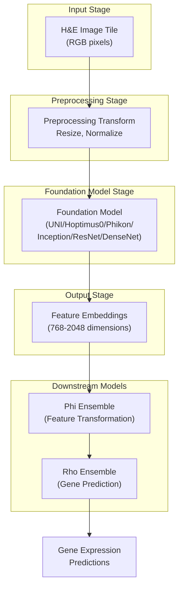
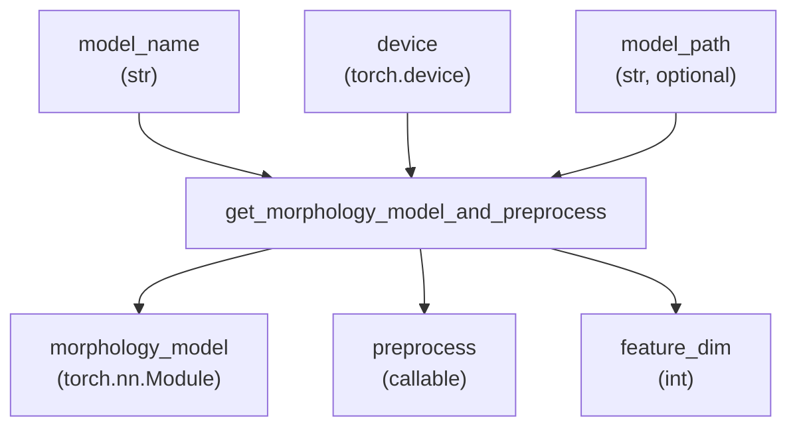
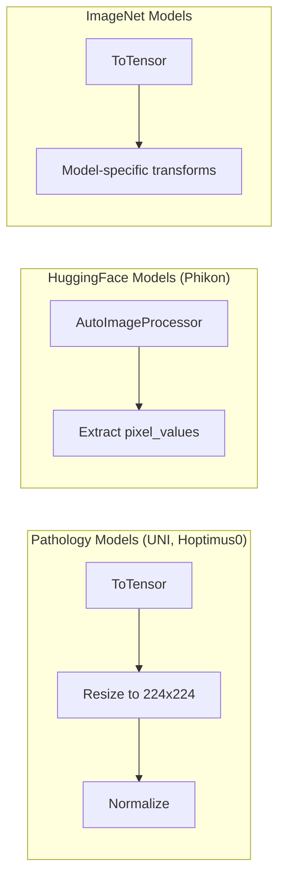
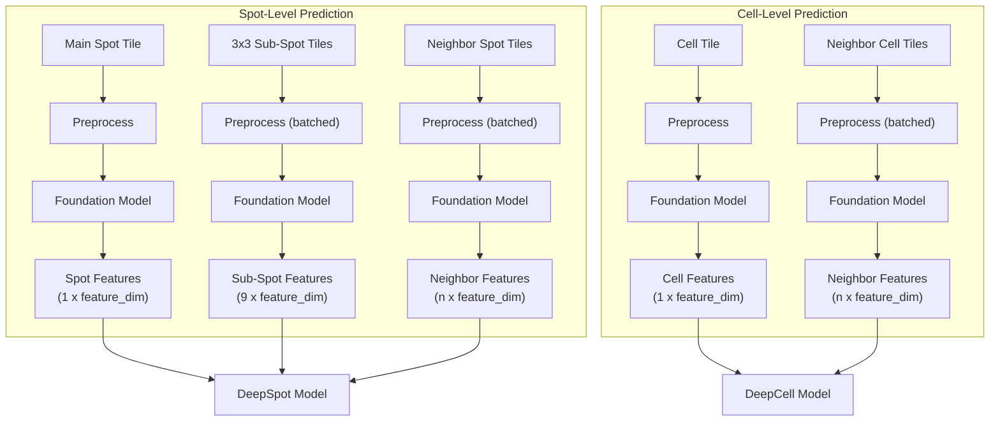
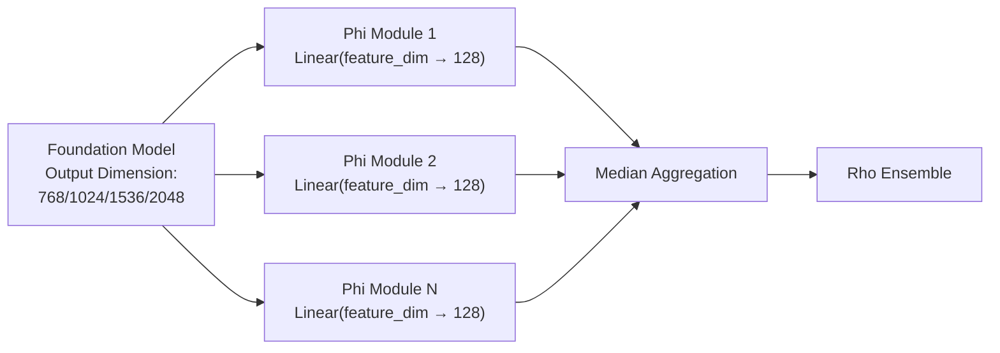
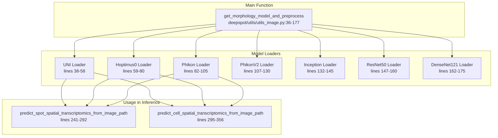

# Foundation Models

<details>
<summary>Relevant source files</summary>

The following files were used as context for generating this wiki page:

- [.codeboarding/Image Processing Module.md](.codeboarding/Image Processing Module.md)
- [README.md](README.md)
- [deepspot/utils/utils_image.py](deepspot/utils/utils_image.py)

</details>


## Purpose and Scope

This document explains the role of pathology foundation models in the DeepSpot system. Foundation models are pretrained deep learning models that extract morphological features from H&E image tiles, converting raw pixel data into compact, semantically-rich embeddings. These embeddings serve as the input features for the DeepSpot and DeepCell prediction models.

For information about how these features are used in the neural architecture, see [Phi and Rho Neural Layers](#5.3). For details on the complete image processing pipeline, see [Image Processing](#6).

---

## Foundation Models in the DeepSpot Pipeline

Foundation models serve as feature extractors that transform raw H&E histology images into fixed-dimensional representations. The DeepSpot system supports multiple pretrained models, each with different architectures, training paradigms, and output dimensions. These models are applied to spot tiles, sub-spot tiles, and neighbor tiles before feeding features into the Phi-Rho neural network.



**Figure: Foundation models convert image tiles into feature embeddings used by DeepSpot/DeepCell**

Sources: [deepspot/utils/utils_image.py:36-177](), [README.md:37-38]()

---

## Supported Foundation Models

The system supports seven foundation models, divided into two categories: pathology-specific models pretrained on histology data, and general-purpose computer vision models.

### Model Comparison Table

| Model Name | Architecture | Feature Dim | Source Library | Pretrained Domain |
|-----------|-------------|-------------|----------------|-------------------|
| `uni` | ViT-Large/16 | 1024 | `timm` | Pathology (100M+ tiles) |
| `hoptimus0` | ViT-Giant/14 | 1536 | `timm` | Pathology (H-optimus) |
| `phikon` | ViT-Base/16 | 768 | `transformers` | Pathology (pan-cancer) |
| `phikonv2` | ViT-Base/16 | 1024 | `transformers` | Pathology (v2) |
| `inception` | Inception-v3 | 2048 | `torchvision` | ImageNet |
| `resnet50` | ResNet-50 | 2048 | `torchvision` | ImageNet |
| `densenet121` | DenseNet-121 | 1024 | `torchvision` | ImageNet |

Sources: [deepspot/utils/utils_image.py:36-177](), [README.md:80-86]()

---

## Pathology-Specific Foundation Models

### UNI (Universal Pathology Model)

The `uni` model is a Vision Transformer (ViT-Large) pretrained on over 100 million histology tiles from diverse tissue types and staining protocols. It produces 1024-dimensional embeddings.

**Architecture**: ViT-Large with 16×16 patches at 224×224 resolution  
**Output Dimension**: 1024  
**Normalization**: ImageNet statistics (mean=[0.485, 0.456, 0.406], std=[0.229, 0.224, 0.225])


**Figure: UNI model processing pipeline**

Sources: [deepspot/utils/utils_image.py:38-58](), [README.md:84]()

### Hoptimus0 (H-optimus-0)

The `hoptimus0` model is a Vision Transformer Giant trained with DINOv2 on large-scale histology data. It produces 1536-dimensional embeddings with tissue-specific normalization statistics.

**Architecture**: ViT-Giant with 14×14 patches, DINOv2 pretraining  
**Output Dimension**: 1536  
**Normalization**: Histology-specific statistics (mean=[0.707, 0.579, 0.704], std=[0.212, 0.230, 0.178])

Sources: [deepspot/utils/utils_image.py:59-80](), [README.md:85]()

### Phikon

The `phikon` model is a ViT-Base trained on pan-cancer histology data using HuggingFace Transformers. It extracts features from the [CLS] token.

**Architecture**: ViT-Base/16 from HuggingFace  
**Output Dimension**: 768  
**Preprocessing**: HuggingFace AutoImageProcessor

The implementation wraps the HuggingFace model with a custom `MyModel` class that extracts the [CLS] token from the final hidden state:

```python
# From deepspot/utils/utils_image.py:91-105
class MyModel(torch.nn.Module):
    def __init__(self, model):
        super().__init__()
        self.model = model

    def forward(self, x):
        with torch.no_grad():
            x = self.model(x)
            x = x.last_hidden_state[:, 0, :]  # Extract [CLS] token
            return x
```

Sources: [deepspot/utils/utils_image.py:82-105](), [README.md:86]()

### PhikonV2

The `phikonv2` model is an updated version of Phikon with 1024-dimensional output. It follows the same processing pattern as Phikon but with a larger feature dimension.

Sources: [deepspot/utils/utils_image.py:107-130]()

---

## General Computer Vision Models

The system also supports three ImageNet-pretrained models for comparison and baseline purposes.

### Inception-v3

Classical CNN architecture with inception modules, producing 2048-dimensional features. The final classification layer is replaced with an identity mapping to extract features.

Sources: [deepspot/utils/utils_image.py:132-145]()

### ResNet-50

Standard residual network with 50 layers. The final fully connected layer is replaced with identity to output 2048-dimensional features.

Sources: [deepspot/utils/utils_image.py:147-160]()

### DenseNet-121

Densely connected convolutional network with 121 layers, producing 1024-dimensional features.

Sources: [deepspot/utils/utils_image.py:162-175]()

---

## Model Loading and Configuration

All foundation models are loaded through the `get_morphology_model_and_preprocess` function, which returns three objects:



**Figure: get_morphology_model_and_preprocess function signature**

### Function Parameters

- **`model_name`** (str): One of `"uni"`, `"hoptimus0"`, `"phikon"`, `"phikonv2"`, `"inception"`, `"resnet50"`, or `"densenet121"`
- **`device`** (torch.device): Target device for model inference (CPU or CUDA)
- **`model_path`** (str, optional): File path to pretrained weights (required for `uni`, `hoptimus0`, `phikon`, `phikonv2`)

### Return Values

1. **`morphology_model`**: PyTorch model set to evaluation mode, ready for feature extraction
2. **`preprocess`**: Preprocessing function that transforms PIL images into model-ready tensors
3. **`feature_dim`**: Integer dimension of output features (768, 1024, 1536, or 2048)

Sources: [deepspot/utils/utils_image.py:36-177]()

---

## Preprocessing Transforms

Each foundation model requires specific preprocessing steps. The `preprocess` function returned by `get_morphology_model_and_preprocess` encapsulates these transformations.

### Transform Pipeline Components



**Figure: Preprocessing pipelines for different model families**

### Example: UNI Preprocessing

```python
# From deepspot/utils/utils_image.py:50-56
preprocess = transforms.Compose([
    transforms.ToTensor(),
    transforms.Resize(224, antialias=True),
    transforms.Normalize(
        mean=(0.485, 0.456, 0.406), 
        std=(0.229, 0.224, 0.225)
    ),
])
```

### Example: Hoptimus0 Preprocessing

```python
# From deepspot/utils/utils_image.py:71-78
preprocess = transforms.Compose([
    transforms.ToTensor(),
    transforms.Resize(224, antialias=True),
    transforms.Normalize(
        mean=(0.707223, 0.578729, 0.703617),
        std=(0.211883, 0.230117, 0.177517)
    ),
])
```

Sources: [deepspot/utils/utils_image.py:50-78]()

---

## Integration with Prediction Pipeline

Foundation models are applied at multiple levels in the spatial prediction workflow:



**Figure: Foundation model application in spot and cell prediction pipelines**

### Feature Extraction Workflow

1. **Tile Extraction**: Images are cropped into tiles corresponding to spots or cells
2. **Preprocessing**: Tiles are transformed using model-specific preprocessing
3. **Batch Processing**: Multiple tiles (sub-spots or neighbors) are batched for efficiency
4. **Feature Extraction**: Foundation model processes batches in inference mode
5. **Feature Aggregation**: Features are passed to Phi-Rho ensemble for prediction

Sources: [deepspot/utils/utils_image.py:241-292](), [deepspot/utils/utils_image.py:295-356]()

---

## Runtime Feature Extraction

During inference, foundation models are applied on-the-fly to extract features from image tiles. This occurs in two main functions:

### Spot-Level Inference: `predict_spot_spatial_transcriptomics_from_image_path`

```python
# Pseudocode from deepspot/utils/utils_image.py:272-280
# For each spot:
X_spot = preprocess(X_spot).to(device).float()
X_subspot = torch.stack([preprocess(x) for x in X_subspot]).to(device).float()
X_neighbors = torch.stack([preprocess(x) for x in X_neighbors]).to(device).float()

# Apply morphology model to extract features
X_spot = morphology_model(X_spot[None, ])
X_subspot = morphology_model(X_subspot)
X_neighbors = morphology_model(X_neighbors)
```

### Cell-Level Inference: `predict_cell_spatial_transcriptomics_from_image_path`

```python
# Pseudocode from deepspot/utils/utils_image.py:338-344
# For each cell:
X_cell = preprocess(X_cell).to(device).float()
X_neighbors = torch.stack([preprocess(x) for x in X_neighbors]).to(device).float()

# Apply morphology model to extract features
X_cell = morphology_model(X_cell[None, ])
X_neighbors = morphology_model(X_neighbors)
```

Both functions use mixed-precision inference (`torch.autocast`) and inference mode (`torch.inference_mode()`) for efficiency.

Sources: [deepspot/utils/utils_image.py:241-292](), [deepspot/utils/utils_image.py:295-356]()

---

## Setup and Configuration

### Downloading Foundation Model Weights

Pathology foundation models require manual weight downloads from HuggingFace:

| Model | HuggingFace Repository |
|-------|----------------------|
| UNI | https://huggingface.co/MahmoodLab/UNI |
| Hoptimus0 | https://huggingface.co/bioptimus/H-optimus-0 |
| Phikon | https://huggingface.co/owkin/phikon |

**Important**: You may need to agree to terms and conditions before downloading weights.

Sources: [README.md:82-86]()

### Configuring Model Paths

After downloading weights, update the `model_path` parameter when calling `get_morphology_model_and_preprocess`:

```python
from deepspot.utils.utils_image import get_morphology_model_and_preprocess
import torch

# Example: Load UNI model
device = torch.device("cuda:0")
model, preprocess, feature_dim = get_morphology_model_and_preprocess(
    model_name="uni",
    device=device,
    model_path="/path/to/uni_weights.pth"
)

print(f"Loaded UNI model with {feature_dim} features")
```

For ImageNet-pretrained models (`inception`, `resnet50`, `densenet121`), weights are downloaded automatically from `torchvision` and no `model_path` is required.

Sources: [deepspot/utils/utils_image.py:36-177](), [README.md:82]()

---

## Model Architecture Details

### Vision Transformer Models (UNI, Hoptimus0, Phikon)

Vision Transformers divide input images into patches, process them through self-attention layers, and extract features from either the [CLS] token or global average pooling.

**Key Configuration Parameters**:
- `img_size`: 224 (input resolution)
- `patch_size`: 16 or 14 (patch dimensions)
- `num_classes`: 0 (feature extraction mode, no classification head)
- `dynamic_img_size`: True (allows flexible input sizes)

```python
# Example: UNI model creation (deepspot/utils/utils_image.py:40-46)
morphology_model = timm.create_model(
    "vit_large_patch16_224",
    img_size=224,
    patch_size=16,
    init_values=1e-5,
    num_classes=0,  # No classification head
    dynamic_img_size=True
)
```

Sources: [deepspot/utils/utils_image.py:40-68]()

### CNN Models (Inception, ResNet, DenseNet)

Classical convolutional neural networks extract features through hierarchical convolutions. The final classification layer is replaced with `torch.nn.Identity()` to output feature embeddings.

```python
# Example: Inception-v3 (deepspot/utils/utils_image.py:134-136)
morphology_model = inception_v3(weights=weights)
morphology_model.fc = torch.nn.Identity()  # Remove classification head
morphology_model.eval()
```

Sources: [deepspot/utils/utils_image.py:132-175]()

---

## Feature Dimension Considerations

The Phi ensemble in DeepSpot/DeepCell must accommodate different feature dimensions from various foundation models. The first layer of each Phi module adapts to the input feature dimension:



**Figure: Phi modules normalize varying feature dimensions to fixed representation**

The `feature_dim` returned by `get_morphology_model_and_preprocess` is used to initialize the Phi modules with the correct input dimension.

Sources: [deepspot/utils/utils_image.py:36-177]()

---

## Performance Considerations

### Model Size and Memory

Different foundation models have varying computational requirements:

| Model | Parameters | GPU Memory (inference) | Inference Speed |
|-------|-----------|----------------------|-----------------|
| UNI | ~307M | ~2GB | Medium |
| Hoptimus0 | ~1.1B | ~5GB | Slow |
| Phikon | ~86M | ~1GB | Fast |
| Inception | ~24M | ~500MB | Fast |

**Recommendation**: For rapid prototyping, use `phikon` or `inception`. For maximum performance, use `uni` or `hoptimus0`.

### Mixed-Precision Inference

Both spot and cell prediction functions use `torch.autocast` with `float16` precision for efficient GPU inference:

```python
# From deepspot/utils/utils_image.py:255-256
with torch.autocast(device_type="cuda", dtype=torch.float16):
    with torch.inference_mode():
        # Feature extraction code
```

This reduces memory consumption and increases throughput without significant accuracy loss.

Sources: [deepspot/utils/utils_image.py:255-256](), [deepspot/utils/utils_image.py:322-323]()

---

## Code Reference Map



**Figure: Code organization for foundation model loading and usage**

Sources: [deepspot/utils/utils_image.py:1-357]()

---