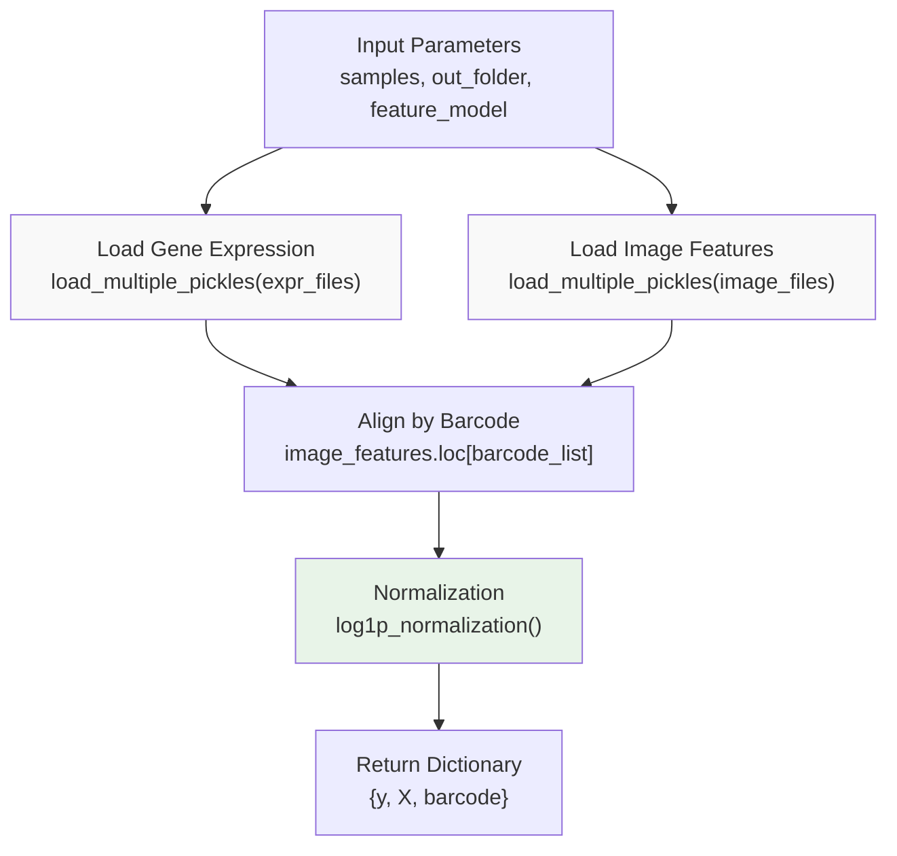
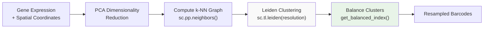
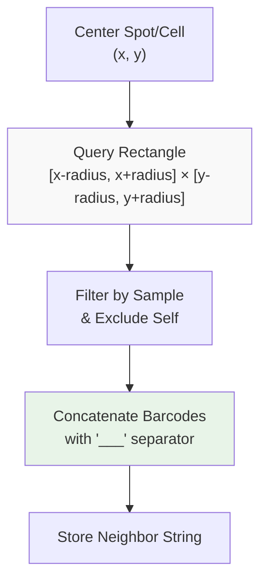
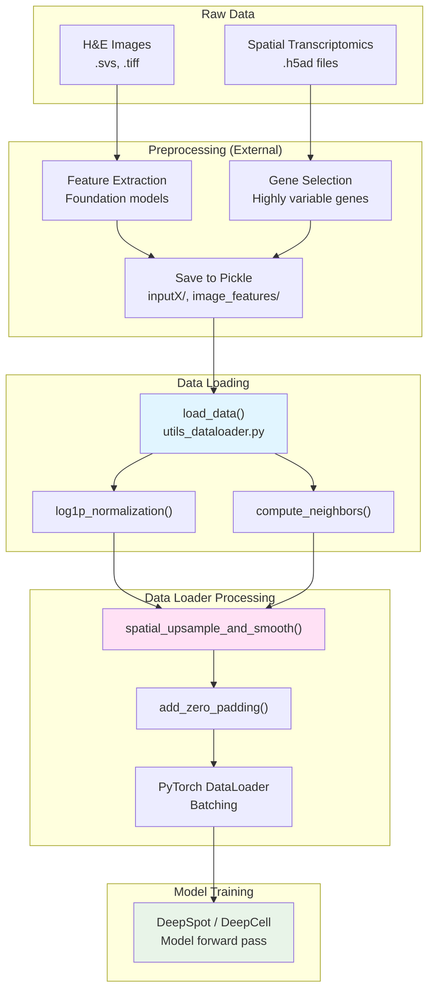

# Data Management & Preprocessing

<details>
<summary>Relevant source files</summary>

The following files were used as context for generating this wiki page:

- [.codeboarding/Data Management & Preprocessing.md](.codeboarding/Data Management & Preprocessing.md)
- [deepspot/utils/utils_dataloader.py](deepspot/utils/utils_dataloader.py)

</details>


## Purpose and Scope

This document covers the data management and preprocessing infrastructure that prepares spatial transcriptomics data for model training and inference. It includes:

- Loading gene expression counts and image features from disk
- Spatial upsampling and smoothing for data augmentation
- Normalization strategies (log1p transformation)
- Neighbor computation for spatial context
- Directory structure and file organization conventions

For detailed documentation of the data loaders themselves, see:
- **[DeepCellDataLoader](#4.3)** - Cell-level data batching and preprocessing
- **[DeepSpotDataLoader](#4.4)** - Spot-level data batching and preprocessing

For spatial processing concepts, see **[Spatial Processing](#4.2)**.

---

## Data Directory Structure

The DeepSpot system expects a standardized directory structure for organizing preprocessed data. All data files are stored as pandas DataFrames serialized to pickle format (`.pkl`).

### Expected Folder Layout

```
<out_folder>/
├── data/
│   ├── inputX/
│   │   ├── <sample1>.pkl       # Gene expression counts (spots/cells × genes)
│   │   ├── <sample2>.pkl
│   │   └── ...
│   └── image_features/
│       ├── <feature_model>/
│       │   ├── <sample1>.pkl   # Image embeddings for spots
│       │   ├── <sample2>.pkl
│       │   └── ...
│       └── <feature_model>_<cell_diameter>/
│           ├── <sample1>.pkl   # Image embeddings for cells
│           ├── <sample2>.pkl
│           └── ...
```

### File Format Conventions

- **Gene Expression Files** (`inputX/<sample>.pkl`): Pandas DataFrame with barcode indices and gene columns
- **Image Feature Files** (`image_features/<model>/<sample>.pkl`): Pandas DataFrame with barcode indices and embedding dimensions as columns
- **Barcode Format**: `<prefix>_<sampleID>_<unique_id>` (e.g., `AAACAAGTATCTCCCA_sample1_1`)

The system uses the barcode as the primary key to align gene expression with image features across files.

**Sources:** [deepspot/utils/utils_dataloader.py:132-174]()

---

## Primary Data Loading Function

### `load_data` Function

The `load_data` function is the main entry point for loading preprocessed data from disk. It handles loading gene expression counts and optionally image features for multiple samples.

```python
def load_data(
    samples,              # List of sample names
    out_folder,           # Root data directory
    feature_model=None,   # Foundation model name (e.g., "UNI", "Hoptimus0")
    cell_diameter=None,   # Cell diameter for cell-level data
    load_image_features=True,  # Whether to load image embeddings
    factor=10000,         # Normalization factor
    raw_counts=False      # If True, skip log1p normalization
)
```

#### Return Value

Returns a dictionary with three keys:

| Key | Type | Description |
|-----|------|-------------|
| `"y"` | `np.ndarray` | Gene expression matrix (n_samples × n_genes) |
| `"X"` | `pd.DataFrame` | Image feature embeddings (n_samples × embedding_dim) |
| `"barcode"` | `np.ndarray` | Barcode identifiers (n_samples,) |

#### Loading Pipeline



**Diagram: Data loading pipeline showing file loading, alignment, and normalization steps**

#### Usage Example

```python
from deepspot.utils.utils_dataloader import load_data

data = load_data(
    samples=["sample1", "sample2", "sample3"],
    out_folder="/path/to/preprocessed/data",
    feature_model="UNI",
    load_image_features=True,
    raw_counts=False  # Apply log1p normalization
)

gene_expr = data["y"]        # Shape: (n_spots, n_genes)
image_features = data["X"]   # Shape: (n_spots, embedding_dim)
barcodes = data["barcode"]   # Shape: (n_spots,)
```

**Sources:** [deepspot/utils/utils_dataloader.py:132-174](), [deepspot/utils/utils_dataloader.py:124-125]()

---

## Normalization

### Log1p Normalization

The default normalization strategy applies library-size normalization followed by log1p transformation. This is a standard approach in single-cell and spatial transcriptomics analysis.

#### Formula

For each spot/cell $i$ and gene $j$:

$$y_{ij}^{\text{norm}} = \log_1(1 + \frac{x_{ij}}{\sum_j x_{ij}} \times \text{factor})$$

Where:
- $x_{ij}$ is the raw count
- $\sum_j x_{ij}$ is the library size (total counts per spot/cell)
- $\text{factor}$ is typically 10,000
- $\log_1$ is the natural logarithm

#### Implementation

```python
def log1p_normalization(arr, factor=10000, eps=1e-12):
    return np.log1p(((arr.T / (np.sum(arr, axis=1) + eps)).T) * factor)
```

This normalization is automatically applied in `load_data()` unless `raw_counts=True` is specified.

**Sources:** [deepspot/utils/utils_dataloader.py:128-129](), [deepspot/utils/utils_dataloader.py:165-166]()

---

## Spatial Upsampling and Smoothing

### Overview

Spatial upsampling and smoothing are data augmentation techniques used during training to increase sample diversity and incorporate spatial context. These operations are performed on-the-fly by the data loaders.

### `spatial_upsample_and_smooth` Function

```python
def spatial_upsample_and_smooth(
    counts,           # Gene expression matrix
    obs,              # Observation metadata (DataFrame)
    barcode,          # Barcode identifiers
    resolution,       # Leiden clustering resolution (or None to skip)
    smooth_n=0,       # Number of neighbors for smoothing (0 to skip)
    augmentation="default"  # Clustering method: "default" or "aestetik"
)
```

#### Return Values

Returns a tuple:
1. `resampled_barcodes` (np.ndarray): Balanced set of barcodes after upsampling
2. `transcriptomics_smooth` (np.ndarray): Smoothed gene expression matrix

### Upsampling Strategy

The upsampling process performs sample balancing within each tissue sample:

1. **Cluster the data** using Leiden community detection (via scanpy)
2. **Identify cluster sizes** and find the maximum cluster size
3. **Resample from each cluster** to match the maximum size
4. **Return balanced barcodes** across all clusters



**Diagram: Spatial upsampling pipeline using clustering and resampling**

### Smoothing Strategy

If `smooth_n > 0`, the function computes k-nearest neighbors in the latent space (PCA or AESTETIK embeddings) and averages gene expression across neighbors:

1. **Fit k-NN model** on latent representations
2. **Find k nearest neighbors** for each spot/cell
3. **Average gene expression** across neighbors
4. **Return smoothed counts**

This incorporates spatial context by creating "pseudo-observations" that blend local neighborhoods.

### Clustering Methods

| Method | Description | Use Case |
|--------|-------------|----------|
| `"default"` | Standard PCA + Leiden clustering | General purpose, fast |
| `"aestetik"` | AESTETIK spatial clustering with morphology | Incorporates spatial window context |

Both methods use the `resolution` parameter to control cluster granularity (higher = more clusters).

**Sources:** [deepspot/utils/utils_dataloader.py:65-98](), [deepspot/utils/utils_dataloader.py:29-37](), [deepspot/utils/utils_dataloader.py:40-62](), [deepspot/utils/utils_dataloader.py:20-26]()

---

## Neighbor Computation

### Spatial Neighbor Identification

The `compute_neighbors` function identifies neighboring spots or cells within a spatial radius. This is essential for models that incorporate spatial context.

```python
def compute_neighbors(row, coordinates, radius=1):
    query = f"""
    ((x_array - {radius}) <= {row.x_array} <= (x_array + {radius})) and \
    ((y_array - {radius}) <= {row.y_array} <= (y_array + {radius})) and \
    (sampleID == '{row.sampleID}' and barcode != '{row.barcode}')
    """
    neighbors = coordinates.query(query)
    neighbors = neighbors.barcode.values
    neighbors = "___".join(neighbors)
    return neighbors
```

### Neighbor String Format

Neighbors are stored as a string with barcodes concatenated by `"___"`:

```
AAACAAGTATCTCCCA_sample1_1___AAACAATCTACTAGCA_sample1_2___AAACACCAATAACTGC_sample1_3
```

This format is later parsed by the data loaders to retrieve neighbor features during training.

### Grid-Based Search

The function uses a rectangular bounding box for efficiency:



**Diagram: Neighbor computation using spatial grid search**

**Key Parameters:**
- `radius=1`: For Visium spots (captures ~3×3 neighborhood)
- `radius` varies for cells depending on `neighbor_context` parameter

**Sources:** [deepspot/utils/utils_dataloader.py:112-121]()

---

## Zero Padding

### Purpose

The `add_zero_padding` function ensures fixed-size arrays for batch processing. This is necessary when different spots/cells have varying numbers of neighbors or sub-tiles.

```python
def add_zero_padding(original_array, desired_padding):
    if desired_padding == original_array.shape[0]:
        return original_array
    padding_needed = desired_padding - original_array.shape[0]
    padded_array = np.pad(original_array, ((0, padding_needed), (0, 0)), 
                          mode='constant', constant_values=0)
    return padded_array
```

### Usage in Data Loaders

- **Spot neighbors:** Pad to fixed number of neighbors (e.g., 8 neighbors → always return 8 rows)
- **Sub-tiles:** Pad to 9 tiles for consistent mini-tile processing
- **Cell neighbors:** Pad to `neighbor_context` size

Padding with zeros allows batch processing while the model learns to ignore padded entries.

**Sources:** [deepspot/utils/utils_dataloader.py:101-109]()

---

## Complete Data Flow

### End-to-End Pipeline



**Diagram: Complete data flow from raw data through preprocessing to model training**

This diagram shows how data flows through the entire system:

1. **Preprocessing** (external notebooks): Extract features and select genes → save to pickle
2. **Data Loading** (`load_data`): Load pickles, normalize, compute neighbors
3. **Data Loader Processing** (DeepCellDataLoader/DeepSpotDataLoader): Apply upsampling, smoothing, padding
4. **Batching**: PyTorch DataLoader creates mini-batches
5. **Training**: Model consumes batched data

**Sources:** [deepspot/utils/utils_dataloader.py:132-174](), [deepspot/utils/utils_dataloader.py:65-98](), [deepspot/utils/utils_dataloader.py:112-121]()

---

## Key Classes and Functions Summary

| Component | Location | Purpose |
|-----------|----------|---------|
| `load_data()` | [utils_dataloader.py:132-174]() | Main function for loading gene expression and image features |
| `log1p_normalization()` | [utils_dataloader.py:128-129]() | Library-size normalization + log transformation |
| `spatial_upsample_and_smooth()` | [utils_dataloader.py:65-98]() | Data augmentation via clustering and spatial smoothing |
| `compute_neighbors()` | [utils_dataloader.py:112-121]() | Identify spatial neighbors within radius |
| `add_zero_padding()` | [utils_dataloader.py:101-109]() | Pad arrays to fixed size for batching |
| `get_balanced_index()` | [utils_dataloader.py:20-26]() | Balance sampling across clusters |
| `run_default()` | [utils_dataloader.py:29-37]() | PCA + Leiden clustering for upsampling |
| `run_aestetik()` | [utils_dataloader.py:40-62]() | AESTETIK spatial clustering for upsampling |
| `load_multiple_pickles()` | [utils_dataloader.py:124-125]() | Load and concatenate multiple pickle files |

---

## Integration with Data Loaders

The utilities documented here are consumed by two main data loader classes:

- **[DeepCellDataLoader](#4.3)**: Extends these utilities for cell-level data
  - Uses `load_data()` to load cell features and gene expression
  - Applies `spatial_upsample_and_smooth()` during initialization
  - Uses `compute_neighbors()` to create cell neighborhoods
  - Applies `add_zero_padding()` to neighbor features

- **[DeepSpotDataLoader](#4.4)**: Extends these utilities for spot-level data
  - Uses `load_data()` to load spot features and mini-tile features
  - Applies `spatial_upsample_and_smooth()` with spot-specific parameters
  - Handles both spot neighbors and 3×3 sub-tile arrays
  - Supports multiple spatial contexts (spot, subspot, neighbors, full)

Both data loaders inherit from `torch.utils.data.Dataset` and implement `__getitem__` to batch data for PyTorch training loops.

**Sources:** [deepspot/utils/utils_dataloader.py:1-174]()

---