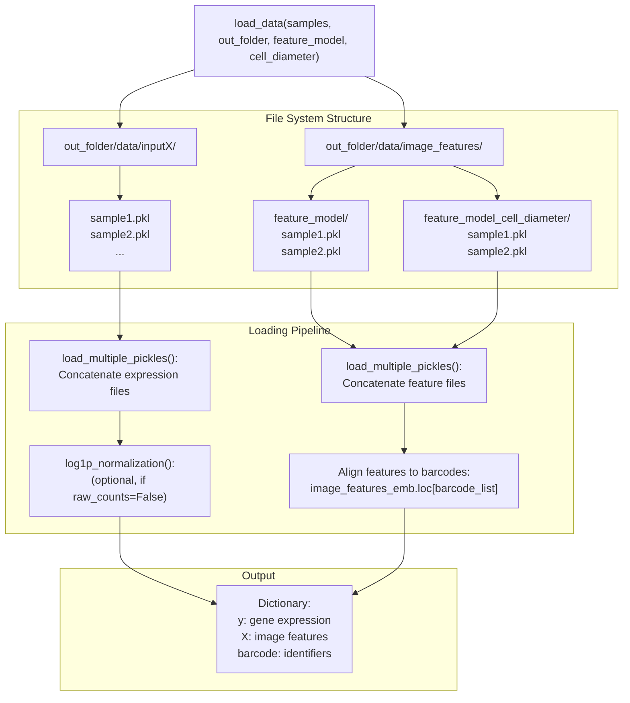
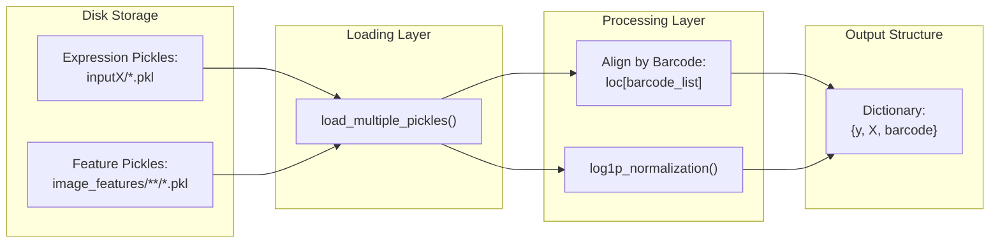
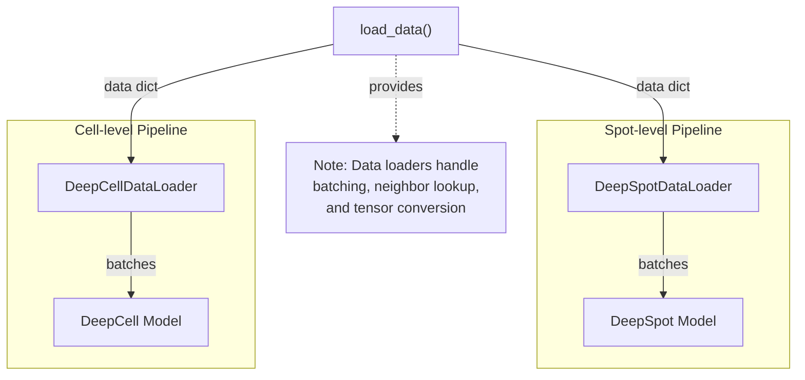

# Data Loading Utilities

<details>
<summary>Relevant source files</summary>

The following files were used as context for generating this wiki page:

- [deepspot/utils/utils_dataloader.py](deepspot/utils/utils_dataloader.py)

</details>


## Purpose and Scope

This document covers the utility functions for loading and preparing data for DeepSpot and DeepCell models. These utilities handle loading gene expression counts and image feature embeddings from disk, applying normalization transformations, and preparing data structures for model training and inference.

The primary focus is on the `load_data` function and its supporting utilities located in `deepspot/utils/utils_dataloader.py`. These utilities serve as the foundational layer between preprocessed data files on disk and the data loaders (see [DeepCellDataLoader](#4.3) and [DeepSpotDataLoader](#4.4)). For spatial processing operations like upsampling and smoothing, see [Spatial Processing](#4.2).

---

## Core Data Loading Function

### The `load_data` Function

The `load_data` function is the primary entry point for loading preprocessed data into memory. It loads gene expression counts and optionally loads image feature embeddings, returning a dictionary containing the data ready for model training or inference.

**Function Signature:**
```python
load_data(
    samples,
    out_folder,
    feature_model=None,
    cell_diameter=None,
    load_image_features=True,
    factor=10000,
    raw_counts=False
)
```

**Parameters:**

| Parameter | Type | Description |
|-----------|------|-------------|
| `samples` | list | List of sample identifiers to load |
| `out_folder` | str | Root directory containing preprocessed data |
| `feature_model` | str | Name of the morphology model (e.g., "uni", "hoptimus0", "phikon") |
| `cell_diameter` | int/None | Diameter in pixels for cell/spot extraction (used in file path construction) |
| `load_image_features` | bool | Whether to load image feature embeddings (default: True) |
| `factor` | int | Normalization factor for log1p transformation (default: 10000) |
| `raw_counts` | bool | If True, skip log1p normalization (default: False) |

**Returns:**

A dictionary with keys:
- `"y"`: Gene expression matrix (samples × genes) as numpy array
- `"X"`: Image feature embeddings (samples × features) as pandas DataFrame (if `load_image_features=True`)
- `"barcode"`: Array of barcode identifiers

**Sources:** [deepspot/utils/utils_dataloader.py:132-174]()

---

## Data Loading Architecture

The following diagram illustrates how `load_data` retrieves and combines data from the file system:



**Sources:** [deepspot/utils/utils_dataloader.py:132-174]()

---

## File Organization and Lookup Logic

The `load_data` function expects preprocessed data to be organized in a specific directory structure:

```
out_folder/
├── data/
│   ├── inputX/
│   │   ├── sample1.pkl  (gene expression counts)
│   │   ├── sample2.pkl
│   │   └── ...
│   └── image_features/
│       ├── uni/  (spot-level features)
│       │   ├── sample1.pkl
│       │   └── sample2.pkl
│       ├── uni_55/  (cell-level features with diameter)
│       │   ├── sample1.pkl
│       │   └── sample2.pkl
│       └── phikon/
│           └── ...
```

The function constructs file paths based on whether `cell_diameter` is provided:

- **With `cell_diameter`**: `{out_folder}/data/image_features/{feature_model}_{cell_diameter}/{sample}.pkl`
- **Without `cell_diameter`**: `{out_folder}/data/image_features/{feature_model}/{sample}.pkl`

This convention allows the same function to handle both spot-level (Visium) and cell-level (Xenium) data.

**Sources:** [deepspot/utils/utils_dataloader.py:151-161]()

---

## Normalization Pipeline

### Log1p Normalization

Gene expression counts are normalized using the `log1p_normalization` function unless `raw_counts=True`. This performs library-size normalization followed by log transformation:

$$
\text{normalized}_{ij} = \log_e\left(1 + \frac{x_{ij}}{\sum_j x_{ij}} \times \text{factor}\right)
$$

Where:
- $x_{ij}$ is the raw count for gene $j$ in sample $i$
- factor is typically 10,000 (standard scRNA-seq normalization)
- An epsilon term ($1 \times 10^{-12}$) is added to prevent division by zero

**Function Implementation:**
```python
def log1p_normalization(arr, factor=10000, eps=1e-12):
    return np.log1p(((arr.T / (np.sum(arr, axis=1) + eps)).T) * factor)
```

**Sources:** [deepspot/utils/utils_dataloader.py:128-129](), [deepspot/utils/utils_dataloader.py:165-166]()

---

## Supporting Utility Functions

### File Loading Utilities

#### `load_multiple_pickles`

Loads and concatenates multiple pickle files into a single pandas DataFrame:

```python
def load_multiple_pickles(files):
    return pd.concat([pd.read_pickle(f) for f in files])
```

This function is used internally by `load_data` to merge data from multiple samples. It expects each pickle file to contain a pandas DataFrame with consistent schemas.

**Sources:** [deepspot/utils/utils_dataloader.py:124-125](), [deepspot/utils/utils_dataloader.py:146](), [deepspot/utils/utils_dataloader.py:152-155](), [deepspot/utils/utils_dataloader.py:159-161]()

---

### Spatial Utilities

#### `compute_neighbors`

Computes spatial neighbors for a given spot or cell based on array coordinates:

```python
def compute_neighbors(row, coordinates, radius=1):
    query = f"""
    ((x_array - {radius}) <= {row.x_array} <= (x_array + {radius})) and \
    ((y_array - {radius}) <= {row.y_array} <= (y_array + {radius})) and \
    (sampleID == '{row.sampleID}' and barcode != '{row.barcode}')
    """
    neighbors = coordinates.query(query)
    neighbors = neighbors.barcode.values
    neighbors = "___".join(neighbors)
    return neighbors
```

This function:
- Queries for neighbors within a square region of size `(2*radius + 1) × (2*radius + 1)`
- Excludes the query spot/cell itself
- Only considers neighbors within the same sample
- Returns neighbor barcodes joined with `"___"` delimiter

**Sources:** [deepspot/utils/utils_dataloader.py:112-121]()

#### `add_zero_padding`

Adds zero-padding to arrays to ensure consistent dimensions:

```python
def add_zero_padding(original_array, desired_padding):
    if desired_padding == original_array.shape[0]:
        return original_array
    padding_needed = desired_padding - original_array.shape[0]
    padded_array = np.pad(original_array, ((0, padding_needed), (0, 0)), 
                          mode='constant', constant_values=0)
    return padded_array
```

This is primarily used when batching neighbor data with varying neighbor counts, ensuring all samples have the same tensor shape.

**Sources:** [deepspot/utils/utils_dataloader.py:101-109]()

---

### Spatial Upsampling and Smoothing

#### `spatial_upsample_and_smooth`

Performs spatial upsampling and optional smoothing on gene expression data:

```python
def spatial_upsample_and_smooth(counts, obs, barcode, resolution, 
                                smooth_n=0, augmentation="default"):
```

**Process:**

1. **Sample-wise Processing**: Processes each sample independently
2. **Clustering**: If `resolution` is specified, performs spatial clustering using either:
   - `"default"`: PCA + Leiden clustering via `run_default`
   - `"aestetik"`: AESTETIK spatially-aware clustering via `run_aestetik`
3. **Balanced Resampling**: Uses `get_balanced_index` to create balanced samples from clusters
4. **Smoothing**: If `smooth_n > 0`, smooths counts using k-nearest neighbors in latent space

**Returns:**
- `resampled_barcodes`: Array of selected barcodes after upsampling
- `transcriptomics_smooth`: Smoothed count matrix (all zeros if `smooth_n=0`)

This function is primarily used for data augmentation during training, allowing the model to see more balanced representations across spatial domains.

**Sources:** [deepspot/utils/utils_dataloader.py:65-98]()

---

## Data Flow Diagram

The following diagram shows how data flows from disk through the utility functions to the final data dictionary:



**Sources:** [deepspot/utils/utils_dataloader.py:132-174]()

---

## Usage Patterns

### Basic Usage: Loading Data for Training

```python
from deepspot.utils.utils_dataloader import load_data

# Load spot-level Visium data
data = load_data(
    samples=["sample1", "sample2", "sample3"],
    out_folder="/path/to/preprocessed/data",
    feature_model="uni",
    cell_diameter=None,  # No diameter for spot-level
    load_image_features=True,
    factor=10000,
    raw_counts=False
)

# Access the loaded data
gene_expression = data["y"]  # shape: (n_spots, n_genes)
image_features = data["X"]   # shape: (n_spots, feature_dim)
barcodes = data["barcode"]   # array of barcode strings
```

### Loading Cell-level Data

```python
# Load cell-level Xenium data
data = load_data(
    samples=["xenium_sample1"],
    out_folder="/path/to/xenium/data",
    feature_model="phikon",
    cell_diameter=20,  # Include diameter for cell-level
    load_image_features=True,
    factor=10000,
    raw_counts=False
)
```

### Loading Without Image Features

For cases where only gene expression is needed (e.g., baseline models):

```python
data = load_data(
    samples=["sample1"],
    out_folder="/path/to/data",
    load_image_features=False,  # Skip image features
    raw_counts=False
)
# data["X"] will not be present in the returned dictionary
```

**Sources:** [deepspot/utils/utils_dataloader.py:132-174]()

---

## Key Design Decisions

### Sample-based Organization

The utility assumes data is organized by sample, with each sample stored in a separate pickle file. This design:
- Enables efficient loading of subsets of samples
- Supports distributed preprocessing (one file per sample)
- Allows incremental addition of new samples

### Pandas for Feature Embeddings, NumPy for Counts

The function returns:
- Image features as pandas DataFrames (preserves barcode index for alignment)
- Gene expression as NumPy arrays (efficient for numerical operations)
- Barcodes as NumPy arrays (simple identifier storage)

This mixed representation balances convenience (pandas indexing) with performance (NumPy computation).

### Barcode Alignment

Image features are explicitly aligned to expression barcodes using pandas `.loc` indexing:
```python
image_features_emb = image_features_emb.loc[barcode_list]
```

This ensures consistent ordering between `X` and `y` even if pickle files contain barcodes in different orders.

**Sources:** [deepspot/utils/utils_dataloader.py:155](), [deepspot/utils/utils_dataloader.py:161]()

---

## Integration with Data Loaders

The `load_data` function serves as the preprocessing layer for both data loaders:



After `load_data` returns the data dictionary, the data loaders (see [DeepSpotDataLoader](#4.4) and [DeepCellDataLoader](#4.3)) perform additional operations:
- Neighbor feature aggregation
- Mini-tile organization (for spots)
- Batching and tensor conversion
- Data augmentation during training

**Sources:** [deepspot/utils/utils_dataloader.py:132-174]()

---

## Dependencies

The utilities rely on the following external libraries:

| Library | Purpose | Key Usage |
|---------|---------|-----------|
| `pandas` | DataFrame operations | Loading pickles, barcode alignment |
| `numpy` | Numerical operations | Array manipulation, normalization |
| `sklearn.neighbors` | Spatial queries | Neighbor computation, smoothing |
| `scanpy` | Single-cell analysis | PCA, Leiden clustering |
| `anndata` | Data structure | Temporary AnnData objects for clustering |
| `torch` | Deep learning (indirect) | Not used directly in these utilities |

**Sources:** [deepspot/utils/utils_dataloader.py:1-17]()

---