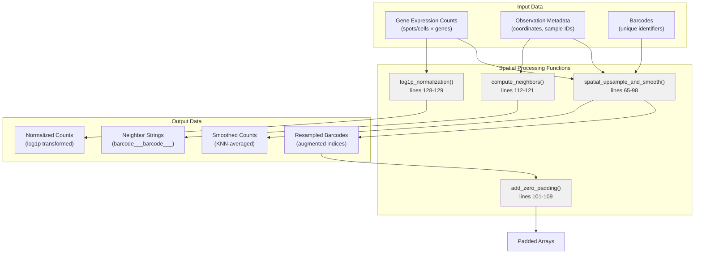
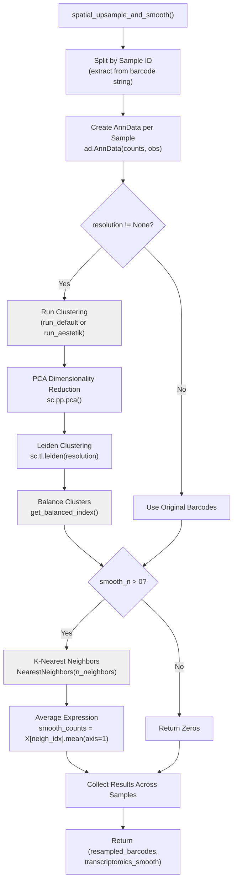
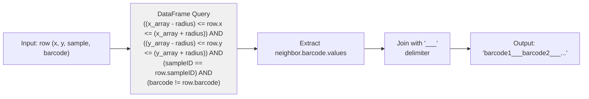
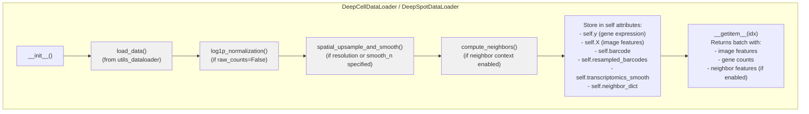

# Spatial Processing

<details>
<summary>Relevant source files</summary>

The following files were used as context for generating this wiki page:

- [.codeboarding/Data Management & Preprocessing.md](.codeboarding/Data Management & Preprocessing.md)
- [deepspot/utils/utils_dataloader.py](deepspot/utils/utils_dataloader.py)

</details>


This page documents the spatial processing utilities that transform raw spatial transcriptomics data into model-ready inputs. These functions handle spatial upsampling (balancing samples through clustering), k-nearest neighbor smoothing, log-normalization, neighbor computation, and supporting operations like zero-padding. For information about loading gene expression and image features, see [Data Loading Utilities](#4.1). For how these utilities integrate into the full data loading pipeline, see [DeepCellDataLoader](#4.3) and [DeepSpotDataLoader](#4.4).

## Overview

Spatial processing operations are implemented in [deepspot/utils/utils_dataloader.py]() and serve three primary purposes:

1. **Data augmentation**: Upsampling to balance sample distributions across spatial clusters
2. **Signal enhancement**: Smoothing gene expression using spatial neighborhoods
3. **Normalization**: Standardizing count data for model training

These utilities are shared by both spot-level and cell-level pipelines and are invoked during dataloader initialization.



**Sources:** [deepspot/utils/utils_dataloader.py:1-175]()

## Spatial Upsampling and Smoothing

### Purpose

The `spatial_upsample_and_smooth` function addresses two challenges in spatial transcriptomics:

1. **Class imbalance**: Different spatial regions may have varying numbers of spots/cells, leading to biased model training
2. **Noise**: Individual spot/cell measurements contain technical and biological noise that can be reduced through spatial averaging

### Function Signature

```python
def spatial_upsample_and_smooth(counts, obs, barcode, resolution, smooth_n=0, augmentation="default")
```

**Parameters:**

| Parameter | Type | Description |
|-----------|------|-------------|
| `counts` | `np.ndarray` | Gene expression matrix (n_samples × n_genes) |
| `obs` | `pd.DataFrame` | Observation metadata with coordinates and sample IDs |
| `barcode` | `np.ndarray` | Array of spot/cell identifiers (format: `prefix_sampleID_suffix`) |
| `resolution` | `float` or `None` | Clustering resolution for upsampling (higher = more clusters). If `None`, no upsampling |
| `smooth_n` | `int` | Number of nearest neighbors for smoothing (default: 0 = no smoothing) |
| `augmentation` | `str` | Clustering method: `"default"` (Leiden) or `"aestetik"` (spatial-aware) |

**Returns:**

| Return Value | Type | Description |
|--------------|------|-------------|
| `resampled_barcodes` | `np.ndarray` | Augmented barcode list with balanced sampling |
| `transcriptomics_smooth` | `np.ndarray` | KNN-smoothed gene expression (zeros if `smooth_n=0`) |

**Sources:** [deepspot/utils/utils_dataloader.py:65-98]()

### Upsampling Pipeline



**Sources:** [deepspot/utils/utils_dataloader.py:65-98]()

### Clustering Methods

#### Default Clustering (`run_default`)

Uses standard scanpy workflow with Leiden community detection:

```python
def run_default(adata, resolution=1.0)
```

**Steps:**
1. PCA: Compute up to 50 principal components via `sc.pp.pca`
2. Neighbors: Build k-nearest neighbor graph via `sc.pp.neighbors`
3. Leiden: Cluster with igraph flavor, 2 iterations via `sc.tl.leiden`
4. Store latent representation in `adata.obsm["latent"]` and cluster labels in `adata.obs["label"]`

**Sources:** [deepspot/utils/utils_dataloader.py:29-37]()

#### AESTETIK Clustering (`run_aestetik`)

Spatial-aware clustering that incorporates spatial proximity through a sliding window:

```python
def run_aestetik(adata, window_size=3, resolution=1.0)
```

**Steps:**
1. PCA: Compute principal components via `sc.pp.pca`
2. Create dual modalities: transcriptomics PCA and dummy morphology (5D ones)
3. Initialize `AESTETIK` with `window_size=3`, `morphology_weight=0`, and Leiden clustering
4. Fit and predict to generate `adata.obsm["AESTETIK"]` latent space and cluster labels

**Note:** Despite the morphology modality being dummy, the window-based spatial integration still affects clustering.

**Sources:** [deepspot/utils/utils_dataloader.py:40-62]()

### Balanced Indexing

After clustering, `get_balanced_index` ensures equal representation of each cluster:

```python
def get_balanced_index(barcode, labels, n_count)
```

**Algorithm:**
1. For each unique cluster label, randomly sample `n_count - 1` barcodes
2. `n_count` is determined by the largest cluster: `np.max(adata.obs.label.value_counts())`
3. Returns concatenated list of resampled barcodes

**Effect:** Balances training by upsampling minority clusters and effectively downsampling (through partial sampling) majority clusters.

**Sources:** [deepspot/utils/utils_dataloader.py:20-26](), [deepspot/utils/utils_dataloader.py:86-87]()

### K-Nearest Neighbor Smoothing

When `smooth_n > 0`, gene expression is averaged across spatial neighbors:

**Algorithm:**
1. Fit `NearestNeighbors` on the latent representation (`adata.obsm["latent"]`)
2. Find `smooth_n` nearest neighbors for each spot/cell
3. Compute mean expression across neighbors: `smooth_counts = adata.X[neigh_idx].mean(axis=1)`
4. Store in `transcriptomics_smooth` array

**Typical values:**
- Spots: `smooth_n = 0` (no smoothing, spots already aggregate multiple cells)
- Cells: `smooth_n = 5-10` (smooth noisy single-cell measurements)

**Sources:** [deepspot/utils/utils_dataloader.py:91-96]()

## Normalization

### Log1p Normalization

The `log1p_normalization` function applies library-size normalization followed by log transformation:

```python
def log1p_normalization(arr, factor=10000, eps=1e-12)
```

**Formula:**

```
normalized = log(1 + (arr / sum(arr, axis=1)) * factor)
```

**Steps:**
1. Compute library sizes: sum of counts per spot/cell (`np.sum(arr, axis=1)`)
2. Divide by library size (with `eps` to avoid division by zero)
3. Multiply by scaling `factor` (default: 10,000)
4. Apply `np.log1p` (log(1 + x))

**Purpose:** 
- Normalizes for sequencing depth differences across spots/cells
- Log transformation stabilizes variance and approximates normal distribution
- Standard preprocessing in single-cell RNA-seq analysis

**Usage:** Applied in `load_data` when `raw_counts=False` (default behavior).

**Sources:** [deepspot/utils/utils_dataloader.py:128-129](), [deepspot/utils/utils_dataloader.py:166]()

## Neighbor Computation

### Finding Spatial Neighbors

The `compute_neighbors` function identifies neighboring spots/cells within a spatial radius:

```python
def compute_neighbors(row, coordinates, radius=1)
```

**Parameters:**

| Parameter | Type | Description |
|-----------|------|-------------|
| `row` | `pd.Series` | Single observation with fields: `x_array`, `y_array`, `sampleID`, `barcode` |
| `coordinates` | `pd.DataFrame` | Full coordinate dataframe with same fields |
| `radius` | `int` | Spatial radius for neighbor search (default: 1) |

**Returns:** String of neighbor barcodes joined by `"___"` delimiter (e.g., `"barcode1___barcode2___barcode3"`)

### Query Logic



**Key constraints:**
1. **Spatial proximity**: Within square region `[x-radius, x+radius] × [y-radius, y+radius]`
2. **Same sample**: Neighbors must be from the same tissue section (`sampleID` match)
3. **Exclude self**: `barcode != row.barcode`

**Coordinate system:** Uses `x_array` and `y_array` fields, which represent array indices (integer grid positions) rather than micron coordinates.

**Sources:** [deepspot/utils/utils_dataloader.py:112-121]()

### Typical Usage Patterns

**Visium Spots:**
- `radius=1`: Captures first-order hexagonal neighbors (6 neighbors in perfect grid)
- Used in `DeepSpotDataLoader` for neighbor context modes

**Xenium Cells:**
- Often precomputed using `scanpy.pp.neighbors` or `squidpy.gr.spatial_neighbors`
- Can specify `n_neighbors` (e.g., 45) instead of radius-based search
- More flexible for irregular cell distributions

**Sources:** [deepspot/cell/dataloader.py](), [deepspot/spot/dataloader.py]()

## Supporting Utilities

### Zero Padding

The `add_zero_padding` function pads arrays to a target size:

```python
def add_zero_padding(original_array, desired_padding)
```

**Purpose:** Ensures all samples in a batch have the same neighbor count by padding with zeros.

**Algorithm:**
1. If `desired_padding == original_array.shape[0]`, return unchanged
2. Calculate `padding_needed = desired_padding - original_array.shape[0]`
3. Apply `np.pad` with mode `'constant'` and `constant_values=0`
4. Padding applied only to first axis (rows), not features

**Use case:** When batching spots/cells with neighbors, different samples may have different numbers of neighbors. Padding ensures uniform tensor shapes for PyTorch.

**Sources:** [deepspot/utils/utils_dataloader.py:101-109]()

### Multiple Pickle Loading

Utility for loading data split across multiple files:

```python
def load_multiple_pickles(files)
```

**Implementation:** `pd.concat([pd.read_pickle(f) for f in files])`

**Usage:** Concatenates gene expression or image feature dataframes across multiple samples.

**Sources:** [deepspot/utils/utils_dataloader.py:124-125]()

## Integration with DataLoaders

### Processing Flow in DataLoaders



**Sources:** [deepspot/cell/dataloader.py:23-167](), [deepspot/spot/dataloader.py:22-118]()

### Configuration Example

**Typical DeepCellDataLoader initialization:**

```python
dataloader = DeepCellDataLoader(
    samples=["sample1", "sample2"],
    out_folder="./data",
    feature_model="uni",
    cell_diameter=20,
    smooth_n=5,                    # Enable KNN smoothing
    resolution=1.0,                # Enable upsampling with Leiden
    augmentation="default",        # Use standard clustering
    neighbors_smoothing=True,      # Compute neighbor context
    neighbor_context=45,           # Use 45 nearest neighbors
    raw_counts=False,              # Apply log1p normalization
    factor=10000                   # Normalization scaling factor
)
```

This configuration triggers:
1. `log1p_normalization` with `factor=10000`
2. `spatial_upsample_and_smooth` with `resolution=1.0`, `smooth_n=5`, `augmentation="default"`
3. Neighbor computation with `neighbor_context=45`

**Sources:** [deepspot/cell/dataloader.py:23-167]()

## Performance Considerations

### Memory Usage

- **Smoothing arrays**: `transcriptomics_smooth` has same shape as original counts, doubling memory
- **Neighbor storage**: String concatenation in `compute_neighbors` is memory-efficient but string operations are slower than numeric arrays
- **Upsampling**: Resampled barcodes may increase effective dataset size by 2-5×

### Computational Cost

| Operation | Complexity | Typical Time |
|-----------|-----------|--------------|
| Leiden clustering | O(n log n) | ~5-30s per sample |
| KNN fitting | O(n log n) | ~1-5s per sample |
| KNN smoothing | O(n × k) | ~2-10s per sample |
| Neighbor queries | O(n²) (naive) | Varies by radius |
| Log normalization | O(n × g) | <1s per sample |

**Optimization:** All operations are performed per-sample within `spatial_upsample_and_smooth`, allowing for parallelization across samples (not currently implemented).

**Sources:** [deepspot/utils/utils_dataloader.py:65-98]()

## Summary Table

| Function | Input | Output | Primary Use Case |
|----------|-------|--------|------------------|
| `spatial_upsample_and_smooth` | Counts, metadata, barcodes | Resampled barcodes, smoothed counts | Data augmentation and denoising |
| `log1p_normalization` | Raw count matrix | Normalized matrix | Library-size normalization |
| `compute_neighbors` | Single row, coordinate df | Neighbor barcode string | Spatial context extraction |
| `add_zero_padding` | Array, target size | Padded array | Batch shape uniformity |
| `get_balanced_index` | Barcodes, labels, n_count | Resampled barcodes | Cluster balancing |
| `run_default` | AnnData, resolution | Clustered AnnData | Standard clustering |
| `run_aestetik` | AnnData, window_size, resolution | Spatially-aware clustered AnnData | Spatial clustering |

**Sources:** [deepspot/utils/utils_dataloader.py:1-175]()

---