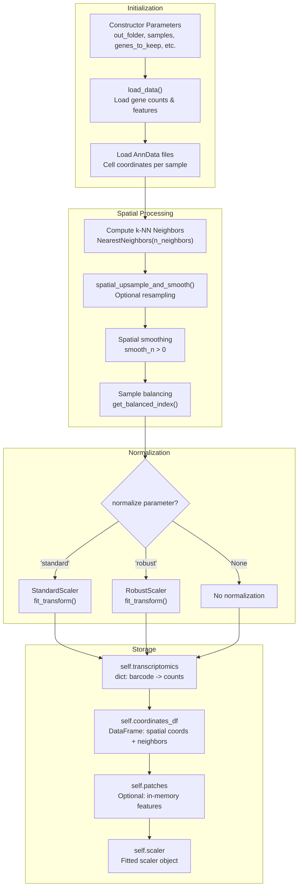
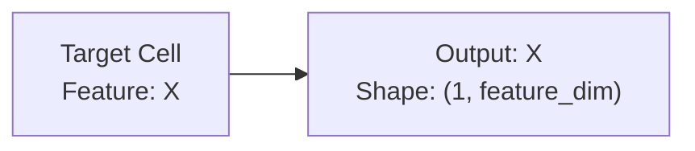
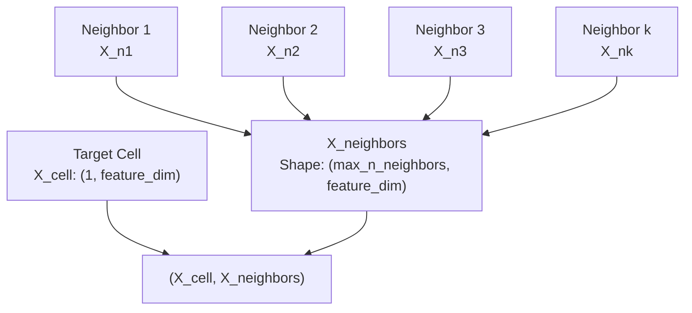
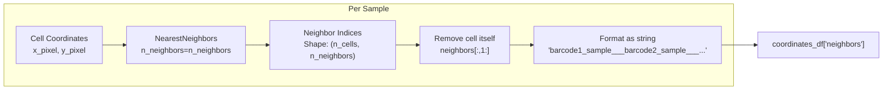
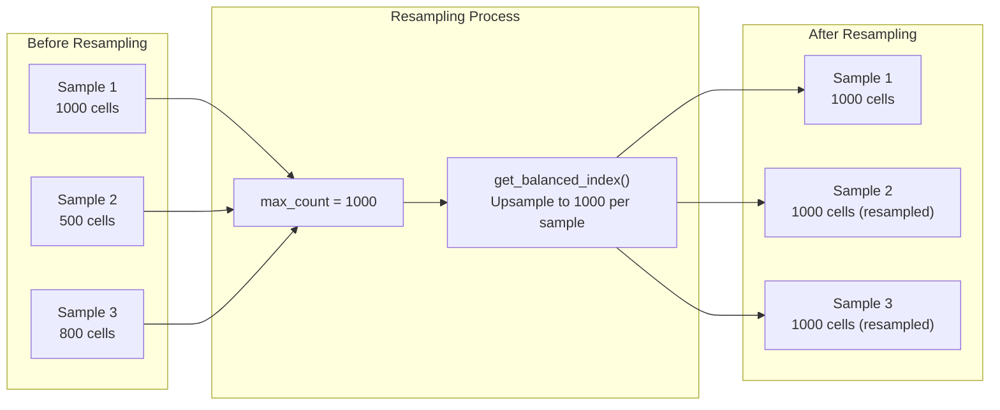
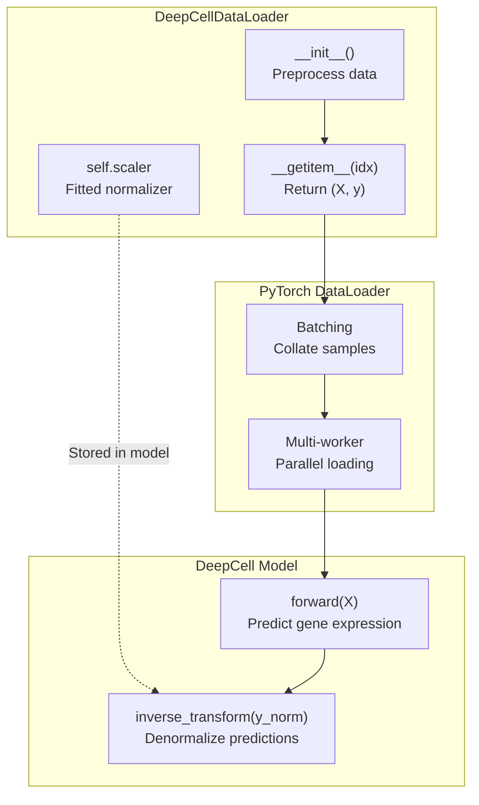

# DeepCellDataLoader

<details>
<summary>Relevant source files</summary>

The following files were used as context for generating this wiki page:

- [deepspot/cell/dataloader.py](deepspot/cell/dataloader.py)
- [example_notebook/Xenium_single-cell_example/GettingStartedWithDeepCell_1_preprocessing.ipynb](example_notebook/Xenium_single-cell_example/GettingStartedWithDeepCell_1_preprocessing.ipynb)
- [example_notebook/Xenium_single-cell_example/GettingStartedWithDeepCell_2_training_xenium.ipynb](example_notebook/Xenium_single-cell_example/GettingStartedWithDeepCell_2_training_xenium.ipynb)
- [example_notebook/Xenium_single-cell_example/GettingStartedWithDeepCell_3_inference_xenium.ipynb](example_notebook/Xenium_single-cell_example/GettingStartedWithDeepCell_3_inference_xenium.ipynb)

</details>


## Purpose and Scope

`DeepCellDataLoader` is a PyTorch `Dataset` class that loads and preprocesses cell-level spatial transcriptomics data for training the `DeepCell` model. It handles batching of image features, gene expression counts, spatial coordinates, and neighbor relationships for single-cell resolution spatial transcriptomics (e.g., Xenium data).

For spot-level data loading (e.g., Visium), see [DeepSpotDataLoader](#4.4). For underlying spatial processing utilities, see [Spatial Processing](#4.2). For general data loading functions, see [Data Loading Utilities](#4.1).

**Sources:** [deepspot/cell/dataloader.py:22-209]()

---

## Overview

`DeepCellDataLoader` manages the complete data pipeline from preprocessed cell features to training-ready batches. It performs five primary operations:

1. **Loads preprocessed data**: Reads gene expression counts and image features from disk
2. **Computes spatial neighbors**: Calculates k-nearest neighbors for each cell
3. **Applies spatial transformations**: Optionally upsamples, smooths, and resamples data
4. **Normalizes gene expression**: Applies StandardScaler or RobustScaler transformations
5. **Batches data**: Serves `(X, y)` pairs to the training loop via PyTorch's DataLoader interface

The class inherits from `torch.utils.data.Dataset` and is designed to work seamlessly with PyTorch's multi-worker data loading infrastructure.

**Sources:** [deepspot/cell/dataloader.py:22-39](), [example_notebook/Xenium_single-cell_example/GettingStartedWithDeepCell_2_training_xenium.ipynb:167-177]()

---

## Data Loading Pipeline



**Figure 1: Data Loading and Preprocessing Pipeline**

The pipeline executes sequentially during `__init__()`, with preprocessing steps applied conditionally based on constructor parameters. The fitted scaler is stored for later use during inference to ensure consistent normalization.

**Sources:** [deepspot/cell/dataloader.py:56-168]()

---

## Initialization Parameters

| Parameter | Type | Default | Description |
|-----------|------|---------|-------------|
| `out_folder` | `str` | *required* | Parent directory containing preprocessed data (`data/h5ad/`, `data/image_features/`, `data/inputX/`) |
| `samples` | `set[str]` | *required* | Set of sample IDs (slide identifiers) to load |
| `genes_to_keep` | `np.ndarray` | *required* | Boolean array indicating which genes to include for training |
| `morphology_model_name` | `str` | *required* | Name of foundation model used for image features (e.g., `'inception'`, `'uni'`, `'phikon'`) |
| `cell_diameter` | `int` | *required* | Diameter of cell patches in pixels (typically `20` for Xenium) |
| `target_sum` | `int` | `10000` | Target sum for library size normalization factor |
| `resolution` | `int` | `0` | Spatial upsampling factor (0 = no upsampling, >0 = upsample by factor) |
| `cell_context` | `str` | `'cell_neighbors'` | Context mode: `'cell'` (individual cells) or `'cell_neighbors'` (cells + neighbors) |
| `n_neighbors` | `int` | `0` | Number of nearest neighbors to compute (required if `cell_context='cell_neighbors'`) |
| `augmentation` | `str` | `'default'` | Augmentation strategy for spatial upsampling (`'default'` or `'aestetik'`) |
| `normalize` | `str` or `None` | `None` | Normalization method: `'standard'` (StandardScaler), `'robust'` (RobustScaler), or `None` |
| `scaler` | `sklearn.Scaler` or `None` | `None` | Pre-fitted scaler for inference (overrides `normalize` parameter) |
| `resample_samples` | `bool` | `False` | Whether to balance samples by resampling to match largest sample size |
| `load_image_features_in_memory` | `bool` | `False` | Whether to load all image features into RAM (faster but memory-intensive) |
| `smooth_n` | `int` | `0` | Number of neighbors for spatial smoothing (0 = no smoothing) |

**Table 1: DeepCellDataLoader Constructor Parameters**

**Sources:** [deepspot/cell/dataloader.py:23-38](), [example_notebook/Xenium_single-cell_example/GettingStartedWithDeepCell_2_training_xenium.ipynb:93-110]()

---

## File System Structure

`DeepCellDataLoader` expects a specific directory structure created during preprocessing:

```
out_folder/
├── data/
│   ├── h5ad/
│   │   ├── {sample_1}.h5ad          # AnnData with .obs['x_pixel', 'y_pixel']
│   │   └── {sample_2}.h5ad
│   ├── image_features/
│   │   └── {morphology_model_name}_{cell_diameter}/
│   │       ├── {sample_1}/
│   │       │   ├── {barcode_1}.npy  # Shape: (feature_dim,)
│   │       │   └── {barcode_2}.npy
│   │       └── {sample_2}/
│   └── inputX/
│       ├── {sample_1}.pkl           # DataFrame: barcodes x genes
│       └── {sample_2}.pkl
```

**Key Paths:**
- **AnnData files**: `{out_folder}/data/h5ad/{sample}.h5ad` - Contains cell coordinates in `.obs`
- **Image features**: `{out_folder}/data/image_features/{morphology_model_name}_{cell_diameter}/{sample}/{barcode}.npy` - Precomputed embeddings per cell
- **Gene counts**: `{out_folder}/data/inputX/{sample}.pkl` - Pandas DataFrame with expression values

**Sources:** [deepspot/cell/dataloader.py:56-60](), [deepspot/cell/dataloader.py:153](), [deepspot/cell/dataloader.py:173-178](), [example_notebook/Xenium_single-cell_example/GettingStartedWithDeepCell_1_preprocessing.ipynb:110-114]()

---

## Cell Context Modes

The `cell_context` parameter determines how spatial information is aggregated for each cell:

### Mode 1: `'cell'` (Individual Cell)

Returns only the cell's own image features without neighbor information.



**Data Shape:**
- `X`: `(1, feature_dim)` - Single cell feature vector
- `y`: `(n_genes,)` - Gene expression counts

**Sources:** [deepspot/cell/dataloader.py:186-188]()

---

### Mode 2: `'cell_neighbors'` (Cell + Neighbors)

Returns the target cell features plus features from its k-nearest neighbors, enabling the model to capture spatial context.



**Data Shape:**
- `X_cell`: `(1, feature_dim)` - Target cell features
- `X_neighbors`: `(max_n_neighbors, feature_dim)` - Stacked neighbor features (zero-padded)
- `y`: `(n_genes,)` - Gene expression counts

**Neighbor Computation:**
1. `NearestNeighbors` computes k-nearest neighbors based on pixel coordinates
2. Excludes the cell itself from the neighbor list
3. Zero-pads to `max_n_neighbors` (maximum across all cells in dataset)
4. Stores neighbor barcodes as strings: `"barcode1_sample___barcode2_sample___..."`

**Sources:** [deepspot/cell/dataloader.py:85-100](), [deepspot/cell/dataloader.py:189-203]()

---

## Neighbor Computation Details



**Figure 2: Neighbor Computation Process**

**Implementation Details:**
- Uses scikit-learn's `NearestNeighbors` with default Euclidean distance
- Fits on `(x_pixel, y_pixel)` coordinates per sample
- First neighbor is always the cell itself (excluded)
- Neighbor barcodes stored with sample suffix: `{barcode}_{sampleID}`
- Delimiter: `___` (triple underscore)

**Example:**
```python
# For cell "AAACCCAAGAAACCTA" in sample "NCBI858" with 3 neighbors:
neighbors = "AAACCCAAGAAACCAT_NCBI858___AAACCCAAGAAACGAG_NCBI858___AAACCCAAGAAACTAC_NCBI858"
```

**Sources:** [deepspot/cell/dataloader.py:85-100]()

---

## Spatial Processing Operations

### Upsampling and Smoothing

When `resolution > 0` or `smooth_n > 0`, `DeepCellDataLoader` applies spatial transformations via `spatial_upsample_and_smooth()`:

| Operation | Condition | Effect |
|-----------|-----------|--------|
| **Spatial Upsampling** | `resolution > 0` | Increases data points by factor of `resolution` using spatial interpolation |
| **Spatial Smoothing** | `smooth_n > 0` | Smooths gene expression using k-nearest neighbors (k=`smooth_n`) |

**Processing Order:**
1. Compute upsampled indices and smoothed values
2. If `smooth_n > 0`: Replace original counts with smoothed values in-place
3. If `resolution > 0`: Subset data to upsampled indices only
4. Update `coordinates_df` to match new indices

**Sources:** [deepspot/cell/dataloader.py:109-130]()

---

### Sample Resampling

When `resample_samples=True`, balances the number of cells across samples:



**Figure 3: Sample Resampling Strategy**

This prevents the model from being biased toward samples with more cells.

**Sources:** [deepspot/cell/dataloader.py:132-151]()

---

## Normalization

`DeepCellDataLoader` supports three normalization strategies:

### 1. Standard Normalization (`normalize='standard'`)

Applies `sklearn.preprocessing.StandardScaler`:
- Mean = 0
- Standard deviation = 1
- Formula: `z = (x - μ) / σ`

```python
self.scaler = StandardScaler()
transcriptomics.values[:] = self.scaler.fit_transform(transcriptomics.values)
```

**Sources:** [deepspot/cell/dataloader.py:159-161]()

---

### 2. Robust Normalization (`normalize='robust'`)

Applies `sklearn.preprocessing.RobustScaler`:
- Median = 0
- Interquartile range (IQR) = 1
- Robust to outliers
- Formula: `z = (x - median) / IQR`

```python
self.scaler = RobustScaler()
transcriptomics.values[:] = self.scaler.fit_transform(transcriptomics.values)
```

**Sources:** [deepspot/cell/dataloader.py:162-164]()

---

### 3. Pre-fitted Scaler (`scaler=<fitted_scaler>`)

For inference, pass a pre-fitted scaler from training:

```python
self.scaler.transform(transcriptomics.values)
```

**Critical for Inference:** The scaler must match the one used during training. The fitted scaler is stored in the trained `DeepCell` model and must be passed to the dataloader during inference.

**Sources:** [deepspot/cell/dataloader.py:155-156](), [example_notebook/Xenium_single-cell_example/GettingStartedWithDeepCell_2_training_xenium.ipynb:184-192]()

---

## Data Format and `__getitem__` Return Values

### Cell Mode (`cell_context='cell'`)

```python
X, y = dataloader[idx]
# X: np.ndarray, shape (1, feature_dim), dtype float32
# y: np.ndarray, shape (n_genes,), dtype float32
```

**Example:**
```python
X = array([[0.12, -0.45, 0.87, ..., 0.34]])  # Shape: (1, 2048) for Inception
y = array([0.5, 1.2, 0.0, ..., 2.3])          # Shape: (500,) for 500 genes
```

---

### Cell + Neighbors Mode (`cell_context='cell_neighbors'`)

```python
X, y = dataloader[idx]
# X: tuple of (X_cell, X_neighbors)
#   X_cell:      np.ndarray, shape (1, feature_dim), dtype float32
#   X_neighbors: np.ndarray, shape (max_n_neighbors, feature_dim), dtype float32
# y: np.ndarray, shape (n_genes,), dtype float32
```

**Example:**
```python
X_cell = array([[0.12, -0.45, 0.87, ..., 0.34]])           # Shape: (1, 2048)
X_neighbors = array([[0.22, -0.55, 0.77, ..., 0.44],       # Shape: (44, 2048)
                     [0.32, -0.65, 0.67, ..., 0.54],       # 44 neighbors
                     ...])
X = (X_cell, X_neighbors)
y = array([0.5, 1.2, 0.0, ..., 2.3])                       # Shape: (500,)
```

**Zero Padding:** If a cell has fewer than `max_n_neighbors` neighbors, the remaining rows are zero-padded.

**Sources:** [deepspot/cell/dataloader.py:180-208]()

---

## Internal Data Structures

### Class Attributes

| Attribute | Type | Description |
|-----------|------|-------------|
| `self.transcriptomics_df` | `pd.DataFrame` | Gene expression counts (normalized), indexed by `{barcode}_{sampleID}` |
| `self.transcriptomics` | `dict` | Dict mapping `{barcode}_{sampleID}` to count arrays for fast lookup |
| `self.coordinates_df` | `pd.DataFrame` | Cell coordinates with columns: `x_pixel`, `y_pixel`, `barcode`, `sampleID`, `neighbors` (if applicable) |
| `self.patches` | `dict` or `None` | If `load_image_features_in_memory=True`, maps `{barcode}_{sampleID}` to feature arrays |
| `self.scaler` | `sklearn.Scaler` or `None` | Fitted normalization scaler for inverse transform during inference |
| `self.max_n_neighbors` | `int` | Maximum number of neighbors across all cells (for zero-padding) |
| `self.image_feature_source` | `str` | Base path for image feature `.npy` files |

**Sources:** [deepspot/cell/dataloader.py:40-168]()

---

## Usage Example: Training

```python
from deepspot.cell import DeepCellDataLoader, DeepCell
import torch

# Define parameters
dataloader_params = {
    'morphology_model_name': 'inception',
    'batch_size': 1024,
    'cell_context': 'cell_neighbors',
    'cell_diameter': 20,
    'n_neighbors': 45,
    'resolution': 1,
    'normalize': 'standard',
    'augmentation': 'default'
}

samples = {'NCBI858'}
genes_to_keep = np.array([True, False, True, ...])  # Boolean mask

# Create dataset
dataset = DeepCellDataLoader(
    out_folder='example_data',
    samples=samples,
    genes_to_keep=genes_to_keep,
    **dataloader_params
)

# Create PyTorch DataLoader
dataloader = torch.utils.data.DataLoader(
    dataset=dataset,
    batch_size=1024,
    num_workers=4,
    shuffle=True
)

# Initialize model with fitted scaler
model = DeepCell(
    input_size=2048,  # Inception feature dim
    output_size=500,  # Number of genes
    scaler=dataset.scaler  # Pass fitted scaler
)

# Training loop
for X, y in dataloader:
    # X: tuple of (X_cell, X_neighbors) or just X_cell
    # y: (batch_size, n_genes)
    predictions = model(X)
    # ... compute loss and backprop
```

**Sources:** [example_notebook/Xenium_single-cell_example/GettingStartedWithDeepCell_2_training_xenium.ipynb:167-177]()

---

## Usage Example: Inference with Pre-fitted Scaler

```python
from deepspot.cell import DeepCellDataLoader, DeepCell
import torch

# Load trained model (contains fitted scaler)
model = torch.load('weights_Xenium.pkl', map_location='cpu')

# Create inference dataset with pre-fitted scaler
dataset = DeepCellDataLoader(
    out_folder='inference_data',
    samples={'new_sample'},
    genes_to_keep=genes_to_keep,
    morphology_model_name='inception',
    cell_diameter=20,
    cell_context='cell_neighbors',
    n_neighbors=45,
    scaler=model.scaler  # Use scaler from trained model
)

# Generate predictions
predictions = []
for X, y in dataset:
    with torch.no_grad():
        pred = model(X)
        predictions.append(pred)

# Important: Inverse transform to original scale
predictions = np.vstack(predictions)
predictions = model.inverse_transform(predictions)
```

**Critical Note:** Always use `model.inverse_transform()` after predictions to convert normalized values back to original scale.

**Sources:** [example_notebook/Xenium_single-cell_example/GettingStartedWithDeepCell_3_inference_xenium.ipynb:258-293]()

---

## Memory Management

### In-Memory vs. On-Disk Features

`DeepCellDataLoader` supports two modes for image feature loading:

| Mode | Parameter | Memory Usage | Speed | Use Case |
|------|-----------|--------------|-------|----------|
| **On-Disk** | `load_image_features_in_memory=False` (default) | Low | Moderate | Large datasets, limited RAM |
| **In-Memory** | `load_image_features_in_memory=True` | High | Fast | Small datasets, abundant RAM |

**On-Disk Loading** (`_load_patch()` method):
```python
X = np.load(f"{self.image_feature_source}_{self.cell_diameter}/{sampleID}/{cell_id}.npy")
```

**In-Memory Loading** (preloaded in `__init__`):
```python
X = self.patches[f"{cell_id}_{sampleID}"]
```

**Recommendation:** Use on-disk loading for datasets with >100,000 cells or when training on GPUs with limited system RAM.

**Sources:** [deepspot/cell/dataloader.py:66-68](), [deepspot/cell/dataloader.py:173-178]()

---

## Key Implementation Details

### Barcode Formatting

Barcodes are consistently formatted with sample suffixes:
```python
f"{barcode}_{sampleID}"
```

Examples:
- `"AAACCCAAGAAACCTA_NCBI858"`
- `"AAACCCAAGAAACCAT_sample_123"`

**Sources:** [deepspot/cell/dataloader.py:102](), [deepspot/cell/dataloader.py:205]()

---

### Zero Padding for Neighbors

Ensures all neighbor feature arrays have identical shapes:

```python
from deepspot.utils.utils_dataloader import add_zero_padding

X_neighbors = add_zero_padding(X_neighbors, self.max_n_neighbors)
# Input:  (n_actual_neighbors, feature_dim)
# Output: (max_n_neighbors, feature_dim)  # Zero-padded
```

**Sources:** [deepspot/cell/dataloader.py:202]()

---

### Dataset Length

```python
def __len__(self):
    return len(self.coordinates_df)
```

Returns the number of cells after all preprocessing (upsampling, resampling, etc.).

**Sources:** [deepspot/cell/dataloader.py:169-171]()

---

## Relationship to DeepCell Model



**Figure 4: Integration with DeepCell Training Pipeline**

The fitted scaler from `DeepCellDataLoader` is passed to `DeepCell` during initialization and stored for later inverse transformations.

**Sources:** [example_notebook/Xenium_single-cell_example/GettingStartedWithDeepCell_2_training_xenium.ipynb:214-218]()

---

## Differences from DeepSpotDataLoader

| Feature | DeepCellDataLoader | DeepSpotDataLoader |
|---------|-------------------|-------------------|
| **Resolution** | Cell-level (~20μm) | Spot-level (~55μm) |
| **Sub-tiling** | No mini-tiles | 3×3 mini-tiles (subspots) |
| **Context Modes** | `'cell'`, `'cell_neighbors'` | `'spot'`, `'subspot'`, `'neighbors'`, `'subspot_neighbors'` |
| **Typical `n_neighbors`** | 45 | Radius-based (default radius=1) |
| **Typical Genes** | 500 HVGs | 300-800 HVGs |
| **Feature File Structure** | `{barcode}.npy` per cell | `{barcode}.npy` with shape `(10, feature_dim)` for 9 subspots |
| **Use Case** | Xenium, MERFISH | Visium, ST |

For spot-level data loading details, see [DeepSpotDataLoader](#4.4).

**Sources:** [deepspot/cell/dataloader.py:22-209](), [example_notebook/Xenium_single-cell_example/GettingStartedWithDeepCell_2_training_xenium.ipynb:93-110]()

---

## Common Issues and Solutions

### Issue 1: Scaler Mismatch During Inference

**Problem:** Predictions are on wrong scale because scaler was not passed during inference.

**Solution:**
```python
# During training - save the scaler
torch.save(model, 'model.pkl')  # Scaler is stored in model.scaler

# During inference - load and use the same scaler
model = torch.load('model.pkl')
dataset = DeepCellDataLoader(..., scaler=model.scaler)

# Always inverse transform predictions
predictions = model.inverse_transform(predictions)
```

**Sources:** [example_notebook/Xenium_single-cell_example/GettingStartedWithDeepCell_3_inference_xenium.ipynb:273-293]()

---

### Issue 2: Neighbors Not Computed

**Problem:** `cell_context='cell_neighbors'` but `n_neighbors=0` or not set.

**Solution:** Always set `n_neighbors` when using neighbor context:
```python
dataset = DeepCellDataLoader(
    ...,
    cell_context='cell_neighbors',
    n_neighbors=45  # Must be > 0
)
```

**Sources:** [deepspot/cell/dataloader.py:85-100]()

---

### Issue 3: Feature Files Not Found

**Problem:** `FileNotFoundError` when loading `.npy` files.

**Solution:** Ensure preprocessing created feature files in the correct structure:
```
out_folder/data/image_features/{morphology_model_name}_{cell_diameter}/{sample}/{barcode}.npy
```

Verify with:
```python
import glob
files = glob.glob(f"{out_folder}/data/image_features/{model}_{diameter}/{sample}/*")
print(f"Found {len(files)} feature files")
```

**Sources:** [deepspot/cell/dataloader.py:173-178](), [example_notebook/Xenium_single-cell_example/GettingStartedWithDeepCell_1_preprocessing.ipynb:288-307]()

---

## Performance Considerations

### Multi-Worker Data Loading

Use PyTorch's `num_workers` for parallel data loading:

```python
dataloader = torch.utils.data.DataLoader(
    dataset=dataset,
    batch_size=1024,
    num_workers=4,  # Parallel workers
    shuffle=True,
    pin_memory=True  # Faster GPU transfer
)
```

**Recommendation:** Set `num_workers = torch.get_num_threads() - 1`

**Sources:** [example_notebook/Xenium_single-cell_example/GettingStartedWithDeepCell_2_training_xenium.ipynb:113]()

---

### Batch Size Guidelines

| Dataset Size | Recommended Batch Size | Memory (GPU) |
|--------------|------------------------|--------------|
| <10,000 cells | 512-1024 | ~4 GB |
| 10,000-100,000 cells | 1024-2048 | ~8 GB |
| >100,000 cells | 2048-4096 | ~16 GB |

Larger batches improve training stability but require more GPU memory.

**Sources:** [example_notebook/Xenium_single-cell_example/GettingStartedWithDeepCell_2_training_xenium.ipynb:97]()

---