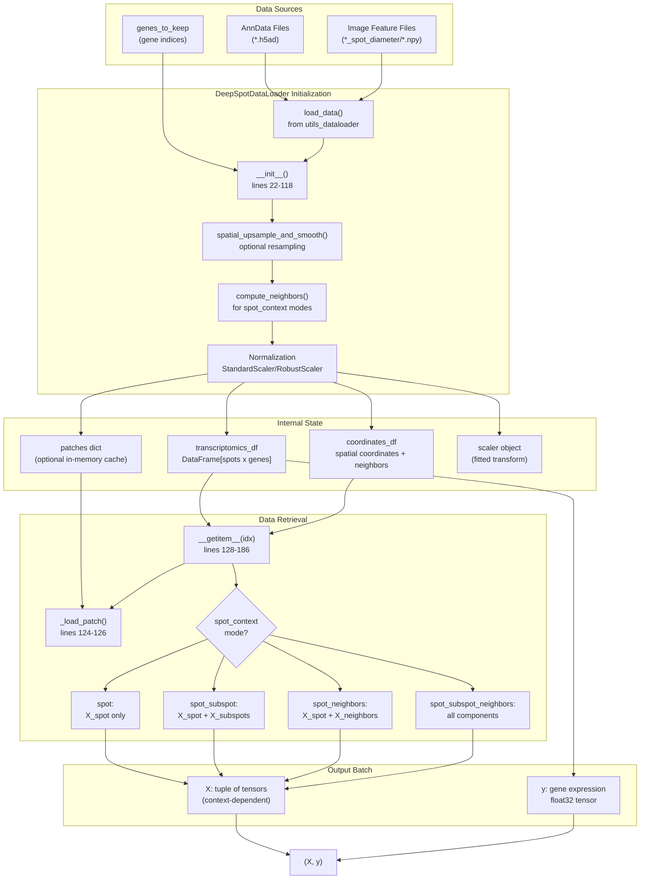
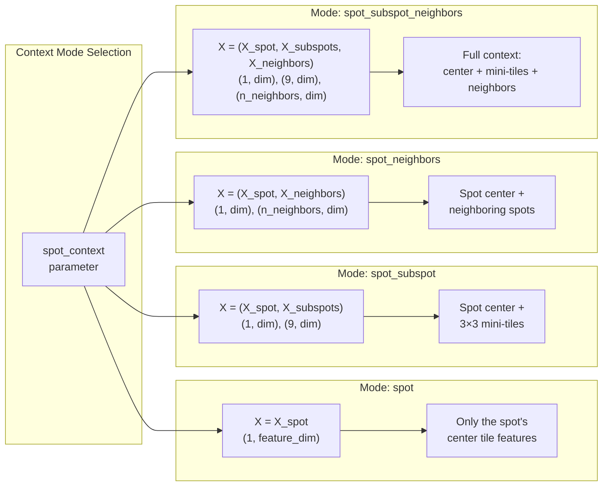
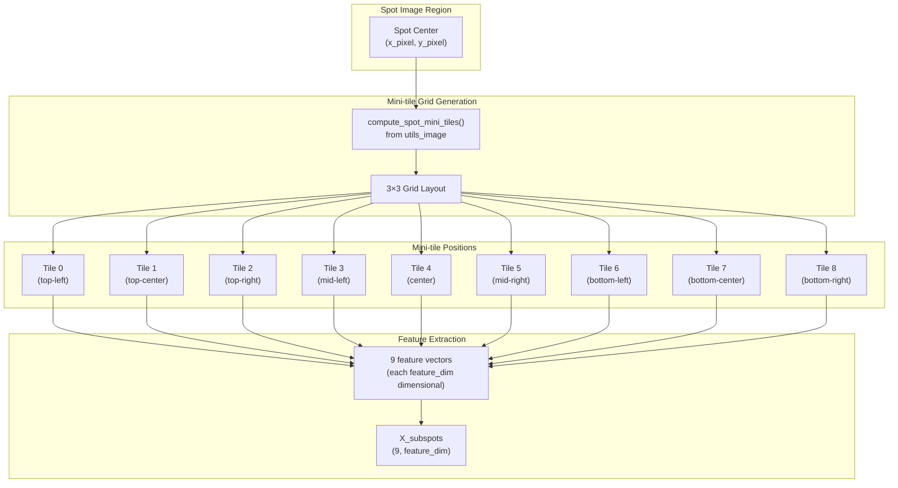
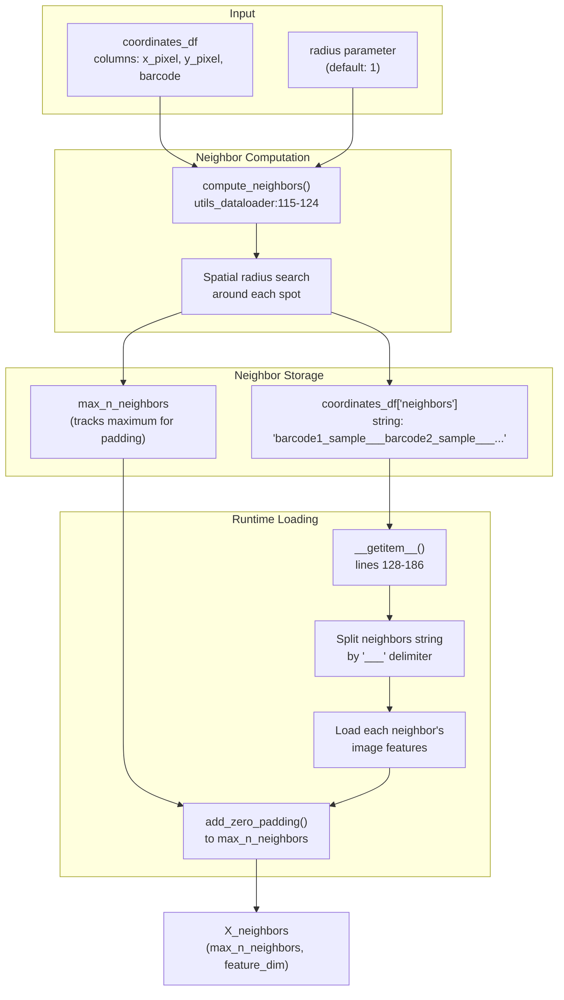
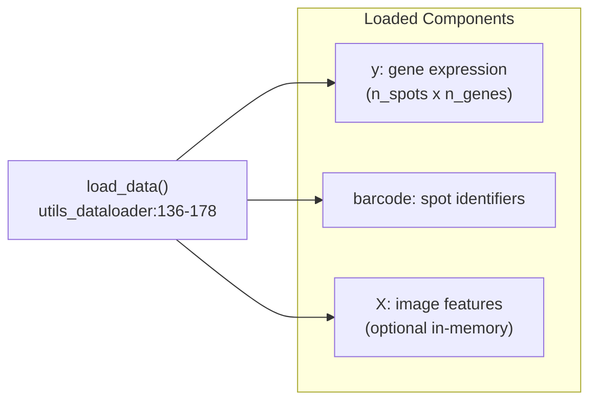
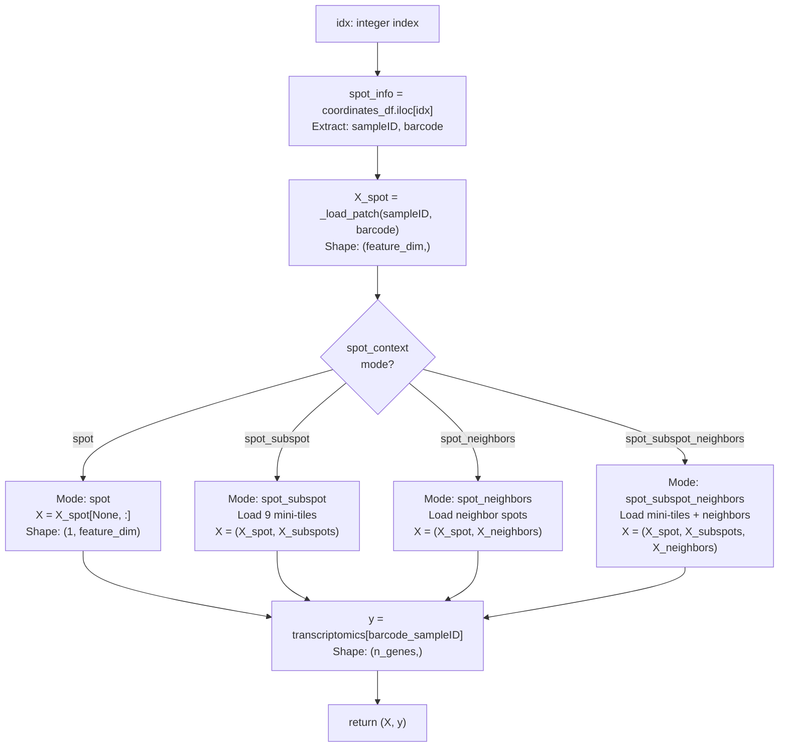
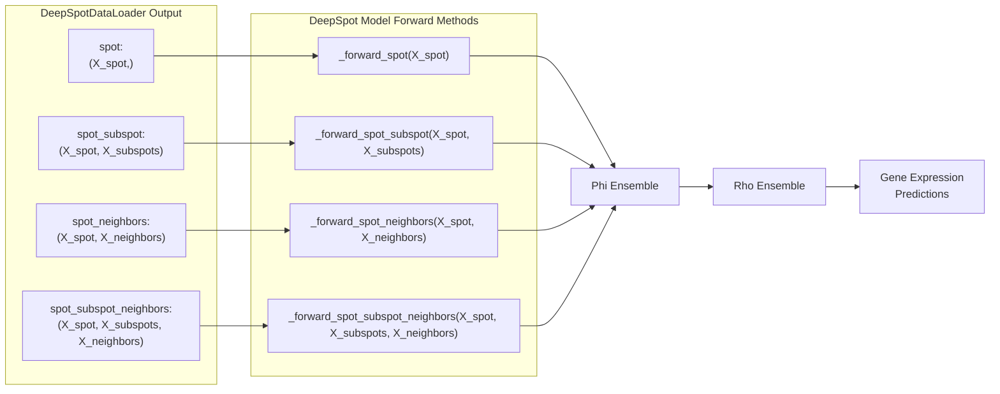

# DeepSpotDataLoader

<details>
<summary>Relevant source files</summary>

The following files were used as context for generating this wiki page:

- [.codeboarding/Data Management & Preprocessing.md](.codeboarding/Data Management & Preprocessing.md)
- [deepspot/cell/dataloader.py](deepspot/cell/dataloader.py)

</details>


## Purpose and Scope

The `DeepSpotDataLoader` class provides batch loading and preprocessing functionality for spot-level spatial transcriptomics data (primarily Visium technology). It handles loading gene expression counts, image features, spatial coordinates, and neighbor information for training and inference with the `DeepSpot` model. This data loader supports multiple spot context modes including individual spots, sub-spot tiles, neighbor aggregation, and combinations thereof.

For cell-level data loading, see [DeepCellDataLoader](#4.3). For general data preprocessing utilities, see [Spatial Processing](#4.2).

**Sources:** [deepspot/spot/dataloader.py:21-186](), [.codeboarding/Data Management & Preprocessing.md]()

---

## Overview

`DeepSpotDataLoader` extends PyTorch's `Dataset` class to provide specialized data batching for Visium spot-level spatial transcriptomics. Each Visium spot has a diameter of approximately 55μm and may contain multiple cells. The data loader implements a preprocessing pipeline that:

1. Loads gene expression counts and image features from disk
2. Applies spatial upsampling and smoothing operations
3. Computes spot neighbors based on spatial coordinates
4. Divides spots into 3×3 mini-tiles (sub-spots) for finer spatial resolution
5. Normalizes gene expression using standard or robust scaling
6. Prepares data in formats compatible with four different spot context modes



**Diagram: DeepSpotDataLoader Data Flow Pipeline**

**Sources:** [deepspot/spot/dataloader.py:21-186](), [deepspot/utils/utils_dataloader.py:68-101](), [deepspot/utils/utils_dataloader.py:136-178]()

---

## Initialization Parameters

The `DeepSpotDataLoader.__init__()` method accepts the following parameters to configure data loading and preprocessing behavior:

| Parameter | Type | Description |
|-----------|------|-------------|
| `out_folder` | str | Root directory containing preprocessed data (h5ad files and image features) |
| `samples` | list[str] | List of sample identifiers to load |
| `genes_to_keep` | array-like | Indices of genes to use for prediction (e.g., highly variable genes) |
| `morphology_model_name` | str | Foundation model name (e.g., "uni", "hoptimus0", "phikon") |
| `spot_diameter` | float | Spot diameter in pixels for image feature extraction |
| `target_sum` | int | Target sum for library size normalization (default: 10000) |
| `resolution` | int | Spatial upsampling resolution factor (default: 0 = no upsampling) |
| `spot_context` | str | Context mode: "spot", "spot_subspot", "spot_neighbors", "spot_subspot_neighbors" |
| `radius` | int | Neighbor search radius for spatial connectivity (default: 1) |
| `augmentation` | str | Augmentation strategy for spatial smoothing: "default" or "aestetik" |
| `normalize` | str/None | Normalization method: None, "standard", or "robust" |
| `scaler` | object/None | Pre-fitted scaler object for applying existing transformation |
| `resample_samples` | bool | Whether to balance sample sizes via resampling (default: False) |
| `load_image_features_in_memory` | bool | Cache all image features in RAM (default: False) |
| `smooth_n` | int | Number of spatial neighbors for smoothing (default: 0 = no smoothing) |

**Sources:** [deepspot/spot/dataloader.py:22-118](), [deepspot/cell/dataloader.py:23-38]()

---

## Spot Context Modes

Unlike `DeepCellDataLoader` which supports two context modes, `DeepSpotDataLoader` implements four distinct context modes that determine which spatial information is provided to the model:



**Diagram: Spot Context Mode Branching Logic**

### Context Mode Details

| Mode | Components | Tensor Shapes | Use Case |
|------|-----------|---------------|----------|
| `"spot"` | X_spot only | (1, feature_dim) | Baseline: no spatial context |
| `"spot_subspot"` | X_spot + X_subspots | (1, dim), (9, dim) | Sub-spot heterogeneity without neighbors |
| `"spot_neighbors"` | X_spot + X_neighbors | (1, dim), (n_neighbors, dim) | Spatial context without sub-resolution |
| `"spot_subspot_neighbors"` | X_spot + X_subspots + X_neighbors | (1, dim), (9, dim), (n_neighbors, dim) | Full spatial and sub-spot resolution |

The choice of context mode is determined at initialization and affects:
- The structure of the returned `X` tuple in `__getitem__()`
- Which forward pass method is called in `DeepSpot` model (see [DeepSpot Model](#5.2))
- Memory requirements during training

**Sources:** [deepspot/spot/dataloader.py:128-186]()

---

## Mini-tile Processing (Sub-spots)

A key distinction of `DeepSpotDataLoader` is its support for mini-tile decomposition. Each Visium spot can be subdivided into a 3×3 grid of "sub-spots" to capture intra-spot morphological heterogeneity. This is particularly important because:

1. Visium spots (~55μm diameter) typically contain 1-10 cells
2. Gene expression within a spot may arise from morphologically distinct regions
3. Foundation models extract features from fixed-size image tiles



**Diagram: Mini-tile Decomposition of Visium Spots**

During preprocessing (see [Visium Preprocessing](#7.1.1)), mini-tile features are pre-extracted and stored as `.npy` files with naming convention: `{sample}/{spot_barcode}_minitile_{0-8}.npy`. The data loader loads these pre-computed features rather than computing mini-tiles on-the-fly.

**Sources:** [deepspot/spot/dataloader.py:128-186]()

---

## Neighbor Computation

When `spot_context` includes "neighbors", the data loader computes spatial neighbors using `compute_neighbors()` from `utils_dataloader.py`. The neighbor computation differs from `DeepCellDataLoader` in two ways:

1. **Distance-based radius**: Uses `radius` parameter instead of `n_neighbors`
2. **Hexagonal spot layout**: Visium spots are arranged in a hexagonal grid with specific neighbor patterns



**Diagram: Neighbor Loading and Padding Pipeline**

The `radius=1` setting for Visium typically captures 6 neighbors in a hexagonal pattern (first-order neighbors). Higher radius values expand the neighborhood but increase computational cost.

**Sources:** [deepspot/spot/dataloader.py:128-186](), [deepspot/utils/utils_dataloader.py:115-124](), [deepspot/utils/utils_dataloader.py:104-112]()

---

## Data Preprocessing Pipeline

The initialization sequence performs the following preprocessing steps:

### 1. Data Loading


Calls `load_data()` to aggregate data across all samples specified in the `samples` parameter. Loads AnnData files from `{out_folder}/data/h5ad/{sample}.h5ad` and optionally loads image features from `{out_folder}/data/image_features/{morphology_model_name}_{spot_diameter}/`.

### 2. Gene Filtering
Subsets gene expression to only the genes specified in `genes_to_keep`:
```
y = data["y"][:, self.genes_to_keep]
```

### 3. Coordinate Processing
For each sample, loads spatial coordinates from AnnData `.obs` and constructs a unified `coordinates_df` with columns: `x_pixel`, `y_pixel`, `barcode`, `sampleID`, and (optionally) `neighbors`.

### 4. Spatial Upsampling and Smoothing (Optional)
If `resolution > 0` or `smooth_n > 0`, applies `spatial_upsample_and_smooth()`:

| Operation | Condition | Effect |
|-----------|-----------|--------|
| Smoothing | `smooth_n > 0` | Averages expression with `smooth_n` spatial neighbors |
| Upsampling | `resolution > 0` | Increases spot density by `resolution` factor |

Upsampling generates synthetic spots between existing spots, useful for data augmentation.

### 5. Sample Rebalancing (Optional)
If `resample_samples=True`, balances the number of spots per sample by randomly resampling to match the largest sample size.

### 6. Normalization
Applies gene expression normalization based on the `normalize` parameter:

| Setting | Method | Scaler Class |
|---------|--------|--------------|
| `None` | No normalization | - |
| `"standard"` | Z-score standardization | `StandardScaler` |
| `"robust"` | Median/IQR scaling | `RobustScaler` |
| Pre-fitted scaler | Apply existing transform | User-provided |

The fitted scaler is stored in `self.scaler` for later use during inference.

**Sources:** [deepspot/spot/dataloader.py:22-118](), [deepspot/utils/utils_dataloader.py:136-178](), [deepspot/utils/utils_dataloader.py:68-101]()

---

## Data Retrieval (`__getitem__`)

The `__getitem__(idx)` method is called by PyTorch's DataLoader to retrieve a single training sample. The implementation at [deepspot/spot/dataloader.py:128-186]() follows this logic:



**Diagram: __getitem__ Execution Flow**

### Patch Loading

The `_load_patch(sampleID, barcode)` method at [deepspot/spot/dataloader.py:124-126]() handles loading image features:

- **In-memory mode** (`load_image_features_in_memory=True`): Retrieves from `self.patches` dictionary
- **On-disk mode**: Loads from `.npy` file at `{image_feature_source}_{spot_diameter}/{sampleID}/{barcode}.npy`

For sub-spots, the barcode is suffixed with `_minitile_{i}` where `i ∈ [0, 8]`.

### Neighbor Loading

When loading neighbors:
1. Parse `spot_info.neighbors` string by splitting on `"___"` delimiter
2. Extract barcode and sample ID from each neighbor identifier
3. Call `_load_patch()` for each neighbor
4. Stack neighbor features into array of shape `(n_neighbors, feature_dim)`
5. Apply zero-padding via `add_zero_padding()` to reach `max_n_neighbors` dimension

**Sources:** [deepspot/spot/dataloader.py:128-186](), [deepspot/spot/dataloader.py:124-126](), [deepspot/utils/utils_dataloader.py:104-112]()

---

## Comparison with DeepCellDataLoader

The following table highlights key differences between the spot-level and cell-level data loaders:

| Aspect | DeepSpotDataLoader | DeepCellDataLoader |
|--------|-------------------|-------------------|
| **Target technology** | Visium (spot-level) | Xenium (single-cell) |
| **Spatial resolution** | ~55μm spots | ~20μm cells |
| **Context modes** | 4: spot, spot_subspot, spot_neighbors, spot_subspot_neighbors | 2: cell, cell_neighbors |
| **Mini-tiles** | Yes (3×3 grid per spot) | No |
| **Neighbor parameter** | `radius` (distance-based) | `n_neighbors` (k-nearest) |
| **Typical neighbor count** | 6-12 (radius=1) | 45 (default) |
| **Gene count** | 300-800 HVGs | 500 HVGs |
| **Implementation file** | [deepspot/spot/dataloader.py:21-186]() | [deepspot/cell/dataloader.py:22-208]() |

**Sources:** [deepspot/spot/dataloader.py:21-186](), [deepspot/cell/dataloader.py:22-208]()

---

## Usage Pattern

The typical initialization pattern for `DeepSpotDataLoader`:

```python
# Example initialization (not actual code, for reference only)
from deepspot.spot.dataloader import DeepSpotDataLoader

dataloader = DeepSpotDataLoader(
    out_folder="/path/to/preprocessed/data",
    samples=["sample1", "sample2", "sample3"],
    genes_to_keep=hvg_indices,  # e.g., np.arange(500)
    morphology_model_name="uni",
    spot_diameter=128,
    target_sum=10000,
    spot_context="spot_subspot_neighbors",  # Full context mode
    radius=1,  # First-order neighbors
    normalize="standard",
    smooth_n=0,
    resolution=0,
    load_image_features_in_memory=False
)

# Use with PyTorch DataLoader
from torch.utils.data import DataLoader
train_loader = DataLoader(
    dataloader,
    batch_size=32,
    shuffle=True,
    num_workers=4
)

# Training loop retrieves (X, y) tuples
for X, y in train_loader:
    # X is tuple of tensors based on spot_context
    # y is gene expression tensor of shape (batch_size, n_genes)
    pass
```

For complete workflow examples, see [Visium Training](#7.1.2) and [Visium Preprocessing](#7.1.1).

**Sources:** [deepspot/spot/dataloader.py:21-186]()

---

## Integration with DeepSpot Model

The data loader's output format is designed to work seamlessly with the `DeepSpot` model's forward pass methods:



**Diagram: Data Loader to Model Integration**

The `spot_context` parameter must match the model's expected input format during training and inference. See [DeepSpot Model](#5.2) for details on forward pass implementations.

**Sources:** [deepspot/spot/dataloader.py:128-186]()

---