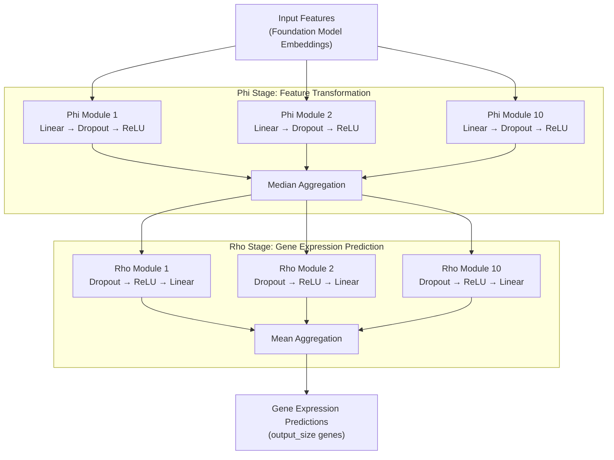
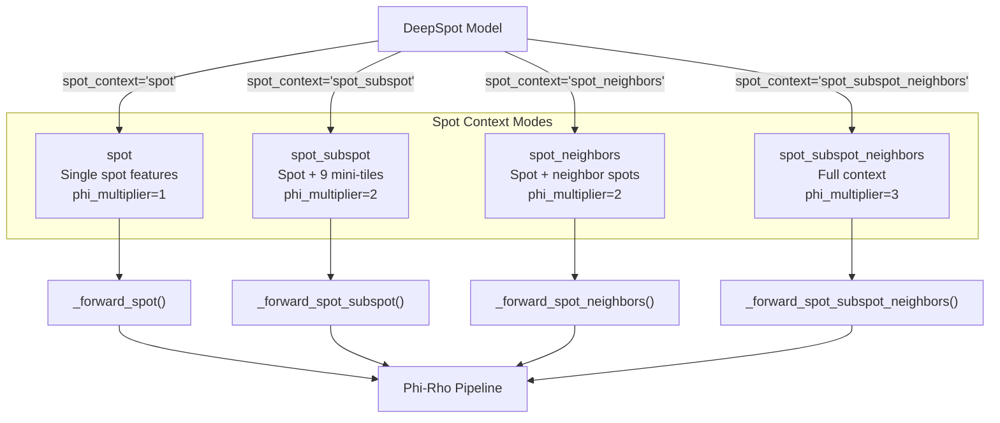
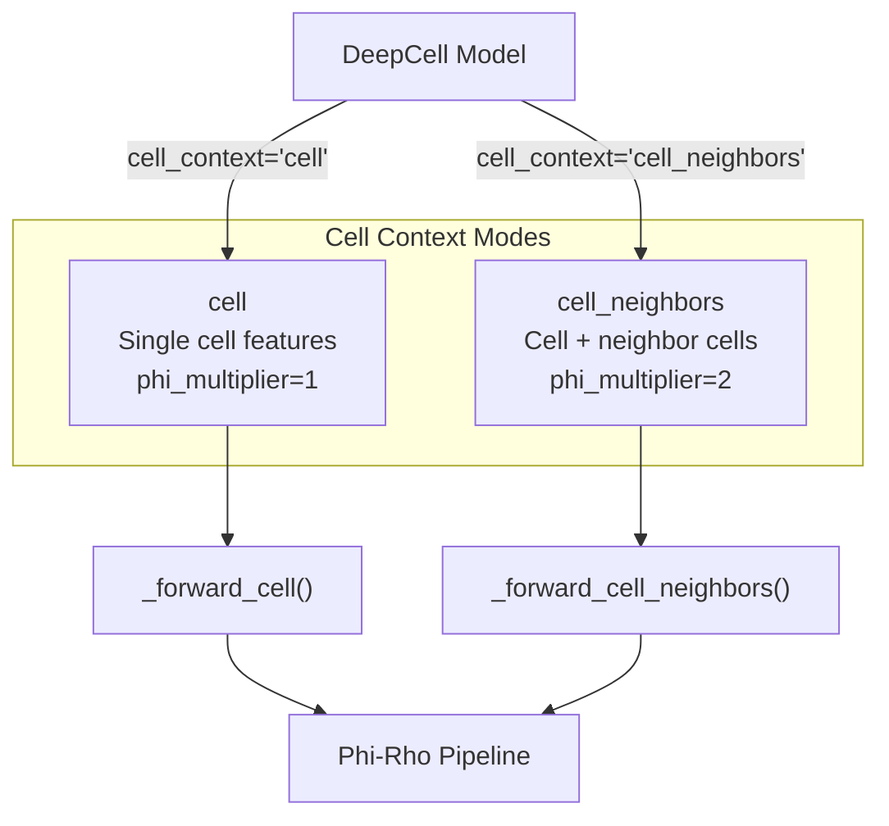
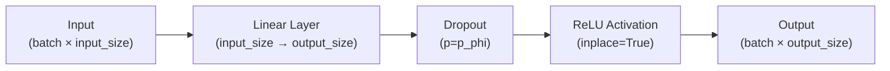
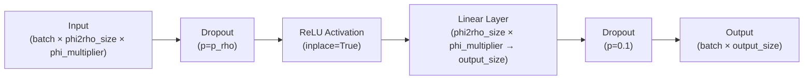
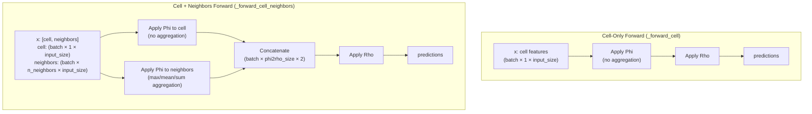
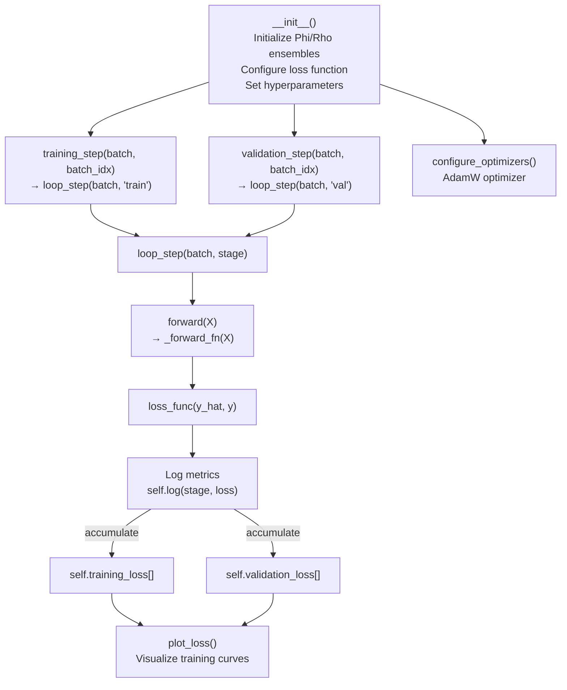
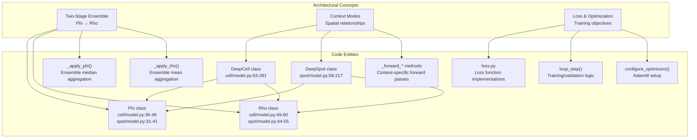

# Model Architecture

<details>
<summary>Relevant source files</summary>

The following files were used as context for generating this wiki page:

- [.codeboarding/DeepSpot Models.md](.codeboarding/DeepSpot Models.md)
- [deepspot/cell/model.py](deepspot/cell/model.py)

</details>


## Purpose and Scope

This page provides an in-depth overview of the neural network architecture shared by both `DeepCell` and `DeepSpot` models. It covers the two-stage Phi-Rho ensemble design, context modes for handling spatial relationships, and the training lifecycle. For detailed documentation of individual model classes, see [DeepCell Model](#5.1) and [DeepSpot Model](#5.2). For the underlying neural layer implementations, see [Phi and Rho Neural Layers](#5.3). For optimization objectives, see [Loss Functions](#5.4).

---

## Architectural Overview

Both `DeepCell` and `DeepSpot` implement a two-stage ensemble architecture consisting of **Phi modules** for feature transformation and **Rho modules** for final prediction. This design follows a deep-set architecture pattern that enables the models to process variable-sized inputs (e.g., spots with different numbers of sub-tiles or neighbors) while maintaining permutation invariance.

### Two-Stage Ensemble Architecture



**Sources:** [deepspot/cell/model.py:36-60](), [deepspot/cell/model.py:125-127](), [deepspot/cell/model.py:190-214]()

### Key Architectural Properties

| Component | Purpose | Aggregation | Count |
|-----------|---------|-------------|-------|
| **Phi Modules** | Transform input features to intermediate representation | Median across ensemble | 10 (default, configurable via `n_ensemble_phi`) |
| **Rho Modules** | Transform Phi output to gene expression predictions | Mean across ensemble | 10 (default, configurable via `n_ensemble_rho`) |
| **Input Size** | Foundation model embedding dimension | N/A | 1024 (UNI), 1536 (Hoptimus0), 768 (Phikon), 2048 (Inception) |
| **Phi Output** | Intermediate representation dimension | N/A | 1024 (default, configurable via `phi2rho_size`) |
| **Output Size** | Number of genes to predict | N/A | 300-800 (Visium), 500 (Xenium) |

**Sources:** [deepspot/cell/model.py:64-81]()

---

## Model Variants and Context Modes

The architecture supports two model variants operating at different spatial resolutions, each with multiple context modes for incorporating spatial information.

### DeepSpot Context Modes



**Sources:** [deepspot/spot/model.py:110-126](), [deepspot/spot/model.py:163-187]()

### DeepCell Context Modes



**Sources:** [deepspot/cell/model.py:130-142](), [deepspot/cell/model.py:179-188]()

### Context Mode Comparison

| Model | Context Mode | Description | Phi Multiplier | Forward Function |
|-------|--------------|-------------|----------------|------------------|
| **DeepSpot** | `spot` | Individual spot only | 1 | `_forward_spot()` |
| **DeepSpot** | `spot_subspot` | Spot + 9 mini-tiles (3×3 grid) | 2 | `_forward_spot_subspot()` |
| **DeepSpot** | `spot_neighbors` | Spot + neighboring spots | 2 | `_forward_spot_neighbors()` |
| **DeepSpot** | `spot_subspot_neighbors` | Spot + mini-tiles + neighbors (full) | 3 | `_forward_spot_subspot_neighbors()` |
| **DeepCell** | `cell` | Individual cell only | 1 | `_forward_cell()` |
| **DeepCell** | `cell_neighbors` | Cell + neighboring cells | 2 | `_forward_cell_neighbors()` |

The `phi_multiplier` determines the input dimension to Rho modules: `phi2rho_size × phi_multiplier`. This accommodates concatenated Phi outputs from multiple spatial contexts.

**Sources:** [deepspot/cell/model.py:130-135](), [deepspot/spot/model.py:110-117]()

---

## Component-Level Architecture

### Phi Module Design

The `Phi` class implements feature transformation with the following structure:



**Implementation Details:**
- **Input Size**: Foundation model embedding dimension (e.g., 1024 for UNI)
- **Output Size**: Configurable via `phi2rho_size` parameter (default: 1024)
- **Dropout Rate**: Configurable via `p_phi` parameter (default: 0.2)
- **Activation**: ReLU with in-place operation for memory efficiency

**Ensemble Aggregation:**
For each input, all Phi modules in the ensemble process it independently. The median value across the ensemble is selected for each feature dimension, providing robustness to outlier predictions.

**Sources:** [deepspot/cell/model.py:36-46](), [deepspot/cell/model.py:190-209]()

### Rho Module Design

The `Rho` class implements final gene expression prediction:



**Implementation Details:**
- **Input Size**: `phi2rho_size × phi_multiplier` (e.g., 1024×2 = 2048 for `cell_neighbors` mode)
- **Output Size**: Number of genes to predict (e.g., 500 for Xenium)
- **Dropout Rates**: Configurable `p_rho` before activation (default: 0.2), fixed 0.1 after linear layer
- **Activation**: ReLU with in-place operation

**Ensemble Aggregation:**
The mean of all Rho module outputs is computed, providing a stable final prediction by averaging over the ensemble.

**Sources:** [deepspot/cell/model.py:49-60](), [deepspot/cell/model.py:211-214]()

---

## Forward Pass Mechanisms

### Spatial Context Processing

Different context modes process spatial information differently through the Phi-Rho pipeline:



**Neighbor Aggregation Strategies:**
The `agg_neighbors` parameter (default: `"max"`) controls how neighbor features are aggregated after Phi transformation:
- **`max`**: Takes maximum value across neighbors for each feature dimension
- **`mean`**: Computes mean across neighbors
- **`sum`**: Sums neighbor features

**Sources:** [deepspot/cell/model.py:179-188](), [deepspot/cell/model.py:109-115]()

### Spot Context Processing

DeepSpot extends this pattern to support sub-spot tiles:

| Forward Function | Inputs | Phi Applications | Concatenation |
|------------------|--------|-----------------|---------------|
| `_forward_spot()` | `x` (spot features) | Spot through `phi_spot` | Single Phi output |
| `_forward_spot_subspot()` | `[x_spot, x_subspot]` | Spot through `phi_spot`, subspots through `phi_subspot` | 2 Phi outputs |
| `_forward_spot_neighbors()` | `[x_spot, x_neighbors]` | Spot through `phi_spot`, neighbors through `phi_spot` (aggregated) | 2 Phi outputs |
| `_forward_spot_subspot_neighbors()` | `[x_spot, x_subspot, x_neighbors]` | Spot through `phi_spot`, subspots through `phi_subspot`, neighbors through `phi_spot` (aggregated) | 3 Phi outputs |

**Sources:** [deepspot/spot/model.py:163-187]()

---

## Training Lifecycle

Both models inherit from `lightning.LightningModule` and implement standard PyTorch Lightning training patterns:



**Sources:** [deepspot/cell/model.py:144-168](), [deepspot/cell/model.py:216-218](), [deepspot/cell/model.py:235-281]()

### Key Training Components

| Component | Implementation | Configuration |
|-----------|----------------|---------------|
| **Optimizer** | `torch.optim.AdamW` | `lr` (default: 1e-4), `weight_decay` (default: 1e-6) |
| **Loss Function** | Configurable via `loss_func` parameter | See [Loss Functions](#5.4) for available options |
| **Loss Tracking** | `self.training_loss` and `self.validation_loss` lists | Populated during `loop_step()` |
| **Visualization** | `plot_loss()` method | Exponentially smoothed training curves with original overlays |
| **Random Seed** | `fix_seed(random_seed)` | Ensures reproducibility (default: 2024) |

**Sources:** [deepspot/cell/model.py:64-81](), [deepspot/cell/model.py:88-107](), [deepspot/cell/model.py:216-218]()

---

## Initialization Parameters

### Shared Parameters (DeepCell and DeepSpot)

```python
# Core architecture parameters
input_size: int           # Foundation model embedding dimension
output_size: int          # Number of genes to predict
phi2rho_size: int = 1024  # Intermediate representation size
emb_size: int = 1024      # (Deprecated, maintained for compatibility)

# Ensemble configuration
n_ensemble: int = 10           # Default ensemble size
n_ensemble_phi: int = None     # Phi ensemble size (defaults to n_ensemble)
n_ensemble_rho: int = None     # Rho ensemble size (defaults to n_ensemble)

# Regularization
p: float = 0.2                 # Default dropout probability
p_phi: float = None            # Phi dropout (defaults to p)
p_rho: float = None            # Rho dropout (defaults to p)

# Training configuration
loss_func: str = "mse"         # Loss function identifier
lr: float = 1e-4               # Learning rate
weight_decay: float = 1e-6     # AdamW weight decay
random_seed: int = 2024        # Random seed for reproducibility

# Data processing
scaler = None                  # Optional scaler for inverse transforms
```

### DeepCell-Specific Parameters

```python
cell_context: str = 'cell_neighbors'  # Context mode: 'cell' or 'cell_neighbors'
agg_neighbors: str = "max"            # Neighbor aggregation: 'max', 'mean', or 'sum'
```

**Sources:** [deepspot/cell/model.py:64-81]()

### DeepSpot-Specific Parameters

```python
spot_context: str = 'spot_subspot_neighbors'  # Context mode (4 options)
agg_neighbors: str = "max"                    # Neighbor aggregation
```

**Sources:** [deepspot/spot/model.py:59-83]()

---

## Code-to-Architecture Mapping

This diagram maps architectural concepts to their implementations:



**Sources:** [deepspot/cell/model.py:36-281](), [deepspot/spot/model.py:31-217]()

---

## Summary

The DeepSpot architecture implements a flexible two-stage ensemble design that supports multiple spatial context modes for both spot-level and cell-level spatial transcriptomics prediction:

- **Phi Stage**: Transforms input features through 10 parallel modules with median aggregation for robustness
- **Rho Stage**: Generates final predictions through 10 parallel modules with mean aggregation for stability
- **Context Modes**: Enable incorporation of spatial relationships (sub-tiles, neighbors) while maintaining a unified architecture
- **Training**: Leverages PyTorch Lightning for standardized training loops with configurable loss functions and AdamW optimization

For implementation details of specific model variants, see [DeepCell Model](#5.1) and [DeepSpot Model](#5.2). For neural layer internals, see [Phi and Rho Neural Layers](#5.3). For optimization objectives, see [Loss Functions](#5.4).

---