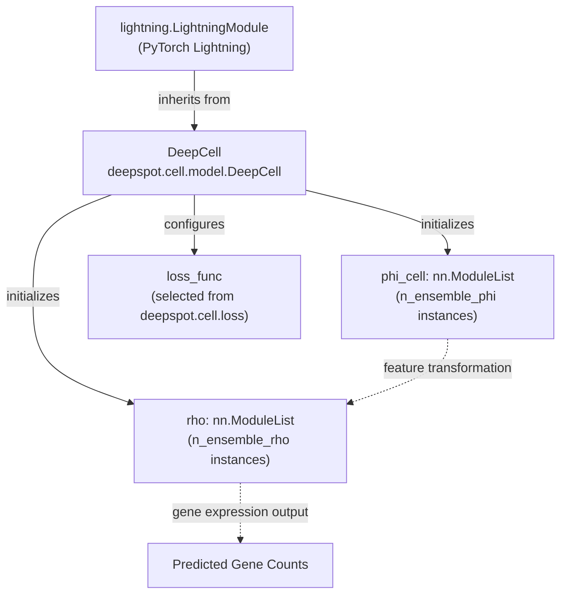
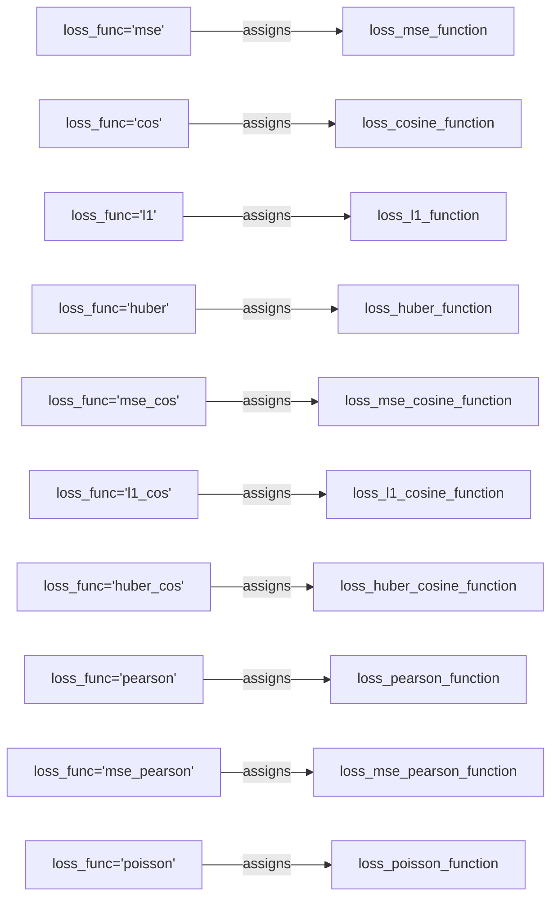
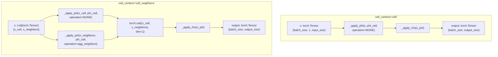
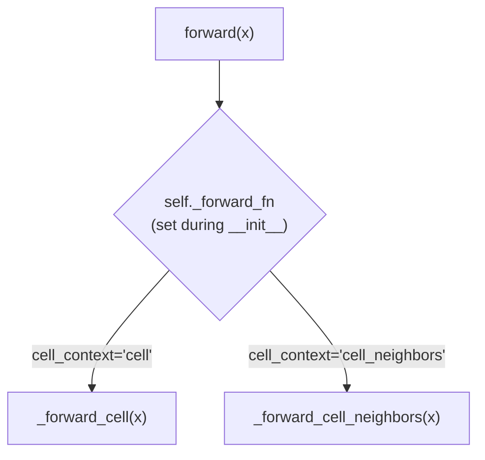
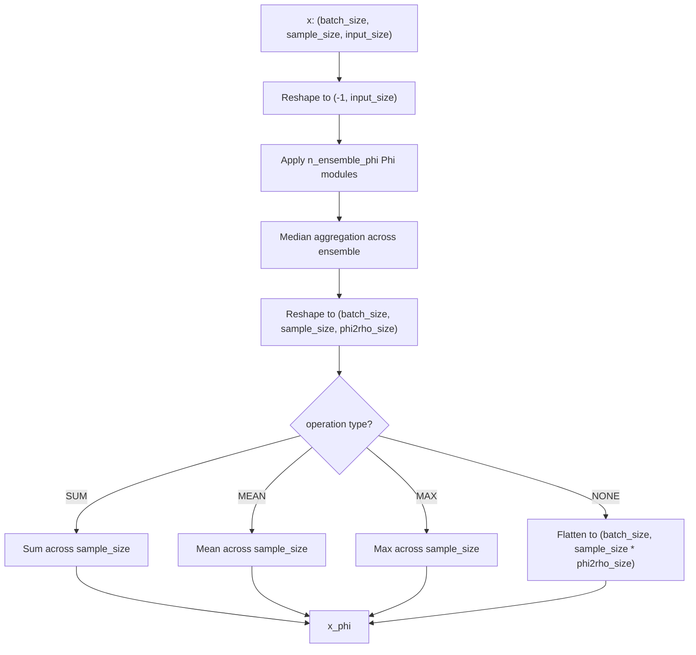
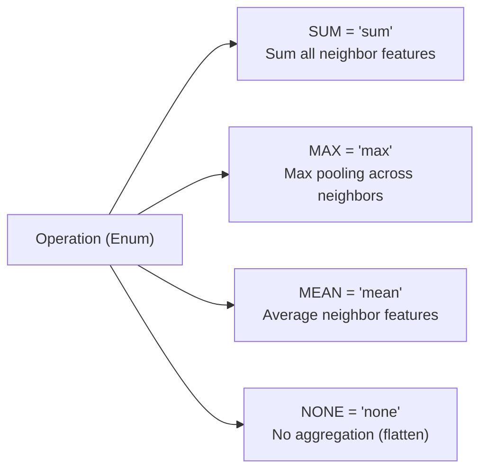
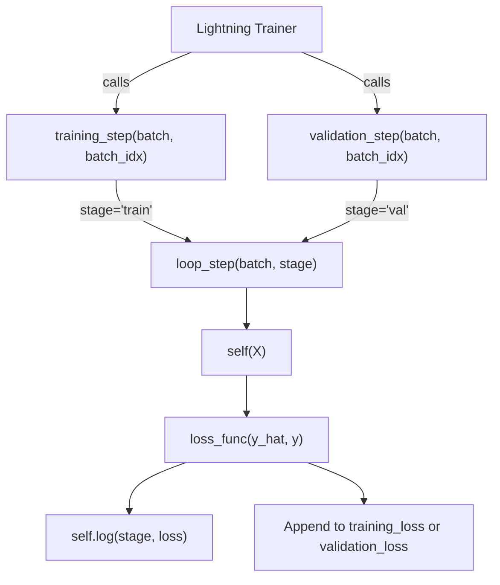
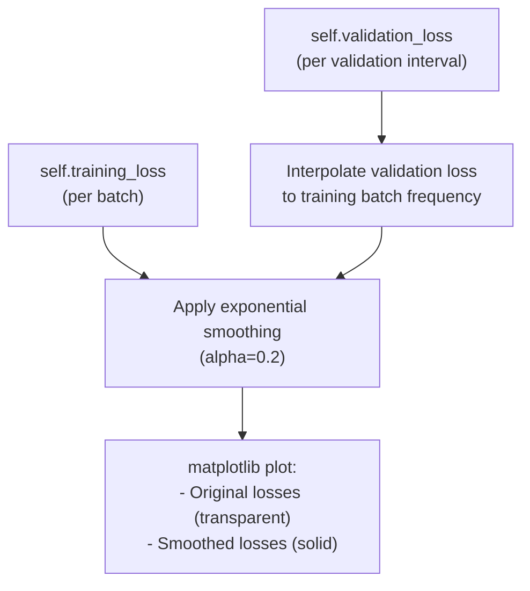
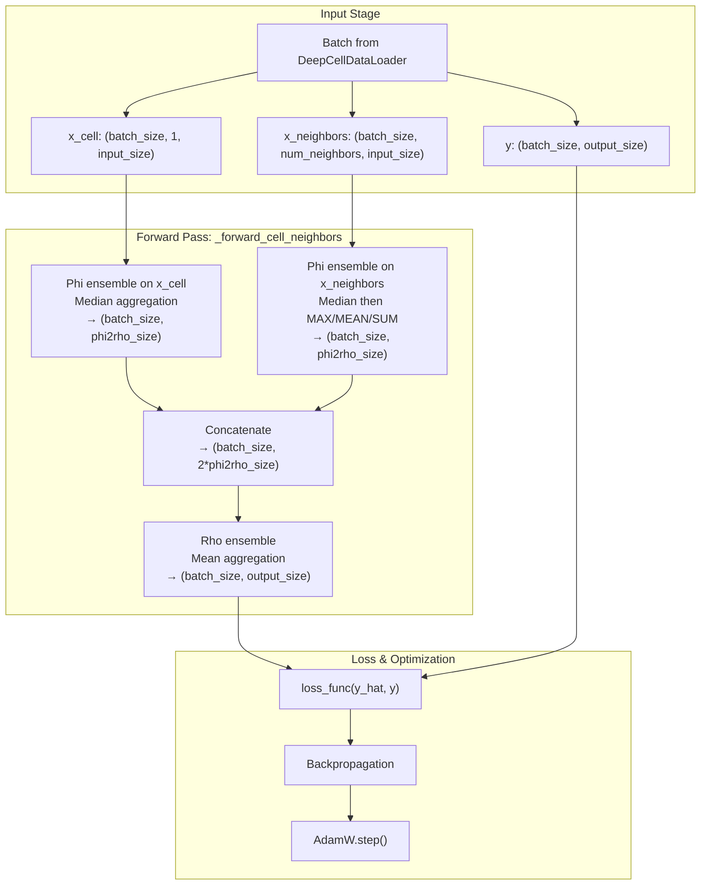

# DeepCell Model

<details>
<summary>Relevant source files</summary>

The following files were used as context for generating this wiki page:

- [.codeboarding/Core Utilities.md](.codeboarding/Core Utilities.md)
- [.codeboarding/DeepSpot Models.md](.codeboarding/DeepSpot Models.md)
- [deepspot/cell/model.py](deepspot/cell/model.py)

</details>


## Purpose and Scope

The `DeepCell` model is the core neural network architecture for predicting gene expression at single-cell resolution from H&E histology images. This page documents the `DeepCell` class implementation, including its initialization parameters, cell context modes, forward pass mechanisms, and training lifecycle.

For information about the underlying Phi and Rho neural layer implementations, see [Phi and Rho Neural Layers](#5.3). For details about available loss functions, see [Loss Functions](#5.4). For the spot-level equivalent model, see [DeepSpot Model](#5.2).

**Sources:** [deepspot/cell/model.py:63-281]()

---

## Class Overview

The `DeepCell` class inherits from `lightning.LightningModule`, leveraging PyTorch Lightning's training orchestration capabilities. The model implements a deep-set architecture that processes cell-level histology features and optionally incorporates spatial neighbor information to predict gene expression profiles.



**Core Responsibilities:**
- Initialize ensemble of Phi and Rho neural network modules
- Configure loss function and optimizer
- Execute forward passes based on cell context mode
- Track training and validation losses
- Provide loss visualization capabilities

**Sources:** [deepspot/cell/model.py:63-128]()

---

## Initialization Parameters

The `DeepCell.__init__` method accepts the following parameters:

| Parameter | Type | Default | Description |
|-----------|------|---------|-------------|
| `input_size` | `int` | - | Dimension of input feature vectors (foundation model output) |
| `output_size` | `int` | - | Number of genes to predict |
| `loss_func` | `str` | `"mse"` | Loss function identifier: `"mse"`, `"cos"`, `"l1"`, `"huber"`, `"mse_cos"`, `"l1_cos"`, `"huber_cos"`, `"pearson"`, `"mse_pearson"`, `"poisson"` |
| `lr` | `float` | `1e-4` | Learning rate for AdamW optimizer |
| `p` | `float` | `0.2` | Default dropout probability for Phi and Rho |
| `p_phi` | `Union[None, float]` | `None` | Dropout probability for Phi layers (overrides `p` if set) |
| `p_rho` | `Union[None, float]` | `None` | Dropout probability for Rho layers (overrides `p` if set) |
| `n_ensemble` | `int` | `10` | Default number of ensemble models |
| `n_ensemble_phi` | `Union[None, int]` | `None` | Number of Phi ensemble models (overrides `n_ensemble` if set) |
| `n_ensemble_rho` | `Union[None, int]` | `None` | Number of Rho ensemble models (overrides `n_ensemble` if set) |
| `phi2rho_size` | `int` | `1024` | Dimension of Phi output / Rho input |
| `emb_size` | `int` | `1024` | Embedding size (stored but not actively used) |
| `weight_decay` | `float` | `1e-6` | L2 regularization weight for AdamW |
| `random_seed` | `int` | `2024` | Random seed for reproducibility |
| `agg_neighbors` | `str` | `"max"` | Aggregation operation for neighbor features: `"max"`, `"mean"`, `"sum"` |
| `scaler` | - | `None` | Optional scaler object for inverse transformation |
| `cell_context` | `str` | `"cell_neighbors"` | Forward pass mode: `"cell"` or `"cell_neighbors"` |

**Loss Function Mapping:**

The `loss_func` parameter maps to functions in [deepspot/cell/loss.py]():



**Sources:** [deepspot/cell/model.py:64-128](), [deepspot/cell/model.py:88-107]()

---

## Cell Context Modes

The `cell_context` parameter determines which forward pass function is used. The model supports two modes:

### Mode Comparison

| Mode | Forward Function | Input Structure | Phi Multiplier | Description |
|------|-----------------|-----------------|----------------|-------------|
| `"cell"` | `_forward_cell` | Single tensor | 1 | Processes individual cell features only |
| `"cell_neighbors"` | `_forward_cell_neighbors` | List of 2 tensors | 2 | Processes cell + aggregated neighbor features |



**Phi Multiplier Impact:**

The `_get_phi_multiplier` method determines the Rho input size based on context:
- `"cell"`: multiplier = 1 → Rho input = `phi2rho_size`
- `"cell_neighbors"`: multiplier = 2 → Rho input = `2 * phi2rho_size`

This is because in `"cell_neighbors"` mode, the cell and neighbor Phi outputs are concatenated before passing to Rho.

**Sources:** [deepspot/cell/model.py:130-142](), [deepspot/cell/model.py:179-188]()

---

## Forward Pass Mechanisms

### Overview of Forward Execution

The `forward` method delegates to the appropriate forward function based on the `cell_context` configuration:



### _forward_cell

Processes individual cell features without neighbor information:

1. Apply Phi ensemble to cell features (no aggregation)
2. Apply Rho ensemble to transformed features
3. Return predicted gene expression

**Implementation:** [deepspot/cell/model.py:179-181]()

### _forward_cell_neighbors

Processes cell features with neighbor context:

1. Split input into `x_cell` and `x_neighbors`
2. Apply Phi ensemble to `x_cell` (no aggregation)
3. Apply Phi ensemble to `x_neighbors` (aggregate across neighbors using `agg_neighbors` operation)
4. Concatenate transformed cell and neighbor features
5. Apply Rho ensemble to concatenated features
6. Return predicted gene expression

**Implementation:** [deepspot/cell/model.py:183-188]()

### _apply_phi

Core Phi transformation with ensemble and optional aggregation:



**Key Behavior:**
- Applies each Phi module independently to all samples
- Uses **median aggregation** across the ensemble (robust to outliers)
- `Operation.NONE`: Used for target cell features (preserves spatial structure before Rho)
- `Operation.MAX/MEAN/SUM`: Used for neighbor aggregation

**Implementation:** [deepspot/cell/model.py:190-209]()

### _apply_rho

Final gene expression prediction with ensemble averaging:

1. Apply each Rho module independently to Phi-transformed features
2. **Mean aggregation** across ensemble (smooth predictions)
3. Return final gene expression predictions

**Implementation:** [deepspot/cell/model.py:211-214]()

**Sources:** [deepspot/cell/model.py:170-214]()

---

## Neighbor Aggregation Operations

The `agg_neighbors` parameter controls how neighbor features are combined in `_forward_cell_neighbors` mode. The `Operation` enum defines available operations:



| Operation | Behavior | Use Case |
|-----------|----------|----------|
| `MAX` | Takes maximum value across neighbors for each feature dimension | Default; captures strongest signals from neighborhood |
| `MEAN` | Averages neighbor features | Smooth representation of neighborhood |
| `SUM` | Sums neighbor features | Accumulates total neighborhood signal |
| `NONE` | Flattens all features without aggregation | Not typically used for neighbors |

**Sources:** [deepspot/cell/model.py:29-33](), [deepspot/cell/model.py:109-114]()

---

## Training Lifecycle

### Training and Validation Steps

The model implements PyTorch Lightning's training interface:



**loop_step Method:**

1. Unpack batch into features `X` and targets `y`
2. Convert to float tensors (handle list inputs for neighbor mode)
3. Execute forward pass: `y_hat = self(X)`
4. Compute loss: `loss = self.loss_func(y_hat, y)`
5. Log loss to Lightning logger with stage prefix
6. Track loss in `self.training_loss` or `self.validation_loss` list
7. Return loss for backpropagation

**Implementation:** [deepspot/cell/model.py:144-168]()

### Loss Tracking

The model maintains two lists for monitoring training progress:

- `self.training_loss`: List of loss values from each training batch
- `self.validation_loss`: List of loss values from each validation batch

These lists are populated during `loop_step` and used by the `plot_loss` method for visualization.

**Sources:** [deepspot/cell/model.py:121-122](), [deepspot/cell/model.py:157-160]()

---

## Optimizer Configuration

The model uses AdamW optimizer with L2 weight decay:

```python
# From deepspot/cell/model.py:216-218
def configure_optimizers(self) -> dict:
    optimizer = torch.optim.AdamW(
        self.parameters(), 
        lr=self.hparams.lr,           # Default: 1e-4
        weight_decay=self.hparams.weight_decay  # Default: 1e-6
    )
    return {"optimizer": optimizer}
```

**Configuration:**
- **Optimizer:** `torch.optim.AdamW`
- **Learning Rate:** Configured via `lr` parameter (default: `1e-4`)
- **Weight Decay:** Configured via `weight_decay` parameter (default: `1e-6`)
- **No Learning Rate Scheduler:** Simple constant learning rate

**Sources:** [deepspot/cell/model.py:216-218]()

---

## Loss Visualization

### plot_loss Method

The `plot_loss` method provides visualization of training progress with exponential smoothing:

**Visualization Pipeline:**



**Features:**

1. **Exponential Smoothing:** Applies `smooth_curve` method with `alpha=0.2` to reduce noise
2. **Validation Loss Interpolation:** Validation loss is recorded less frequently than training loss, so it's interpolated to match training step count
3. **Dual Plotting:** Shows both original (transparent) and smoothed (solid) curves
4. **Color Coding:** Blue for training loss, orange for validation loss

**smooth_curve Method:**

Uses exponential weighted moving average:
```
smoothed[0] = data[0]
smoothed[i] = alpha * data[i] + (1 - alpha) * smoothed[i-1]
```

With `alpha=0.2`, each point is 20% current value and 80% smoothed previous value.

**Implementation:** [deepspot/cell/model.py:220-281]()

**Sources:** [deepspot/cell/model.py:220-281]()

---

## Inverse Transformation

The `inverse_transform` method applies inverse scaling if a scaler was provided during initialization:

```python
# From deepspot/cell/model.py:174-177
def inverse_transform(self, x) -> torch.Tensor:
    if self.scaler is not None:
        x = self.scaler.inverse_transform(x)
    return x
```

This is typically used to convert normalized/scaled predictions back to original gene expression scales. The scaler object should implement an `inverse_transform` method compatible with the data preprocessing pipeline.

**Sources:** [deepspot/cell/model.py:174-177]()

---

## Ensemble Architecture Summary

The `DeepCell` model uses a two-stage ensemble architecture:

| Stage | Module | Count | Aggregation | Purpose |
|-------|--------|-------|-------------|---------|
| Phi | `phi_cell` | `n_ensemble_phi` (default: 10) | **Median** | Feature transformation with robustness to outliers |
| Rho | `rho` | `n_ensemble_rho` (default: 10) | **Mean** | Gene expression prediction with smoothed outputs |

**Ensemble Benefits:**
- **Median aggregation (Phi):** Reduces impact of individual module failures or extreme transformations
- **Mean aggregation (Rho):** Produces smooth, averaged predictions across ensemble members
- **Independent training:** Each ensemble member learns slightly different feature representations due to dropout

**Sources:** [deepspot/cell/model.py:125-127](), [deepspot/cell/model.py:195-196](), [deepspot/cell/model.py:212-213]()

---

## Complete Data Flow Example



**Sources:** [deepspot/cell/model.py:63-218]()

---