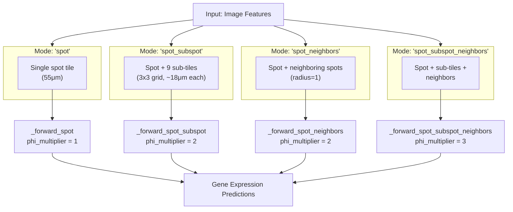
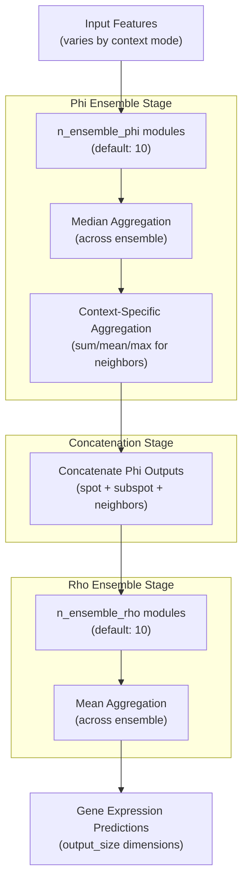
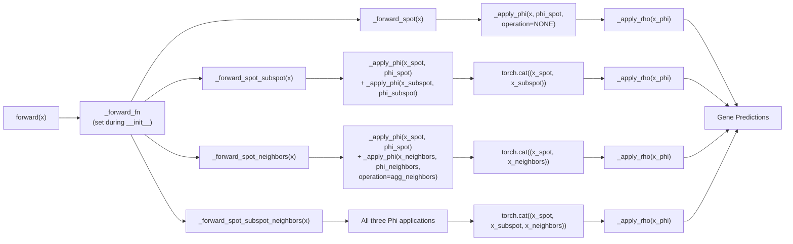
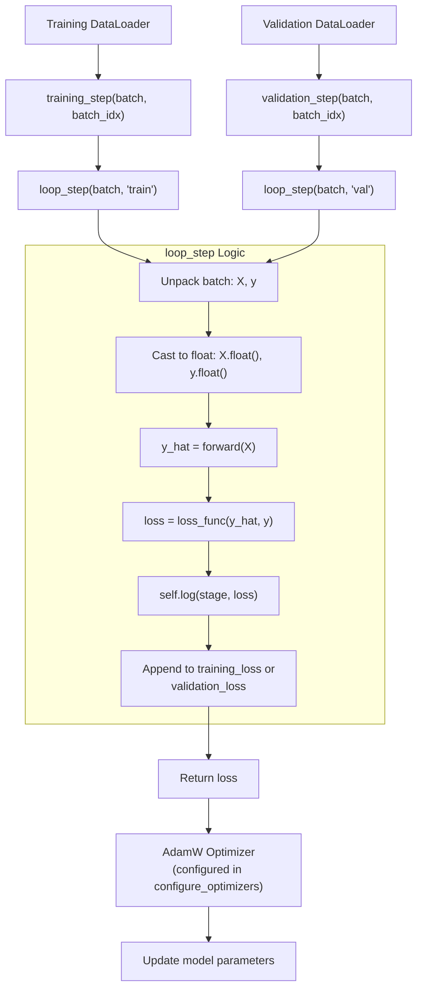
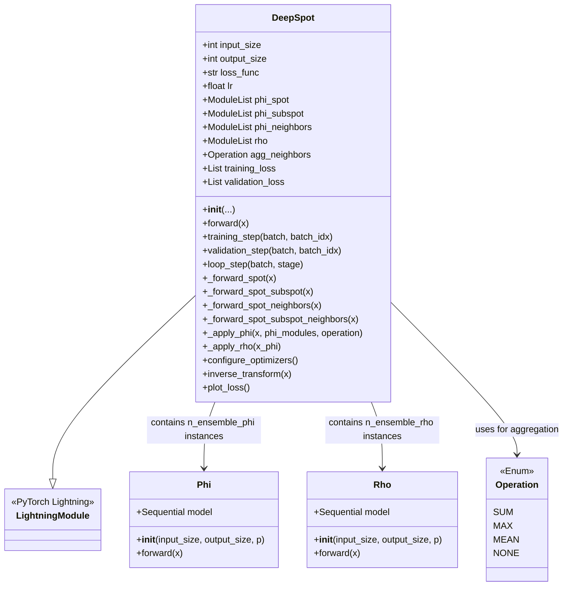
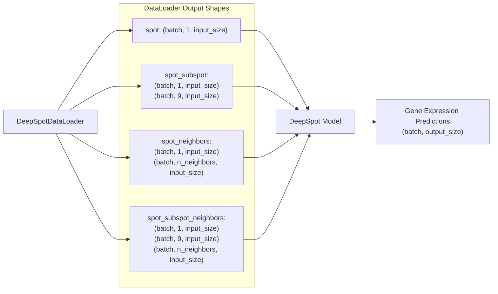

# DeepSpot Model

<details>
<summary>Relevant source files</summary>

The following files were used as context for generating this wiki page:

- [.codeboarding/DeepSpot Models.md](.codeboarding/DeepSpot Models.md)
- [deepspot/cell/model.py](deepspot/cell/model.py)

</details>


## Purpose and Scope

This page documents the `DeepSpot` model class, which implements spot-level spatial transcriptomics prediction for Visium data (~55μm resolution). The model predicts gene expression profiles from H&E image features extracted at spot locations. For cell-level predictions on Xenium data, see [DeepCell Model](#5.1). For details on the Phi and Rho neural layer implementations, see [Phi and Rho Neural Layers](#5.3). For loss function details, see [Loss Functions](#5.4).

**Sources**: [deepspot/spot/model.py:58-217](), [.codeboarding/DeepSpot Models.md:43-62]()

---

## Class Overview

The `DeepSpot` class ([deepspot/spot/model.py:58-217]()) is a PyTorch Lightning module (`L.LightningModule`) that implements a deep-set architecture for predicting gene expression from spot-level morphological features. The model supports four distinct spatial context modes that incorporate varying levels of sub-spot detail and neighborhood information.

### Key Characteristics

| Characteristic | Description |
|---|---|
| **Base Class** | `lightning.LightningModule` |
| **Primary Purpose** | Spot-level gene expression prediction |
| **Spatial Contexts** | 4 modes: `spot`, `spot_subspot`, `spot_neighbors`, `spot_subspot_neighbors` |
| **Architecture Pattern** | Deep-set with Phi (feature transformation) and Rho (aggregation) ensembles |
| **Loss Functions** | MSE, Pearson, Cosine, L1, Huber, Poisson, and combinations |
| **Optimizer** | AdamW with configurable learning rate and weight decay |

**Sources**: [deepspot/spot/model.py:58-217](), [.codeboarding/DeepSpot Models.md:43-62]()

---

## Initialization Parameters

The `DeepSpot.__init__` method ([deepspot/spot/model.py:59-108]()) accepts the following configuration parameters:

### Core Parameters

| Parameter | Type | Default | Description |
|---|---|---|---|
| `input_size` | `int` | Required | Dimensionality of input features (e.g., 1024 for UNI, 1536 for Hoptimus0) |
| `output_size` | `int` | Required | Number of genes to predict (e.g., 300-800 HVGs) |
| `loss_func` | `str` | `"mse"` | Loss function identifier: `"mse"`, `"pearson"`, `"cos"`, `"l1"`, `"huber"`, `"poisson"`, `"mse_pearson"`, `"mse_cos"`, `"l1_cos"`, `"huber_cos"` |
| `lr` | `float` | `1e-4` | Learning rate for AdamW optimizer |

### Ensemble Configuration

| Parameter | Type | Default | Description |
|---|---|---|---|
| `n_ensemble` | `int` | `10` | Number of parallel networks in both Phi and Rho ensembles |
| `n_ensemble_phi` | `int \| None` | `None` | Override for Phi ensemble size (defaults to `n_ensemble`) |
| `n_ensemble_rho` | `int \| None` | `None` | Override for Rho ensemble size (defaults to `n_ensemble`) |
| `phi2rho_size` | `int` | `1024` | Intermediate feature dimension between Phi and Rho stages |

### Regularization Parameters

| Parameter | Type | Default | Description |
|---|---|---|---|
| `p` | `float` | `0.2` | Dropout probability for both Phi and Rho layers |
| `p_phi` | `float \| None` | `None` | Override dropout for Phi layers (defaults to `p`) |
| `p_rho` | `float \| None` | `None` | Override dropout for Rho layers (defaults to `p`) |
| `weight_decay` | `float` | `1e-6` | L2 regularization coefficient for AdamW |

### Context and Utility Parameters

| Parameter | Type | Default | Description |
|---|---|---|---|
| `spot_context` | `str` | `"spot_subspot_neighbors"` | Spatial context mode (see below) |
| `agg_neighbors` | `str` | `"max"` | Neighborhood aggregation: `"max"`, `"mean"`, or `"sum"` |
| `random_seed` | `int` | `2024` | Random seed for reproducibility |
| `scaler` | `object \| None` | `None` | Scikit-learn scaler for inverse transformation |

**Sources**: [deepspot/spot/model.py:59-108]()

---

## Spot Context Modes

The `DeepSpot` model supports four distinct spatial context modes configured via the `spot_context` parameter. Each mode determines which spatial information is incorporated during prediction.

### Context Mode Diagram



### Mode Details

#### 1. `spot` - Basic Spot Context
- **Forward Method**: `_forward_spot` ([deepspot/spot/model.py:163-165]())
- **Phi Multiplier**: 1 (single feature vector)
- **Input**: Single spot-level feature vector
- **Use Case**: Simplest mode, suitable when sub-spot heterogeneity is not critical

#### 2. `spot_subspot` - Spot with Sub-tiles
- **Forward Method**: `_forward_spot_subspot` ([deepspot/spot/model.py:167-172]())
- **Phi Multiplier**: 2 (spot + aggregated sub-spots)
- **Input**: Spot feature + 9 mini-tile features (3×3 grid)
- **Use Case**: Captures sub-spot morphological heterogeneity within each 55μm spot

#### 3. `spot_neighbors` - Spot with Neighborhood
- **Forward Method**: `_forward_spot_neighbors` ([deepspot/spot/model.py:174-179]())
- **Phi Multiplier**: 2 (spot + aggregated neighbors)
- **Input**: Central spot feature + neighboring spot features
- **Use Case**: Incorporates spatial context from surrounding tissue

#### 4. `spot_subspot_neighbors` - Full Context (Default)
- **Forward Method**: `_forward_spot_subspot_neighbors` ([deepspot/spot/model.py:181-187]())
- **Phi Multiplier**: 3 (spot + sub-spots + neighbors)
- **Input**: Central spot + mini-tiles + neighbor spots
- **Use Case**: Most comprehensive mode, capturing both sub-spot detail and spatial context

**Sources**: [deepspot/spot/model.py:163-187](), [deepspot/spot/model.py:110-117](), [deepspot/spot/model.py:119-126]()

---

## Forward Pass Architecture

### Data Flow Through Phi-Rho Ensemble



### Phi Application Logic

The `_apply_phi` method ([deepspot/spot/model.py:189-208]()) processes input features through the Phi ensemble:

1. **Reshape**: Flatten batch and sample dimensions to `(batch_size * sample_size, input_size)`
2. **Ensemble Processing**: Apply all Phi modules in parallel, producing `(n_ensemble, batch_size * sample_size, phi2rho_size)` tensor
3. **Median Aggregation**: Compute median across ensemble dimension for robustness
4. **Reshape Back**: Restore to `(batch_size, sample_size, phi2rho_size)`
5. **Context Aggregation**: Apply operation based on context:
   - `Operation.NONE`: Flatten to `(batch_size, sample_size * phi2rho_size)`
   - `Operation.SUM`: Sum across sample dimension
   - `Operation.MEAN`: Average across sample dimension
   - `Operation.MAX`: Max-pool across sample dimension

### Rho Application Logic

The `_apply_rho` method ([deepspot/spot/model.py:210-213]()) generates final predictions:

1. **Ensemble Processing**: Apply all Rho modules in parallel to concatenated Phi outputs
2. **Mean Aggregation**: Average predictions across ensemble for stability
3. **Output**: Return gene expression predictions of shape `(batch_size, output_size)`

**Sources**: [deepspot/spot/model.py:189-213]()

---

## Context-Specific Forward Methods

### Forward Method Dispatch



### Implementation Details

#### `_forward_spot` ([deepspot/spot/model.py:163-165]())
```python
# Input: x (single tensor)
# Phi multiplier: 1
x_phi = _apply_phi(x, phi_spot, operation=NONE)
return _apply_rho(x_phi)
```

#### `_forward_spot_subspot` ([deepspot/spot/model.py:167-172]())
```python
# Input: [x_spot, x_subspot] (list of 2 tensors)
# Phi multiplier: 2
x_spot_phi = _apply_phi(x_spot, phi_spot)
x_subspot_phi = _apply_phi(x_subspot, phi_subspot)
x_phi = torch.cat((x_spot_phi, x_subspot_phi), dim=1)
return _apply_rho(x_phi)
```

#### `_forward_spot_neighbors` ([deepspot/spot/model.py:174-179]())
```python
# Input: [x_spot, x_neighbors] (list of 2 tensors)
# Phi multiplier: 2
x_spot_phi = _apply_phi(x_spot, phi_spot)
x_neighbors_phi = _apply_phi(x_neighbors, phi_neighbors, operation=agg_neighbors)
x_phi = torch.cat((x_spot_phi, x_neighbors_phi), dim=1)
return _apply_rho(x_phi)
```

#### `_forward_spot_subspot_neighbors` ([deepspot/spot/model.py:181-187]())
```python
# Input: [x_spot, x_subspot, x_neighbors] (list of 3 tensors)
# Phi multiplier: 3
x_spot_phi = _apply_phi(x_spot, phi_spot)
x_subspot_phi = _apply_phi(x_subspot, phi_subspot)
x_neighbors_phi = _apply_phi(x_neighbors, phi_neighbors, operation=agg_neighbors)
x_phi = torch.cat((x_spot_phi, x_subspot_phi, x_neighbors_phi), dim=1)
return _apply_rho(x_phi)
```

**Sources**: [deepspot/spot/model.py:163-187]()

---

## Training Lifecycle

### Training Loop Architecture

The `DeepSpot` model implements standard PyTorch Lightning training hooks with custom loss tracking.



### Method Implementations

#### `training_step` ([deepspot/spot/model.py:148-149]())
Delegates to `loop_step` with stage `"train"`.

#### `validation_step` ([deepspot/spot/model.py:151-152]())
Delegates to `loop_step` with stage `"val"`.

#### `loop_step` ([deepspot/spot/model.py:128-146]())
Core training logic:
1. Unpack batch into features `X` and targets `y`
2. Cast to float tensors (handle list or single tensor for `X`)
3. Forward pass: `y_hat = self(X)`
4. Compute loss using configured loss function
5. Log loss to Lightning for monitoring
6. Append to internal loss tracking (`training_loss` or `validation_loss` lists)
7. Return loss for backpropagation

#### `configure_optimizers` ([deepspot/spot/model.py:215-217]() equivalent to DeepCell [deepspot/cell/model.py:216-218]())
Returns AdamW optimizer with specified learning rate and weight decay.

**Sources**: [deepspot/spot/model.py:128-152](), [deepspot/cell/model.py:144-168](), [deepspot/cell/model.py:216-218]()

---

## Loss Function Configuration

The model supports multiple loss functions specified during initialization. The mapping from string identifiers to loss function implementations is performed in `__init__`:

| `loss_func` String | Loss Function | Module Reference |
|---|---|---|
| `"mse"` | Mean Squared Error | `loss_mse_function` [deepspot/spot/loss.py:19-21]() |
| `"cos"` | Cosine Similarity Loss | `loss_cosine_function` |
| `"l1"` | L1 (Mean Absolute Error) | `loss_l1_function` |
| `"huber"` | Huber Loss | `loss_huber_function` |
| `"mse_cos"` | MSE + Cosine (combined) | `loss_mse_cosine_function` |
| `"l1_cos"` | L1 + Cosine (combined) | `loss_l1_cosine_function` |
| `"huber_cos"` | Huber + Cosine (combined) | `loss_huber_cosine_function` |
| `"pearson"` | Pearson Correlation Loss | `loss_pearson_function` |
| `"mse_pearson"` | MSE + Pearson (combined) | `loss_mse_pearson_function` |
| `"poisson"` | Poisson Loss | `loss_poisson_function` |

For detailed information on each loss function's implementation, see [Loss Functions](#5.4).

**Sources**: [deepspot/cell/model.py:88-107](), [.codeboarding/DeepSpot Models.md:93-99]()

---

## Utility Methods

### `inverse_transform` 
Similar to DeepCell implementation ([deepspot/cell/model.py:174-177]()), applies inverse scaling transformation if a scaler was provided during initialization.

### `plot_loss`
Similar to DeepCell implementation ([deepspot/cell/model.py:235-281]()), visualizes training and validation loss curves with exponential smoothing for trend analysis.

### `_get_phi_multiplier` ([deepspot/spot/model.py:110-117]())
Determines the concatenated feature dimension based on context mode:

| Context Mode | Phi Multiplier | Explanation |
|---|---|---|
| `"spot"` | 1 | Only spot features |
| `"spot_subspot"` | 2 | Spot + subspot features |
| `"spot_neighbors"` | 2 | Spot + neighbor features |
| `"spot_subspot_neighbors"` | 3 | Spot + subspot + neighbor features |

### `_get_forward_function` ([deepspot/spot/model.py:119-126]())
Returns the appropriate forward method based on `spot_context` string during initialization. This enables runtime dispatch without if-else branching in the `forward` method.

**Sources**: [deepspot/spot/model.py:110-126](), [deepspot/cell/model.py:174-177](), [deepspot/cell/model.py:235-281]()

---

## Model Instantiation Example

### Basic Configuration

```python
from deepspot.spot.model import DeepSpot

# Initialize model for 500 genes with UNI features (1024-dim)
model = DeepSpot(
    input_size=1024,           # UNI embedding dimension
    output_size=500,           # Number of genes to predict
    loss_func="mse_pearson",   # Combined MSE + Pearson loss
    lr=1e-4,                   # Learning rate
    p=0.2,                     # Dropout probability
    n_ensemble=10,             # Ensemble size
    phi2rho_size=1024,         # Intermediate dimension
    spot_context="spot_subspot_neighbors",  # Full context mode
    agg_neighbors="max",       # Max-pooling for neighbors
    random_seed=2024
)
```

### Advanced Configuration with Custom Ensemble Sizes

```python
model = DeepSpot(
    input_size=1536,           # Hoptimus0 embedding dimension
    output_size=800,           # 800 highly variable genes
    loss_func="huber_cos",     # Huber + Cosine loss
    lr=5e-5,                   # Lower learning rate
    p_phi=0.3,                 # Higher dropout for Phi
    p_rho=0.1,                 # Lower dropout for Rho
    n_ensemble_phi=15,         # Larger Phi ensemble
    n_ensemble_rho=8,          # Smaller Rho ensemble
    phi2rho_size=2048,         # Larger intermediate dimension
    weight_decay=1e-5,         # Stronger L2 regularization
    spot_context="spot_neighbors",  # Use neighbors only
    agg_neighbors="mean",      # Mean aggregation
    scaler=StandardScaler()    # Provide scaler for inverse transform
)
```

**Sources**: [deepspot/spot/model.py:59-108]()

---

## Code-to-Concept Mapping

### Class Architecture Overview



### Relationship to Data Loaders



**Sources**: [deepspot/spot/model.py:58-217](), [deepspot/cell/model.py:36-60]()

---