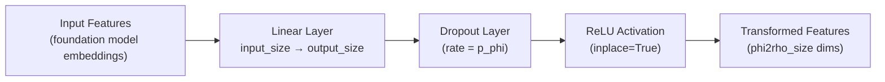
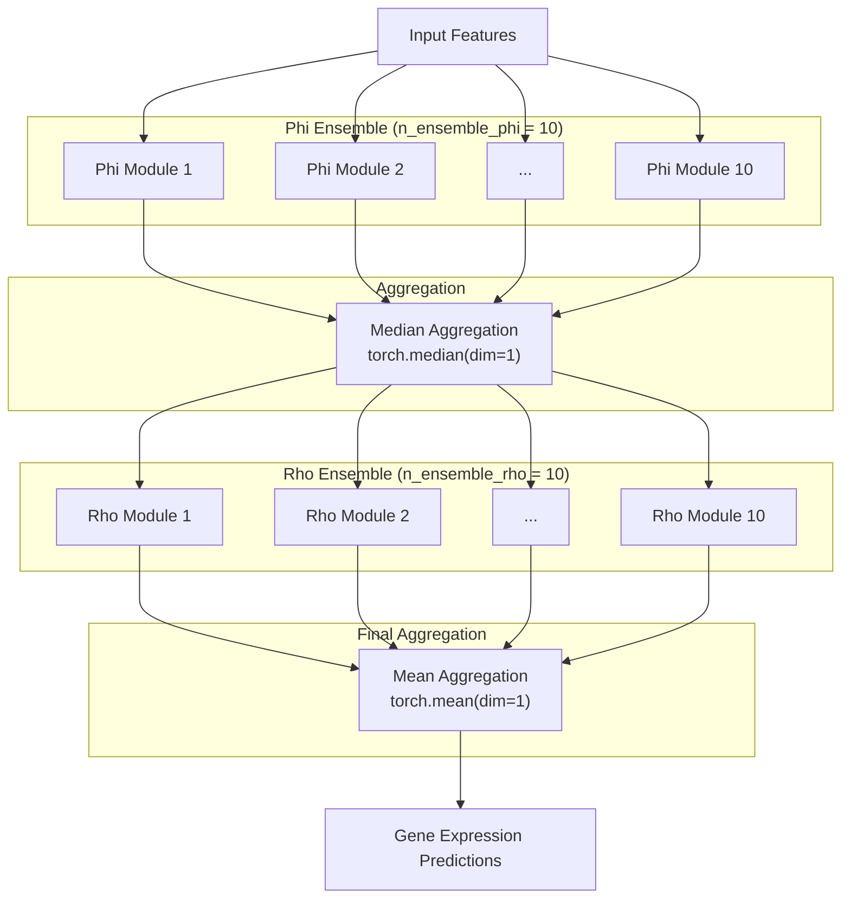
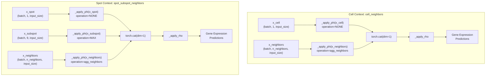

# Phi and Rho Neural Layers

<details>
<summary>Relevant source files</summary>

The following files were used as context for generating this wiki page:

- [.codeboarding/Core Utilities.md](.codeboarding/Core Utilities.md)
- [deepspot/cell/model.py](deepspot/cell/model.py)

</details>


This document explains the `Phi` and `Rho` neural network modules, which form the core computational building blocks of both DeepSpot and DeepCell models. These modules implement a two-stage ensemble architecture for transforming input features (Phi) and generating final predictions (Rho). For information about how these layers are integrated into complete model architectures, see [DeepCell Model](#5.1) and [DeepSpot Model](#5.2). For the loss functions used to train these modules, see [Loss Functions](#5.4).

## Overview

The Phi-Rho architecture implements a permutation-invariant deep-set approach where:
- **Phi modules** transform input features from foundation models into an intermediate representation
- **Rho modules** map the intermediate representation to gene expression predictions
- Both stages use **ensemble learning** with multiple parallel networks and aggregation strategies

This design enables the models to process variable-sized inputs (e.g., multiple sub-tiles or neighbor cells) while maintaining robust predictions through ensemble averaging.

## Phi Neural Layer

### Architecture

The `Phi` class implements a simple three-layer neural network that transforms input features into an intermediate representation.



**Sources:** [deepspot/cell/model.py:36-46](), [deepspot/spot/model.py:31-41]()

### Implementation Details

| Component | Configuration | Purpose |
|-----------|--------------|---------|
| Input Layer | `nn.Linear(input_size, output_size)` | Projects features to intermediate dimension |
| Dropout | `nn.Dropout(p=p_phi)` | Regularization to prevent overfitting |
| Activation | `nn.ReLU(inplace=True)` | Non-linear transformation |
| Output Size | `phi2rho_size` (default: 1024) | Intermediate representation dimension |

The `Phi` module receives foundation model embeddings with varying dimensions:
- UNI: 1024-dimensional features
- Hoptimus0: 1536-dimensional features  
- Phikon: 768-dimensional features
- Inception: 2048-dimensional features

All are projected to a common `phi2rho_size` dimension for consistency.

**Sources:** [deepspot/cell/model.py:36-46](), [deepspot/spot/model.py:31-41]()

### Role in Forward Pass

The `Phi` module serves as a feature normalizer and transformer, enabling different foundation models to work with a common downstream architecture. Multiple Phi modules are instantiated in an ensemble, and their outputs are aggregated using median pooling (see Ensemble Architecture section).

**Sources:** [deepspot/cell/model.py:190-209]()

## Rho Neural Layer

### Architecture

The `Rho` class implements the final prediction stage, mapping intermediate representations to gene expression values.


**Sources:** [deepspot/cell/model.py:49-60](), [deepspot/spot/model.py:44-55]()

### Implementation Details

| Component | Configuration | Purpose |
|-----------|--------------|---------|
| Input Dropout | `nn.Dropout(p=p_rho)` | Regularization on Phi outputs |
| Activation | `nn.ReLU(inplace=True)` | Non-linear transformation |
| Output Layer | `nn.Linear(input_size, output_size)` | Maps to gene expression space |
| Final Dropout | `nn.Dropout(p=0.1)` | Fixed regularization on predictions |

The `Rho` module's input size varies based on context mode:
- **Cell-only**: `phi2rho_size` (e.g., 1024)
- **Cell + neighbors**: `2 * phi2rho_size` (e.g., 2048)
- **Spot-only**: `phi2rho_size`
- **Spot + subspot**: `2 * phi2rho_size`
- **Spot + neighbors**: `2 * phi2rho_size`
- **Spot + subspot + neighbors**: `3 * phi2rho_size` (e.g., 3072)

The output size equals the number of genes being predicted (typically 300-800 for spots, 500 for cells).

**Sources:** [deepspot/cell/model.py:49-60](), [deepspot/cell/model.py:126-127](), [deepspot/spot/model.py:44-55]()

## Ensemble Architecture

### Ensemble Configuration

Both Phi and Rho stages use ensemble learning with multiple parallel networks to improve prediction robustness.



**Sources:** [deepspot/cell/model.py:125-127](), [deepspot/cell/model.py:190-214]()

### Phi Ensemble Aggregation

The `_apply_phi` method processes inputs through all Phi modules and aggregates using **median** pooling:

```python
# From _apply_phi implementation
x_phi = torch.stack([phi(x) for phi in phi_modules], dim=1)
x_phi, _ = torch.median(x_phi, dim=1)  # Median ensemble aggregation
```

**Key steps:**
1. Apply all `n_ensemble_phi` modules in parallel (default: 10)
2. Stack outputs along dimension 1
3. Compute element-wise median across ensemble members
4. Apply spatial aggregation operation (SUM, MEAN, MAX, or NONE) based on context

**Aggregation operations:**
- `Operation.NONE`: Keep all samples (for single cell/spot)
- `Operation.MAX`: Take maximum across samples (default for neighbors)
- `Operation.MEAN`: Average across samples
- `Operation.SUM`: Sum across samples

**Sources:** [deepspot/cell/model.py:190-209](), [deepspot/spot/model.py:189-208]()

### Rho Ensemble Aggregation

The `_apply_rho` method processes Phi outputs through all Rho modules and aggregates using **mean** pooling:

```python
# From _apply_rho implementation
x_rho = torch.stack([rho(x_phi) for rho in self.rho], dim=1)
x_rho = torch.mean(x_rho, dim=1)  # Mean ensemble aggregation
```

**Key steps:**
1. Apply all `n_ensemble_rho` modules in parallel (default: 10)
2. Stack outputs along dimension 1
3. Compute element-wise mean across ensemble members

**Sources:** [deepspot/cell/model.py:211-214](), [deepspot/spot/model.py:210-213]()

### Rationale for Different Aggregation Strategies

The architecture uses **median aggregation for Phi** and **mean aggregation for Rho**:
- **Median (Phi):** Robust to outliers in feature transformations, ensuring stable intermediate representations
- **Mean (Rho):** Provides smooth averaging of final predictions across ensemble members

## Integration in Forward Pass

### Data Flow Through Phi-Rho Layers

The following diagram shows how inputs flow through Phi and Rho modules in different context modes:



**Sources:** [deepspot/cell/model.py:183-188](), [deepspot/spot/model.py:181-187]()

### Context-Specific Forward Methods

Both DeepCell and DeepSpot implement multiple forward methods that leverage Phi-Rho layers differently:

**DeepCell forward methods:**
- `_forward_cell`: Single cell only → `_apply_phi` (NONE) → `_apply_rho`
- `_forward_cell_neighbors`: Cell + neighbors → two `_apply_phi` calls → concatenate → `_apply_rho`

**DeepSpot forward methods:**
- `_forward_spot`: Single spot → `_apply_phi` (NONE) → `_apply_rho`
- `_forward_spot_subspot`: Spot + 9 sub-tiles → two `_apply_phi` calls → concatenate → `_apply_rho`
- `_forward_spot_neighbors`: Spot + neighbors → two `_apply_phi` calls → concatenate → `_apply_rho`
- `_forward_spot_subspot_neighbors`: Full context → three `_apply_phi` calls → concatenate → `_apply_rho`

**Sources:** [deepspot/cell/model.py:179-188](), [deepspot/spot/model.py:163-187]()

## Hyperparameter Configuration

### Initialization Parameters

The following table summarizes key hyperparameters for Phi and Rho modules:

| Parameter | Default | Description |
|-----------|---------|-------------|
| `input_size` | Varies | Foundation model embedding dimension |
| `output_size` | Varies | Number of genes to predict |
| `phi2rho_size` | 1024 | Intermediate dimension between Phi and Rho |
| `p` | 0.2 | Base dropout probability |
| `p_phi` | `p` | Dropout rate for Phi modules |
| `p_rho` | `p` | Dropout rate for Rho modules |
| `n_ensemble` | 10 | Base number of ensemble members |
| `n_ensemble_phi` | `n_ensemble` | Number of Phi modules in ensemble |
| `n_ensemble_rho` | `n_ensemble` | Number of Rho modules in ensemble |

**Sources:** [deepspot/cell/model.py:64-82](), [deepspot/spot/model.py:59-77]()

### Module Instantiation

During model initialization, Phi and Rho ensembles are created as `nn.ModuleList` objects:

```python
# Phi ensemble for cell/spot features
self.phi_cell = nn.ModuleList([
    Phi(input_size, phi2rho_size, self.p_phi) 
    for _ in range(self.n_ensemble_phi)
])

# Rho ensemble for final predictions
self.rho = nn.ModuleList([
    Rho(phi2rho_size * multiplier, output_size, self.p_rho) 
    for _ in range(self.n_ensemble_rho)
])
```

The `multiplier` value depends on the context mode (1 for single cell/spot, 2 for cell+neighbors, 3 for spot+subspot+neighbors).

**Sources:** [deepspot/cell/model.py:125-127](), [deepspot/spot/model.py:120-122]()

### Dropout Strategy

The architecture employs **three dropout layers** per forward pass:
1. **Phi module:** Applied after the linear layer (rate = `p_phi`)
2. **Rho module (input):** Applied before the final linear layer (rate = `p_rho`)
3. **Rho module (output):** Fixed dropout at 0.1 applied to predictions

This aggressive regularization strategy prevents overfitting when training on limited spatial transcriptomics samples.

**Sources:** [deepspot/cell/model.py:36-60]()

## Code Mapping Reference

The following table maps conceptual components to their code implementations:

| Concept | DeepCell Implementation | DeepSpot Implementation |
|---------|------------------------|------------------------|
| Phi class | [deepspot/cell/model.py:36-46]() | [deepspot/spot/model.py:31-41]() |
| Rho class | [deepspot/cell/model.py:49-60]() | [deepspot/spot/model.py:44-55]() |
| Phi ensemble creation | [deepspot/cell/model.py:125]() | [deepspot/spot/model.py:120]() |
| Rho ensemble creation | [deepspot/cell/model.py:126-127]() | [deepspot/spot/model.py:121-122]() |
| `_apply_phi` method | [deepspot/cell/model.py:190-209]() | [deepspot/spot/model.py:189-208]() |
| `_apply_rho` method | [deepspot/cell/model.py:211-214]() | [deepspot/spot/model.py:210-213]() |
| Aggregation operations | [deepspot/cell/model.py:29-33]() | [deepspot/spot/model.py:24-28]() |

**Sources:** [deepspot/cell/model.py:1-282](), [deepspot/spot/model.py:1-277]()

---