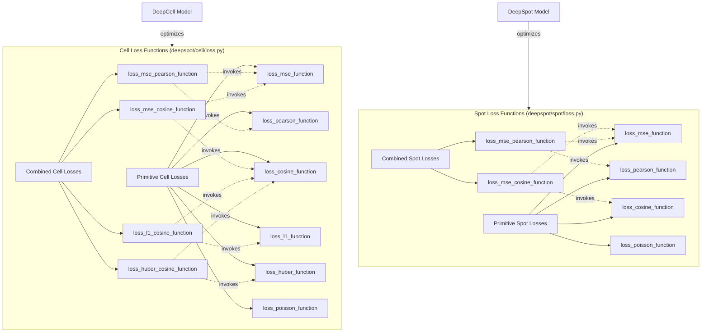
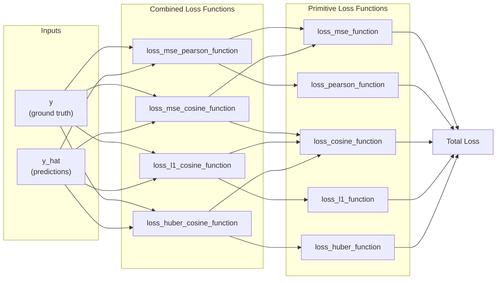
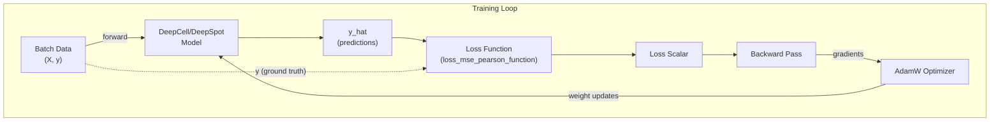

# Loss Functions

<details>
<summary>Relevant source files</summary>

The following files were used as context for generating this wiki page:

- [.codeboarding/Loss Functions.md](.codeboarding/Loss Functions.md)
- [deepspot/cell/loss.py](deepspot/cell/loss.py)

</details>


## Purpose and Scope

This document describes the loss functions available in DeepSpot for training both cell-level and spot-level spatial transcriptomics prediction models. Loss functions measure the discrepancy between predicted and actual gene expression values, enabling gradient-based optimization during model training.

The system provides two parallel sets of loss functions located in `deepspot/cell/loss.py` and `deepspot/spot/loss.py`. These functions fall into two categories: **primitive** (atomic) loss functions that implement individual metrics, and **combined** loss functions that blend multiple primitives for improved optimization.

For information about how these losses are used during model training, see the DeepCell Model ([5.1](#5.1)) and DeepSpot Model ([5.2](#5.2)) documentation. For details on the overall model architecture that these losses optimize, see Phi and Rho Neural Layers ([5.3](#5.3)).

**Sources:** [deepspot/cell/loss.py:1-99](), [.codeboarding/Loss Functions.md:1-66]()

---

## Loss Function Architecture

The loss function system is organized hierarchically, with primitive functions serving as building blocks for more complex combined losses. Both cell-level and spot-level models share similar architectures but maintain separate implementations.

### Overall Structure



**Sources:** [deepspot/cell/loss.py:1-99](), [.codeboarding/Loss Functions.md:1-66]()

---

## Primitive Loss Functions

Primitive loss functions implement single optimization objectives. All primitives accept two tensors: `y` (ground truth gene expression) and `y_hat` (predicted gene expression), both of shape `(N, D)` where `N` is batch size and `D` is number of genes.

### Mean Squared Error (MSE)

Computes the average squared difference between predictions and ground truth. This is the most commonly used loss function in the system.

**Cell Implementation:** [deepspot/cell/loss.py:40-42]()
**Spot Implementation:** [deepspot/spot/loss.py:19-21]()

| Property | Value |
|----------|-------|
| Function Name | `loss_mse_function` |
| Formula | `mean((y - y_hat)²)` |
| Use Case | General-purpose regression loss |
| PyTorch Backend | `torch.nn.functional.mse_loss` |

**Sources:** [deepspot/cell/loss.py:40-42]()

### Pearson Correlation Loss

Measures linear correlation between predicted and true gene expression across samples. Implemented as `1 - pearson_correlation`, so minimizing this loss maximizes correlation.

**Cell Implementation:** [deepspot/cell/loss.py:9-37]()

The cell implementation computes per-gene Pearson correlation:

1. Centers predictions and targets by subtracting means
2. Computes covariance: `sum(centered_pred * centered_true)`
3. Computes standard deviations for both tensors
4. Calculates correlation: `covariance / (std_pred * std_true)`
5. Returns mean of `1 - correlation` across all genes

An epsilon value (`eps=1e-8`) prevents division by zero when standard deviation is very small.

**Spot Implementation:** [deepspot/spot/loss.py:9-16]()

The spot implementation uses a simplified centered cosine similarity approach rather than the full Pearson calculation.

| Property | Cell Value | Spot Value |
|----------|-----------|-----------|
| Implementation | Full Pearson correlation | Centered cosine similarity |
| Epsilon | `1e-8` | None |
| Complexity | Higher | Lower |

**Sources:** [deepspot/cell/loss.py:9-37](), [.codeboarding/Loss Functions.md:42-51]()

### Cosine Similarity Loss

Measures the cosine of the angle between prediction and ground truth vectors. Returns `1 - cosine_similarity`, so perfect alignment (cosine=1) gives loss=0.

**Cell Implementation:** [deepspot/cell/loss.py:4-6]()
**Spot Implementation:** [deepspot/spot/loss.py:4-6]()

| Property | Value |
|----------|-------|
| Function Name | `loss_cosine_function` |
| Formula | `mean(1 - cos(y, y_hat))` |
| Computation | Per-gene (dim=0) |
| PyTorch Backend | `torch.nn.functional.cosine_similarity` |

**Sources:** [deepspot/cell/loss.py:4-6]()

### L1 Loss (Mean Absolute Error)

Computes the average absolute difference between predictions and ground truth. More robust to outliers than MSE.

**Cell Implementation:** [deepspot/cell/loss.py:45-48]()

| Property | Value |
|----------|-------|
| Function Name | `loss_l1_function` |
| Formula | `mean(abs(y - y_hat))` |
| Use Case | Robust regression when outliers present |
| PyTorch Backend | `torch.nn.functional.l1_loss` |
| Availability | Cell losses only |

**Sources:** [deepspot/cell/loss.py:45-48]()

### Huber Loss

Combines MSE for small errors and L1 for large errors, providing robustness to outliers while maintaining smooth gradients near zero.

**Cell Implementation:** [deepspot/cell/loss.py:51-63]()

| Property | Value |
|----------|-------|
| Function Name | `loss_huber_function` |
| Formula | Quadratic for `abs(error) ≤ δ`, linear otherwise |
| Default Delta | `1.0` |
| Use Case | Balanced robustness and smooth optimization |
| PyTorch Backend | `torch.nn.functional.huber_loss` |
| Availability | Cell losses only |

**Sources:** [deepspot/cell/loss.py:51-63]()

### Poisson Negative Log-Likelihood

Designed for count data, this loss assumes predictions follow a Poisson distribution. 

**Cell Implementation:** [deepspot/cell/loss.py:66-70]()
**Spot Implementation:** [deepspot/spot/loss.py:24-28]()

The cell implementation exponentiates the ground truth (`y = exp(y)`) before computing loss, suggesting the model predicts log-space values.

| Property | Value |
|----------|-------|
| Function Name | `loss_poisson_function` |
| Use Case | Gene count data (Poisson-distributed) |
| Preprocessing | `y = exp(y)` in cell version |
| PyTorch Backend | `torch.nn.functional.poisson_nll_loss` |

**Sources:** [deepspot/cell/loss.py:66-70](), [deepspot/spot/loss.py:24-28]()

---

## Combined Loss Functions

Combined loss functions blend multiple primitives to capture different aspects of prediction quality simultaneously. These are implemented by calling primitive functions and summing their outputs.

### Loss Function Composition Diagram



**Sources:** [deepspot/cell/loss.py:73-98](), [deepspot/spot/loss.py:31-42]()

### MSE + Pearson Loss

Combines mean squared error with Pearson correlation loss. The cell implementation supports weighted combination via `mse_w` parameter.

**Cell Implementation:** [deepspot/cell/loss.py:73-77]()
**Spot Implementation:** [deepspot/spot/loss.py:31-35]()

```python
# Cell version with weighting
loss = mse_w * loss_pearson + loss_mse  # default mse_w=0.1

# Spot version (equal weighting)
loss = loss_pearson + loss_mse
```

| Property | Cell Value | Spot Value |
|----------|-----------|-----------|
| Default Weight | Pearson: 0.1, MSE: 1.0 | Equal (1.0 each) |
| Configurable | Yes (via `mse_w` parameter) | No |

This combination optimizes both absolute accuracy (MSE) and correlation structure (Pearson), making it effective for gene expression where both magnitude and pattern matter.

**Sources:** [deepspot/cell/loss.py:73-77](), [deepspot/spot/loss.py:31-35]()

### MSE + Cosine Loss

Combines mean squared error with cosine similarity loss using equal weighting.

**Cell Implementation:** [deepspot/cell/loss.py:80-84]()
**Spot Implementation:** [deepspot/spot/loss.py:38-42]()

```python
loss = loss_cosine + loss_mse
```

This combination balances absolute error (MSE) with directional similarity (cosine), useful when maintaining the relative pattern of gene expression is important.

**Sources:** [deepspot/cell/loss.py:80-84](), [deepspot/spot/loss.py:38-42]()

### L1 + Cosine Loss

Combines L1 loss with cosine similarity. Available only in cell losses.

**Cell Implementation:** [deepspot/cell/loss.py:87-91]()

```python
loss = loss_cosine + loss_l1
```

This provides outlier robustness (L1) while maintaining directional accuracy (cosine).

**Sources:** [deepspot/cell/loss.py:87-91]()

### Huber + Cosine Loss

Combines Huber loss with cosine similarity. Available only in cell losses.

**Cell Implementation:** [deepspot/cell/loss.py:94-98]()

```python
loss = loss_cosine + loss_huber
```

Offers balanced robustness (Huber) with directional similarity (cosine), providing smooth gradients for small errors and outlier resistance for large errors.

**Sources:** [deepspot/cell/loss.py:94-98]()

---

## Cell vs Spot Loss Differences

While cell and spot loss modules share similar structures, they differ in implementation details and available functions.

| Feature | Cell Losses | Spot Losses |
|---------|------------|-------------|
| **File Location** | `deepspot/cell/loss.py` | `deepspot/spot/loss.py` |
| **MSE** | ✓ Standard implementation | ✓ Standard implementation |
| **Pearson** | ✓ Full correlation with epsilon | ✓ Centered cosine approximation |
| **Cosine** | ✓ Per-gene similarity | ✓ Per-gene similarity |
| **L1** | ✓ Available | ✗ Not available |
| **Huber** | ✓ Available with delta parameter | ✗ Not available |
| **Poisson** | ✓ With exp(y) preprocessing | ✓ Standard implementation |
| **MSE+Pearson** | ✓ Weighted (configurable) | ✓ Equal weights |
| **MSE+Cosine** | ✓ Equal weights | ✓ Equal weights |
| **L1+Cosine** | ✓ Available | ✗ Not available |
| **Huber+Cosine** | ✓ Available | ✗ Not available |

### Key Implementation Differences

**Pearson Correlation:**
- Cell: Full Pearson with centering, covariance, and standard deviation calculation [deepspot/cell/loss.py:9-37]()
- Spot: Simplified centered cosine similarity [deepspot/spot/loss.py:9-16]()

**Poisson Loss:**
- Cell: Exponentiates ground truth before computing loss [deepspot/cell/loss.py:66-70]()
- Spot: Direct Poisson NLL computation [deepspot/spot/loss.py:24-28]()

**Combined Loss Weighting:**
- Cell MSE+Pearson: Configurable weight via `mse_w` parameter (default 0.1) [deepspot/cell/loss.py:73-77]()
- Spot MSE+Pearson: Fixed equal weighting [deepspot/spot/loss.py:31-35]()

**Sources:** [deepspot/cell/loss.py:1-99](), [.codeboarding/Loss Functions.md:1-66]()

---

## Usage in Training

Loss functions are specified during model initialization and called automatically during training. The training loop computes predictions, passes them to the loss function, and uses gradients for optimization.

### Integration with Models



**Sources:** [deepspot/cell/loss.py:1-99](), [.codeboarding/Loss Functions.md:1-66]()

### Specifying Loss Functions

Loss functions are typically specified by string name when initializing data loaders or models:

| String Name | Function | Module |
|-------------|----------|--------|
| `"mse"` | `loss_mse_function` | Both |
| `"pearson"` | `loss_pearson_function` | Both |
| `"cosine"` | `loss_cosine_function` | Both |
| `"l1"` | `loss_l1_function` | Cell only |
| `"huber"` | `loss_huber_function` | Cell only |
| `"poisson"` | `loss_poisson_function` | Both |
| `"mse_pearson"` | `loss_mse_pearson_function` | Both |
| `"mse_cosine"` | `loss_mse_cosine_function` | Both |
| `"l1_cosine"` | `loss_l1_cosine_function` | Cell only |
| `"huber_cosine"` | `loss_huber_cosine_function` | Cell only |

### Typical Usage Pattern

```
1. Model instantiation specifies loss type
2. During training:
   - Forward pass generates predictions (y_hat)
   - Loss function computes scalar loss value
   - Backward pass computes gradients
   - Optimizer updates model weights
3. Loss values logged for monitoring convergence
```

For practical examples of using loss functions in training workflows, see:
- Visium Training ([7.1.2](#7.1.2)) for spot-level training
- Xenium Training ([7.2.2](#7.2.2)) for cell-level training

**Sources:** [deepspot/cell/loss.py:1-99](), [.codeboarding/Loss Functions.md:1-66]()

---

## Mathematical Formulations

### Summary Table

| Loss Function | Formula | Output Shape |
|--------------|---------|--------------|
| **MSE** | `mean((y - ŷ)²)` | Scalar |
| **Pearson** | `mean(1 - cov(y,ŷ)/(σ_y·σ_ŷ))` | Scalar |
| **Cosine** | `mean(1 - (y·ŷ)/(‖y‖·‖ŷ‖))` | Scalar |
| **L1** | `mean(abs(y - ŷ))` | Scalar |
| **Huber** | `0.5·δ·abs(e) - 0.5·e²` if `abs(e) > δ` else `0.5·e²` | Scalar |
| **Poisson** | `ŷ - y·log(ŷ)` | Scalar |
| **MSE+Pearson** | `w·Pearson + MSE` | Scalar |
| **MSE+Cosine** | `Cosine + MSE` | Scalar |
| **L1+Cosine** | `Cosine + L1` | Scalar |
| **Huber+Cosine** | `Cosine + Huber` | Scalar |

Where:
- `y`: Ground truth tensor of shape `(N, D)`
- `ŷ`: Predicted tensor of shape `(N, D)`
- `N`: Batch size (number of spots/cells)
- `D`: Number of genes
- `e`: Error `(y - ŷ)`
- `δ`: Huber loss delta parameter
- `w`: Weight parameter (e.g., `mse_w` in MSE+Pearson)

All loss functions operate on entire batches and return scalar values for gradient computation.

**Sources:** [deepspot/cell/loss.py:1-99]()

---