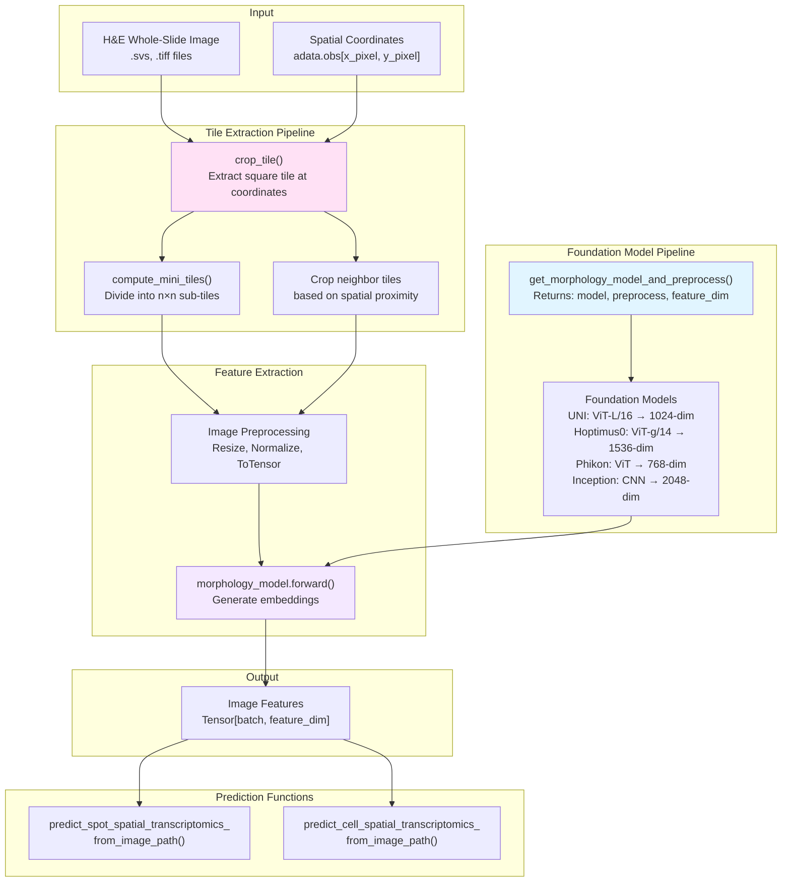
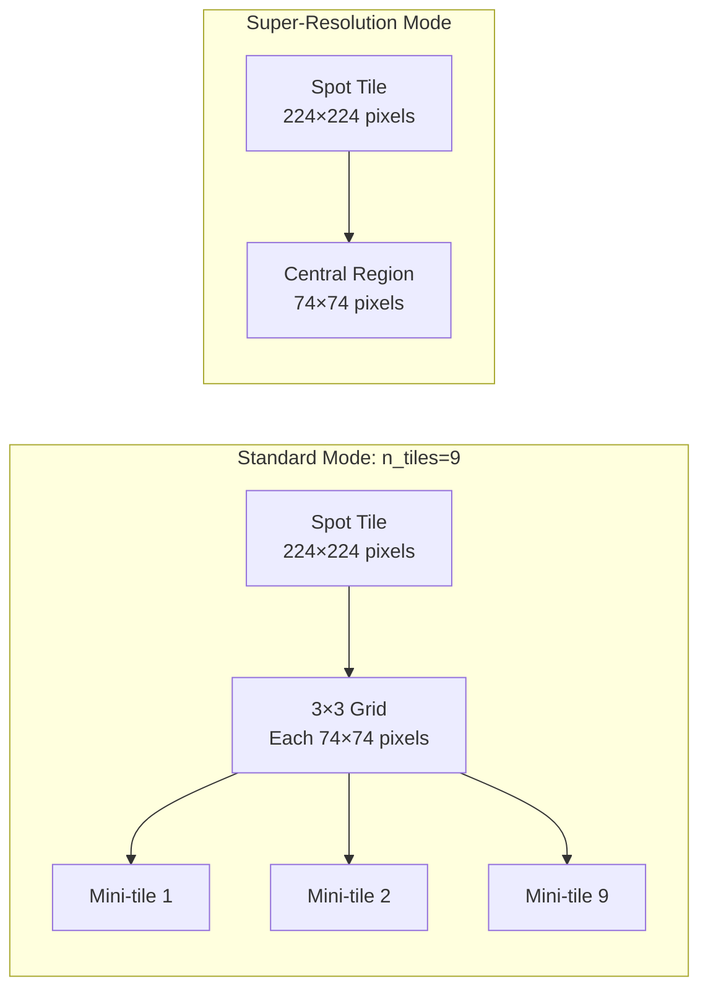
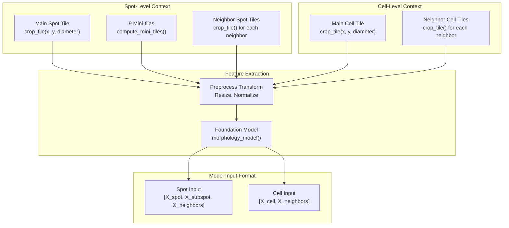

# Image Processing

<details>
<summary>Relevant source files</summary>

The following files were used as context for generating this wiki page:

- [.codeboarding/Image Processing Module.md](.codeboarding/Image Processing Module.md)
- [deepspot/utils/utils_image.py](deepspot/utils/utils_image.py)

</details>


This document describes the image processing subsystem of DeepSpot, which handles loading and preprocessing of H&E whole-slide images (WSI), extracting spatial tiles, and computing morphological features using pretrained foundation models. Image processing is the bridge between raw histology images and the neural network models that predict spatial transcriptomics.

For information about the data loaders that consume these image features, see [Data Management & Preprocessing](#4). For details about the neural network architectures that process these features, see [Model Architecture](#5).

---

## Overview

The image processing pipeline consists of three main stages:

1. **Foundation Model Loading**: Loading pretrained pathology vision models (UNI, Hoptimus0, Phikon) and their associated preprocessing transforms
2. **Spatial Tile Extraction**: Cropping tiles from whole-slide images at specific coordinates (spots or cells) and optionally dividing them into mini-tiles
3. **Feature Extraction**: Processing tiles through foundation models to generate fixed-dimensional embeddings

All image processing functionality is centralized in [deepspot/utils/utils_image.py:1-357]().



**Figure 1: Image Processing Pipeline Architecture**

**Sources**: [deepspot/utils/utils_image.py:36-357]()

---

## Foundation Models and Feature Extractors

DeepSpot supports six foundation models for extracting morphological features from histology images. Each model has specific characteristics regarding architecture, output dimensionality, and preprocessing requirements.

### Supported Models

| Model Name | Architecture | Feature Dimension | Input Size | Normalization Mean | Normalization Std | Source |
|------------|--------------|-------------------|------------|-------------------|------------------|--------|
| `uni` | ViT-Large/16 | 1024 | 224×224 | (0.485, 0.456, 0.406) | (0.229, 0.224, 0.225) | timm |
| `hoptimus0` | ViT-Giant/14 | 1536 | 224×224 | (0.707, 0.579, 0.704) | (0.212, 0.230, 0.178) | timm |
| `phikon` | ViT-Base | 768 | 224×224 | HuggingFace AutoImageProcessor | HuggingFace AutoImageProcessor | transformers |
| `phikonv2` | ViT-Base | 1024 | 224×224 | HuggingFace AutoImageProcessor | HuggingFace AutoImageProcessor | transformers |
| `inception` | Inception V3 | 2048 | 299×299 | ImageNet default | ImageNet default | torchvision |
| `resnet50` | ResNet-50 | 2048 | 224×224 | ImageNet default | ImageNet default | torchvision |
| `densenet121` | DenseNet-121 | 1024 | 224×224 | ImageNet default | ImageNet default | torchvision |

**Sources**: [deepspot/utils/utils_image.py:36-177]()

### Model Loading Function

The `get_morphology_model_and_preprocess()` function provides a unified interface for loading any supported foundation model:

```python
morphology_model, preprocess, feature_dim = get_morphology_model_and_preprocess(
    model_name="uni",
    device=torch.device("cuda"),
    model_path="/path/to/uni_weights.pth"
)
```

**Parameters:**
- `model_name` (str): One of the supported model names listed above
- `device` (torch.device): Device to load the model onto
- `model_path` (str, optional): Path to pretrained weights (required for UNI, Hoptimus0, Phikon)

**Returns:**
- `morphology_model` (torch.nn.Module): The loaded model in eval mode
- `preprocess` (callable): Transform function to preprocess images before feeding to the model
- `feature_dim` (int): Dimensionality of the output features

**Sources**: [deepspot/utils/utils_image.py:36-177]()

---

## Image Loading and Tile Extraction

### Whole-Slide Image Loading

DeepSpot uses `pyvips` for memory-efficient loading of large whole-slide images. Unlike loading the entire image into memory, `pyvips` streams image regions on-demand.

```python
import pyvips
image = pyvips.Image.new_from_file(image_path, access='sequential')
```

The `get_low_res_image()` function provides downsampled views for visualization:

```python
low_res_array = get_low_res_image(
    image_path="/path/to/slide.svs",
    downsample_factor=32
)
```

**Sources**: [deepspot/utils/utils_image.py:180-187]()

### Tile Cropping

The `crop_tile()` function extracts square tiles centered at specific pixel coordinates:

```python
tile = crop_tile(
    image=pyvips_image,
    x_pixel=5000,
    y_pixel=3000,
    cell_diameter=112  # tile size in pixels
)
# Returns: numpy.ndarray of shape [cell_diameter, cell_diameter, 3]
```

**Implementation Details:**
- Centers the crop at `(x_pixel, y_pixel)`
- Extracts a square region of size `cell_diameter × cell_diameter`
- Converts from pyvips format to numpy array
- Retains only RGB channels (first 3 bands)

**Sources**: [deepspot/utils/utils_image.py:190-198]()

### Mini-Tile Decomposition

For spot-level predictions, DeepSpot decomposes each spot tile into an n×n grid of mini-tiles to capture sub-spot heterogeneity. The `compute_mini_tiles()` function performs this decomposition:

```python
mini_tiles = compute_mini_tiles(
    image=spot_tile,  # shape [224, 224, 3]
    n_tiles=9,        # 3×3 grid
    super_resolution_mode=False
)
# Returns: list of 9 numpy arrays, each of shape [74, 74, 3]
```

**Modes:**
- **Standard mode** (`super_resolution_mode=False`): Divides the tile into a non-overlapping n×n grid
- **Super-resolution mode** (`super_resolution_mode=True`): Extracts a single central tile for higher resolution processing



**Figure 2: Mini-Tile Decomposition Strategies**

**Sources**: [deepspot/utils/utils_image.py:201-234]()

---

## Spatial Context Aggregation

DeepSpot models incorporate spatial context by processing neighboring spots or cells. The image processing pipeline handles this by:

1. Computing spatial neighbors based on coordinates
2. Cropping tiles for each neighbor
3. Processing all tiles through the foundation model
4. Passing the feature sets to the neural network



**Figure 3: Spatial Context Processing for Spots and Cells**

**Sources**: [deepspot/utils/utils_image.py:241-356](), [deepspot/utils/utils_dataloader.py:115-124]()

---

## Prediction Functions

The image processing module provides two high-level prediction functions that integrate all components:

### Spot-Level Prediction

`predict_spot_spatial_transcriptomics_from_image_path()` processes Visium spot data:

```python
counts = predict_spot_spatial_transcriptomics_from_image_path(
    image_path="/path/to/slide.svs",
    adata=anndata_object,
    spot_diameter=224,
    n_mini_tiles=9,
    preprocess=preprocess_function,
    morphology_model=foundation_model,
    model_expression=deepspot_model,
    device=torch.device("cuda"),
    super_resolution=False,
    neighbor_radius=1
)
# Returns: numpy.ndarray of shape [n_spots, n_genes]
```

**Processing Steps:**
1. For each spot in `adata.obs`:
   - Compute neighbors using `compute_neighbors()` with specified `neighbor_radius`
   - Crop main spot tile using `crop_tile()`
   - Decompose into mini-tiles using `compute_mini_tiles()`
   - Crop tiles for all neighboring spots
2. Preprocess all tiles using `preprocess`
3. Extract features using `morphology_model`
4. Predict gene expression using `model_expression`
5. Apply inverse transformation to convert from normalized space to counts

**Sources**: [deepspot/utils/utils_image.py:241-292]()

### Cell-Level Prediction

`predict_cell_spatial_transcriptomics_from_image_path()` processes Xenium cell data:

```python
counts = predict_cell_spatial_transcriptomics_from_image_path(
    image_path="/path/to/slide.tiff",
    adata=anndata_object,
    cell_diameter=112,
    radius_neighbors=45,
    preprocess=preprocess_function,
    morphology_model=foundation_model,
    model_expression=deepcell_model,
    device=torch.device("cuda")
)
# Returns: numpy.ndarray of shape [n_cells, n_genes]
```

**Processing Steps:**
1. Compute neighbors for all cells using `sklearn.neighbors.NearestNeighbors` with `radius_neighbors`
2. Store neighbor barcodes in `adata.obs["neighbors"]`
3. For each cell in `adata.obs`:
   - Crop main cell tile using `crop_tile()`
   - Crop tiles for all neighboring cells
4. Preprocess all tiles using `preprocess`
5. Extract features using `morphology_model`
6. Predict gene expression using `model_expression`
7. Apply inverse transformation

**Key Differences from Spot Prediction:**
- No mini-tile decomposition (cells are smaller than spots)
- Uses radius-based neighbor computation via scikit-learn
- Input format is `[X_cell, X_neighbors]` instead of `[X_spot, X_subspot, X_neighbors]`

**Sources**: [deepspot/utils/utils_image.py:295-356]()

---

## Performance Optimizations

### Mixed-Precision Inference

Both prediction functions use `torch.autocast` for faster inference with reduced memory:

```python
with torch.autocast(device_type="cuda", dtype=torch.float16):
    with torch.inference_mode():
        # Feature extraction and prediction
```

This enables automatic mixed-precision, using FP16 where safe and FP32 where necessary.

### Memory-Efficient Image Loading

Using `pyvips` with `access='sequential'` enables streaming access:
- Does not load entire WSI into memory
- Crops regions on-demand
- Supports images larger than available RAM

### Batch Processing

While prediction functions iterate over spots/cells individually, feature extraction internally uses batch processing:
- Mini-tiles are stacked and processed as batches: `morphology_model(X_subspot)` where `X_subspot` has shape `[n_mini_tiles, 3, 224, 224]`
- Neighbor tiles are batched: `morphology_model(X_neighbors)` where `X_neighbors` has shape `[n_neighbors, 3, 224, 224]`

**Sources**: [deepspot/utils/utils_image.py:255-256](), [deepspot/utils/utils_image.py:322-323]()

---

## Data Type Conversions

The `format_to_dtype` dictionary maps pyvips format strings to numpy dtypes:

```python
format_to_dtype = {
    'uchar': np.uint8,
    'char': np.int8,
    'ushort': np.uint16,
    'short': np.int16,
    'uint': np.uint32,
    'int': np.int32,
    'float': np.float32,
    'double': np.float64,
    'complex': np.complex64,
    'dpcomplex': np.complex128,
}
```

This enables correct conversion from pyvips internal formats to numpy arrays during tile extraction.

**Sources**: [deepspot/utils/utils_image.py:22-33]()

---

## Integration with Training Pipeline

During training, image features are typically pre-computed and saved to disk rather than extracted on-the-fly:

1. **Preprocessing Phase**: Run feature extraction once for all spots/cells, save as `.npy` files
2. **Training Phase**: Load pre-computed features from disk via data loaders
3. **Inference Phase**: Extract features on-the-fly using prediction functions

This separation improves training efficiency since feature extraction through large foundation models is computationally expensive. The data loaders ([DeepSpotDataLoader](#4.4) and [DeepCellDataLoader](#4.3)) expect pre-computed features as input.

For on-the-fly inference on new images without pre-computed features, use the prediction functions documented above.

**Sources**: [deepspot/utils/utils_image.py:241-356]()

---

## Summary

The image processing module provides:

| Component | Function | Input | Output |
|-----------|----------|-------|--------|
| Model Loading | `get_morphology_model_and_preprocess()` | model name, device, path | model, preprocess, feature_dim |
| Image Loading | `pyvips.Image.new_from_file()` | image path | pyvips.Image |
| Tile Cropping | `crop_tile()` | image, x, y, diameter | numpy.ndarray [D, D, 3] |
| Mini-Tiles | `compute_mini_tiles()` | tile, n_tiles | list of numpy arrays |
| Spot Prediction | `predict_spot_spatial_transcriptomics_from_image_path()` | image path, adata, models | numpy.ndarray [n_spots, n_genes] |
| Cell Prediction | `predict_cell_spatial_transcriptomics_from_image_path()` | image path, adata, models | numpy.ndarray [n_cells, n_genes] |

For detailed documentation on specific functions, see:
- [Image Utilities](#6.1)
- [Morphology Model Loading](#6.2)
- [Prediction from Image Paths](#6.3)

**Sources**: [deepspot/utils/utils_image.py:1-357]()

---