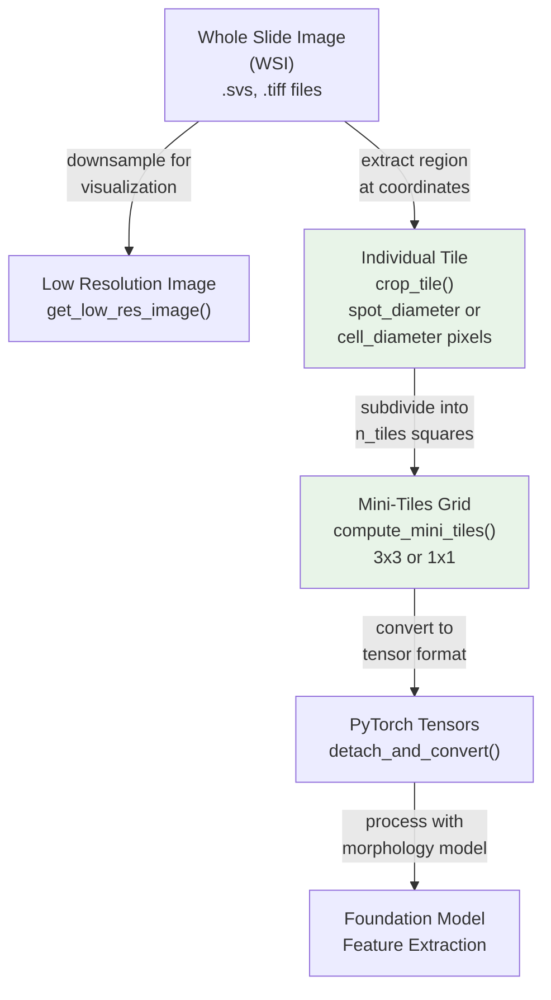
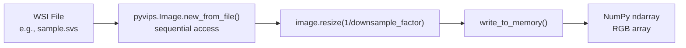
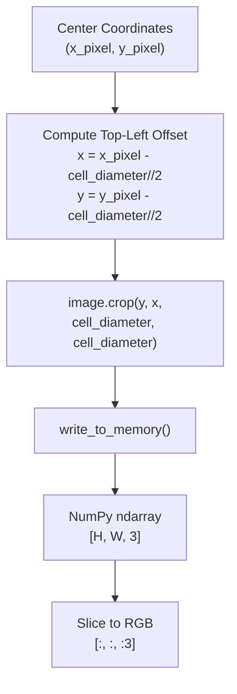
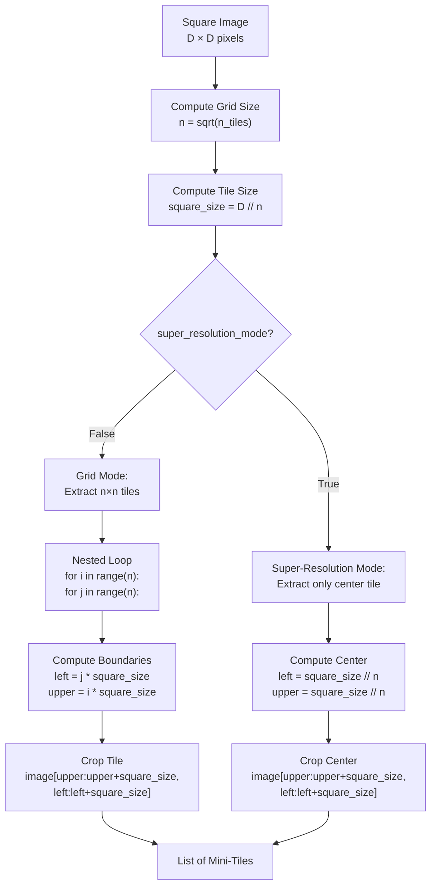
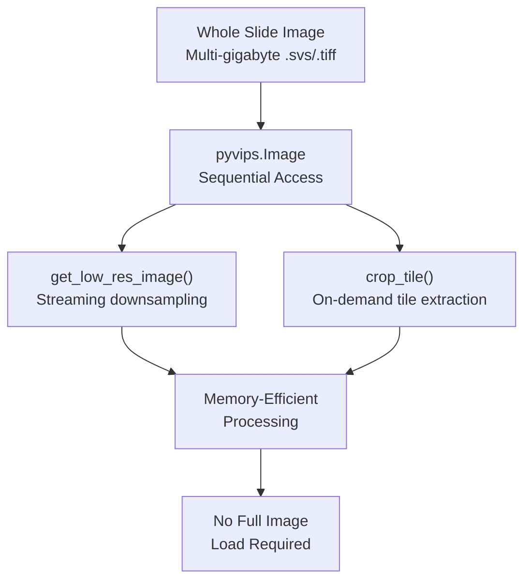
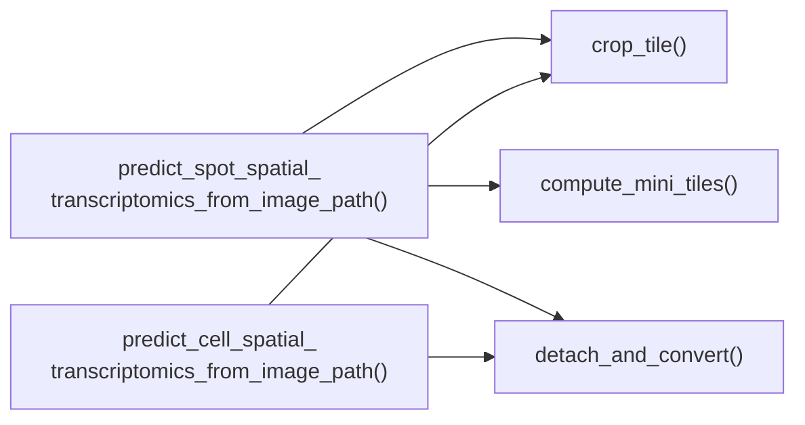

# Image Utilities

<details>
<summary>Relevant source files</summary>

The following files were used as context for generating this wiki page:

- [.codeboarding/Image Processing Module.md](.codeboarding/Image Processing Module.md)
- [deepspot/utils/utils_image.py](deepspot/utils/utils_image.py)

</details>


The `utils_image.py` module provides low-level image processing functions for loading, cropping, and tiling histology images in preparation for feature extraction and model inference. These utilities handle the spatial decomposition of H&E whole-slide images into tiles and sub-tiles that can be processed by foundation models.

For information about loading morphology models and their preprocessing pipelines, see [Morphology Model Loading](#6.2). For complete inference workflows that use these utilities, see [Prediction from Image Paths](#6.3).

---

## Image Processing Workflow

The image utilities support a hierarchical spatial decomposition strategy where large whole-slide images are broken down into manageable tiles:



**Sources:** [deepspot/utils/utils_image.py:180-238]()

---

## Image Loading with Downsampling

### `get_low_res_image()`

The `get_low_res_image()` function loads a downsampled version of a whole-slide image using `pyvips` for memory-efficient streaming:

| Parameter | Type | Description |
|-----------|------|-------------|
| `image_path` | str | Path to whole-slide image file |
| `downsample_factor` | float | Factor by which to reduce resolution (e.g., 16 for 16× downsampling) |

**Returns:** `np.ndarray` with shape `[height, width, bands]`



The function uses the `format_to_dtype` lookup table [deepspot/utils/utils_image.py:22-33]() to correctly interpret pyvips format strings (`'uchar'`, `'float'`, etc.) as NumPy dtypes. This ensures proper memory mapping when converting from pyvips internal representation to NumPy arrays.

**Key Implementation Details:**
- Uses `access='sequential'` mode for efficient streaming without loading entire image into memory
- Automatically determines output dtype based on pyvips image format
- Returns RGB array with shape `[height, width, bands]` where `bands` is typically 3 for RGB

**Sources:** [deepspot/utils/utils_image.py:180-187](), [deepspot/utils/utils_image.py:22-33]()

---

## Tile Extraction at Specific Coordinates

### `crop_tile()`

The `crop_tile()` function extracts a square tile centered at specified pixel coordinates:

| Parameter | Type | Description |
|-----------|------|-------------|
| `image` | pyvips.Image | Loaded pyvips image object |
| `x_pixel` | int | X coordinate of tile center |
| `y_pixel` | int | Y coordinate of tile center |
| `cell_diameter` | int | Side length of square tile in pixels |

**Returns:** `np.ndarray` with shape `[cell_diameter, cell_diameter, 3]` (RGB)



**Coordinate Convention:**
- Input coordinates `(x_pixel, y_pixel)` represent the **center** of the desired tile
- The function computes the top-left corner by subtracting `cell_diameter // 2` from each coordinate
- Note: pyvips uses `(y, x)` ordering for `crop()`, requiring coordinate swapping

**RGB Channel Extraction:**
The function explicitly slices `[:, :, :3]` to extract only RGB channels, discarding any alpha channel that may be present in the source image.

**Sources:** [deepspot/utils/utils_image.py:190-198]()

---

## Mini-Tile Grid Computation

### `compute_mini_tiles()`

The `compute_mini_tiles()` function subdivides a square tile into a grid of smaller tiles. This is crucial for DeepSpot's spot-level architecture, which models each spot as a "bag" of sub-spot regions.

| Parameter | Type | Description |
|-----------|------|-------------|
| `image` | np.ndarray | Square image array with shape `[D, D, channels]` |
| `n_tiles` | int | Number of mini-tiles to create (must be perfect square: 1, 4, 9, 16, ...) |
| `super_resolution_mode` | bool | If `True`, extract only the center tile instead of grid |

**Returns:** `list` of `np.ndarray` mini-tiles



**Standard Grid Mode (`super_resolution_mode=False`):**
When processing a standard Visium spot with `n_tiles=9`:
1. Input: `224 × 224` pixel tile representing a ~55μm spot
2. Compute grid size: `n = sqrt(9) = 3`
3. Compute tile size: `square_size = 224 // 3 = 74` pixels
4. Extract 9 tiles in row-major order: `[(0,0), (0,1), (0,2), (1,0), ..., (2,2)]`

**Super-Resolution Mode (`super_resolution_mode=True`):**
Extracts only the center tile, used when the full tile already represents sub-spot resolution. The center offset is computed as `square_size // n` to position the crop in the center of the original image.

**Sources:** [deepspot/utils/utils_image.py:201-234]()

---

## Mini-Tile Use Cases by Resolution

The mini-tiling strategy varies depending on the spatial resolution:

| Resolution | Technology | Tile Represents | `n_tiles` | Mini-Tile Purpose |
|------------|-----------|-----------------|-----------|-------------------|
| Spot-level | Visium | ~55μm spot (~1-10 cells) | 9 (3×3 grid) | Capture sub-spot heterogeneity |
| Spot-level | Visium | ~55μm spot | 1 (full tile) | No sub-tiling, process entire spot |
| Cell-level | Xenium | ~20μm cell | 1 (full tile) | Cell already at resolution limit |

**Sources:** [deepspot/utils/utils_image.py:201-234]()

---

## Tensor Conversion Utilities

### `detach_and_convert()`

A simple utility function for converting model outputs to detached float tensors with an added batch dimension:

```python
def detach_and_convert(data):
    return data[None, ].detach().float()
```

| Operation | Purpose |
|-----------|---------|
| `data[None, ]` | Adds batch dimension at position 0: `[N, D]` → `[1, N, D]` |
| `.detach()` | Disconnects tensor from computational graph (no gradients) |
| `.float()` | Ensures float32 dtype |

This function is used in inference pipelines [deepspot/utils/utils_image.py:241-356]() to prepare feature embeddings from the morphology model before passing them to the expression prediction model.

**Sources:** [deepspot/utils/utils_image.py:237-238]()

---

## Integration with pyvips

All image loading and cropping functions use the `pyvips` library for memory-efficient processing of large whole-slide images:



**Key pyvips Advantages:**
- **Streaming:** Images loaded with `access='sequential'` can be processed in chunks without loading entire file
- **Lazy Evaluation:** Operations like `resize()` and `crop()` are deferred until `write_to_memory()` is called
- **Format Support:** Native support for `.svs`, `.tiff`, `.ndpi` and other whole-slide imaging formats via OpenSlide backend

**Format-to-Dtype Mapping:**
The module defines a dictionary [deepspot/utils/utils_image.py:22-33]() that maps pyvips format strings to NumPy dtypes:

| pyvips Format | NumPy dtype |
|---------------|-------------|
| `'uchar'` | `np.uint8` |
| `'float'` | `np.float32` |
| `'double'` | `np.float64` |
| `'ushort'` | `np.uint16` |
| `'uint'` | `np.uint32` |

**Sources:** [deepspot/utils/utils_image.py:180-198](), [deepspot/utils/utils_image.py:22-33]()

---

## Usage in Inference Pipelines

These utilities are composed into higher-level inference functions:



**Spot-Level Pipeline [deepspot/utils/utils_image.py:241-292]():**
1. Load image with pyvips
2. For each spot in `adata.obs`:
   - `crop_tile()` to extract spot region
   - `compute_mini_tiles()` to create 3×3 grid (if using sub-spots)
   - `crop_tile()` to extract neighbor spots
   - Preprocess all tiles with morphology model
   - `detach_and_convert()` feature embeddings
   - Pass to DeepSpot model for prediction

**Cell-Level Pipeline [deepspot/utils/utils_image.py:295-356]():**
1. Load image with pyvips
2. For each cell in `adata.obs`:
   - `crop_tile()` to extract cell region
   - `crop_tile()` to extract neighbor cells
   - Preprocess all tiles with morphology model
   - `detach_and_convert()` feature embeddings
   - Pass to DeepCell model for prediction

See [Prediction from Image Paths](#6.3) for detailed documentation of these inference functions.

**Sources:** [deepspot/utils/utils_image.py:241-356]()

---

## Summary of Functions

| Function | Input | Output | Purpose |
|----------|-------|--------|---------|
| `get_low_res_image()` | Image path, downsample factor | NumPy array | Load downsampled image for visualization |
| `crop_tile()` | pyvips image, center coords, diameter | NumPy array `[D, D, 3]` | Extract square tile at coordinates |
| `compute_mini_tiles()` | Square array, n_tiles, mode flag | List of NumPy arrays | Subdivide tile into n×n grid |
| `detach_and_convert()` | PyTorch tensor | Detached float tensor with batch dim | Prepare features for model input |

**Sources:** [deepspot/utils/utils_image.py:180-238]()

---