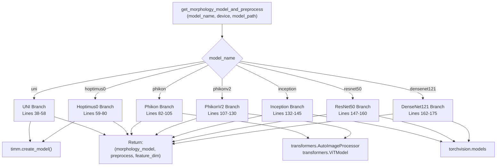
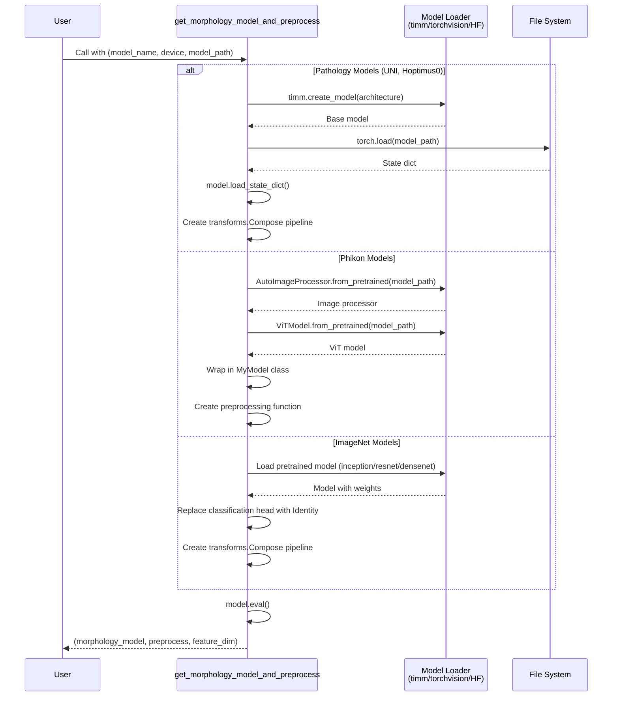
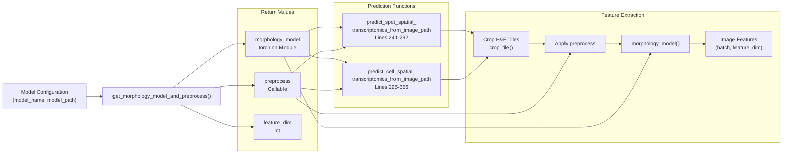

# Morphology Model Loading

<details>
<summary>Relevant source files</summary>

The following files were used as context for generating this wiki page:

- [README.md](README.md)
- [deepspot/utils/utils_image.py](deepspot/utils/utils_image.py)

</details>


This page documents the morphology model loading infrastructure in DeepSpot, specifically the `get_morphology_model_and_preprocess` function that initializes pathology foundation models for feature extraction from H&E images. For information about how these models are used during prediction workflows, see [Prediction from Image Paths](#6.3). For general image processing utilities, see [Image Utilities](#6.1).

**Sources**: [deepspot/utils/utils_image.py:36-177](), [README.md:80-86]()

---

## Purpose and Architecture

The DeepSpot system relies on pretrained pathology foundation models to extract morphological features from histology images. The `get_morphology_model_and_preprocess` function serves as a unified interface to load different foundation models and their corresponding preprocessing pipelines. This abstraction enables seamless switching between models without modifying downstream code.

**Function Signature**:
```python
def get_morphology_model_and_preprocess(model_name, device, model_path=None):
    # Returns: (morphology_model, preprocess, feature_dim)
```

The function returns three components:
1. **morphology_model**: A PyTorch model ready for inference
2. **preprocess**: A transformation pipeline to prepare images for the model
3. **feature_dim**: The dimensionality of the model's output features

**Sources**: [deepspot/utils/utils_image.py:36-37]()

---

## Supported Foundation Models

The system supports seven pathology foundation models, divided into two categories: specialized pathology models and general-purpose computer vision models.

### Model Specifications

| Model Name | Architecture | Feature Dimension | Source | Training Data |
|------------|--------------|-------------------|--------|---------------|
| `uni` | ViT-L/16 | 1024 | HuggingFace/MahmoodLab | Pathology images |
| `hoptimus0` | ViT-g/14 (DINOv2) | 1536 | HuggingFace/bioptimus | Pathology images |
| `phikon` | ViT | 768 | HuggingFace/owkin | Pathology images |
| `phikonv2` | ViT | 1024 | HuggingFace/owkin | Pathology images |
| `inception` | Inception V3 | 2048 | torchvision | ImageNet |
| `resnet50` | ResNet-50 | 2048 | torchvision | ImageNet |
| `densenet121` | DenseNet-121 | 1024 | torchvision | ImageNet |

**Recommended Models**: The paper and pretrained weights use pathology-specific foundation models (UNI, Hoptimus0, Phikon) as they provide superior performance on histology images compared to ImageNet-pretrained models.

**Sources**: [deepspot/utils/utils_image.py:38-176](), [README.md:80-86]()

---

## Model Loading Architecture



**Diagram**: Model loading dispatch mechanism in `get_morphology_model_and_preprocess`

**Sources**: [deepspot/utils/utils_image.py:36-177]()

---

## Pathology Foundation Models

### UNI Model

**UNI** (Universal Network for pathology Images) is a ViT-Large/16 model trained on pathology images.

**Loading Process**:
```python
# Model architecture creation
morphology_model = timm.create_model(
    "vit_large_patch16_224",
    img_size=224,
    patch_size=16,
    init_values=1e-5,
    num_classes=0,
    dynamic_img_size=True
)
# Load pretrained weights
morphology_model.load_state_dict(torch.load(model_path, map_location=device), strict=True)
```

**Preprocessing Pipeline**:
- Convert to tensor
- Resize to 224×224 pixels
- Normalize with ImageNet statistics: mean=(0.485, 0.456, 0.406), std=(0.229, 0.224, 0.225)

**Feature Dimension**: 1024

**Sources**: [deepspot/utils/utils_image.py:38-58](), [README.md:84]()

---

### Hoptimus0 Model

**Hoptimus0** is a ViT-giant/14 model based on DINOv2 architecture, specifically trained for pathology applications.

**Loading Process**:
```python
# Model architecture creation
morphology_model = timm.create_model(
    "vit_giant_patch14_reg4_dinov2",
    img_size=224,
    init_values=1e-5,
    num_classes=0,
    dynamic_img_size=True
)
# Load pretrained weights
morphology_model.load_state_dict(torch.load(model_path, map_location=device), strict=True)
```

**Preprocessing Pipeline**:
- Convert to tensor
- Resize to 224×224 pixels
- Normalize with pathology-specific statistics: mean=(0.707223, 0.578729, 0.703617), std=(0.211883, 0.230117, 0.177517)

**Feature Dimension**: 1536

**Note**: Hoptimus0 uses pathology-specific normalization statistics that differ from ImageNet.

**Sources**: [deepspot/utils/utils_image.py:59-80](), [README.md:85]()

---

### Phikon Models

**Phikon** and **PhikonV2** are Vision Transformer models from Owkin, trained on histopathology images.

**Phikon (v1) Loading Process**:
```python
# Load processor and model from HuggingFace
image_processor = AutoImageProcessor.from_pretrained(model_path)
model = ViTModel.from_pretrained(model_path, add_pooling_layer=False)

# Custom preprocessing function
def image_processor_edit(x):
    x = image_processor(x, return_tensors="pt")["pixel_values"].squeeze()
    return x

# Wrapper to extract CLS token
class MyModel(torch.nn.Module):
    def __init__(self, model):
        super().__init__()
        self.model = model
    
    def forward(self, x):
        with torch.no_grad():
            x = self.model(x)
            x = x.last_hidden_state[:, 0, :]  # Extract CLS token
            return x
```

**Feature Dimensions**:
- Phikon: 768
- PhikonV2: 1024

**Key Difference**: Phikon models use HuggingFace's `transformers` library with custom wrappers to extract the CLS token from the transformer output.

**Sources**: [deepspot/utils/utils_image.py:82-130](), [README.md:86]()

---

## Computer Vision Models

The system also supports three standard ImageNet-pretrained models for baseline comparisons.

### Inception V3

**Loading**:
```python
weights = Inception_V3_Weights.DEFAULT
morphology_model = inception_v3(weights=weights)
morphology_model.fc = torch.nn.Identity()  # Remove classification head
```

**Feature Dimension**: 2048

**Sources**: [deepspot/utils/utils_image.py:132-145]()

---

### ResNet-50

**Loading**:
```python
weights = ResNet50_Weights.DEFAULT
morphology_model = resnet50(weights=weights)
morphology_model.fc = torch.nn.Identity()  # Remove classification head
```

**Feature Dimension**: 2048

**Sources**: [deepspot/utils/utils_image.py:147-160]()

---

### DenseNet-121

**Loading**:
```python
weights = DenseNet121_Weights.DEFAULT
morphology_model = densenet121(weights=weights)
morphology_model.classifier = torch.nn.Identity()  # Remove classification head
```

**Feature Dimension**: 1024

**Sources**: [deepspot/utils/utils_image.py:162-175]()

---

## Model Loading Flow



**Diagram**: Sequence of operations during model loading

**Sources**: [deepspot/utils/utils_image.py:36-177]()

---

## Configuration and Setup

### Required Setup Steps

1. **Download Foundation Model Weights**: Users must manually download weights for pathology foundation models (UNI, Hoptimus0, Phikon) from HuggingFace. Links are provided in [README.md:84-86]().

2. **Update File Paths**: The `model_path` parameter must point to the local path where weights are stored. As stated in [README.md:82](): "Please ensure that you download the weights for the pathology foundation models and update their file path deepspot/utils/utils_image.py."

3. **Accept Terms**: Some models require agreeing to specific terms and conditions before downloading from HuggingFace.

### Usage Example

```python
from deepspot.utils.utils_image import get_morphology_model_and_preprocess
import torch

# Load UNI model
device = torch.device("cuda" if torch.cuda.is_available() else "cpu")
model_path = "/path/to/uni/pytorch_model.bin"

morphology_model, preprocess, feature_dim = get_morphology_model_and_preprocess(
    model_name="uni",
    device=device,
    model_path=model_path
)

# Move model to device
morphology_model = morphology_model.to(device)
morphology_model.eval()

# Use preprocessing pipeline on an image
from PIL import Image
image = Image.open("path/to/tile.png")
tensor = preprocess(image).to(device)

# Extract features
with torch.no_grad():
    features = morphology_model(tensor.unsqueeze(0))  # Add batch dimension
    # features.shape = (1, feature_dim)
```

**Sources**: [deepspot/utils/utils_image.py:36-177]()

---

## Integration with Prediction Pipeline



**Diagram**: How morphology models integrate with the prediction pipeline

The loaded morphology model and preprocessing function are passed to prediction functions `predict_spot_spatial_transcriptomics_from_image_path` and `predict_cell_spatial_transcriptomics_from_image_path`, where they extract features from H&E tiles during inference.

**Sources**: [deepspot/utils/utils_image.py:241-356]()

---

## Model Selection Guidelines

| Use Case | Recommended Model | Rationale |
|----------|-------------------|-----------|
| **Production Inference** | UNI or Hoptimus0 | Pathology-specific training, validated in paper |
| **High-dimensional features** | Hoptimus0 | 1536-dim features capture more detail |
| **Memory-constrained** | Phikon | 768-dim features reduce memory footprint |
| **Baseline comparison** | Inception V3 | Standard ImageNet model for ablation studies |
| **Fast prototyping** | DenseNet-121 | Smaller model, faster inference |

**Note**: All pretrained DeepSpot weights available on Zenodo were trained using pathology foundation models, not ImageNet models.

**Sources**: [README.md:75-78]()

---

## Preprocessing Pipelines by Model

```mermaid
graph TB
    subgraph "UNI Preprocessing"
        U1["PIL Image"]
        U2["transforms.ToTensor()"]
        U3["transforms.Resize(224)"]
        U4["transforms.Normalize<br/>mean=(0.485, 0.456, 0.406)<br/>std=(0.229, 0.224, 0.225)"]
        U1 --> U2 --> U3 --> U4
    end
    
    subgraph "Hoptimus0 Preprocessing"
        H1["PIL Image"]
        H2["transforms.ToTensor()"]
        H3["transforms.Resize(224)"]
        H4["transforms.Normalize<br/>mean=(0.707, 0.578, 0.704)<br/>std=(0.212, 0.230, 0.178)"]
        H1 --> H2 --> H3 --> H4
    end
    
    subgraph "Phikon Preprocessing"
        P1["PIL Image"]
        P2["AutoImageProcessor<br/>from HuggingFace"]
        P3["Extract pixel_values tensor"]
        P1 --> P2 --> P3
    end
    
    subgraph "ImageNet Models Preprocessing"
        I1["PIL Image"]
        I2["transforms.ToTensor()"]
        I3["weights.transforms()<br/>Model-specific transforms"]
        I1 --> I2 --> I3
    end
```



**Diagram**: Different preprocessing pipelines for each model family

**Key Differences**:
- UNI uses ImageNet normalization statistics
- Hoptimus0 uses pathology-specific normalization
- Phikon uses HuggingFace's AutoImageProcessor
- ImageNet models use their respective default transforms

**Sources**: [deepspot/utils/utils_image.py:50-173]()

---

## Error Handling and Validation

The function performs minimal error handling, relying on:
1. PyTorch/timm to raise errors for invalid architectures
2. `torch.load()` to raise errors for missing or corrupted weight files
3. HuggingFace transformers to validate model paths

**Common Issues**:
- **Missing model_path**: Required for UNI, Hoptimus0, and Phikon models
- **Invalid model_name**: Results in no matching branch, function returns without value
- **Corrupted weights**: `torch.load()` will fail with error message
- **Missing HuggingFace dependencies**: Import errors if transformers not installed

**Sources**: [deepspot/utils/utils_image.py:36-177]()

---

## Feature Dimension Mapping

The `feature_dim` return value is critical for downstream model initialization, as it determines the input size for the Phi neural layers (see [Phi and Rho Neural Layers](#5.3)).

| Model | Feature Dim | Used By |
|-------|-------------|---------|
| UNI | 1024 | DeepSpot.phi_modules input |
| Hoptimus0 | 1536 | DeepSpot.phi_modules input |
| Phikon | 768 | DeepSpot.phi_modules input |
| PhikonV2 | 1024 | DeepSpot.phi_modules input |
| Inception | 2048 | DeepSpot.phi_modules input |
| ResNet50 | 2048 | DeepSpot.phi_modules input |
| DenseNet121 | 1024 | DeepSpot.phi_modules input |

**Architecture Implication**: The Phi ensemble modules must be initialized with `input_dim=feature_dim` to properly receive features from the morphology model.

**Sources**: [deepspot/utils/utils_image.py:58-175]()

---