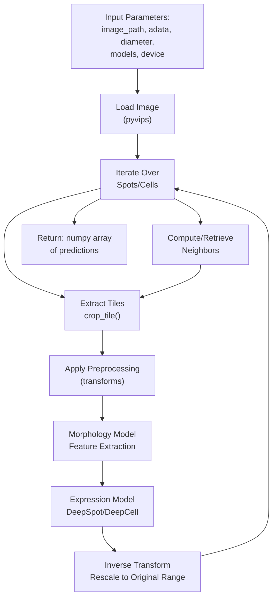
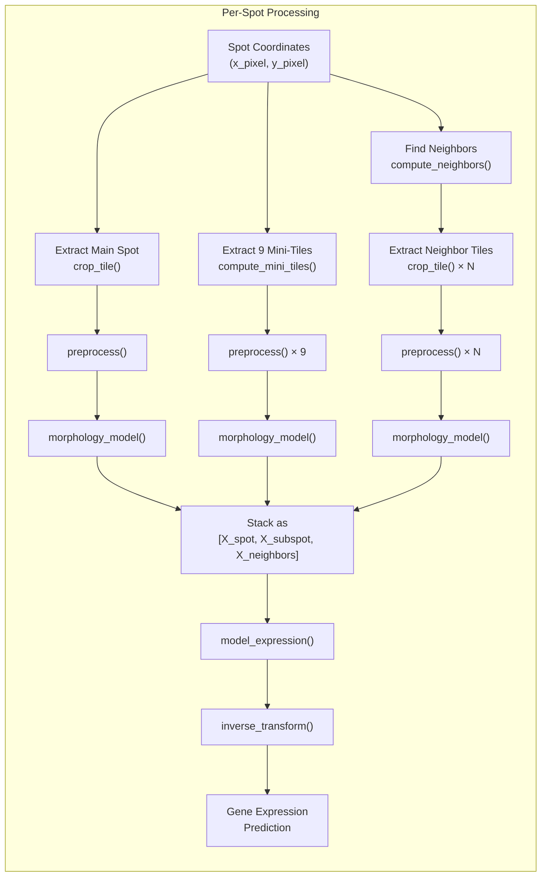
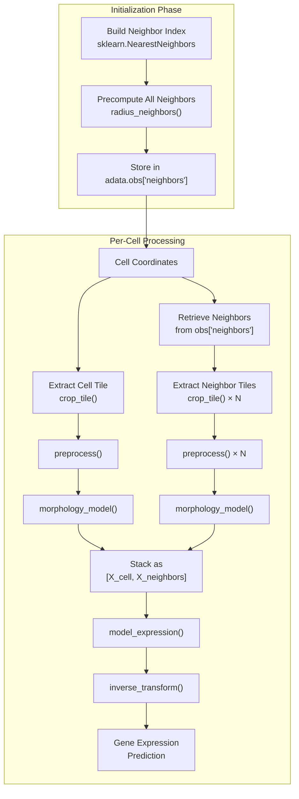
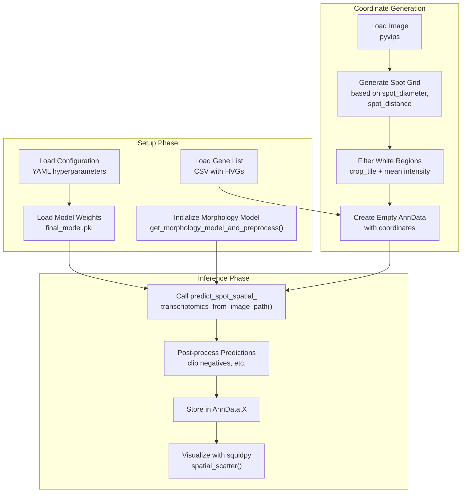

# Prediction from Image Paths

<details>
<summary>Relevant source files</summary>

The following files were used as context for generating this wiki page:

- [deepspot/utils/utils_image.py](deepspot/utils/utils_image.py)
- [example_notebook/Visium_spot_example/GettingStartedWithDeepSpot_3.1_inference_pretrained_models.ipynb](example_notebook/Visium_spot_example/GettingStartedWithDeepSpot_3.1_inference_pretrained_models.ipynb)

</details>


This page documents the high-level inference functions that predict spatial transcriptomics directly from H&E image paths. These functions orchestrate the complete prediction pipeline: loading images, extracting tiles, computing features with morphology models, and generating gene expression predictions.

**Scope**: This page covers the two main prediction functions: `predict_spot_spatial_transcriptomics_from_image_path` and `predict_cell_spatial_transcriptomics_from_image_path`. For details on the underlying models being invoked, see [DeepSpot Model](#5.2) and [DeepCell Model](#5.1). For morphology model configuration, see [Morphology Model Loading](#6.2). For complete end-to-end workflows, see [Visium Inference](#7.1.3) and [Xenium Inference](#7.2.3).

---

## Overview

The prediction-from-image-path functions provide a simplified interface for inference that handles all image processing internally. Unlike training workflows where image features are pre-extracted and stored, these functions perform feature extraction on-the-fly for each spot or cell.

### High-Level Prediction Workflow



**Sources**: [deepspot/utils/utils_image.py:241-356]()

---

## Spot-Level Prediction Function

The `predict_spot_spatial_transcriptomics_from_image_path` function generates spatial transcriptomics predictions for Visium spot-level data.

### Function Signature and Parameters

```python
predict_spot_spatial_transcriptomics_from_image_path(
    image_path,           # Path to H&E image (.svs, .tiff, etc.)
    adata,                # AnnData with spot coordinates in obs
    spot_diameter,        # Spot diameter in pixels
    n_mini_tiles,         # Number of mini-tiles (typically 9)
    preprocess,           # Preprocessing transform
    morphology_model,     # Foundation model for feature extraction
    model_expression,     # Trained DeepSpot model
    device,               # torch.device
    super_resolution=False,  # Super-resolution mode flag
    neighbor_radius=1     # Radius for neighbor computation
)
```

**Sources**: [deepspot/utils/utils_image.py:241-250]()

### Parameter Details

| Parameter | Type | Description |
|-----------|------|-------------|
| `image_path` | str | File path to whole-slide H&E image |
| `adata` | AnnData | AnnData object with `x_pixel`, `y_pixel`, `barcode` in `.obs` |
| `spot_diameter` | int | Diameter of spot in pixels (e.g., 100 for 20x magnification) |
| `n_mini_tiles` | int | Number of non-overlapping sub-tiles (always 9 for 3×3 grid) |
| `preprocess` | callable | Preprocessing function from `get_morphology_model_and_preprocess` |
| `morphology_model` | torch.nn.Module | Feature extraction model (UNI, Hoptimus0, etc.) |
| `model_expression` | DeepSpot | Trained DeepSpot model with inverse_transform capability |
| `device` | torch.device | Device for computation (cuda/cpu) |
| `super_resolution` | bool | If True, uses center-cropped mini-tile instead of grid |
| `neighbor_radius` | int | Spatial radius for neighbor spot detection |

**Sources**: [example_notebook/Visium_spot_example/GettingStartedWithDeepSpot_3.1_inference_pretrained_models.ipynb:115-151]()

### Spot Prediction Pipeline



**Sources**: [deepspot/utils/utils_image.py:257-291]()

### Implementation Details

The function performs the following steps for each spot:

1. **Image Loading**: Opens image using `pyvips.Image.new_from_file()` for memory-efficient streaming access
2. **Neighbor Computation**: Calls `compute_neighbors(spot, adata.obs, radius=neighbor_radius)` to identify neighboring spots within the specified radius
3. **Tile Extraction**:
   - Main spot tile: `crop_tile(image, x_pixel, y_pixel, spot_diameter)`
   - Mini-tiles: `compute_mini_tiles(X_spot, n_mini_tiles, super_resolution)`
   - Neighbor tiles: `crop_tile()` for each neighbor
4. **Preprocessing**: Applies preprocessing transform to all tiles
5. **Feature Extraction**: Passes preprocessed tiles through `morphology_model`
6. **Prediction**: Feeds features `[X_spot, X_subspot, X_neighbors]` to `model_expression`
7. **Rescaling**: Applies `model_expression.inverse_transform()` to convert normalized predictions back to original scale

**Optimization**: Uses `torch.autocast(device_type="cuda", dtype=torch.float16)` for mixed-precision inference and `torch.inference_mode()` for reduced memory overhead.

**Sources**: [deepspot/utils/utils_image.py:252-292]()

### Critical Post-Processing Note

The function calls `model_expression.inverse_transform(expr)` internally ([deepspot/utils/utils_image.py:288]()), which rescales predictions from normalized space back to the original gene expression scale. However, the example notebook shows additional post-processing may be needed:

```python
counts = predict_spot_spatial_transcriptomics_from_image_path(...)
counts = model_expression.inverse_transform(counts)  # Already done internally
counts[counts < 0] = 0  # Optional: clip negative values
```

**Sources**: [example_notebook/Visium_spot_example/GettingStartedWithDeepSpot_3.1_inference_pretrained_models.ipynb:369-423]()

---

## Cell-Level Prediction Function

The `predict_cell_spatial_transcriptomics_from_image_path` function generates predictions for Xenium single-cell data.

### Function Signature and Parameters

```python
predict_cell_spatial_transcriptomics_from_image_path(
    image_path,           # Path to H&E image
    adata,                # AnnData with cell coordinates
    cell_diameter,        # Cell diameter in pixels
    radius_neighbors,     # Radius for neighbor detection (pixels)
    preprocess,           # Preprocessing transform
    morphology_model,     # Foundation model
    model_expression,     # Trained DeepCell model
    device                # torch.device
)
```

**Sources**: [deepspot/utils/utils_image.py:295-302]()

### Parameter Details

| Parameter | Type | Description |
|-----------|------|-------------|
| `image_path` | str | File path to whole-slide H&E image |
| `adata` | AnnData | AnnData object with `x_pixel`, `y_pixel`, `barcode` in `.obs` |
| `cell_diameter` | int | Diameter of cell region in pixels (e.g., 40-60 pixels) |
| `radius_neighbors` | float | Euclidean distance radius for neighbor detection (e.g., 45.0) |
| `preprocess` | callable | Preprocessing function from foundation model |
| `morphology_model` | torch.nn.Module | Feature extraction model |
| `model_expression` | DeepCell | Trained DeepCell model with inverse_transform |
| `device` | torch.device | Device for computation |

### Cell Prediction Pipeline



**Sources**: [deepspot/utils/utils_image.py:303-356]()

### Key Differences from Spot Prediction

1. **No Mini-Tiles**: Cell predictions do not use sub-tile decomposition since cells are smaller than spots
2. **Precomputed Neighbors**: All neighbor relationships are computed upfront using `sklearn.neighbors.NearestNeighbors` with the specified radius
3. **Neighbor Storage**: Neighbor barcodes are stored in `adata.obs["neighbors"]` as strings with `"___"` separator
4. **Input Structure**: Model receives `[X_cell, X_neighbors]` (2 elements) instead of spot's 3-element structure

**Sources**: [deepspot/utils/utils_image.py:304-316](), [deepspot/utils/utils_image.py:324-354]()

### Neighbor Precomputation Strategy

The cell function uses a different neighbor computation strategy:

```python
from sklearn.neighbors import NearestNeighbors
neigh = NearestNeighbors(radius=radius_neighbors)
neigh.fit(adata.obs[["x_pixel", "y_pixel"]].values)
neighbors = neigh.radius_neighbors(...)[1]
neighbors = [n[1:] for n in neighbors]  # Remove self from neighbor list

adata.obs["neighbors"] = [
    "___".join(f"{cell_ids[cell_id]}" for cell_id in neigh_ids)
    for neigh_ids in neighbors
]
```

This approach builds a spatial index once, then retrieves neighbors from `adata.obs["neighbors"]` during iteration, avoiding repeated distance computations.

**Sources**: [deepspot/utils/utils_image.py:303-316]()

---

## Usage Workflow

### Complete Spot Prediction Example



**Sources**: [example_notebook/Visium_spot_example/GettingStartedWithDeepSpot_3.1_inference_pretrained_models.ipynb:115-454]()

### Step-by-Step Code Flow

The typical workflow involves:

1. **Load pretrained model and configuration**:
   ```python
   model_weights = 'DeepSpot_pretrained_model_weights/.../final_model.pkl'
   model_hparam = 'DeepSpot_pretrained_model_weights/.../top_param_overall.yaml'
   model_expression = torch.load(model_weights, map_location=device)
   ```

2. **Initialize morphology model**:
   ```python
   morphology_model, preprocess, feature_dim = get_morphology_model_and_preprocess(
       model_name=image_feature_model, 
       device=device, 
       model_path=image_feature_model_path
   )
   ```

3. **Generate spot coordinates and create AnnData**:
   ```python
   coord = []
   for x in range(spot_diameter + 1, image.height - spot_diameter - 1, spot_distance):
       for y in range(spot_diameter + 1, image.width - spot_diameter - 1, spot_distance):
           coord.append([x, y])
   # Filter out white regions, create AnnData
   ```

4. **Run prediction**:
   ```python
   counts = predict_spot_spatial_transcriptomics_from_image_path(
       image_path, adata, spot_diameter, n_mini_tiles,
       preprocess, morphology_model, model_expression, device,
       super_resolution=False, neighbor_radius=1
   )
   ```

5. **Post-process and visualize**:
   ```python
   counts[counts < 0] = 0  # Optional clipping
   adata_predicted = ad.AnnData(counts, var=adata.var, obs=adata.obs)
   sq.pl.spatial_scatter(adata_predicted, color=['GENE1', 'GENE2'])
   ```

**Sources**: [example_notebook/Visium_spot_example/GettingStartedWithDeepSpot_3.1_inference_pretrained_models.ipynb:138-454]()

---

## Function Comparison

| Aspect | `predict_spot_...` | `predict_cell_...` |
|--------|-------------------|-------------------|
| **Input Structure** | `[X_spot, X_subspot, X_neighbors]` | `[X_cell, X_neighbors]` |
| **Mini-Tiles** | Yes (3×3 grid via `compute_mini_tiles`) | No |
| **Neighbor Computation** | Per-spot via `compute_neighbors()` | Precomputed via sklearn |
| **Neighbor Storage** | Not stored | Stored in `adata.obs["neighbors"]` |
| **Typical Diameter** | 100 pixels (55μm at 20x) | 40-60 pixels (20μm) |
| **Model Type** | DeepSpot | DeepCell |
| **Use Case** | Visium spot-level | Xenium cell-level |

**Sources**: [deepspot/utils/utils_image.py:241-356]()

---

## Performance Considerations

### Memory Efficiency

Both functions use **pyvips** for image loading, which provides memory-mapped access to large whole-slide images without loading the entire file into RAM:

```python
import pyvips
image = pyvips.Image.new_from_file(image_path)
```

This allows processing of multi-gigabyte `.svs` or `.tiff` files on systems with limited memory.

**Sources**: [deepspot/utils/utils_image.py:252](), [deepspot/utils/utils_image.py:319]()

### Mixed Precision Inference

Both functions use `torch.autocast` with FP16 precision to reduce GPU memory usage and increase inference speed:

```python
with torch.autocast(device_type="cuda", dtype=torch.float16):
    with torch.inference_mode():
        # Prediction loop
```

This can provide 2-3× speedup on modern GPUs with Tensor Cores.

**Sources**: [deepspot/utils/utils_image.py:255-256](), [deepspot/utils/utils_image.py:322-323]()

### Batching Limitations

The current implementation processes **one spot/cell at a time**. The notebook acknowledges this limitation:

> "The current implementation preprocesses a single spot per batch, but extending it to multiple spots might offer additional speed improvements. Contributions are welcome."

To optimize:
- Batch multiple spots/cells together before calling `morphology_model`
- Use DataLoader for parallel preprocessing
- Consider pre-extracting features if running predictions multiple times on the same image

**Sources**: [example_notebook/Visium_spot_example/GettingStartedWithDeepSpot_3.1_inference_pretrained_models.ipynb:330-335]()

### Neighbor Detection Overhead

- **Spot version**: Calls `compute_neighbors()` for each spot individually, which may be inefficient for large datasets
- **Cell version**: Precomputes all neighbors once using sklearn's KD-tree, which is more efficient

For large spot datasets, consider precomputing neighbors before calling `predict_spot_spatial_transcriptomics_from_image_path`.

**Sources**: [deepspot/utils/utils_image.py:258](), [deepspot/utils/utils_image.py:303-308]()

---

## Common Issues and Solutions

### Missing Neighbors

If a spot/cell has no neighbors within the specified radius:

```python
if len(X_neighbors) == 0:
    X_neighbors = np.zeros((1, *X_spot.shape))
```

The functions create a zero-filled dummy neighbor tensor to maintain consistent input shapes.

**Sources**: [deepspot/utils/utils_image.py:268-269](), [deepspot/utils/utils_image.py:334-335]()

### AnnData Requirements

Both functions require specific columns in `adata.obs`:
- `x_pixel`: X coordinate in pixels
- `y_pixel`: Y coordinate in pixels  
- `barcode`: Unique identifier for each spot/cell

Missing columns will cause KeyError during execution.

**Sources**: [deepspot/utils/utils_image.py:257](), [deepspot/utils/utils_image.py:324]()

### Coordinate System

The coordinate system assumes:
- Origin (0, 0) at top-left of image
- `x_pixel` represents vertical position (row)
- `y_pixel` represents horizontal position (column)

This follows the standard image coordinate convention where the first dimension is height (rows) and the second is width (columns).

**Sources**: [deepspot/utils/utils_image.py:191-198](), [example_notebook/Visium_spot_example/GettingStartedWithDeepSpot_3.1_inference_pretrained_models.ipynb:218-224]()

---