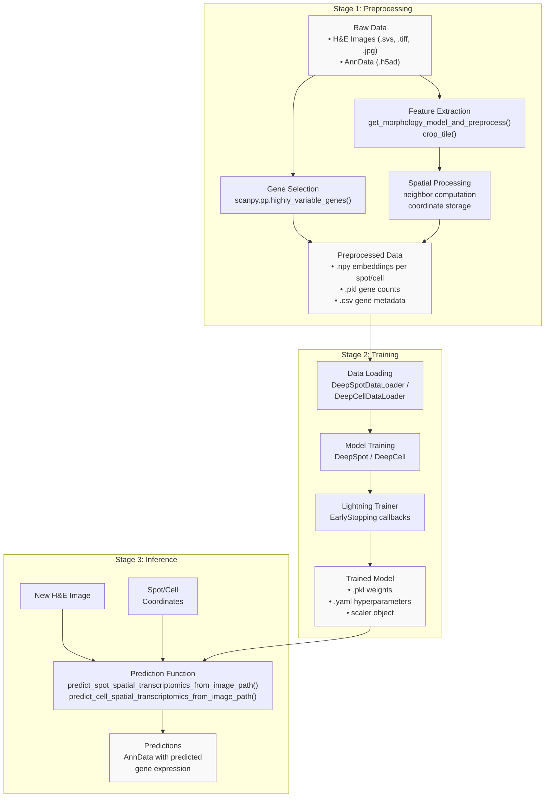
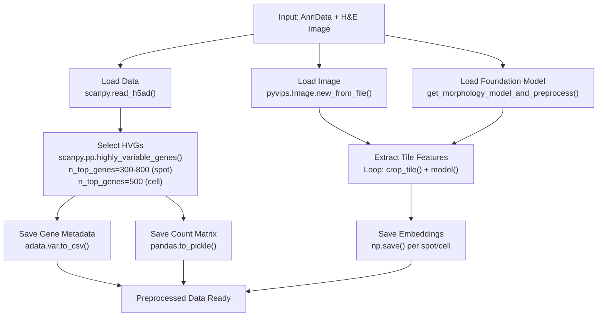
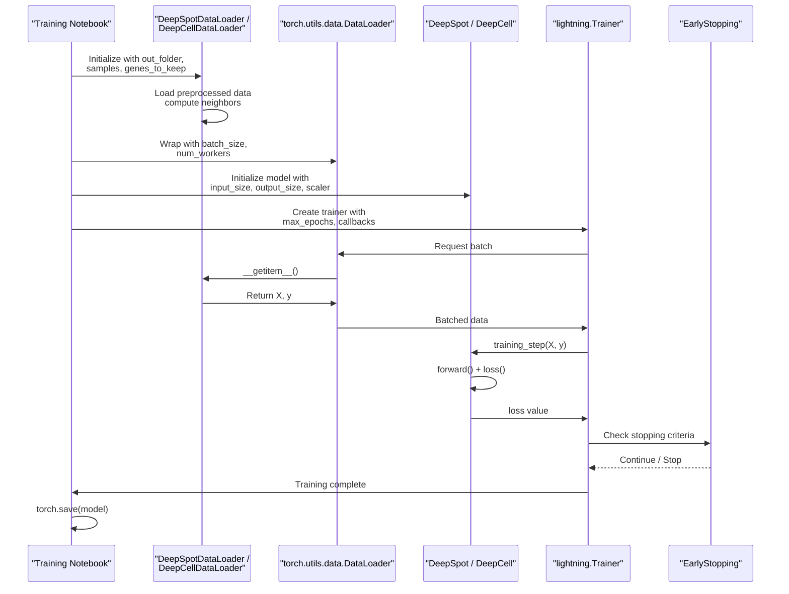
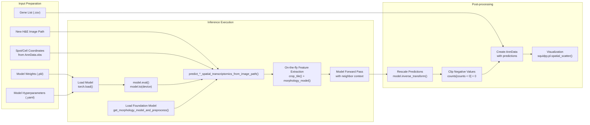

# Workflows

<details>
<summary>Relevant source files</summary>

The following files were used as context for generating this wiki page:

- [README.md](README.md)
- [example_notebook/Xenium_single-cell_example/GettingStartedWithDeepCell_1_preprocessing.ipynb](example_notebook/Xenium_single-cell_example/GettingStartedWithDeepCell_1_preprocessing.ipynb)
- [example_notebook/Xenium_single-cell_example/GettingStartedWithDeepCell_2_training_xenium.ipynb](example_notebook/Xenium_single-cell_example/GettingStartedWithDeepCell_2_training_xenium.ipynb)
- [example_notebook/Xenium_single-cell_example/GettingStartedWithDeepCell_3_inference_xenium.ipynb](example_notebook/Xenium_single-cell_example/GettingStartedWithDeepCell_3_inference_xenium.ipynb)

</details>


This page provides an overview of the complete end-to-end workflows for predicting spatial transcriptomics from H&E images using DeepSpot. It covers the two main resolution-specific pipelines: **Visium spot-level** workflow ([section 7.1](#7.1)) and **Xenium cell-level** workflow ([section 7.2](#7.2)). Each workflow consists of three sequential stages: preprocessing, training, and inference.

For installation and environment setup, see [Installation](#2.1). For architectural details about the models themselves, see [Model Architecture](#5). For detailed API documentation of the classes and functions used in these workflows, see [API Reference](#9).

---

## Workflow Architecture

Both workflows follow a three-stage pipeline pattern, but operate at different spatial resolutions and use resolution-specific data loaders and models.

### Complete Workflow Stages



**Sources:** [README.md:60-73](), [example_notebook/Xenium_single-cell_example/GettingStartedWithDeepCell_1_preprocessing.ipynb:1-359](), [example_notebook/Xenium_single-cell_example/GettingStartedWithDeepCell_2_training_xenium.ipynb:1-363](), [example_notebook/Xenium_single-cell_example/GettingStartedWithDeepCell_3_inference_xenium.ipynb:1-374]()

---

## Spot vs Cell Workflow Comparison

The system provides two parallel workflows optimized for different spatial transcriptomics technologies:

| Aspect | Visium Spot Workflow ([7.1](#7.1)) | Xenium Cell Workflow ([7.2](#7.2)) |
|--------|-----------------------------------|-----------------------------------|
| **Resolution** | ~55μm spot diameter | ~20μm cell diameter |
| **Technology** | Visium spot-level | Xenium single-cell |
| **Data Loader** | `DeepSpotDataLoader` | `DeepCellDataLoader` |
| **Model** | `DeepSpot` | `DeepCell` |
| **Gene Count** | 300-800 highly variable genes | ~500 highly variable genes |
| **Spatial Context** | 4 modes: spot, subspot, neighbors, full | 2 modes: cell, cell_neighbors |
| **Mini-tiling** | 3×3 sub-tiles per spot | Not used (cells are small) |
| **Neighbor Context** | `radius=1` (default) | `n_neighbors=45` (typical) |
| **Preprocessing Notebooks** | `GettingStartedWithDeepSpot_1_preprocessing.ipynb` | `GettingStartedWithDeepCell_1_preprocessing.ipynb` |
| **Training Notebooks** | `GettingStartedWithDeepSpot_2_training.ipynb` | `GettingStartedWithDeepCell_2_training.ipynb` |
| **Inference Notebooks** | `GettingStartedWithDeepSpot_3_inference.ipynb` | `GettingStartedWithDeepCell_3_inference.ipynb` |

**Sources:** [README.md:64-73]()

---

## Code Entity Mapping by Workflow Stage

The following diagram maps each workflow stage to the specific classes, functions, and file paths involved:

```mermaid
graph LR
    subgraph "Preprocessing Stage"
        P1["scanpy.pp.highly_variable_genes()"]
        P2["get_morphology_model_and_preprocess()<br/>utils/utils_image.py"]
        P3["crop_tile()<br/>utils/utils_image.py"]
        P4["pyvips.Image.new_from_file()"]
        P5["torch.save() embeddings<br/>to .npy files"]
        P6["pandas.to_pickle()<br/>save gene counts"]
    end
    
    subgraph "Training Stage"
        T1["DeepSpotDataLoader<br/>spot/deepspot_data_loader.py"]
        T2["DeepCellDataLoader<br/>cell/deepcell_data_loader.py"]
        T3["DeepSpot model<br/>spot/deepspot.py"]
        T4["DeepCell model<br/>cell/deepcell.py"]
        T5["lightning.Trainer<br/>trainer.fit()"]
        T6["EarlyStopping<br/>callback"]
        T7["torch.save()<br/>save model weights"]
    end
    
    subgraph "Inference Stage"
        I1["predict_spot_spatial_transcriptomics_from_image_path()<br/>utils/utils_image.py"]
        I2["predict_cell_spatial_transcriptomics_from_image_path()<br/>utils/utils_image.py"]
        I3["model.eval()<br/>inference mode"]
        I4["model.inverse_transform()<br/>rescale predictions"]
        I5["anndata.AnnData()<br/>create output"]
    end
    
    P1 --> T1
    P1 --> T2
    P2 --> P3
    P3 --> P4
    P4 --> P5
    P1 --> P6
    
    P5 --> T1
    P5 --> T2
    P6 --> T1
    P6 --> T2
    
    T1 --> T3
    T2 --> T4
    T3 --> T5
    T4 --> T5
    T5 --> T6
    T5 --> T7
    
    T7 --> I1
    T7 --> I2
    I1 --> I3
    I2 --> I3
    I3 --> I4
    I4 --> I5
```



**Sources:** [example_notebook/Xenium_single-cell_example/GettingStartedWithDeepCell_1_preprocessing.ipynb:38-41](), [example_notebook/Xenium_single-cell_example/GettingStartedWithDeepCell_2_training_xenium.ipynb:38-53](), [example_notebook/Xenium_single-cell_example/GettingStartedWithDeepCell_3_inference_xenium.ipynb:38-58]()

---

## Preprocessing Stage Details

The preprocessing stage transforms raw spatial transcriptomics data and H&E images into a format suitable for model training.

### Key Preprocessing Steps



### File Organization After Preprocessing

The preprocessing stage creates the following directory structure:

```
out_folder/
├── data/
│   ├── inputX/
│   │   └── {sample_id}.pkl          # Gene count matrices
│   ├── image_features/
│   │   └── {model_name}_{diameter}/
│   │       └── {sample_id}/
│   │           ├── {barcode_1}.npy  # Per-spot/cell embeddings
│   │           ├── {barcode_2}.npy
│   │           └── ...
│   └── info_highly_variable_genes_{technology}.csv  # Gene metadata
```

**Sources:** [example_notebook/Xenium_single-cell_example/GettingStartedWithDeepCell_1_preprocessing.ipynb:109-114](), [example_notebook/Xenium_single-cell_example/GettingStartedWithDeepCell_1_preprocessing.ipynb:189-206](), [example_notebook/Xenium_single-cell_example/GettingStartedWithDeepCell_1_preprocessing.ipynb:242-308]()

---

## Training Stage Details

The training stage uses data loaders to batch preprocessed features and trains the neural network models.

### Training Configuration Parameters

| Parameter Category | Spot Workflow | Cell Workflow |
|-------------------|---------------|---------------|
| **Data Loader Class** | `DeepSpotDataLoader` | `DeepCellDataLoader` |
| **Model Class** | `DeepSpot` | `DeepCell` |
| **Context Mode** | `spot_context` (4 options) | `cell_context` (2 options) |
| **Batch Size** | Configurable (e.g., 1024) | Configurable (e.g., 1024) |
| **Normalization** | `'standard'` / `None` | `'standard'` / `None` |
| **Spatial Resolution** | `resolution` parameter | `resolution` parameter |
| **Optimizer** | AdamW (default) | AdamW (default) |
| **Loss Function** | MSE + Pearson (default) | MSE + Pearson (default) |

### Training Loop Components



**Sources:** [example_notebook/Xenium_single-cell_example/GettingStartedWithDeepCell_2_training_xenium.ipynb:86-117](), [example_notebook/Xenium_single-cell_example/GettingStartedWithDeepCell_2_training_xenium.ipynb:162-177](), [example_notebook/Xenium_single-cell_example/GettingStartedWithDeepCell_2_training_xenium.ipynb:230-240]()

---

## Inference Stage Details

The inference stage applies trained models to new H&E images to predict spatial gene expression.

### Inference Pipeline



### Key Inference Functions

| Function | Location | Purpose |
|----------|----------|---------|
| `predict_spot_spatial_transcriptomics_from_image_path()` | `utils/utils_image.py` | Predict spot-level gene expression from image path |
| `predict_cell_spatial_transcriptomics_from_image_path()` | `utils/utils_image.py` | Predict cell-level gene expression from image path |
| `crop_tile()` | `utils/utils_image.py` | Extract image tiles at specified coordinates |
| `get_morphology_model_and_preprocess()` | `utils/utils_image.py` | Load foundation model and preprocessing function |
| `model.inverse_transform()` | Model classes | Rescale normalized predictions to original ranges |

**Sources:** [example_notebook/Xenium_single-cell_example/GettingStartedWithDeepCell_3_inference_xenium.ipynb:39-42](), [example_notebook/Xenium_single-cell_example/GettingStartedWithDeepCell_3_inference_xenium.ipynb:82-96](), [example_notebook/Xenium_single-cell_example/GettingStartedWithDeepCell_3_inference_xenium.ipynb:232-266](), [example_notebook/Xenium_single-cell_example/GettingStartedWithDeepCell_3_inference_xenium.ipynb:286-293]()

---

## Critical Post-Processing Step

**IMPORTANT:** Both workflows require manual rescaling of predictions using the model's `scaler` object:

```python
# Predictions are normalized during inference
expression_norm = model(X)  # Returns normalized values

# Must manually rescale to original ranges
expression = model.inverse_transform(expression_norm)

# Optional: clip negative predictions
expression[expression < 0] = 0
```

The `scaler` object used during training must be saved with model weights and loaded during inference. It is stored in the model checkpoint and accessible via `model.inverse_transform()`.

**Sources:** [example_notebook/Xenium_single-cell_example/GettingStartedWithDeepCell_2_training_xenium.ipynb:184-192](), [example_notebook/Xenium_single-cell_example/GettingStartedWithDeepCell_3_inference_xenium.ipynb:273-293]()

---

## Getting Started with Workflows

### Visium Spot Workflow ([7.1](#7.1))

For complete spot-level spatial transcriptomics prediction:

1. **Preprocessing ([7.1.1](#7.1.1))**: Extract spot features from H&E images, select highly variable genes (300-800), compute 3×3 mini-tiles per spot
2. **Training ([7.1.2](#7.1.2))**: Configure `DeepSpotDataLoader` with spatial context options, train `DeepSpot` model with chosen context mode
3. **Inference ([7.1.3](#7.1.3))**: Apply trained model to new images using `predict_spot_spatial_transcriptomics_from_image_path()`

### Xenium Cell Workflow ([7.2](#7.2))

For complete cell-level spatial transcriptomics prediction:

1. **Preprocessing ([7.2.1](#7.2.1))**: Extract cell features from H&E images, select highly variable genes (~500), compute cell neighbors
2. **Training ([7.2.2](#7.2.2))**: Configure `DeepCellDataLoader` with `n_neighbors=45`, train `DeepCell` model
3. **Inference ([7.2.3](#7.2.3))**: Apply trained model to new images using `predict_cell_spatial_transcriptomics_from_image_path()`

### Notebook Locations

All example notebooks are located in the `example_notebook/` directory:

- Visium workflows: `example_notebook/Visium_spot_example/`
- Xenium workflows: `example_notebook/Xenium_single-cell_example/`

**Sources:** [README.md:60-73]()

---

## Workflow Execution Time Considerations

| Stage | Visium Spot | Xenium Cell | Notes |
|-------|-------------|-------------|-------|
| **Preprocessing** | Hours | Hours | Depends on image size and number of spots/cells |
| **Training** | Minutes to hours | Minutes to hours | Depends on dataset size, epochs, and GPU |
| **Inference** | Minutes | Minutes | With precomputed embeddings: faster. On-the-fly: slower per image |

Preprocessing is the most time-consuming stage but only needs to be done once per dataset. Training can be repeated with different hyperparameters using the same preprocessed data. Inference with precomputed embeddings is significantly faster than on-the-fly feature extraction.

**Sources:** [example_notebook/Xenium_single-cell_example/GettingStartedWithDeepCell_3_inference_xenium.ipynb:219-223]()

---