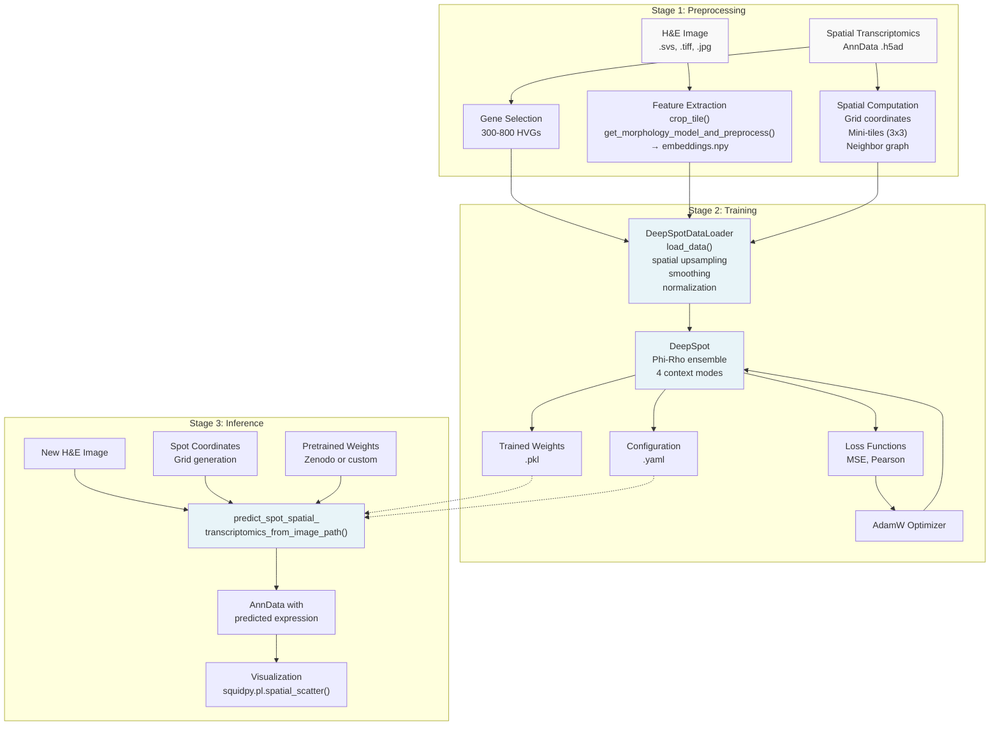
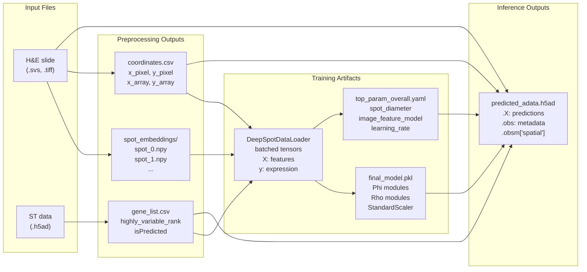
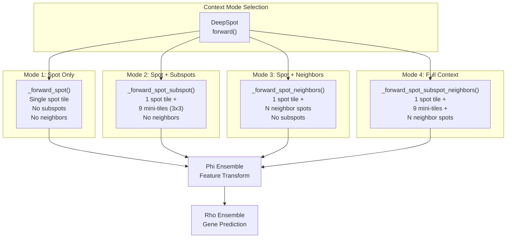

# Visium Spot Workflow

<details>
<summary>Relevant source files</summary>

The following files were used as context for generating this wiki page:

- [README.md](README.md)
- [example_notebook/Visium_spot_example/GettingStartedWithDeepSpot_3.1_inference_pretrained_models.ipynb](example_notebook/Visium_spot_example/GettingStartedWithDeepSpot_3.1_inference_pretrained_models.ipynb)

</details>


## Purpose and Scope

This document provides a complete overview of the Visium spot-level spatial transcriptomics workflow, from raw H&E images and spatial transcriptomics data to trained models and predictions. The workflow operates at approximately 55μm spot resolution, where each spot captures expression from 1-10 cells. This page covers the end-to-end pipeline; for detailed steps, see [Visium Preprocessing](#7.1.1), [Visium Training](#7.1.2), and [Visium Inference](#7.1.3). For single-cell resolution workflows, see [Xenium Cell Workflow](#7.2).

**Sources:** [README.md:60-68]()

---

## Workflow Overview

The Visium spot workflow consists of three sequential stages that transform H&E histology images into predicted spatial transcriptomics data:

1. **Preprocessing**: Extract morphological features from H&E images, select highly variable genes, compute spatial relationships, and prepare data for training
2. **Training**: Train the `DeepSpot` model to learn mappings from image features to gene expression using `DeepSpotDataLoader`
3. **Inference**: Apply trained models to new H&E images to predict spatial transcriptomics, with optional use of pretrained weights from Zenodo

The workflow leverages pathology foundation models (UNI, Hoptimus0, Phikon) for feature extraction and supports multiple spatial context modes (individual spots, sub-spots, neighbors, or combinations).

**Sources:** [README.md:60-78]()

---

## Complete Pipeline Architecture



**Diagram: Complete Visium Spot Workflow showing three stages and key code entities**

**Sources:** [README.md:60-68](), [example_notebook/Visium_spot_example/GettingStartedWithDeepSpot_3.1_inference_pretrained_models.ipynb:74-93]()

---

## Key Components and Code Entities

### Data Structures

| Component | Type | Description | Location |
|-----------|------|-------------|----------|
| Input AnnData | `anndata.AnnData` | Spatial transcriptomics with `.X` (counts), `.var` (genes), `.obs` (spot metadata), `.obsm['spatial']` (coordinates) | Preprocessing input |
| Feature Files | `.npy` arrays | Pre-extracted morphological features per spot, shape: `(n_features,)` | Preprocessing output |
| Training Config | `.yaml` | Hyperparameters: `spot_diameter`, `spot_distance`, `image_feature_model`, learning rate, batch size | Training configuration |
| Model Weights | `.pkl` | Serialized `DeepSpot` model with `Phi` and `Rho` ensembles | Training output |
| Gene Manifest | `.csv` | DataFrame with `gene_name`, `highly_variable_rank`, `isPredicted` columns | Training metadata |
| Prediction AnnData | `anndata.AnnData` | Output with predicted expression in `.X` | Inference output |

### Core Classes and Functions

| Entity | Type | Purpose |
|--------|------|---------|
| `DeepSpot` | Class | Spot-level prediction model with four context modes: `_forward_spot()`, `_forward_spot_subspot()`, `_forward_spot_neighbors()`, `_forward_spot_subspot_neighbors()` |
| `DeepSpotDataLoader` | Class | PyTorch DataLoader for spot-level data with spatial preprocessing |
| `load_data()` | Function | Loads gene expression and image features from disk |
| `get_morphology_model_and_preprocess()` | Function | Initializes foundation model and preprocessing transforms |
| `crop_tile()` | Function | Extracts image tiles at specified coordinates |
| `predict_spot_spatial_transcriptomics_from_image_path()` | Function | End-to-end inference from image path to predicted expression |

**Sources:** [example_notebook/Visium_spot_example/GettingStartedWithDeepSpot_3.1_inference_pretrained_models.ipynb:74-93](), [README.md:21-22]()

---

## Workflow Stages Detail

### 1. Preprocessing ([see detailed guide](#7.1.1))

**Objectives:**
- Select 300-800 highly variable genes from spatial transcriptomics data
- Extract morphological features for each spot using foundation models
- Divide each spot into 9 non-overlapping mini-tiles (3×3 grid) to capture sub-spot heterogeneity
- Compute spatial neighbor graphs for context-aware modeling
- Generate grid coordinates for spots on H&E images

**Key Operations:**
- Gene selection based on variance ranking
- Per-spot feature extraction and storage as `.npy` files
- Mini-tile computation at spot_diameter/3 resolution
- Neighbor computation within specified radius (default: 1)

### 2. Training ([see detailed guide](#7.1.2))

**Objectives:**
- Initialize `DeepSpotDataLoader` with spatial upsampling and smoothing
- Configure `DeepSpot` model with appropriate context mode
- Train using MSE and/or Pearson correlation loss
- Save trained weights and configuration

**Key Operations:**
- Data normalization using StandardScaler
- Spatial upsampling to increase effective resolution
- Batch training with AdamW optimizer
- Model checkpoint saving

### 3. Inference ([see detailed guide](#7.1.3))

**Objectives:**
- Load pretrained weights (from Zenodo or custom training)
- Generate predictions on new H&E images
- Create AnnData objects compatible with scanpy/squidpy
- Visualize predicted spatial gene expression

**Key Operations:**
- On-the-fly feature extraction using `predict_spot_spatial_transcriptomics_from_image_path()`
- Inverse scaling to original expression ranges
- Post-processing (e.g., negative value clipping)
- Spatial visualization

**Sources:** [README.md:60-78](), [example_notebook/Visium_spot_example/GettingStartedWithDeepSpot_3.1_inference_pretrained_models.ipynb:1-511]()

---

## Data Flow Through Visium Pipeline



**Diagram: Data artifacts and transformations in Visium workflow**

**Sources:** [example_notebook/Visium_spot_example/GettingStartedWithDeepSpot_3.1_inference_pretrained_models.ipynb:118-186]()

---

## Critical Configuration Parameters

The following parameters must be consistent across preprocessing, training, and inference stages:

| Parameter | Typical Value | Description | Impact |
|-----------|---------------|-------------|--------|
| `spot_diameter` | 100 pixels | Physical diameter of spot in H&E image at working resolution | Determines tile extraction size |
| `spot_distance` | 100 pixels | Center-to-center distance between adjacent spots | Controls grid density |
| `n_mini_tiles` | 9 | Number of sub-tiles per spot (always 3×3 grid) | Fixed architecture requirement |
| `image_feature_model` | `"uni"`, `"hoptimus0"`, `"phikon"` | Foundation model for feature extraction | Must match training model |
| `white_cutoff` | 200 | Mean RGB threshold for tissue detection (0-255) | Filters background spots |
| `neighbor_radius` | 1 | Radius for neighbor graph computation | Controls spatial context |
| `n_highly_variable_genes` | 300-800 | Number of genes to predict | Balances performance vs. coverage |
| `super_resolution` | `False` | Enable super-resolution mode during inference | Affects prediction granularity |

**Configuration Loading Example:**

```python
# Load training configuration for inference
with open('top_param_overall.yaml', 'r') as f:
    config = yaml.safe_load(f)
    
spot_diameter = config['spot_diameter']
image_feature_model = config['image_feature_model']
```

**Sources:** [example_notebook/Visium_spot_example/GettingStartedWithDeepSpot_3.1_inference_pretrained_models.ipynb:138-151]()

---

## Spot Context Modes

The `DeepSpot` model supports four spatial context modes, selectable during training and inference:



**Diagram: DeepSpot context modes and neural layer routing**

Context selection impacts model capacity and inference speed. Mode 4 (full context) provides the most spatial information but requires more computation.

**Sources:** [README.md:33-38]()

---

## Integration with Pretrained Resources

### Pretrained DeepSpot Weights

Available from Zenodo for immediate inference without training:

```python
# Download from https://zenodo.org/records/15322099
model_weights = 'DeepSpot_pretrained_model_weights/Colon_HEST1K/final_model.pkl'
model_hparam = 'DeepSpot_pretrained_model_weights/Colon_HEST1K/top_param_overall.yaml'
gene_path = 'DeepSpot_pretrained_model_weights/Colon_HEST1K/info_highly_variable_genes.csv'

model = torch.load(model_weights, map_location=device)
model.eval()
```

**Sources:** [example_notebook/Visium_spot_example/GettingStartedWithDeepSpot_3.1_inference_pretrained_models.ipynb:33-46](), [README.md:75-78]()

### Foundation Model Integration

Foundation models must be downloaded separately and paths configured:

```python
# Example: UNI model
image_feature_model_path = "../huggingface/hub/models--MahmoodLab--UNI/blobs/..."

morphology_model, preprocess, feature_dim = get_morphology_model_and_preprocess(
    model_name='uni',
    device=device,
    model_path=image_feature_model_path
)
```

**Sources:** [example_notebook/Visium_spot_example/GettingStartedWithDeepSpot_3.1_inference_pretrained_models.ipynb:170-173](), [README.md:80-86]()

---

## Typical Workflow Execution

### Using Pretrained Models (Fast Track)

1. Download pretrained weights from Zenodo
2. Ensure foundation model weights are available
3. Load H&E image and generate spot coordinates
4. Run inference using `predict_spot_spatial_transcriptomics_from_image_path()`
5. Inverse transform predictions to original scale
6. Visualize with squidpy

```python
counts = predict_spot_spatial_transcriptomics_from_image_path(
    image_path,
    adata,
    spot_diameter,
    n_mini_tiles,
    preprocess,
    morphology_model,
    model_expression,
    device,
    super_resolution=False,
    neighbor_radius=1
)

counts = model_expression.inverse_transform(counts)
```

**Sources:** [example_notebook/Visium_spot_example/GettingStartedWithDeepSpot_3.1_inference_pretrained_models.ipynb:369-379]()

### Training Custom Models (Full Pipeline)

1. Preprocess spatial transcriptomics data and H&E images
2. Extract features for all spots and save as `.npy` files
3. Initialize `DeepSpotDataLoader` with spatial preprocessing
4. Train `DeepSpot` model with appropriate loss functions
5. Save model weights and configuration
6. Run inference on new samples using saved artifacts

---

## Output Structure

The final prediction is an AnnData object with the following structure:

```python
adata_predicted
# .X - Predicted gene expression matrix (n_spots, n_genes)
# .var - Gene metadata with gene names
# .obs - Spot metadata:
#        - x_pixel, y_pixel: pixel coordinates
#        - x_array, y_array: grid coordinates
#        - is_white: mean RGB value
#        - sampleID: sample identifier
#        - barcode: unique spot identifier
# .obsm['spatial'] - Spatial coordinates for visualization
# .uns['spatial']['library_id']['images']['hires'] - Downsampled H&E image
```

This structure is compatible with scanpy and squidpy for downstream analysis and visualization.

**Sources:** [example_notebook/Visium_spot_example/GettingStartedWithDeepSpot_3.1_inference_pretrained_models.ipynb:273-314](), [example_notebook/Visium_spot_example/GettingStartedWithDeepSpot_3.1_inference_pretrained_models.ipynb:433-439]()

---

## Related Workflows

- For detailed preprocessing steps including feature extraction and gene selection, see [Visium Preprocessing](#7.1.1)
- For model training configuration and optimization, see [Visium Training](#7.1.2)
- For inference procedures and pretrained model usage, see [Visium Inference](#7.1.3)
- For single-cell resolution workflows using Xenium data, see [Xenium Cell Workflow](#7.2)
- For understanding the model architecture, see [DeepSpot Model](#5.2)
- For data loader details, see [DeepSpotDataLoader](#4.4)

---