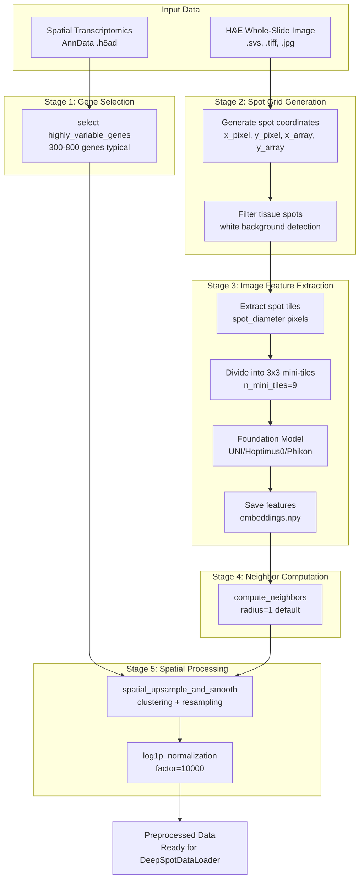
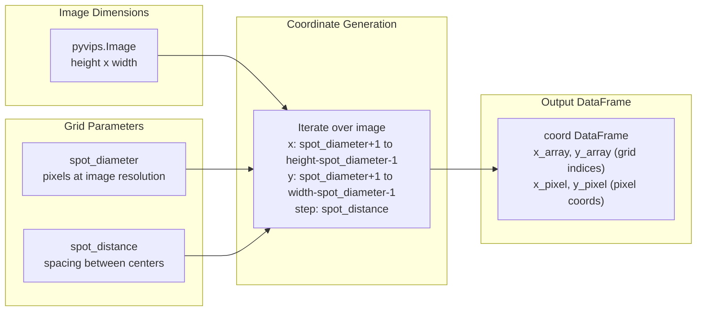
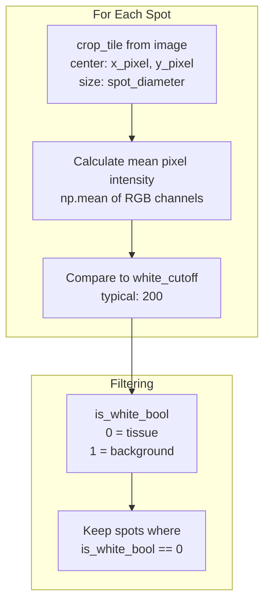
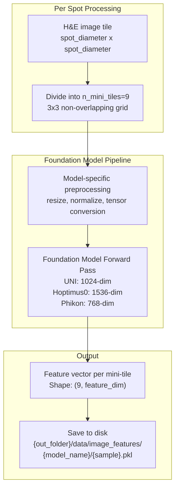
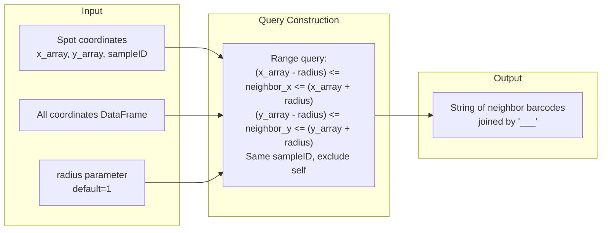
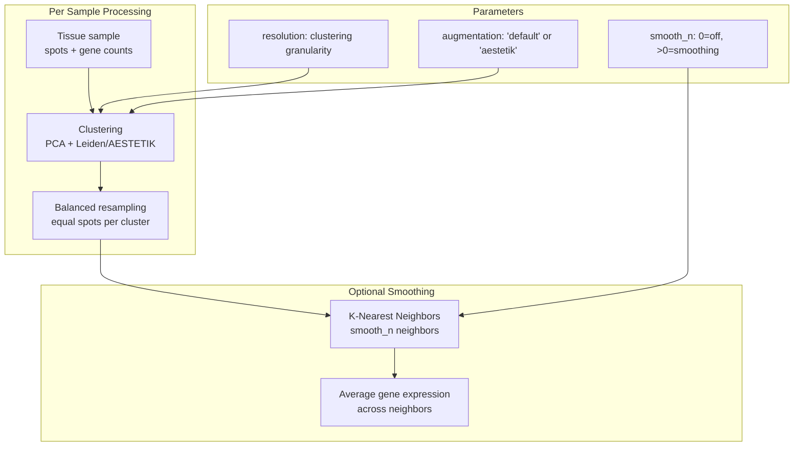
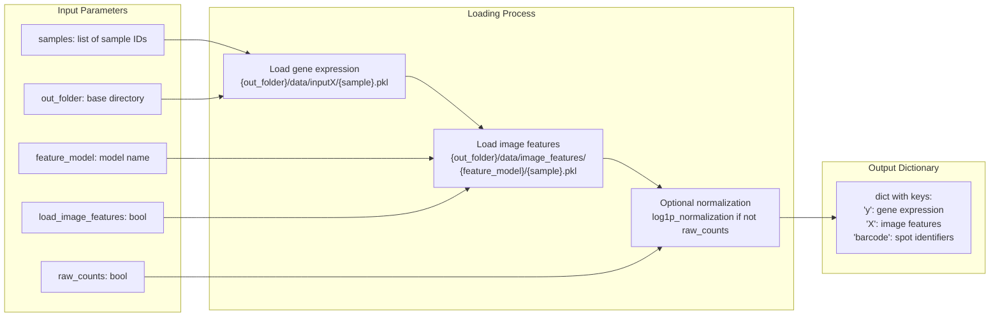
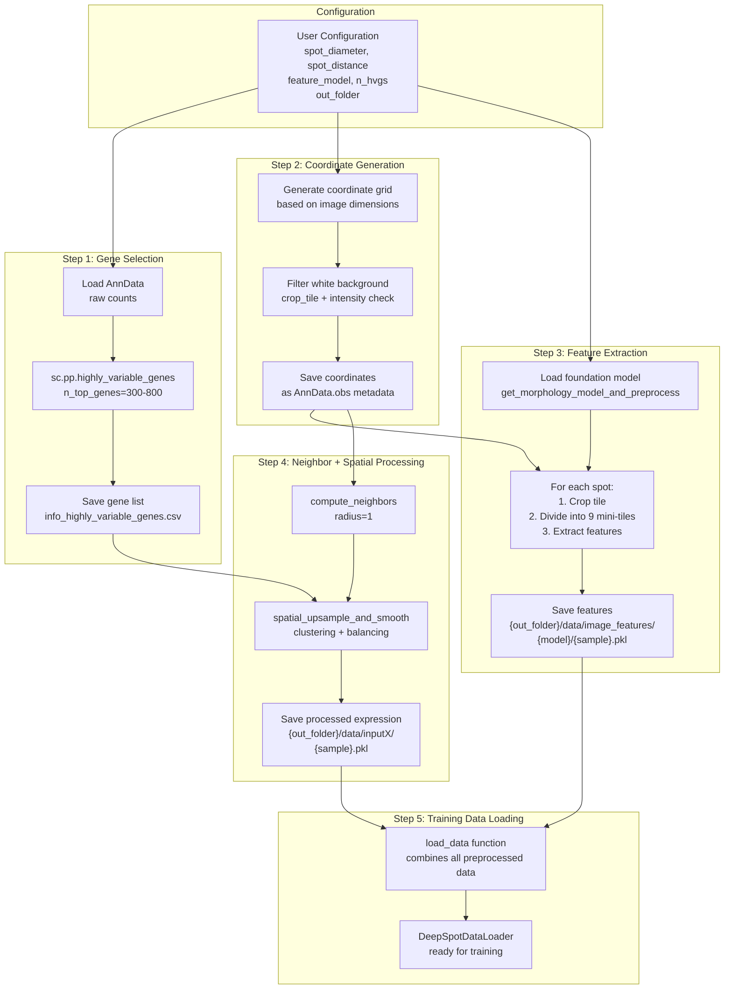

# Visium Preprocessing

<details>
<summary>Relevant source files</summary>

The following files were used as context for generating this wiki page:

- [deepspot/utils/utils_dataloader.py](deepspot/utils/utils_dataloader.py)
- [example_notebook/Visium_spot_example/GettingStartedWithDeepSpot_3.1_inference_pretrained_models.ipynb](example_notebook/Visium_spot_example/GettingStartedWithDeepSpot_3.1_inference_pretrained_models.ipynb)

</details>


This page documents the preprocessing steps required to prepare Visium spatial transcriptomics data for training DeepSpot models. Preprocessing transforms raw H&E histology images and gene expression data into model-ready features. For training procedures, see [Visium Training](#7.1.2). For inference with preprocessed data, see [Visium Inference](#7.1.3). For cell-level preprocessing in Xenium data, see [Xenium Preprocessing](#7.2.1).

---

## Overview

Visium preprocessing consists of five sequential stages that prepare data for model training:



**Sources:** [deepspot/utils/utils_dataloader.py:132-174](), [example_notebook/Visium_spot_example/GettingStartedWithDeepSpot_3.1_inference_pretrained_models.ipynb:213-257]()

---

## Gene Selection

Visium preprocessing begins with selecting highly variable genes (HVGs) from the spatial transcriptomics data. This reduces dimensionality and focuses model training on genes with meaningful expression variation.

### Selection Process

The system typically selects **300-800 genes** ranked by their variability across spots. The exact count depends on the tissue type and dataset characteristics. Gene selection is performed using scanpy's built-in functions and stored in the `.var` annotations of the AnnData object.

### Storage Format

Selected genes are stored in a CSV file with the following structure:

| Column | Description |
|--------|-------------|
| `gene_name` | Gene symbol (e.g., "MUC2", "ITLN1") |
| `highly_variable_rank` | Integer rank by variability |
| `isPredicted` | Boolean indicating if gene should be predicted |

The pretrained models include an `info_highly_variable_genes.csv` file that specifies which genes the model was trained to predict.

**Sources:** [example_notebook/Visium_spot_example/GettingStartedWithDeepSpot_3.1_inference_pretrained_models.ipynb:181-185]()

---

## Spot Coordinate Generation

Spot coordinates define the spatial grid where predictions will be made. For Visium technology, spots are typically arranged in a hexagonal pattern with ~55μm diameter at 20x magnification.

### Grid Creation



The coordinate generation creates a regular grid with four columns:
- `x_array`, `y_array`: Integer grid indices (0, 1, 2, ...)
- `x_pixel`, `y_pixel`: Pixel coordinates in the image

**Sources:** [example_notebook/Visium_spot_example/GettingStartedWithDeepSpot_3.1_inference_pretrained_models.ipynb:218-226]()

### Tissue Detection

Not all grid positions contain tissue. White background filtering identifies spots within tissue regions:



Spots with mean intensity above `white_cutoff` (typically 200 for 8-bit RGB) are flagged as background and excluded from training.

**Sources:** [example_notebook/Visium_spot_example/GettingStartedWithDeepSpot_3.1_inference_pretrained_models.ipynb:243-257]()

---

## Image Feature Extraction

Image feature extraction converts spot regions into numerical embeddings using pretrained pathology foundation models. This is the most computationally intensive preprocessing step.

### Spot-Level Feature Extraction



### Mini-Tile Decomposition

Each spot is divided into **9 non-overlapping mini-tiles** arranged in a 3×3 grid. This captures sub-spot spatial heterogeneity, which is critical since Visium spots (~55μm) typically contain 1-10 cells.

The mini-tile dimension calculation:
```
mini_tile_size = spot_diameter // 3
```

Each mini-tile is independently processed through the foundation model, producing 9 feature vectors per spot.

### Storage Structure

Preprocessed features are stored in pickle files organized by sample:

```
{out_folder}/data/
├── inputX/
│   └── {sample}.pkl          # Gene expression counts
└── image_features/
    └── {model_name}/
        └── {sample}.pkl      # Image embeddings
```

Each pickle file contains a pandas DataFrame indexed by barcode (spot identifier) with feature dimensions as columns.

**Sources:** [example_notebook/Visium_spot_example/GettingStartedWithDeepSpot_3.1_inference_pretrained_models.ipynb:334-360](), [deepspot/utils/utils_dataloader.py:151-161]()

---

## Neighbor Computation

Neighbor computation identifies spatially adjacent spots to enable context-aware predictions. The `compute_neighbors` function finds spots within a specified radius.

### Neighbor Identification Algorithm



### Implementation Details

The `compute_neighbors` function at [deepspot/utils/utils_dataloader.py:112-121]() uses pandas query syntax to efficiently filter neighbors:

- **Radius**: Defines the grid distance (default `radius=1` includes immediate neighbors)
- **Same Sample**: Neighbors must be from the same tissue sample (`sampleID`)
- **Self-Exclusion**: The query spot itself is excluded
- **Output Format**: Neighbor barcodes concatenated with `"___"` delimiter

For a spot at position (10, 10) with radius=1, neighbors would be all spots at positions (9-11, 9-11) excluding (10, 10).

**Sources:** [deepspot/utils/utils_dataloader.py:112-121]()

---

## Spatial Processing

Spatial processing applies optional augmentation and normalization techniques to improve model training stability and performance.

### Spatial Upsampling and Smoothing

The `spatial_upsample_and_smooth` function performs cluster-based upsampling to balance representation of tissue regions:



**Key Parameters:**

| Parameter | Type | Description |
|-----------|------|-------------|
| `resolution` | float | Leiden clustering resolution; higher = more clusters |
| `smooth_n` | int | Number of neighbors for smoothing; 0 disables |
| `augmentation` | str | `"default"` uses standard Leiden, `"aestetik"` uses AESTETIK |

The function returns:
1. Array of resampled barcodes (balanced across clusters)
2. Smoothed transcriptomics matrix (if `smooth_n > 0`)

**Sources:** [deepspot/utils/utils_dataloader.py:65-98]()

### Normalization

Gene expression counts are normalized using log1p transformation to stabilize variance:

```python
# log1p_normalization formula
normalized = log(1 + ((counts / total_counts) * factor))
```

The `log1p_normalization` function at [deepspot/utils/utils_dataloader.py:128-129]():
- **Total Normalization**: Divides by spot total counts
- **Scaling**: Multiplies by `factor` (default 10000)
- **Log Transform**: Applies `log(1 + x)` to compress dynamic range

This is the standard scanpy normalization (`sc.pp.normalize_total` + `sc.pp.log1p`).

**Sources:** [deepspot/utils/utils_dataloader.py:128-129]()

---

## Data Loading Interface

After preprocessing, the `load_data` function provides a unified interface to load gene expression and image features for model training.

### Function Signature



### Return Structure

The function returns a dictionary with three keys:

| Key | Type | Shape | Description |
|-----|------|-------|-------------|
| `"y"` | np.ndarray | (n_spots, n_genes) | Gene expression matrix, normalized unless `raw_counts=True` |
| `"X"` | pd.DataFrame | (n_spots, feature_dim) | Image feature embeddings, only if `load_image_features=True` |
| `"barcode"` | np.ndarray | (n_spots,) | Spot identifiers in format `"{sample_id}_{spot_id}"` |

**Sources:** [deepspot/utils/utils_dataloader.py:132-174]()

---

## Complete Preprocessing Workflow

The following diagram shows how preprocessing components interact in a typical workflow:



**Sources:** [deepspot/utils/utils_dataloader.py:132-174](), [example_notebook/Visium_spot_example/GettingStartedWithDeepSpot_3.1_inference_pretrained_models.ipynb]()

---

## Preprocessing Output Summary

After completing all preprocessing steps, the following directory structure is created:

```
{out_folder}/
├── data/
│   ├── inputX/
│   │   └── {sample}.pkl                    # Normalized gene expression
│   └── image_features/
│       └── {feature_model}/
│           └── {sample}.pkl                # Image embeddings (9 per spot)
└── models/
    └── {experiment_name}/
        └── info_highly_variable_genes.csv  # Gene metadata
```

### File Formats

- **Gene Expression** (`inputX/{sample}.pkl`): Pandas DataFrame with barcode index, gene columns
- **Image Features** (`image_features/{model}/{sample}.pkl`): Pandas DataFrame with barcode index, feature dimension columns
- **Gene Metadata** (`info_highly_variable_genes.csv`): CSV with columns `gene_name`, `highly_variable_rank`, `isPredicted`

These files are consumed by `load_data` and passed to `DeepSpotDataLoader` for model training (see [Visium Training](#7.1.2)).

**Sources:** [deepspot/utils/utils_dataloader.py:144-161]()

---