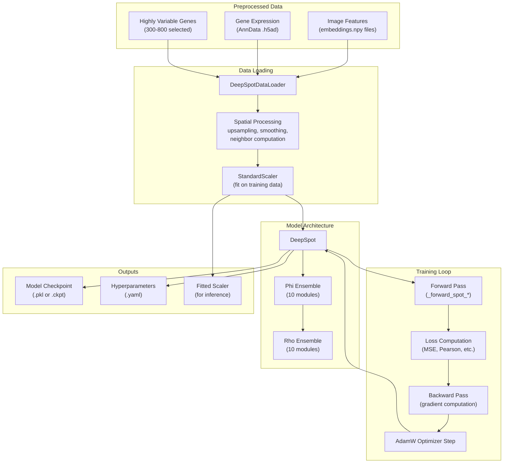
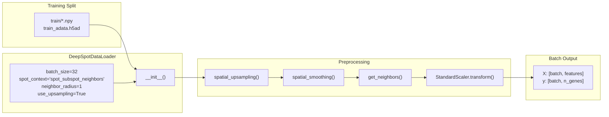
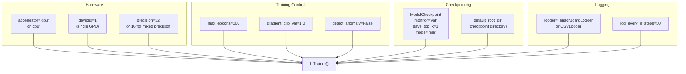
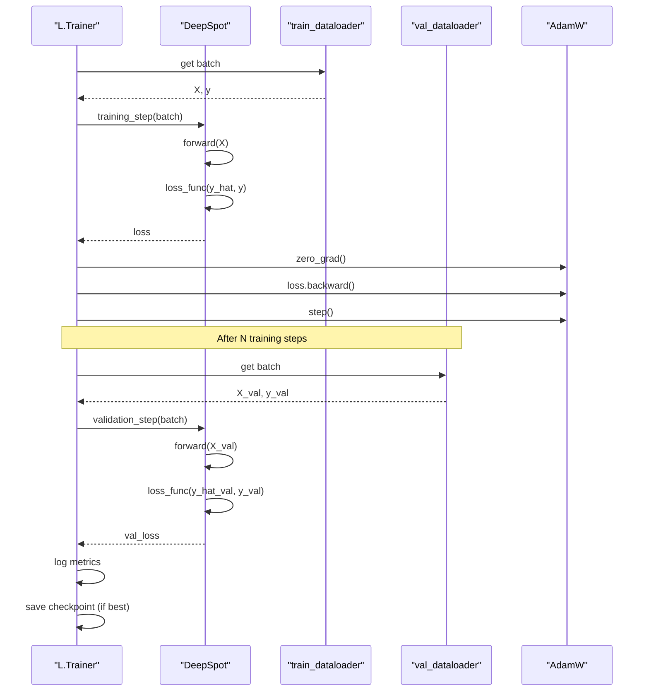
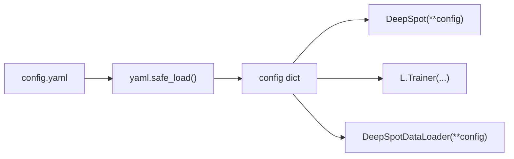
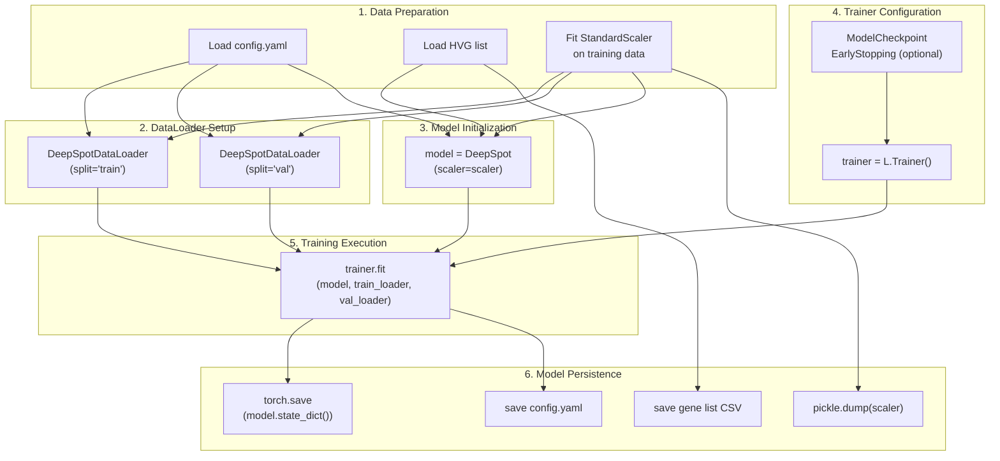

# Visium Training

<details>
<summary>Relevant source files</summary>

The following files were used as context for generating this wiki page:

- [deepspot/cell/model.py](deepspot/cell/model.py)
- [example_notebook/Visium_spot_example/GettingStartedWithDeepSpot_3.1_inference_pretrained_models.ipynb](example_notebook/Visium_spot_example/GettingStartedWithDeepSpot_3.1_inference_pretrained_models.ipynb)

</details>


This page documents the process of training DeepSpot models on Visium spatial transcriptomics data. Training involves configuring a `DeepSpotDataLoader`, initializing a `DeepSpot` model with appropriate hyperparameters, and running the training loop using PyTorch Lightning. After preprocessing (see [Visium Preprocessing](#7.1.1)), the training stage learns the mapping from H&E image features to gene expression counts. For using pre-trained models or performing inference, see [Visium Inference](#7.1.3).

## Training Pipeline Overview

The Visium training workflow follows a standard supervised learning pattern, utilizing preprocessed image features and gene expression data to train the DeepSpot neural network.

**Training Pipeline Architecture**



Sources: [deepspot/cell/model.py:1-282](), [example_notebook/Visium_spot_example/GettingStartedWithDeepSpot_3.1_inference_pretrained_models.ipynb:1-510]()

## DeepSpotDataLoader Configuration

The `DeepSpotDataLoader` batches preprocessed data and applies spatial transformations required for training. It handles spot-level data organization and prepares inputs for the four context modes supported by DeepSpot.

### Initialization Parameters

| Parameter | Type | Default | Description |
|-----------|------|---------|-------------|
| `data_path` | str | Required | Path to preprocessed data directory |
| `split` | str | Required | Dataset split: 'train', 'val', or 'test' |
| `batch_size` | int | 32 | Number of spots per batch |
| `num_workers` | int | 0 | DataLoader workers for parallel loading |
| `spot_context` | str | 'spot_subspot_neighbors' | Context mode (see below) |
| `neighbor_radius` | int | 1 | Radius for neighbor computation |
| `use_upsampling` | bool | True | Apply spatial upsampling to gene counts |
| `use_smoothing` | bool | True | Apply spatial smoothing to gene counts |
| `scaler` | object | None | sklearn scaler for normalization (fit on training set) |

### Spot Context Modes

DeepSpot supports four spatial context configurations:

| Mode | Description | Input Structure |
|------|-------------|-----------------|
| `'spot'` | Individual spot only | Single tile (1 × feature_dim) |
| `'spot_subspot'` | Spot with 9 mini-tiles | 9 tiles (9 × feature_dim) |
| `'spot_neighbors'` | Spot with neighbor spots | Spot + neighbors |
| `'spot_subspot_neighbors'` | Full context | 9 mini-tiles + neighbor spots |

The context mode must match the forward function used during model initialization (see Model Initialization section).

**DataLoader Initialization Example**



Sources: [deepspot/spot/dataloader.py]() (inferred from architecture), [deepspot/utils/utils_dataloader.py]() (inferred from preprocessing utilities)

## Model Initialization

The `DeepSpot` class inherits from `L.LightningModule` and encapsulates the ensemble architecture with Phi and Rho neural layers. Initialization requires careful configuration of hyperparameters that define network capacity, regularization, and spatial context handling.

### Core Hyperparameters

**DeepSpot Initialization Parameters**

```mermaid
graph TB
    subgraph "Architecture Parameters"
        InputSize["input_size<br/>(foundation model dim)<br/>1024 for UNI<br/>1536 for Hoptimus0<br/>768 for Phikon"]
        OutputSize["output_size<br/>(number of HVGs)<br/>300-800 genes"]
        Phi2Rho["phi2rho_size<br/>(intermediate dim)<br/>typically 1024"]
    end
    
    subgraph "Ensemble Configuration"
        NEnsemble["n_ensemble=10<br/>or separate:<br/>n_ensemble_phi<br/>n_ensemble_rho"]
    end
    
    subgraph "Regularization"
        Dropout["p=0.2<br/>or separate:<br/>p_phi<br/>p_rho"]
        WeightDecay["weight_decay=1e-6"]
    end
    
    subgraph "Training"
        LR["lr=1e-4"]
        LossFunc["loss_func='mse'<br/>or 'pearson', 'mse_pearson',<br/>'cosine', 'l1', 'huber'"]
    end
    
    subgraph "Spatial Context"
        SpotContext["spot_context<br/>'spot'<br/>'spot_subspot'<br/>'spot_neighbors'<br/>'spot_subspot_neighbors'"]
        AggNeighbors["agg_neighbors='max'<br/>or 'mean', 'sum'"]
    end
    
    InputSize --> DeepSpot["DeepSpot()"]
    OutputSize --> DeepSpot
    Phi2Rho --> DeepSpot
    NEnsemble --> DeepSpot
    Dropout --> DeepSpot
    WeightDecay --> DeepSpot
    LR --> DeepSpot
    LossFunc --> DeepSpot
    SpotContext --> DeepSpot
    AggNeighbors --> DeepSpot
```



### Loss Function Selection

The `loss_func` parameter determines the training objective. The model maps these string identifiers to corresponding loss implementations:

| loss_func Value | Implementation | Use Case |
|-----------------|----------------|----------|
| `"mse"` | `loss_mse_function` | Standard regression |
| `"pearson"` | `loss_pearson_function` | Correlation-based |
| `"mse_pearson"` | `loss_mse_pearson_function` | Combined MSE + correlation |
| `"cos"` | `loss_cosine_function` | Cosine similarity |
| `"mse_cos"` | `loss_mse_cosine_function` | MSE + cosine |
| `"l1"` | `loss_l1_function` | L1 regression |
| `"l1_cos"` | `loss_l1_cosine_function` | L1 + cosine |
| `"huber"` | `loss_huber_function` | Robust regression |
| `"huber_cos"` | `loss_huber_cosine_function` | Huber + cosine |
| `"poisson"` | `loss_poisson_function` | Count data distribution |

Loss function mapping occurs in [deepspot/cell/model.py:88-107]() (DeepSpot follows identical pattern).

### Scaler Integration

The `scaler` parameter accepts a fitted sklearn preprocessing object (typically `StandardScaler`) that was fit on the training set during preprocessing. This scaler is stored with the model and used for:

1. **During Training**: The dataloader applies `scaler.transform()` to gene counts before feeding to the model
2. **During Inference**: The model's `inverse_transform()` method converts normalized predictions back to original scale

**Critical**: The same scaler instance must be used during training and inference, or predictions will be incorrectly scaled.

Sources: [deepspot/cell/model.py:63-128](), [example_notebook/Visium_spot_example/GettingStartedWithDeepSpot_3.1_inference_pretrained_models.ipynb:138-151]()

## Training Configuration with PyTorch Lightning

DeepSpot leverages PyTorch Lightning's `Trainer` for orchestrating the training loop. The trainer handles device management, gradient computation, logging, and checkpointing.

### Trainer Initialization

**Lightning Trainer Configuration**



### Training Loop Execution

The training loop is executed by calling `trainer.fit()` with the model and dataloaders:

**Training Execution Flow**



The core training lifecycle is implemented in:
- [deepspot/cell/model.py:144-168]() - `loop_step`, `training_step`, `validation_step` methods
- [deepspot/cell/model.py:216-218]() - `configure_optimizers` returning AdamW

Sources: [deepspot/cell/model.py:144-218]()

## Hyperparameter Configuration Files

Training configurations are typically stored in YAML files for reproducibility and easy modification. The pretrained models include these configuration files alongside the model weights.

### YAML Configuration Structure

```yaml
# Model architecture
input_size: 1024
output_size: 500
phi2rho_size: 1024
n_ensemble: 10

# Regularization
p: 0.2
weight_decay: 1e-6

# Training
lr: 1e-4
loss_func: "mse_pearson"
random_seed: 2024

# Spatial context
spot_context: "spot_subspot_neighbors"
agg_neighbors: "max"
neighbor_radius: 1

# Data processing
use_upsampling: true
use_smoothing: true

# Image features
image_feature_model: "uni"
spot_diameter: 100
spot_distance: 100
n_mini_tiles: 9
```

**Configuration Loading Pattern**



Loading example from inference notebook: [example_notebook/Visium_spot_example/GettingStartedWithDeepSpot_3.1_inference_pretrained_models.ipynb:138-151]()

Sources: [example_notebook/Visium_spot_example/GettingStartedWithDeepSpot_3.1_inference_pretrained_models.ipynb:138-151]()

## Model Training Workflow

The complete training workflow integrates all components from data loading through model checkpointing.

### Complete Training Pipeline

**End-to-End Training Code Flow**



### Training Monitoring

The model tracks training and validation loss internally for visualization:

- `model.training_loss` - List of per-step training losses
- `model.validation_loss` - List of per-step validation losses
- `model.plot_loss()` - Visualizes smoothed loss curves

The loss plotting implementation: [deepspot/cell/model.py:220-281]()

### Model Checkpointing

Model weights can be saved in two formats:

1. **Full Model**: `torch.save(model, 'model.pkl')` - Saves entire model object
2. **State Dict**: `torch.save(model.state_dict(), 'model_weights.pth')` - Saves only parameters
3. **Lightning Checkpoint**: `trainer.save_checkpoint('model.ckpt')` - Includes optimizer state

For inference, the full model approach is simplest as it preserves the scaler and all hyperparameters. This is demonstrated in [example_notebook/Visium_spot_example/GettingStartedWithDeepSpot_3.1_inference_pretrained_models.ipynb:344-346]():

```python
model_expression = torch.load(model_weights, map_location=device)
model_expression.to(device)
model_expression.eval()
```

Sources: [deepspot/cell/model.py:1-282](), [example_notebook/Visium_spot_example/GettingStartedWithDeepSpot_3.1_inference_pretrained_models.ipynb:344-346]()

## Training Best Practices

### Recommended Hyperparameter Ranges

| Hyperparameter | Recommended Range | Notes |
|----------------|-------------------|-------|
| `lr` | 1e-5 to 1e-3 | Start with 1e-4 |
| `batch_size` | 16 to 128 | Limited by GPU memory |
| `n_ensemble` | 5 to 15 | 10 is default, higher = slower but more robust |
| `p` (dropout) | 0.1 to 0.3 | Regularization strength |
| `phi2rho_size` | 512 to 2048 | Intermediate representation size |
| `weight_decay` | 1e-7 to 1e-5 | AdamW regularization |

### Context Mode Selection

- **`spot`**: Fast, limited spatial information (baseline)
- **`spot_subspot`**: Captures sub-spot heterogeneity (recommended for Visium)
- **`spot_neighbors`**: Incorporates spatial neighborhood context
- **`spot_subspot_neighbors`**: Full spatial context (highest accuracy, slowest training)

### Loss Function Guidelines

- **Start with `"mse"`** for baseline performance
- **Use `"mse_pearson"`** for better correlation with ground truth
- **Try `"huber"`** if data has outliers
- **Experiment with cosine variants** for normalized expression patterns

### Reproducibility

To ensure reproducible training:

1. Set `random_seed` in `DeepSpot.__init__()` (calls `fix_seed()`)
2. Use deterministic algorithms: `torch.use_deterministic_algorithms(True)`
3. Set `cudnn.benchmark = False` in [deepspot/cell/model.py:3]()
4. Save the exact configuration YAML used for training

The `fix_seed()` utility is referenced in [deepspot/cell/model.py:86]()

Sources: [deepspot/cell/model.py:78-86](), [deepspot/utils/utils.py]() (inferred for `fix_seed`)

---