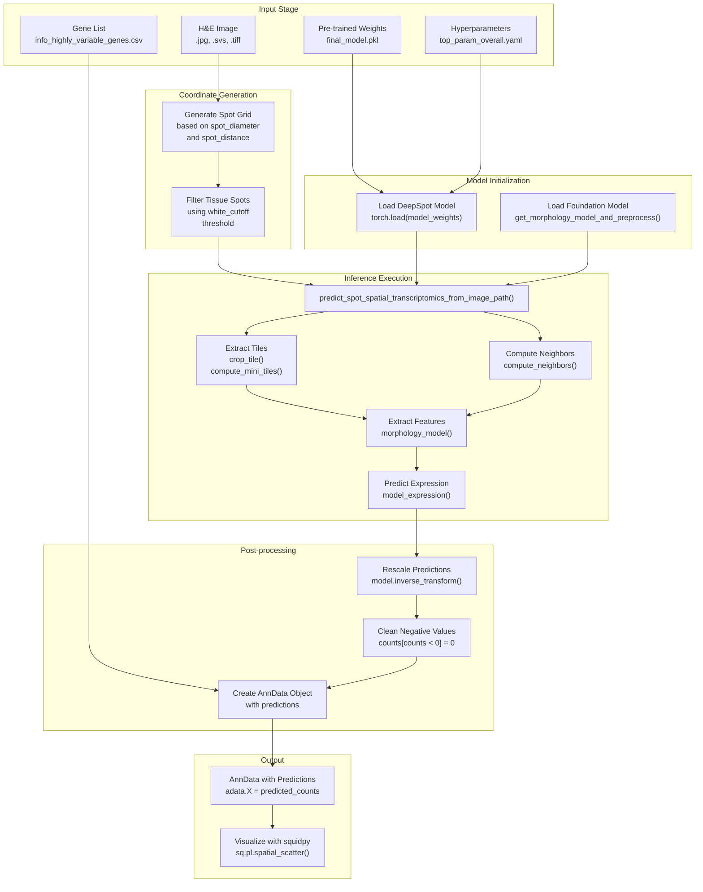
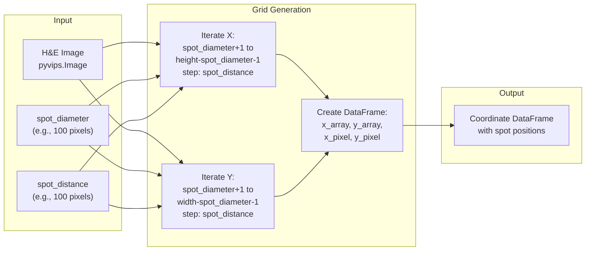
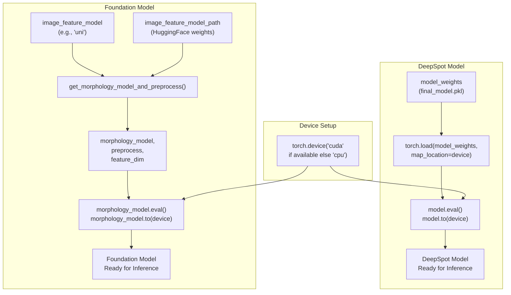
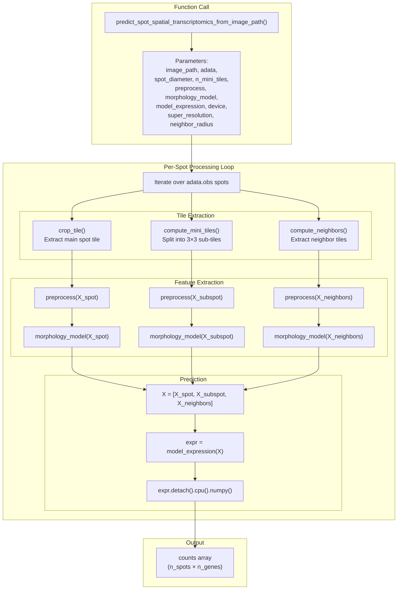
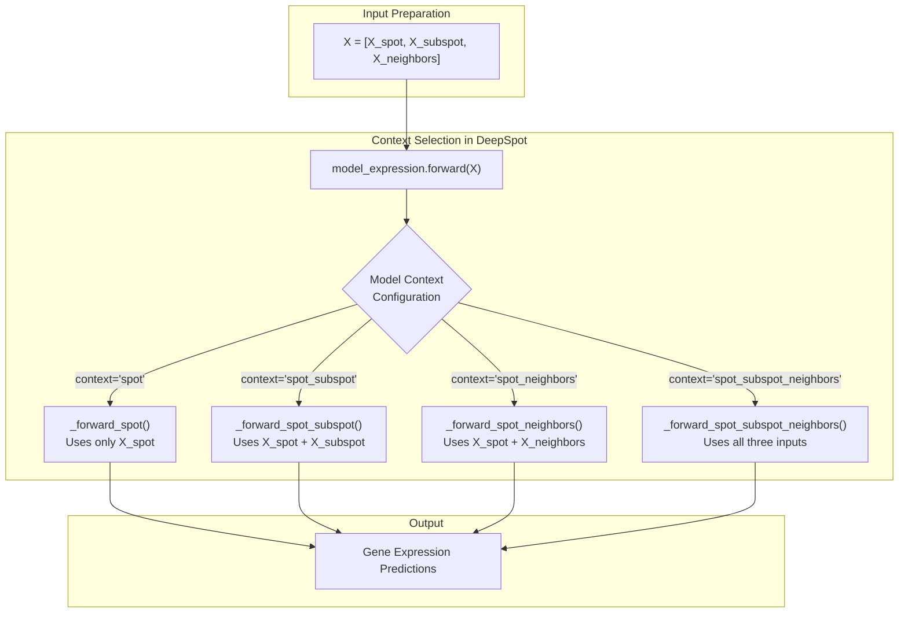

# Visium Inference

<details>
<summary>Relevant source files</summary>

The following files were used as context for generating this wiki page:

- [deepspot/utils/utils_image.py](deepspot/utils/utils_image.py)
- [example_notebook/Visium_spot_example/GettingStartedWithDeepSpot_3.1_inference_pretrained_models.ipynb](example_notebook/Visium_spot_example/GettingStartedWithDeepSpot_3.1_inference_pretrained_models.ipynb)

</details>


## Purpose and Scope

This page documents the inference workflow for predicting spatial transcriptomics gene expression from H&E histology images using trained DeepSpot models. Inference can be performed using either pre-trained weights downloaded from Zenodo or custom weights from a training run.

For preprocessing steps to prepare data before inference, see [Visium Preprocessing](#7.1.1). For training custom DeepSpot models, see [Visium Training](#7.1.2). For cell-level inference on Xenium data, see [Xenium Inference](#7.2.3).

---

## Overview

The Visium inference workflow consists of five stages:

1. **Setup**: Load pre-trained model weights, configuration parameters, and gene lists
2. **Coordinate Generation**: Create a grid of spot coordinates covering the H&E image
3. **Tissue Detection**: Filter spots to retain only those within tissue regions
4. **Prediction**: Extract image features and predict gene expression for each spot
5. **Post-processing**: Transform predictions back to original scale and create output AnnData

**Diagram: Visium Inference Pipeline**



**Sources:** [example_notebook/Visium_spot_example/GettingStartedWithDeepSpot_3.1_inference_pretrained_models.ipynb:1-510](), [deepspot/utils/utils_image.py:241-293]()

---

## Prerequisites

Before running inference, ensure the following are available:

| Requirement | Description | Location |
|-------------|-------------|----------|
| **Pre-trained Weights** | DeepSpot model checkpoint (`.pkl` file) | Zenodo: https://zenodo.org/records/15322099 |
| **Configuration File** | Model hyperparameters (`.yaml` file) | Included with pre-trained weights |
| **Gene List** | CSV with highly variable genes to predict | Included with pre-trained weights |
| **Foundation Model Weights** | Pathology foundation model (UNI, Hoptimus0, Phikon) | HuggingFace (see [Foundation Models](#3.3)) |
| **H&E Image** | Histology image for prediction target | User-provided (`.jpg`, `.svs`, `.tiff`) |

**Sources:** [example_notebook/Visium_spot_example/GettingStartedWithDeepSpot_3.1_inference_pretrained_models.ipynb:33-56](), [example_notebook/Visium_spot_example/GettingStartedWithDeepSpot_3.1_inference_pretrained_models.ipynb:120-151]()

---

## Downloading Pre-trained Weights

Pre-trained DeepSpot models are available on Zenodo. The weights archive contains three critical files:

```python
# Download and extract weights
!wget -c https://zenodo.org/records/15322099/files/DeepSpot_pretrained_model_weights.zip?download=1
!unzip DeepSpot_pretrained_model_weights.zip
```

The extracted directory structure:

```
DeepSpot_pretrained_model_weights/
├── Colon_HEST1K/
│   ├── final_model.pkl              # DeepSpot model weights
│   ├── top_param_overall.yaml       # Hyperparameters
│   └── info_highly_variable_genes.csv  # Gene list with prediction flags
```

**Sources:** [example_notebook/Visium_spot_example/GettingStartedWithDeepSpot_3.1_inference_pretrained_models.ipynb:33-56]()

---

## Configuration Parameters

Load the model configuration from the YAML file to extract critical parameters:

```python
import yaml

with open(model_hparam, "r") as stream:
    config = yaml.safe_load(stream)

# Key parameters
spot_diameter = config['spot_diameter']      # Spot diameter in pixels (e.g., 100)
spot_distance = config['spot_distance']      # Distance between spots (e.g., 100)
image_feature_model = config['image_feature_model']  # Foundation model name (e.g., "uni")
n_mini_tiles = 9                             # Always 9 for Visium (3×3 grid)
```

**Important Parameters:**

| Parameter | Description | Typical Value |
|-----------|-------------|---------------|
| `spot_diameter` | Diameter of each spot in pixels at the H&E image resolution | 100 (for 20× magnification) |
| `spot_distance` | Spacing between adjacent spot centers | 100 (for 20× magnification) |
| `n_mini_tiles` | Number of sub-tiles per spot (always 3×3 for Visium) | 9 |
| `image_feature_model` | Foundation model identifier | `"uni"`, `"hoptimus0"`, `"phikon"` |

**Note:** The `spot_diameter` and `spot_distance` values depend on the H&E image magnification. For 20× magnification imaging Visium tissue (55 μm spot diameter, 100 μm center-to-center), typical values are 100 pixels each. Adjust these parameters based on your specific imaging resolution.

**Sources:** [example_notebook/Visium_spot_example/GettingStartedWithDeepSpot_3.1_inference_pretrained_models.ipynb:138-151]()

---

## Loading Gene Information

The gene list CSV specifies which genes the model was trained to predict:

```python
import pandas as pd

genes = pd.read_csv(gene_path)
selected_genes_bool = genes.isPredicted.values
genes_to_predict = genes[selected_genes_bool]
```

The CSV contains the following columns:

| Column | Description |
|--------|-------------|
| `gene_name` | Gene symbol (e.g., "MUC2", "ITLN1") |
| `isPredicted` | Boolean flag indicating if gene is predicted |
| `highly_variable_rank` | Rank of gene in highly variable gene selection |

**Sources:** [example_notebook/Visium_spot_example/GettingStartedWithDeepSpot_3.1_inference_pretrained_models.ipynb:181-185]()

---

## Generating Spot Coordinates

Create a regular grid of spot coordinates covering the entire H&E image:

**Diagram: Spot Coordinate Generation Process**



```python
import pyvips

image = pyvips.Image.new_from_file(image_path)

coord = []
for i, x in enumerate(range(spot_diameter + 1, 
                            image.height - spot_diameter - 1, 
                            spot_distance)):
    for j, y in enumerate(range(spot_diameter + 1, 
                                image.width - spot_diameter - 1, 
                                spot_distance)):
        coord.append([i, j, x, y])

coord = pd.DataFrame(coord, columns=['x_array', 'y_array', 'x_pixel', 'y_pixel'])
coord.index = coord.index.astype(str)
```

The resulting DataFrame contains:
- `x_array`, `y_array`: Grid indices (0-indexed)
- `x_pixel`, `y_pixel`: Pixel coordinates in the image

**Sources:** [example_notebook/Visium_spot_example/GettingStartedWithDeepSpot_3.1_inference_pretrained_models.ipynb:218-226]()

---

## Tissue Detection and Filtering

Filter spots to retain only those within tissue regions using a white threshold:

```python
from deepspot.utils.utils_image import crop_tile
from tqdm import tqdm

is_white = []
for _, row in tqdm(coord.iterrows()):
    x = row.x_pixel - int(spot_diameter // 2)
    y = row.y_pixel - int(spot_diameter // 2)
    
    main_tile = crop_tile(image, x, y, spot_diameter)
    main_tile = main_tile[:,:,:3]  # RGB channels only
    white = np.mean(main_tile)
    is_white.append(white)

coord['is_white'] = is_white
coord['is_white_bool'] = (coord['is_white'] > white_cutoff).astype(int)

# Filter to tissue spots only
coord_tissue = coord[coord.is_white_bool == 0]
```

**White Cutoff Parameter:**
- Typical value: `white_cutoff = 200` (on 0-255 scale)
- Higher values = more strict filtering (removes lighter spots)
- Lower values = more permissive (includes more spots)

**Sources:** [example_notebook/Visium_spot_example/GettingStartedWithDeepSpot_3.1_inference_pretrained_models.ipynb:243-257](), [deepspot/utils/utils_image.py:190-198]()

---

## Creating the AnnData Object

Prepare an empty AnnData object to hold predictions:

```python
import anndata as ad
import numpy as np

# Initialize empty count matrix
counts = np.empty((len(coord_tissue), selected_genes_bool.sum()))

# Create AnnData
adata = ad.AnnData(counts)
adata.var.index = genes[selected_genes_bool].gene_name.values
adata.obs = adata.obs.merge(coord_tissue, left_index=True, right_index=True)
adata.obs['sampleID'] = sample
adata.obs['barcode'] = adata.obs.index
```

**Sources:** [example_notebook/Visium_spot_example/GettingStartedWithDeepSpot_3.1_inference_pretrained_models.ipynb:274-283]()

---

## Model Initialization

Initialize both the DeepSpot model and the foundation model for feature extraction:

**Diagram: Model Loading and Initialization**



```python
import torch
from deepspot.utils.utils_image import get_morphology_model_and_preprocess

# Set device
device = torch.device('cuda' if torch.cuda.is_available() else 'cpu')

# Load DeepSpot model
model_expression = torch.load(model_weights, map_location=device)
model_expression.to(device)
model_expression.eval()

# Load foundation model
morphology_model, preprocess, feature_dim = get_morphology_model_and_preprocess(
    model_name=image_feature_model,
    device=device,
    model_path=image_feature_model_path
)
morphology_model.to(device)
morphology_model.eval()
```

**Foundation Model Options:**

| Model Name | Feature Dimension | Path Requirements |
|------------|------------------|-------------------|
| `"uni"` | 1024 | Path to UNI weights from HuggingFace |
| `"hoptimus0"` | 1536 | Path to Hoptimus0 weights from HuggingFace |
| `"phikon"` | 768 | Path to Phikon model directory |
| `"inception"` | 2048 | Uses torchvision weights (no path needed) |

**Sources:** [example_notebook/Visium_spot_example/GettingStartedWithDeepSpot_3.1_inference_pretrained_models.ipynb:344-360](), [deepspot/utils/utils_image.py:36-177]()

---

## Running Inference

Execute the prediction using `predict_spot_spatial_transcriptomics_from_image_path`:

**Diagram: Inference Function Internals**



```python
from deepspot.utils.utils_image import predict_spot_spatial_transcriptomics_from_image_path

counts = predict_spot_spatial_transcriptomics_from_image_path(
    image_path=image_path,
    adata=adata,
    spot_diameter=spot_diameter,
    n_mini_tiles=n_mini_tiles,
    preprocess=preprocess,
    morphology_model=morphology_model,
    model_expression=model_expression,
    device=device,
    super_resolution=False,
    neighbor_radius=1
)
```

**Function Parameters:**

| Parameter | Type | Description |
|-----------|------|-------------|
| `image_path` | `str` | Path to H&E image file |
| `adata` | `AnnData` | AnnData object with spot coordinates in `adata.obs` |
| `spot_diameter` | `int` | Spot diameter in pixels |
| `n_mini_tiles` | `int` | Number of sub-tiles (always 9 for Visium) |
| `preprocess` | `callable` | Preprocessing function from foundation model |
| `morphology_model` | `torch.nn.Module` | Foundation model for feature extraction |
| `model_expression` | `DeepSpot` | Trained DeepSpot model |
| `device` | `torch.device` | Computation device (CPU or CUDA) |
| `super_resolution` | `bool` | Enable super-resolution mode (default: `False`) |
| `neighbor_radius` | `int` | Radius for neighbor computation (default: `1`) |

**Returns:**
- `counts`: NumPy array of shape `(n_spots, n_genes)` with **normalized** gene expression predictions

**Sources:** [example_notebook/Visium_spot_example/GettingStartedWithDeepSpot_3.1_inference_pretrained_models.ipynb:369-379](), [deepspot/utils/utils_image.py:241-293]()

---

## Inference Function Implementation Details

The `predict_spot_spatial_transcriptomics_from_image_path` function processes each spot individually:

### Tile Extraction Process

For each spot, three types of tiles are extracted:

1. **Main Spot Tile** (`X_spot`):
   - Extracted using `crop_tile(image, spot.x_pixel, spot.y_pixel, spot_diameter)` [deepspot/utils/utils_image.py:261]()
   - Square region centered at spot coordinates

2. **Sub-spot Tiles** (`X_subspot`):
   - Main tile divided into 3×3 grid using `compute_mini_tiles(X_spot, n_mini_tiles, super_resolution)` [deepspot/utils/utils_image.py:262]()
   - Captures sub-spot heterogeneity
   - Returns list of 9 tiles

3. **Neighbor Tiles** (`X_neighbors`):
   - Neighbors identified using `compute_neighbors(spot, adata.obs, radius=neighbor_radius)` [deepspot/utils/utils_image.py:258]()
   - Tiles extracted for each neighbor spot
   - If no neighbors found, uses zero array [deepspot/utils/utils_image.py:268-269]()

### Feature Extraction Pipeline

Each tile undergoes the following transformations:

```python
# Apply preprocessing (resize, normalize)
X_spot = preprocess(X_spot).to(device).float()
X_subspot = torch.stack([preprocess(x) for x in X_subspot]).to(device).float()
X_neighbors = torch.stack([preprocess(x) for x in X_neighbors]).to(device).float()

# Extract features with foundation model
X_spot = morphology_model(X_spot[None, ])
X_subspot = morphology_model(X_subspot)
X_neighbors = morphology_model(X_neighbors)

# Convert to float and add batch dimension
X_spot = detach_and_convert(X_spot)
X_subspot = detach_and_convert(X_subspot)
X_neighbors = detach_and_convert(X_neighbors)
```

### Prediction Execution

```python
# Combine inputs
X = [X_spot, X_subspot, X_neighbors]

# Predict expression
expr = model_expression(X)
expr = expr.detach().cpu().numpy()
```

**Note:** The function uses `torch.autocast` for mixed precision [deepspot/utils/utils_image.py:255]() and `torch.inference_mode()` [deepspot/utils/utils_image.py:256]() for optimized inference.

**Sources:** [deepspot/utils/utils_image.py:241-293]()

---

## Post-processing Predictions

The predictions returned by `predict_spot_spatial_transcriptomics_from_image_path` are in **normalized space** (the same space used during training). They must be transformed back to the original scale:

### Step 1: Inverse Transform

```python
# Apply inverse transformation
counts = model_expression.inverse_transform(counts)
```

**Critical Note:** The `inverse_transform` method uses the same `StandardScaler` that was fitted during training. This scaler is stored within the DeepSpot model object and must match the training configuration.

### Step 2: Clean Negative Values

```python
# Remove negative predictions
counts[counts < 0] = 0
```

After inverse transformation, some predictions may be negative due to the normalization/standardization process. Setting these to zero is a common practice, though other thresholding strategies can be explored.

### Step 3: Create Final AnnData

```python
adata_predicted = ad.AnnData(
    counts,
    var=adata.var,
    obs=adata.obs,
    uns=adata.uns,
    obsm=adata.obsm
).copy()
```

**Sources:** [example_notebook/Visium_spot_example/GettingStartedWithDeepSpot_3.1_inference_pretrained_models.ipynb:387-439]()

---

## Visualization Setup

To visualize predictions with `squidpy`, spatial coordinates and image metadata must be added to the AnnData object:

```python
import math
import PIL
from openslide import open_slide

# Load image for visualization
img = open_slide(image_path)
n_level = len(img.level_dimensions) - 1

# Calculate downsampled dimensions
downsample_factor = 10
large_w, large_h = img.dimensions
new_w = math.floor(large_w / downsample_factor)
new_h = math.floor(large_h / downsample_factor)

# Create downsampled image
whole_slide_image = img.read_region((0, 0), n_level, img.level_dimensions[-1])
whole_slide_image = whole_slide_image.convert("RGB")
img_downsample = whole_slide_image.resize((new_w, new_h), PIL.Image.BILINEAR)

# Add spatial coordinates
adata_predicted.obsm['spatial'] = adata_predicted.obs[["y_pixel", "x_pixel"]].values
adata_predicted.obsm['spatial'] = adata_predicted.obsm['spatial'] / downsample_factor

# Add image to uns
adata_predicted.uns['spatial'] = dict()
adata_predicted.uns['spatial']['library_id'] = dict()
adata_predicted.uns['spatial']['library_id']['images'] = dict()
adata_predicted.uns['spatial']['library_id']['images']['hires'] = np.array(img_downsample)
```

### Visualize Predictions

```python
import squidpy as sq

sq.pl.spatial_scatter(
    adata_predicted,
    color=['MUC2', 'ITLN1', 'CLCA1', 'FCGBP'],
    wspace=0,
    ncols=2,
    size=5
)
```

**Sources:** [example_notebook/Visium_spot_example/GettingStartedWithDeepSpot_3.1_inference_pretrained_models.ipynb:292-314](), [example_notebook/Visium_spot_example/GettingStartedWithDeepSpot_3.1_inference_pretrained_models.ipynb:448-454]()

---

## Inference Modes and Context

The DeepSpot model supports multiple spatial contexts during inference, controlled by the model's internal configuration:

**Diagram: DeepSpot Context Modes**



The context mode is set during model training and saved in the model checkpoint. During inference, the appropriate forward method is automatically selected based on the model's configuration.

For details on the different context modes, see [DeepSpot Model](#5.2).

**Sources:** [deepspot/utils/utils_image.py:285-287]()

---

## Super-Resolution Mode

The `super_resolution` parameter enables an alternative tiling strategy:

**Standard Mode** (`super_resolution=False`):
- Divides main spot tile into 9 non-overlapping sub-tiles (3×3 grid)
- Each sub-tile is ~1/9 the area of the main tile
- Implemented in `compute_mini_tiles` [deepspot/utils/utils_image.py:210-222]()

**Super-Resolution Mode** (`super_resolution=True`):
- Extracts a single centered sub-tile from the main spot
- Sub-tile size = main tile size / 3
- Provides higher resolution of spot center
- Implemented in `compute_mini_tiles` [deepspot/utils/utils_image.py:224-232]()

To enable super-resolution mode:

```python
counts = predict_spot_spatial_transcriptomics_from_image_path(
    image_path=image_path,
    adata=adata,
    spot_diameter=spot_diameter,
    n_mini_tiles=9,  # Still 9, but used differently
    preprocess=preprocess,
    morphology_model=morphology_model,
    model_expression=model_expression,
    device=device,
    super_resolution=True,  # Enable super-resolution
    neighbor_radius=1
)
```

**Note:** Super-resolution mode should only be used if the model was trained with this setting enabled.

**Sources:** [deepspot/utils/utils_image.py:201-234](), [deepspot/utils/utils_image.py:249]()

---

## Neighbor Radius Configuration

The `neighbor_radius` parameter controls which spots are considered neighbors:

| Radius | Description | Typical Use |
|--------|-------------|-------------|
| `0` | No neighbors (spot only) | Fastest inference, no spatial context |
| `1` | Immediate neighbors (8 spots in grid) | Default, balances performance and context |
| `2` | Extended neighborhood (24 spots) | More spatial context, slower |

**Neighbor Identification Process:**

The `compute_neighbors` function [deepspot/utils/utils_dataloader.py]() identifies neighbors based on array coordinates (`x_array`, `y_array`), not pixel coordinates. For radius `r`, a spot at `(x, y)` has neighbors at all positions `(x±i, y±j)` where `-r ≤ i, j ≤ r` and `(i, j) ≠ (0, 0)`.

```python
# Example: radius=1 includes 8 neighbors
# X X X
# X O X  (O = center spot, X = neighbors)
# X X X

counts = predict_spot_spatial_transcriptomics_from_image_path(
    ...,
    neighbor_radius=1  # Standard setting
)
```

**Sources:** [deepspot/utils/utils_image.py:250](), [deepspot/utils/utils_image.py:258-259]()

---

## Performance Considerations

### Memory Management

- **Batch Size**: The function processes one spot at a time [deepspot/utils/utils_image.py:257]()
- **Future Improvement**: Batching multiple spots could improve speed (contributions welcome per [example_notebook/Visium_spot_example/GettingStartedWithDeepSpot_3.1_inference_pretrained_models.ipynb:334]())

### Mixed Precision

The inference function uses automatic mixed precision (AMP) for CUDA devices:

```python
with torch.autocast(device_type="cuda", dtype=torch.float16):
    with torch.inference_mode():
        # Inference code
```

This reduces memory usage and can speed up inference on compatible GPUs [deepspot/utils/utils_image.py:255-256]().

### Image Loading Strategy

Images are loaded with `pyvips` for memory-efficient streaming [deepspot/utils/utils_image.py:252](), allowing inference on large whole-slide images without loading the entire file into memory.

**Sources:** [deepspot/utils/utils_image.py:241-293]()

---

## Output Format

The final `AnnData` object contains:

**Core Data:**
- **`.X`**: Gene expression predictions (spots × genes)
- **`.var`**: Gene metadata with `gene_name` index
- **`.obs`**: Spot metadata including:
  - `x_array`, `y_array`: Grid coordinates
  - `x_pixel`, `y_pixel`: Pixel coordinates
  - `is_white`: Mean pixel intensity
  - `is_white_bool`: Tissue filter flag
  - `sampleID`: Sample identifier
  - `barcode`: Spot barcode

**Spatial Data:**
- **`.obsm['spatial']`**: Coordinates for visualization (y, x order)
- **`.uns['spatial']['library_id']['images']['hires']`**: Downsampled H&E image

This format is compatible with `scanpy` and `squidpy` for downstream analysis and visualization.

**Sources:** [example_notebook/Visium_spot_example/GettingStartedWithDeepSpot_3.1_inference_pretrained_models.ipynb:433-439]()

---

## Complete Inference Example

**Minimal working example** for inference with pre-trained weights:

```python
import torch
import pandas as pd
import anndata as ad
import numpy as np
from deepspot.utils.utils_image import (
    predict_spot_spatial_transcriptomics_from_image_path,
    get_morphology_model_and_preprocess
)

# Configuration
device = torch.device('cuda' if torch.cuda.is_available() else 'cpu')
model_weights = 'DeepSpot_pretrained_model_weights/Colon_HEST1K/final_model.pkl'
gene_path = 'DeepSpot_pretrained_model_weights/Colon_HEST1K/info_highly_variable_genes.csv'
image_path = 'example_data/data/image/ZEN38_without_fud.jpg'
image_feature_model_path = "../huggingface/hub/models--MahmoodLab--UNI/blobs/..."

# Parameters
spot_diameter = 100
spot_distance = 100
n_mini_tiles = 9
image_feature_model = "uni"

# Load gene list
genes = pd.read_csv(gene_path)
selected_genes_bool = genes.isPredicted.values

# Generate coordinates (assuming coord DataFrame already created)
# coord = ... (see "Generating Spot Coordinates" section)

# Create empty AnnData
counts_empty = np.empty((len(coord), selected_genes_bool.sum()))
adata = ad.AnnData(counts_empty)
adata.var.index = genes[selected_genes_bool].gene_name.values
adata.obs = coord
adata.obs['barcode'] = adata.obs.index

# Load models
model_expression = torch.load(model_weights, map_location=device)
model_expression.to(device).eval()

morphology_model, preprocess, feature_dim = get_morphology_model_and_preprocess(
    model_name=image_feature_model,
    device=device,
    model_path=image_feature_model_path
)
morphology_model.to(device).eval()

# Run inference
counts = predict_spot_spatial_transcriptomics_from_image_path(
    image_path, adata, spot_diameter, n_mini_tiles,
    preprocess, morphology_model, model_expression, device,
    super_resolution=False, neighbor_radius=1
)

# Post-process
counts = model_expression.inverse_transform(counts)
counts[counts < 0] = 0

# Create final AnnData
adata_predicted = ad.AnnData(counts, var=adata.var, obs=adata.obs)
```

**Sources:** [example_notebook/Visium_spot_example/GettingStartedWithDeepSpot_3.1_inference_pretrained_models.ipynb:1-510]()

---

## Troubleshooting

### Common Issues

| Issue | Cause | Solution |
|-------|-------|----------|
| **Negative predictions** | Normal behavior after inverse transform | Apply `counts[counts < 0] = 0` |
| **NaN in predictions** | Corrupted input tiles or model issues | Check assertion at [deepspot/utils/utils_image.py:289]() |
| **Memory errors** | Large image or insufficient GPU memory | Use CPU device or process fewer spots |
| **Misaligned visualizations** | Incorrect coordinate scaling | Verify `downsample_factor` matches image dimensions |
| **Wrong gene predictions** | Mismatch between model and gene list | Ensure gene list matches training configuration |

### Debugging Tips

1. **Verify coordinate generation**: Plot sample spots on image to check alignment
2. **Check tile extraction**: Visualize extracted tiles to confirm correct regions
3. **Validate model loading**: Print model configuration to confirm correct weights loaded
4. **Monitor inference progress**: Use `tqdm` progress bar to track spot processing
5. **Inspect intermediate outputs**: Save features after morphology model to verify extraction

**Sources:** [example_notebook/Visium_spot_example/GettingStartedWithDeepSpot_3.1_inference_pretrained_models.ipynb:1-510](), [deepspot/utils/utils_image.py:241-293]()

---