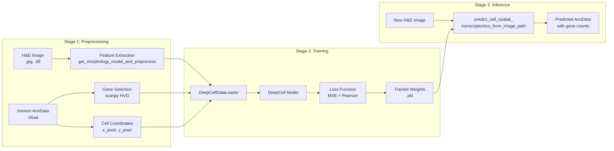
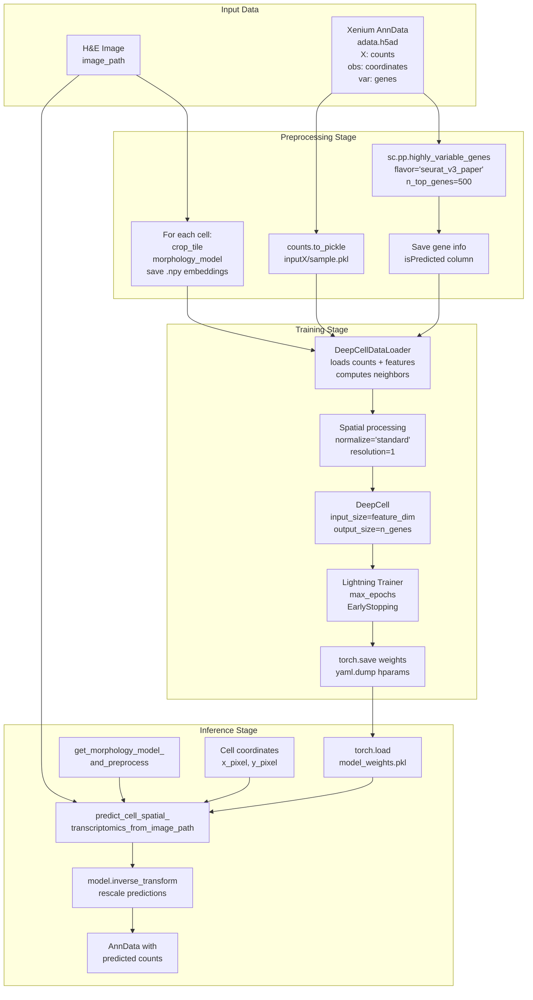
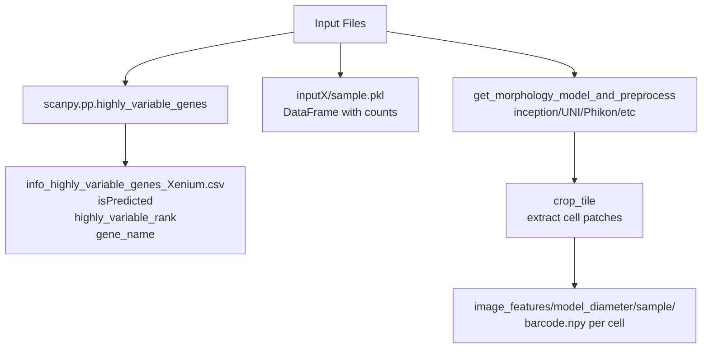
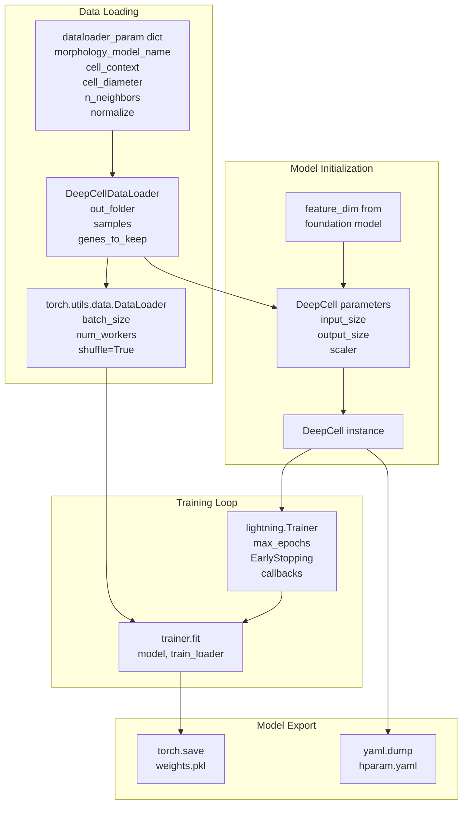
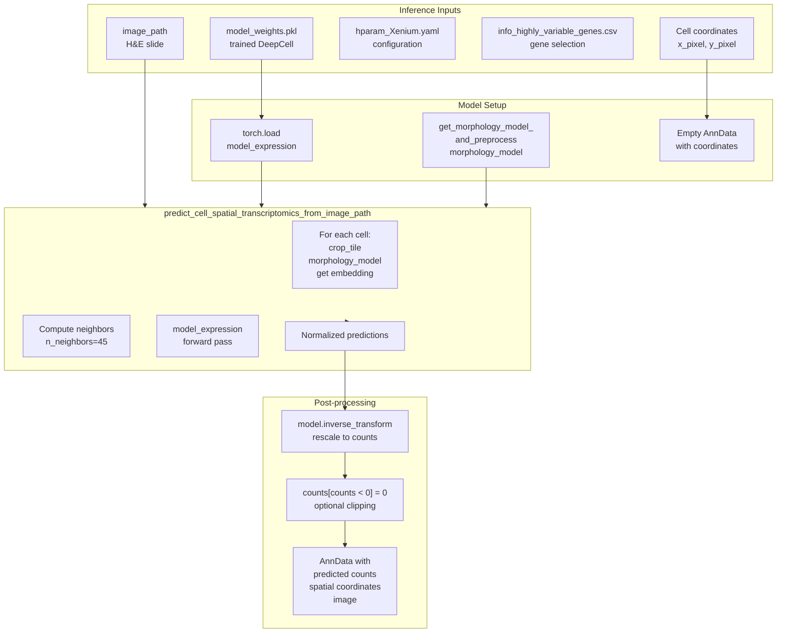

# Xenium Cell Workflow

<details>
<summary>Relevant source files</summary>

The following files were used as context for generating this wiki page:

- [README.md](README.md)
- [example_notebook/Xenium_single-cell_example/GettingStartedWithDeepCell_1_preprocessing.ipynb](example_notebook/Xenium_single-cell_example/GettingStartedWithDeepCell_1_preprocessing.ipynb)
- [example_notebook/Xenium_single-cell_example/GettingStartedWithDeepCell_2_training_xenium.ipynb](example_notebook/Xenium_single-cell_example/GettingStartedWithDeepCell_2_training_xenium.ipynb)
- [example_notebook/Xenium_single-cell_example/GettingStartedWithDeepCell_3_inference_xenium.ipynb](example_notebook/Xenium_single-cell_example/GettingStartedWithDeepCell_3_inference_xenium.ipynb)

</details>


## Purpose and Scope

This page provides a complete overview of the Xenium cell-level spatial transcriptomics prediction workflow using DeepCell. Xenium is a single-cell spatial transcriptomics technology that operates at approximately 20μm resolution, enabling single-cell gene expression prediction from H&E images.

This workflow covers three main stages: **preprocessing** (gene selection, feature extraction, cell coordinate handling), **training** (DeepCell model configuration and optimization), and **inference** (predicting spatial transcriptomics from new H&E images). For spot-level Visium workflows, see [Visium Spot Workflow](#7.1). For detailed information about individual stages, see [Xenium Preprocessing](#7.2.1), [Xenium Training](#7.2.2), and [Xenium Inference](#7.2.3).

**Sources**: [README.md:70-73]()

## Workflow Overview

The Xenium cell workflow consists of three sequential stages that transform raw H&E images and spatial transcriptomics data into trained models capable of predicting single-cell gene expression:



**Sources**: [example_notebook/Xenium_single-cell_example/GettingStartedWithDeepCell_1_preprocessing.ipynb:1-11](), [example_notebook/Xenium_single-cell_example/GettingStartedWithDeepCell_2_training_xenium.ipynb:1-11](), [example_notebook/Xenium_single-cell_example/GettingStartedWithDeepCell_3_inference_xenium.ipynb:1-11]()

## Key Differences from Visium Workflow

The Xenium workflow operates at single-cell resolution and requires different processing strategies compared to the spot-level Visium workflow:

| Aspect | Xenium Cell Workflow | Visium Spot Workflow |
|--------|---------------------|---------------------|
| **Resolution** | ~20μm (single cell) | ~55μm (1-10 cells per spot) |
| **Model Class** | `DeepCell` | `DeepSpot` |
| **Data Loader** | `DeepCellDataLoader` | `DeepSpotDataLoader` |
| **Tile Diameter** | `cell_diameter=20` | `spot_diameter=55` |
| **Sub-tiles** | Not used (cells too small) | 3×3 mini-tiles for sub-spot context |
| **Default Neighbors** | `n_neighbors=45` | `radius=1` or configurable |
| **Typical HVGs** | 500 genes | 300-800 genes |
| **Context Modes** | 2 (`cell`, `cell_neighbors`) | 4 (spot, subspot, neighbors, combined) |

**Sources**: [README.md:64-73](), [example_notebook/Xenium_single-cell_example/GettingStartedWithDeepCell_1_preprocessing.ipynb:98-99]()

## Complete Data Flow

The following diagram shows how data flows through the entire Xenium cell workflow, from raw inputs to final predictions:



**Sources**: [example_notebook/Xenium_single-cell_example/GettingStartedWithDeepCell_1_preprocessing.ipynb:83-307](), [example_notebook/Xenium_single-cell_example/GettingStartedWithDeepCell_2_training_xenium.ipynb:81-239](), [example_notebook/Xenium_single-cell_example/GettingStartedWithDeepCell_3_inference_xenium.ipynb:82-292]()

## Stage 1: Preprocessing

### Purpose

Preprocessing transforms raw Xenium data into a format suitable for DeepCell training. This involves selecting highly variable genes, extracting morphological features from H&E images for each cell location, and organizing data into the expected directory structure.

### Key Components



### Directory Structure

After preprocessing, the following directory structure is created:

```
out_folder/
├── data/
│   ├── info_highly_variable_genes_Xenium.csv
│   ├── inputX/
│   │   └── sample.pkl
│   └── image_features/
│       └── {model_name}_{cell_diameter}/
│           └── {sample}/
│               ├── barcode1.npy
│               ├── barcode2.npy
│               └── ...
```

### Configuration Parameters

| Parameter | Description | Typical Value |
|-----------|-------------|---------------|
| `cell_diameter` | Diameter of cell patches in pixels | 20 |
| `n_top_genes` | Number of highly variable genes | 500 |
| `image_feature_model` | Foundation model name | `"inception"`, `"uni"`, `"phikon"` |
| `flavor` | HVG selection method | `"seurat_v3_paper"` |

### Code References

The preprocessing stage uses these key functions:

- **Gene Selection**: [example_notebook/Xenium_single-cell_example/GettingStartedWithDeepCell_1_preprocessing.ipynb:143-144]() uses `sc.pp.highly_variable_genes` to select the top 500 genes
- **Feature Extraction**: [example_notebook/Xenium_single-cell_example/GettingStartedWithDeepCell_1_preprocessing.ipynb:223-226]() calls `get_morphology_model_and_preprocess` to load the foundation model
- **Tile Cropping**: [example_notebook/Xenium_single-cell_example/GettingStartedWithDeepCell_1_preprocessing.ipynb:269]() uses `crop_tile` to extract cell patches
- **Batch Processing**: [example_notebook/Xenium_single-cell_example/GettingStartedWithDeepCell_1_preprocessing.ipynb:267-307]() processes cells in batches for efficiency

**Sources**: [example_notebook/Xenium_single-cell_example/GettingStartedWithDeepCell_1_preprocessing.ipynb:1-358]()

## Stage 2: Training

### Purpose

Training stage configures and optimizes the DeepCell model using the preprocessed data. This involves setting up the `DeepCellDataLoader`, initializing the `DeepCell` model with appropriate hyperparameters, and training with PyTorch Lightning.

### Key Components



### DeepCellDataLoader Configuration

The `DeepCellDataLoader` is the central component for batching and preprocessing training data:

```python
# Key parameters for DeepCellDataLoader
dataloader_param = {
    "morphology_model_name": "inception",  # Foundation model used in preprocessing
    "batch_size": 1024,                    # Cells per batch
    "cell_context": "cell_neighbors",      # Include neighbor context
    "cell_diameter": 20,                   # Must match preprocessing
    "n_neighbors": 45,                     # Number of neighbor cells
    "resolution": 1,                       # Spatial upsampling factor
    "normalize": "standard",               # StandardScaler normalization
    "augmentation": "default"              # Data augmentation strategy
}
```

**Sources**: [example_notebook/Xenium_single-cell_example/GettingStartedWithDeepCell_2_training_xenium.ipynb:93-116]()

### DeepCell Model Initialization

```python
# Initialize DeepCell with scaler from dataloader
regressor = DeepCell(
    input_size=feature_dim,                    # From foundation model
    output_size=int(selected_genes_bool.sum()), # Number of genes to predict
    scaler=train_data_loader_custom.scaler,    # For inverse_transform later
    **param                                     # Additional hyperparameters
)
```

The `scaler` parameter is critical - it's stored with the model and used during inference to transform predictions back to original gene expression scales via `model.inverse_transform()`.

**Sources**: [example_notebook/Xenium_single-cell_example/GettingStartedWithDeepCell_2_training_xenium.ipynb:214-217]()

### Training Configuration

```python
# PyTorch Lightning trainer with early stopping
trainer = L.Trainer(
    max_epochs=10,
    logger=False,
    enable_checkpointing=False,
    callbacks=[EarlyStopping(
        monitor="train_step",
        patience=3,
        min_delta=0.01,
        mode="min"
    )]
)
trainer.fit(regressor, train_data_loader)
```

**Sources**: [example_notebook/Xenium_single-cell_example/GettingStartedWithDeepCell_2_training_xenium.ipynb:235-239]()

### Model Export

After training, both model weights and hyperparameters must be saved for inference:

```python
# Save model weights
torch.save(regressor, 'weights_Xenium.pkl')

# Save hyperparameters (excluding scaler object)
hparam = dict(regressor.hparams)
hparam['image_feature_model'] = dataloader_param['morphology_model_name']
hparam['scaler'] = str(hparam['scaler'])  # Convert to string
with open('hparam_Xenium.yaml', 'w') as yaml_file:
    yaml.dump(hparam, yaml_file)
```

**Sources**: [example_notebook/Xenium_single-cell_example/GettingStartedWithDeepCell_2_training_xenium.ipynb:285-313]()

## Stage 3: Inference

### Purpose

Inference applies a trained DeepCell model to predict single-cell spatial transcriptomics from new H&E images. This stage extracts features on-the-fly for each cell location and generates an AnnData object with predicted gene expression values.

### Key Components



### Configuration Parameters

Key parameters that must match the training configuration:

| Parameter | Description | Must Match Training |
|-----------|-------------|---------------------|
| `cell_diameter` | Cell patch size | ✓ |
| `n_neighbors` | Neighbor context size | ✓ |
| `image_feature_model` | Foundation model name | ✓ |
| `downsample_factor` | For visualization only | ✗ |

### Prediction Function

The core inference function is `predict_cell_spatial_transcriptomics_from_image_path`:

```python
counts = predict_cell_spatial_transcriptomics_from_image_path(
    image_path,           # H&E slide path
    adata,                # AnnData with coordinates
    cell_diameter,        # Patch size (must match training)
    n_neighbors,          # Neighbor count (must match training)
    preprocess,           # Foundation model preprocessing
    morphology_model,     # Foundation model
    model_expression,     # Trained DeepCell model
    device                # CPU or GPU
)
```

This function:
1. Extracts morphological features for each cell location using `crop_tile` and the foundation model
2. Computes spatial neighbors for each cell
3. Runs the DeepCell forward pass with neighbor context
4. Returns normalized predictions that must be inverse-transformed

**Sources**: [example_notebook/Xenium_single-cell_example/GettingStartedWithDeepCell_3_inference_xenium.ipynb:258-266]()

### Inverse Transformation

**Critical step**: Predictions are normalized during training and must be rescaled to original count scales:

```python
# predictions are normalized
counts = predict_cell_spatial_transcriptomics_from_image_path(...)

# MUST inverse transform using the stored scaler
counts = model_expression.inverse_transform(counts)

# Optional post-processing
counts[counts < 0] = 0  # Remove negative predictions
```

The model's `scaler` object (stored during training) is used to reverse the normalization applied by the `DeepCellDataLoader`. This is **not done automatically** and must be performed explicitly.

**Sources**: [example_notebook/Xenium_single-cell_example/GettingStartedWithDeepCell_3_inference_xenium.ipynb:273-292](), [example_notebook/Xenium_single-cell_example/GettingStartedWithDeepCell_2_training_xenium.ipynb:183-191]()

### Creating Output AnnData

The inference workflow creates a squidpy-compatible AnnData object for visualization:

```python
# Create AnnData with predictions
adata_predicted = ad.AnnData(
    counts,                # Predicted gene expression
    var=adata.var,         # Gene names
    obs=adata.obs,         # Cell metadata and coordinates
    uns=adata.uns,         # Spatial metadata
    obsm=adata.obsm        # Spatial coordinates matrix
)

# Visualize with squidpy
sq.pl.spatial_scatter(
    adata_predicted,
    color=['CCL18', 'POSTN', 'PGC', 'LAMP3'],
    size=1
)
```

The output includes:
- Predicted gene expression in `.X`
- Cell spatial coordinates in `.obsm['spatial']`
- Downsampled H&E image in `.uns['spatial']['library_id']['images']['hires']`
- Cell metadata in `.obs`

**Sources**: [example_notebook/Xenium_single-cell_example/GettingStartedWithDeepCell_3_inference_xenium.ipynb:320-341](), [example_notebook/Xenium_single-cell_example/GettingStartedWithDeepCell_3_inference_xenium.ipynb:179-201]()

## Complete Code Entity Map

This diagram maps the workflow stages to specific code entities in the codebase:

```mermaid
graph TB
    subgraph Preprocessing["Preprocessing"]
        P1["scanpy.pp.highly_variable_genes"]
        P2["deepspot.utils.utils_image.get_morphology_model_and_preprocess"]
        P3["deepspot.utils.utils_image.crop_tile"]
        P4["numpy.save<br/>per-cell .npy files"]
    end
    
    subgraph Training["Training"]
        T1["deepspot.cell.DeepCellDataLoader"]
        T2["deepspot.cell.DeepCell"]
        T3["lightning.Trainer"]
        T4["lightning.pytorch.callbacks.early_stopping.EarlyStopping"]
        T5["torch.save<br/>weights.pkl"]
    end
    
    subgraph Inference["Inference"]
        I1["deepspot.utils.utils_image.predict_cell_spatial_transcriptomics_from_image_path"]
        I2["model.inverse_transform"]
        I3["anndata.AnnData"]
        I4["squidpy.pl.spatial_scatter"]
    end
    
    subgraph Notebooks["Jupyter Notebooks"]
        N1["GettingStartedWithDeepCell_1_preprocessing.ipynb"]
        N2["GettingStartedWithDeepCell_2_training_xenium.ipynb"]
        N3["GettingStartedWithDeepCell_3_inference_xenium.ipynb"]
    end
    
    N1 --> P1
    N1 --> P2
    N1 --> P3
    N1 --> P4
    
    N2 --> T1
    N2 --> T2
    N2 --> T3
    N2 --> T4
    N2 --> T5
    
    N3 --> I1
    N3 --> I2
    N3 --> I3
    N3 --> I4
```



**Sources**: [example_notebook/Xenium_single-cell_example/GettingStartedWithDeepCell_1_preprocessing.ipynb:1-358](), [example_notebook/Xenium_single-cell_example/GettingStartedWithDeepCell_2_training_xenium.ipynb:1-362](), [example_notebook/Xenium_single-cell_example/GettingStartedWithDeepCell_3_inference_xenium.ipynb:1-373]()

## Example Workflow Execution

A complete example workflow for a single Xenium sample:

### Step 1: Preprocessing
```python
# Select HVGs
adata = sc.read_h5ad("data/h5ad/NCBI858.h5ad")
sc.pp.highly_variable_genes(adata, flavor='seurat_v3_paper', n_top_genes=500)

# Save gene info and counts
adata.var.to_csv("data/info_highly_variable_genes_Xenium.csv")
counts.to_pickle("data/inputX/NCBI858.pkl")

# Extract features
morphology_model, preprocess, feature_dim = get_morphology_model_and_preprocess(
    model_name="inception", device=device
)
# For each cell: crop_tile -> preprocess -> morphology_model -> save .npy
```

### Step 2: Training
```python
# Configure dataloader
train_loader = DeepCellDataLoader(
    out_folder="example_data",
    samples={'NCBI858'},
    genes_to_keep=selected_genes_bool,
    morphology_model_name="inception",
    cell_context="cell_neighbors",
    cell_diameter=20,
    n_neighbors=45,
    normalize="standard"
)

# Initialize model
model = DeepCell(
    input_size=feature_dim,
    output_size=500,
    scaler=train_loader.scaler
)

# Train
trainer = L.Trainer(max_epochs=10, callbacks=[EarlyStopping(...)])
trainer.fit(model, train_loader)

# Save
torch.save(model, 'weights_Xenium.pkl')
```

### Step 3: Inference
```python
# Load model and foundation model
model = torch.load('weights_Xenium.pkl', map_location=device)
morphology_model, preprocess, _ = get_morphology_model_and_preprocess(
    model_name="inception", device=device
)

# Predict
counts = predict_cell_spatial_transcriptomics_from_image_path(
    image_path="data/image/NCBI858.jpg",
    adata=adata,
    cell_diameter=20,
    n_neighbors=45,
    preprocess=preprocess,
    morphology_model=morphology_model,
    model_expression=model,
    device=device
)

# Post-process
counts = model.inverse_transform(counts)
counts[counts < 0] = 0

# Create output
adata_predicted = ad.AnnData(counts, var=adata.var, obs=adata.obs)
```

**Sources**: [example_notebook/Xenium_single-cell_example/GettingStartedWithDeepCell_1_preprocessing.ipynb:83-307](), [example_notebook/Xenium_single-cell_example/GettingStartedWithDeepCell_2_training_xenium.ipynb:81-286](), [example_notebook/Xenium_single-cell_example/GettingStartedWithDeepCell_3_inference_xenium.ipynb:82-341]()

## Related Documentation

- For detailed preprocessing steps, see [Xenium Preprocessing](#7.2.1)
- For detailed training configuration, see [Xenium Training](#7.2.2)
- For detailed inference procedures, see [Xenium Inference](#7.2.3)
- For comparison with spot-level workflows, see [Visium Spot Workflow](#7.1)
- For understanding the DeepCell model architecture, see [DeepCell Model](#5.1)
- For understanding the data loader, see [DeepCellDataLoader](#4.3)
- For image processing utilities, see [Image Utilities](#6.1)

---