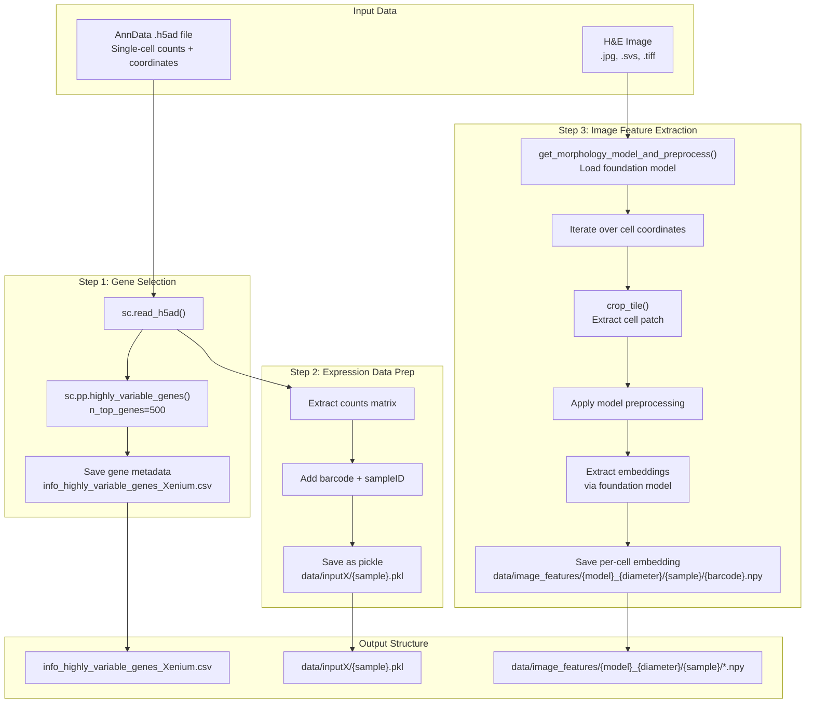
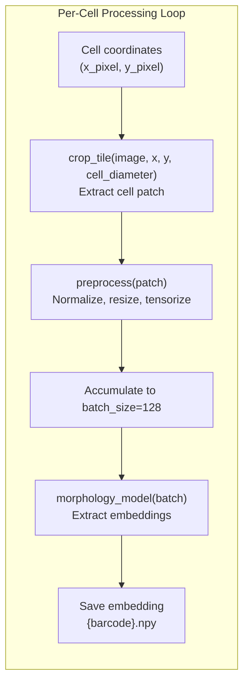
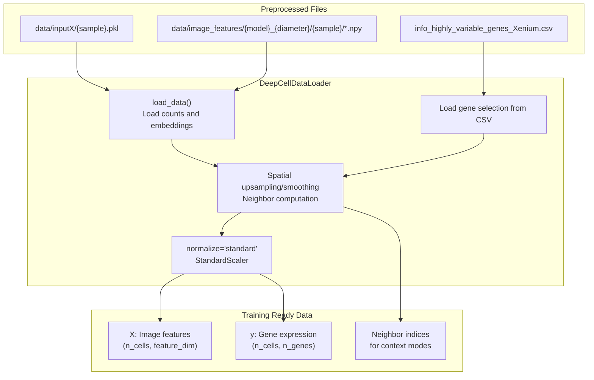

# Xenium Preprocessing

<details>
<summary>Relevant source files</summary>

The following files were used as context for generating this wiki page:

- [deepspot/utils/utils_dataloader.py](deepspot/utils/utils_dataloader.py)
- [example_notebook/Xenium_single-cell_example/GettingStartedWithDeepCell_1_preprocessing.ipynb](example_notebook/Xenium_single-cell_example/GettingStartedWithDeepCell_1_preprocessing.ipynb)
- [example_notebook/Xenium_single-cell_example/GettingStartedWithDeepCell_2_training_xenium.ipynb](example_notebook/Xenium_single-cell_example/GettingStartedWithDeepCell_2_training_xenium.ipynb)
- [example_notebook/Xenium_single-cell_example/GettingStartedWithDeepCell_3_inference_xenium.ipynb](example_notebook/Xenium_single-cell_example/GettingStartedWithDeepCell_3_inference_xenium.ipynb)

</details>


## Purpose and Scope

This page documents the preprocessing steps required to prepare Xenium single-cell spatial transcriptomics data for training with the DeepCell model. Xenium operates at single-cell resolution (~20μm cell diameter), in contrast to spot-level Visium data.

For Visium spot-level preprocessing, see [Visium Preprocessing](#7.1.1). For the subsequent training steps using preprocessed Xenium data, see [Xenium Training](#7.2.2).

---

## Overview

Xenium preprocessing transforms raw single-cell spatial transcriptomics data and H&E images into a format suitable for DeepCell training. The pipeline performs three main operations:

1. **Gene Selection**: Identifies 500 highly variable genes (HVGs) from the single-cell expression matrix
2. **Expression Data Organization**: Saves gene counts as pickle files for efficient loading during training
3. **Image Feature Extraction**: Extracts morphological features from cell-centered image patches using pathology foundation models

The preprocessing outputs are organized into a standardized directory structure that `DeepCellDataLoader` expects during training.

**Sources:** [example_notebook/Xenium_single-cell_example/GettingStartedWithDeepCell_1_preprocessing.ipynb:1-359]()

---

## Preprocessing Pipeline Architecture



**Sources:** [example_notebook/Xenium_single-cell_example/GettingStartedWithDeepCell_1_preprocessing.ipynb:1-359]()

---

## Input Data Requirements

### Required Files

| File Type | Description | Example Path |
|-----------|-------------|--------------|
| AnnData H5AD | Single-cell spatial transcriptomics data with `.obs` columns `x_pixel` and `y_pixel` | `example_data/data/h5ad/NCBI858.h5ad` |
| H&E Image | High-resolution histology image | `example_data/data/image/NCBI858.jpg` |

### AnnData Requirements

The input AnnData object must contain:
- **`.X`**: Raw or normalized gene counts (cells × genes)
- **`.obs['x_pixel']`**: Cell x-coordinates in image space
- **`.obs['y_pixel']`**: Cell y-coordinates in image space
- **`.obs_names`**: Unique cell identifiers (barcodes)

**Sources:** [example_notebook/Xenium_single-cell_example/GettingStartedWithDeepCell_1_preprocessing.ipynb:132-134](), [example_notebook/Xenium_single-cell_example/GettingStartedWithDeepCell_1_preprocessing.ipynb:243-248]()

---

## Step 1: Highly Variable Gene Selection

### Gene Selection Process

Xenium preprocessing selects **500 highly variable genes** using scanpy's Seurat v3 method:

```python
sc.pp.highly_variable_genes(adata, flavor='seurat_v3_paper', n_top_genes=500)
```

This differs from Visium preprocessing, which typically uses 300-800 genes depending on the dataset.

**Sources:** [example_notebook/Xenium_single-cell_example/GettingStartedWithDeepCell_1_preprocessing.ipynb:143-145]()

### Gene Metadata Storage

The selected genes are marked with the `isPredicted` flag and saved to a CSV file:

```python
adata.var["isPredicted"] = adata.var.highly_variable.values
adata.var["gene_name"] = adata.var.index.values
adata.var.to_csv(f"{out_folder}/data/info_highly_variable_genes_Xenium.csv", index=False)
```

This CSV file is used during training and inference to determine which genes to predict. The `highly_variable_rank` column indicates gene importance.

**Sources:** [example_notebook/Xenium_single-cell_example/GettingStartedWithDeepCell_1_preprocessing.ipynb:163-176](), [example_notebook/Xenium_single-cell_example/GettingStartedWithDeepCell_3_inference_xenium.ipynb:106-110]()

---

## Step 2: Gene Expression Data Preparation

### Count Matrix Organization

The gene expression counts are extracted and reformatted with composite barcodes:

```python
counts = pd.DataFrame(adata.X, index=adata.obs_names.values, columns=adata.var.index)
counts.index = [f"{b}_{sample}" for b in counts.index]
```

Each cell barcode is suffixed with the sample ID (e.g., `CELL123_NCBI858`) to ensure uniqueness across multiple samples.

**Sources:** [example_notebook/Xenium_single-cell_example/GettingStartedWithDeepCell_1_preprocessing.ipynb:193-196]()

### Pickle File Storage

The count matrix is saved as a pandas DataFrame pickle file for fast loading:

```python
counts.to_pickle(f"{out_folder}/data/inputX/{sample}.pkl")
```

The `DeepCellDataLoader` loads these files via the `load_data()` function in [deepspot/utils/utils_dataloader.py:132-174]().

**Sources:** [example_notebook/Xenium_single-cell_example/GettingStartedWithDeepCell_1_preprocessing.ipynb:205-206](), [deepspot/utils/utils_dataloader.py:132-174]()

---

## Step 3: Image Feature Extraction

### Foundation Model Loading

Image features are extracted using pathology foundation models (Inception, UNI, Phikon, etc.):

```python
morphology_model, preprocess, feature_dim = get_morphology_model_and_preprocess(
    model_name=image_feature_model, 
    device=device
)
```

The function returns:
- `morphology_model`: Pre-trained CNN or vision transformer
- `preprocess`: Model-specific image preprocessing pipeline
- `feature_dim`: Output embedding dimension (e.g., 2048 for Inception, 1024 for UNI)

**Sources:** [example_notebook/Xenium_single-cell_example/GettingStartedWithDeepCell_1_preprocessing.ipynb:223-226]()

### Cell Patch Extraction and Encoding



The extraction process iterates over all cells and:

1. **Extracts cell patches**: Uses `crop_tile()` to extract a square patch centered on each cell with side length `cell_diameter` (typically 20 pixels)
2. **Batches for efficiency**: Accumulates 128 patches before running inference
3. **Applies mixed precision**: Uses `torch.autocast()` with `float32` for faster GPU inference
4. **Saves per-cell embeddings**: Each cell's feature vector is saved as `{barcode}.npy`

**Sources:** [example_notebook/Xenium_single-cell_example/GettingStartedWithDeepCell_1_preprocessing.ipynb:260-308]()

### Batch Processing Implementation

```python
batch_X = []
batch_barcode = []
batch_size = 128

for i, (b, x, y) in enumerate(zip(barcode, x_pixel, y_pixel)): 
    patch = crop_tile(image, x, y, cell_diameter)
    X = preprocess(patch)
    X = X.unsqueeze(0).to(device).float()
    
    batch_X.append(X)
    batch_barcode.append(b)
    
    if len(batch_X) == batch_size:
        batch_tensor = torch.cat(batch_X, dim=0)
        
        with torch.autocast(device_type="cuda", dtype=torch.float32):
            with torch.inference_mode():
                output = morphology_model(batch_tensor)
                output = output.detach().cpu().numpy()
        
        for b, embedding in zip(batch_barcode, output):
            np.save(f"{folder_to_create}/{b}.npy", embedding)
        
        batch_X.clear()
        batch_barcode.clear()
```

**Sources:** [example_notebook/Xenium_single-cell_example/GettingStartedWithDeepCell_1_preprocessing.ipynb:260-294]()

---

## Output Directory Structure

After preprocessing, the output directory follows this structure:

```
{out_folder}/
├── data/
│   ├── info_highly_variable_genes_Xenium.csv    # Gene selection metadata
│   ├── inputX/
│   │   └── {sample}.pkl                          # Gene expression counts
│   └── image_features/
│       └── {model}_{diameter}/                   # e.g., inception_20
│           └── {sample}/
│               ├── {barcode1}.npy                # Cell 1 embedding (feature_dim,)
│               ├── {barcode2}.npy                # Cell 2 embedding
│               └── ...
```

### File Specifications

| File | Format | Shape | Description |
|------|--------|-------|-------------|
| `info_highly_variable_genes_Xenium.csv` | CSV | (n_genes, columns) | Gene metadata with `isPredicted`, `highly_variable_rank` |
| `inputX/{sample}.pkl` | Pickle | DataFrame (n_cells, n_genes) | Gene counts with composite index `{barcode}_{sample}` |
| `image_features/{model}_{diameter}/{sample}/{barcode}.npy` | NumPy | (feature_dim,) | Per-cell morphological embedding |

**Sources:** [example_notebook/Xenium_single-cell_example/GettingStartedWithDeepCell_1_preprocessing.ipynb:110-114](), [example_notebook/Xenium_single-cell_example/GettingStartedWithDeepCell_1_preprocessing.ipynb:325-326]()

---

## Integration with DeepCellDataLoader

The preprocessed files are consumed by `DeepCellDataLoader` during training:



The loader expects:
- `out_folder` parameter pointing to the preprocessing output directory
- `samples` set containing sample IDs (e.g., `{'NCBI858'}`)
- `genes_to_keep` boolean array from the gene selection CSV
- `cell_diameter` matching the preprocessing value (e.g., 20)
- `morphology_model_name` matching the foundation model used (e.g., `"inception"`)

**Sources:** [example_notebook/Xenium_single-cell_example/GettingStartedWithDeepCell_2_training_xenium.ipynb:167-177](), [deepspot/utils/utils_dataloader.py:132-174]()

---

## Key Differences from Visium Preprocessing

| Aspect | Xenium (Cell-level) | Visium (Spot-level) |
|--------|---------------------|---------------------|
| **Resolution** | Single-cell (~20μm diameter) | Spot-level (~55μm diameter, 1-10 cells) |
| **HVG Count** | 500 genes | 300-800 genes |
| **Patch Tiling** | Single cell patch, no mini-tiles | 3×3 mini-tile grid per spot |
| **Neighbor Context** | `n_neighbors=45` (larger neighborhood) | `radius=1` (adjacent spots) |
| **Embedding Storage** | One `.npy` file per cell | One `.npy` file per spot (may include subspots) |
| **DataLoader** | `DeepCellDataLoader` | `DeepSpotDataLoader` |
| **Model** | `DeepCell` | `DeepSpot` |
| **Gene Info File** | `info_highly_variable_genes_Xenium.csv` | Gene info for Visium dataset |

The absence of mini-tiling in Xenium is due to cells being smaller than spots, eliminating the need to capture sub-region heterogeneity.

**Sources:** [example_notebook/Xenium_single-cell_example/GettingStartedWithDeepCell_1_preprocessing.ipynb:143-145](), [example_notebook/Xenium_single-cell_example/GettingStartedWithDeepCell_2_training_xenium.ipynb:93-110]()

---

## Example Preprocessing Configuration

From the Xenium preprocessing notebook:

```python
# Input parameters
sample = "NCBI858"
out_folder = "example_data"
image_feature_model = "inception"
cell_diameter = 20

# Input files
adata_in = f"example_data/data/h5ad/{sample}.h5ad"
img_path = f"example_data/data/image/{sample}.jpg"

# Output directories
folder_to_create = f"{out_folder}/data/image_features/{image_feature_model}_{cell_diameter}/{sample}"
```

This configuration:
- Uses the Inception v3 foundation model (2048-dimensional embeddings)
- Extracts 20-pixel cell patches
- Selects 500 HVGs using Seurat v3 method
- Saves embeddings to `example_data/data/image_features/inception_20/NCBI858/*.npy`

**Sources:** [example_notebook/Xenium_single-cell_example/GettingStartedWithDeepCell_1_preprocessing.ipynb:83-99](), [example_notebook/Xenium_single-cell_example/GettingStartedWithDeepCell_1_preprocessing.ipynb:110-114]()

---

## Next Steps

After preprocessing is complete, proceed to [Xenium Training](#7.2.2) to:
- Configure `DeepCellDataLoader` with the preprocessed data
- Set up `DeepCell` model with appropriate hyperparameters
- Train the model with spatial upsampling and neighbor context
- Export trained weights for inference

For running inference on new Xenium data, see [Xenium Inference](#7.2.3).

**Sources:** [example_notebook/Xenium_single-cell_example/GettingStartedWithDeepCell_2_training_xenium.ipynb:1-339](), [example_notebook/Xenium_single-cell_example/GettingStartedWithDeepCell_3_inference_xenium.ipynb:1-373]()

---