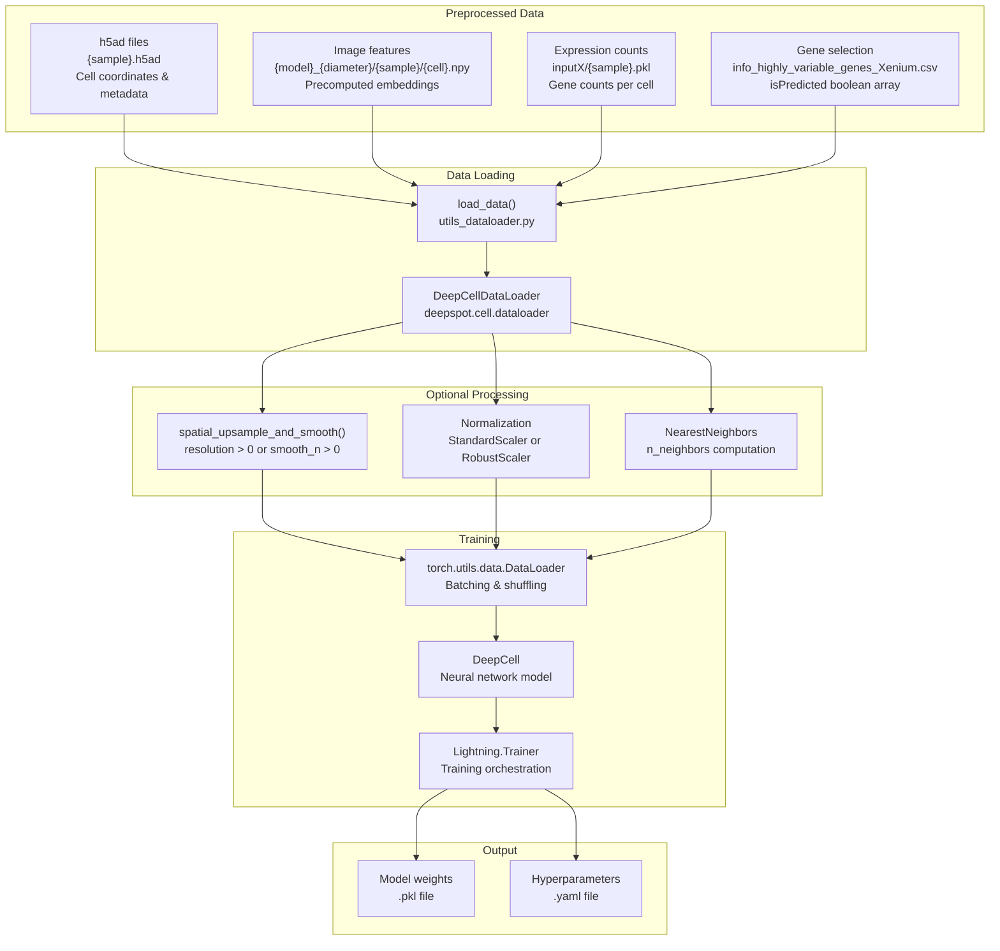
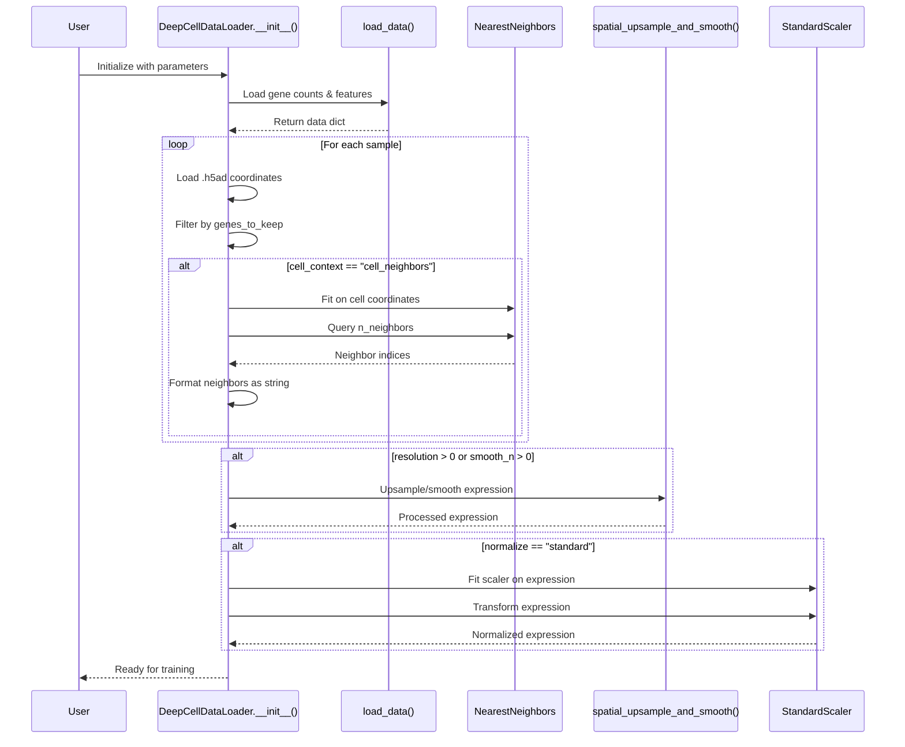
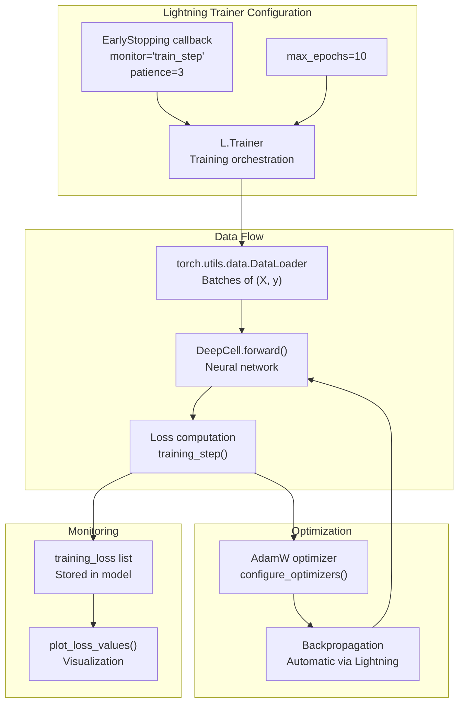
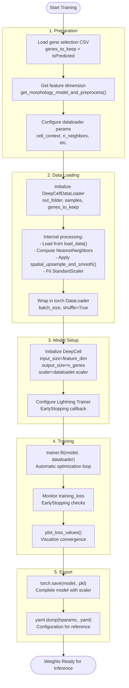

# Xenium Training

<details>
<summary>Relevant source files</summary>

The following files were used as context for generating this wiki page:

- [deepspot/cell/dataloader.py](deepspot/cell/dataloader.py)
- [example_notebook/Xenium_single-cell_example/GettingStartedWithDeepCell_1_preprocessing.ipynb](example_notebook/Xenium_single-cell_example/GettingStartedWithDeepCell_1_preprocessing.ipynb)
- [example_notebook/Xenium_single-cell_example/GettingStartedWithDeepCell_2_training_xenium.ipynb](example_notebook/Xenium_single-cell_example/GettingStartedWithDeepCell_2_training_xenium.ipynb)
- [example_notebook/Xenium_single-cell_example/GettingStartedWithDeepCell_3_inference_xenium.ipynb](example_notebook/Xenium_single-cell_example/GettingStartedWithDeepCell_3_inference_xenium.ipynb)

</details>


This page documents the training process for DeepCell models on Xenium single-cell spatial transcriptomics data. It covers dataloader configuration, model initialization, the training loop using PyTorch Lightning, and exporting trained weights for inference.

For preprocessing Xenium data (gene selection, feature extraction), see [Xenium Preprocessing](#7.2.1). For running inference with trained models, see [Xenium Inference](#7.2.3). For architectural details of the DeepCell model, see [DeepCell Model](#5.1).

## Prerequisites

Before training, ensure you have completed the preprocessing steps from [Xenium Preprocessing](#7.2.1):

1. **Spatial transcriptomics data**: Preprocessed `.h5ad` files stored in `{out_folder}/data/h5ad/`
2. **Gene selection file**: A CSV file containing highly variable gene information with an `isPredicted` column
3. **Image features**: Precomputed tile embeddings stored in `{out_folder}/data/image_features/{model_name}_{cell_diameter}/{sample}/`
4. **Gene expression counts**: Pickled DataFrames in `{out_folder}/data/inputX/`

The training workflow expects the following directory structure:

```
{out_folder}/
├── data/
│   ├── h5ad/{sample}.h5ad
│   ├── image_features/{model_name}_{cell_diameter}/{sample}/*.npy
│   ├── inputX/{sample}.pkl
│   └── info_highly_variable_genes_Xenium.csv
```

**Sources:** [example_notebook/Xenium_single-cell_example/GettingStartedWithDeepCell_2_training_xenium.ipynb:1-85]()

## Training Data Flow



**Sources:** [deepspot/cell/dataloader.py:22-209](), [example_notebook/Xenium_single-cell_example/GettingStartedWithDeepCell_2_training_xenium.ipynb:66-176]()

## DataLoader Configuration

The `DeepCellDataLoader` class manages batch preparation, spatial processing, and data augmentation. It loads precomputed image features and gene expression counts, applies optional spatial upsampling and normalization, and computes cell neighborhoods.

### Core Parameters

| Parameter | Type | Description |
|-----------|------|-------------|
| `out_folder` | str | Parent directory containing preprocessed data |
| `samples` | set | Set of sample IDs to load (e.g., `{'NCBI858'}`) |
| `genes_to_keep` | np.ndarray | Boolean array indicating which genes to train on |
| `morphology_model_name` | str | Foundation model name (e.g., `'inception'`, `'uni'`, `'phikon'`) |
| `cell_diameter` | int | Cell patch size in pixels (typically `20` for Xenium) |
| `batch_size` | int | Number of cells per batch (e.g., `1024`) |

**Sources:** [deepspot/cell/dataloader.py:23-46](), [example_notebook/Xenium_single-cell_example/GettingStartedWithDeepCell_2_training_xenium.ipynb:88-117]()

### Spatial Context Parameters

| Parameter | Default | Description |
|-----------|---------|-------------|
| `cell_context` | `'cell_neighbors'` | Context mode: `'cell'` (individual) or `'cell_neighbors'` (with neighbors) |
| `n_neighbors` | `45` | Number of nearest neighbors to include when `cell_context='cell_neighbors'` |
| `resolution` | `0` | Spatial upsampling factor (0 = no upsampling) |
| `smooth_n` | `0` | Number of neighbors for spatial smoothing (0 = no smoothing) |

The `cell_context` parameter determines the forward pass mode. When set to `'cell_neighbors'`, the dataloader computes k-nearest neighbors using `sklearn.neighbors.NearestNeighbors` and stores neighbor cell IDs in the `coordinates_df['neighbors']` column as a concatenated string.

**Sources:** [deepspot/cell/dataloader.py:31-48](), [example_notebook/Xenium_single-cell_example/GettingStartedWithDeepCell_2_training_xenium.ipynb:93-110]()

### Normalization Parameters

| Parameter | Options | Description |
|-----------|---------|-------------|
| `normalize` | `None`, `'standard'`, `'robust'` | Normalization strategy for gene expression |
| `scaler` | `None` or fitted scaler | Pre-fitted scaler (for validation/test sets) |

When `normalize='standard'`, the dataloader fits a `StandardScaler` to the training data and transforms gene expression values. This scaler is stored in `self.scaler` and must be saved for inference to invert predictions back to original scale.

**Sources:** [deepspot/cell/dataloader.py:34-35, 52-53, 155-165]()

### Example Configuration

```python
dataloader_param = {
    "morphology_model_name": "inception", 
    "batch_size": 1024,
    "cell_context": "cell_neighbors",
    "cell_diameter": 20,
    "n_neighbors": 45, 
    "resolution": 1,  # Optional upsampling
    "normalize": "standard",
    "augmentation": "default"
}
```

**Sources:** [example_notebook/Xenium_single-cell_example/GettingStartedWithDeepCell_2_training_xenium.ipynb:93-116]()

## Dataloader Initialization

### Loading Gene Selection

The gene selection file created during preprocessing contains metadata about highly variable genes:

```python
genes = pd.read_csv(f"{out_folder}/data/info_highly_variable_genes_Xenium.csv")
selected_genes_bool = genes.isPredicted.values
genes_to_predict = genes[selected_genes_bool]
```

The `isPredicted` boolean array identifies which genes to include in training. This typically contains 500 highly variable genes for Xenium data.

**Sources:** [example_notebook/Xenium_single-cell_example/GettingStartedWithDeepCell_2_training_xenium.ipynb:126-129]()

### Creating the DataLoader

```python
train_data_loader_custom = DeepCellDataLoader(
    out_folder=out_folder, 
    samples=samples, 
    genes_to_keep=selected_genes_bool,
    **dataloader_param
)

train_data_loader = torch.utils.data.DataLoader(
    dataset=train_data_loader_custom,
    batch_size=batch_size,
    num_workers=num_workers,
    shuffle=True
)
```

The `DeepCellDataLoader` constructor performs several initialization steps:

1. **Load data** via `load_data()` from [deepspot/utils/utils_dataloader.py]()
2. **Filter genes** using `genes_to_keep` boolean array
3. **Load cell coordinates** from `.h5ad` files for each sample
4. **Compute neighbors** using `NearestNeighbors` if `cell_context='cell_neighbors'`
5. **Apply spatial processing** if `resolution > 0` or `smooth_n > 0`
6. **Fit scaler** if `normalize` is specified

**Sources:** [example_notebook/Xenium_single-cell_example/GettingStartedWithDeepCell_2_training_xenium.ipynb:167-176](), [deepspot/cell/dataloader.py:56-166]()

### Data Loading Internal Process



**Sources:** [deepspot/cell/dataloader.py:56-166]()

## Model Initialization

### Obtaining Feature Dimensions

Before initializing `DeepCell`, obtain the feature dimension from the foundation model:

```python
from deepspot.utils.utils_image import get_morphology_model_and_preprocess

_, _, feature_dim = get_morphology_model_and_preprocess(
    model_name=image_feature_model, 
    device=device
)
# Returns: 2048 for 'inception', 1024 for 'uni', etc.
```

**Sources:** [example_notebook/Xenium_single-cell_example/GettingStartedWithDeepCell_2_training_xenium.ipynb:142-149]()

### DeepCell Instantiation

```python
from deepspot.cell import DeepCell

regressor = DeepCell(
    input_size=feature_dim,
    output_size=int(selected_genes_bool.sum()),
    scaler=train_data_loader_custom.scaler,
    **param  # Additional hyperparameters
)
```

| Parameter | Description |
|-----------|-------------|
| `input_size` | Foundation model feature dimension |
| `output_size` | Number of genes to predict (typically 500) |
| `scaler` | The fitted scaler from dataloader (critical for inverse_transform) |

The `scaler` parameter is essential because DeepCell predicts normalized gene expression. During inference, predictions must be transformed back using `model.inverse_transform()`.

**Sources:** [example_notebook/Xenium_single-cell_example/GettingStartedWithDeepCell_2_training_xenium.ipynb:201-217]()

### Default Hyperparameters

`DeepCell` inherits from `LightningModule` and uses default hyperparameters defined in [deepspot/cell/model.py](). Common parameters include:

- **Architecture**: Phi-Rho ensemble with 10 parallel modules
- **Hidden dimensions**: Configurable layer sizes
- **Dropout rates**: Regularization parameters
- **Loss function**: MSE by default, configurable via `loss_function` parameter
- **Learning rate**: Default AdamW optimizer settings

For architectural details, see [DeepCell Model](#5.1) and [Phi and Rho Neural Layers](#5.3).

**Sources:** [example_notebook/Xenium_single-cell_example/GettingStartedWithDeepCell_2_training_xenium.ipynb:201-217]()

## Training Loop

DeepCell uses PyTorch Lightning for training orchestration, providing automatic GPU management, logging, and callbacks.

### Basic Training Setup

```python
import lightning as L
from lightning.pytorch.callbacks.early_stopping import EarlyStopping

trainer = L.Trainer(
    max_epochs=10,
    logger=False,
    enable_checkpointing=False,
    callbacks=[
        EarlyStopping(
            monitor="train_step",
            patience=3,
            min_delta=0.01, 
            mode="min"
        )
    ]
)

trainer.fit(regressor, train_data_loader)
```

**Sources:** [example_notebook/Xenium_single-cell_example/GettingStartedWithDeepCell_2_training_xenium.ipynb:235-239]()

### Training Components



**Sources:** [example_notebook/Xenium_single-cell_example/GettingStartedWithDeepCell_2_training_xenium.ipynb:235-257]()

### Early Stopping

The `EarlyStopping` callback monitors the training loss (`train_step`) and stops training if:
- Loss does not improve by at least `min_delta=0.01` for `patience=3` consecutive epochs
- This prevents overfitting and reduces unnecessary computation

**Sources:** [example_notebook/Xenium_single-cell_example/GettingStartedWithDeepCell_2_training_xenium.ipynb:235-239]()

### Loss Visualization

```python
from deepspot.utils.utils import plot_loss_values

plot_loss_values(regressor.training_loss)
```

The `DeepCell` model stores loss values in `self.training_loss` during each `training_step()`. The `plot_loss_values()` function visualizes the training progression.

**Sources:** [example_notebook/Xenium_single-cell_example/GettingStartedWithDeepCell_2_training_xenium.ipynb:257-258]()

## Model Export

After training, export both the model weights and hyperparameters for inference.

### Directory Setup

```python
from pathlib import Path

Path("pretrained_model_weights/example_model").mkdir(parents=True, exist_ok=True)
```

**Sources:** [example_notebook/Xenium_single-cell_example/GettingStartedWithDeepCell_2_training_xenium.ipynb:275-275]()

### Saving Model Weights

```python
model_path = 'pretrained_model_weights/example_model/weights_Xenium.pkl'
torch.save(regressor, model_path)
```

This saves the entire model object including:
- Trained neural network parameters (Phi and Rho ensembles)
- The fitted scaler for inverse transformation
- Model architecture configuration

**Sources:** [example_notebook/Xenium_single-cell_example/GettingStartedWithDeepCell_2_training_xenium.ipynb:285-286]()

### Saving Hyperparameters

```python
import yaml

hparam = dict(regressor.hparams)
hparam['image_feature_model'] = dataloader_param['morphology_model_name']
hparam['scaler'] = str(hparam['scaler'])  # Convert object to string

yaml_file_path = 'pretrained_model_weights/example_model/hparam_Xenium.yaml'
with open(yaml_file_path, 'w') as yaml_file:
    yaml.dump(hparam, yaml_file)
```

The hyperparameter file stores:
- Model architecture parameters (layer sizes, dropout rates)
- Training configuration (loss function, optimizer settings)
- Foundation model name (critical for inference)
- Scaler type (as string representation)

**Important**: The scaler object itself is saved in the `.pkl` file. The YAML file stores its string representation for documentation purposes.

**Sources:** [example_notebook/Xenium_single-cell_example/GettingStartedWithDeepCell_2_training_xenium.ipynb:296-313]()

### Exported Files

After export, the following files are available:

```
pretrained_model_weights/example_model/
├── weights_Xenium.pkl      # Complete model with trained weights
└── hparam_Xenium.yaml      # Hyperparameter configuration
```

These files are loaded during inference as described in [Xenium Inference](#7.2.3).

**Sources:** [example_notebook/Xenium_single-cell_example/GettingStartedWithDeepCell_2_training_xenium.ipynb:285-313]()

## Complete Training Workflow



**Sources:** [example_notebook/Xenium_single-cell_example/GettingStartedWithDeepCell_2_training_xenium.ipynb:1-339](), [deepspot/cell/dataloader.py:22-209]()

## Key Considerations

### Scaler Management

The scaler fitted during training is **critical** for inference. DeepCell predicts normalized gene expression, which must be inverse-transformed:

```python
# During inference (not automatic)
expression_norm = model(X)  # Normalized predictions
expression = model.inverse_transform(expression_norm)  # Original scale
```

Always save the scaler with the model weights and apply `inverse_transform()` manually during inference.

**Sources:** [example_notebook/Xenium_single-cell_example/GettingStartedWithDeepCell_2_training_xenium.ipynb:184-191, 273-281]()

### Neighbor Context

The `n_neighbors=45` parameter determines neighborhood size for the `'cell_neighbors'` context. This value should match the biological scale of relevant spatial interactions (typically 45 for Xenium data at 20μm resolution).

The dataloader precomputes neighbors during initialization and stores them as strings in `coordinates_df['neighbors']`. During batching, neighbor features are loaded and padded to `max_n_neighbors`.

**Sources:** [deepspot/cell/dataloader.py:85-100, 192-203]()

### Training Duration

With `max_epochs=10` and `EarlyStopping(patience=3)`, typical training completes in 3-7 epochs depending on convergence. For larger datasets, increase `max_epochs` but keep early stopping to prevent overfitting.

**Sources:** [example_notebook/Xenium_single-cell_example/GettingStartedWithDeepCell_2_training_xenium.ipynb:235-239]()

### Memory Considerations

The `load_image_features_in_memory=False` parameter (default) loads image features from disk during each batch. For small datasets, setting this to `True` loads all features into memory, reducing I/O overhead but increasing memory usage.

**Sources:** [deepspot/cell/dataloader.py:37, 55, 66-68, 174-178]()

---