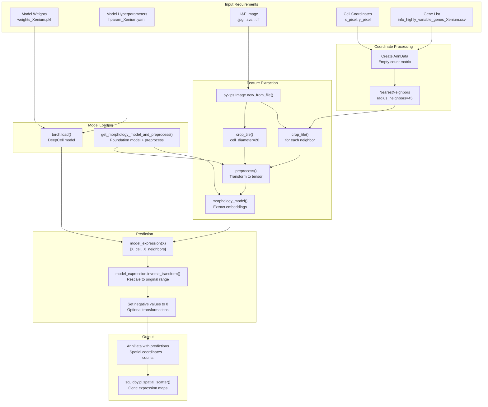
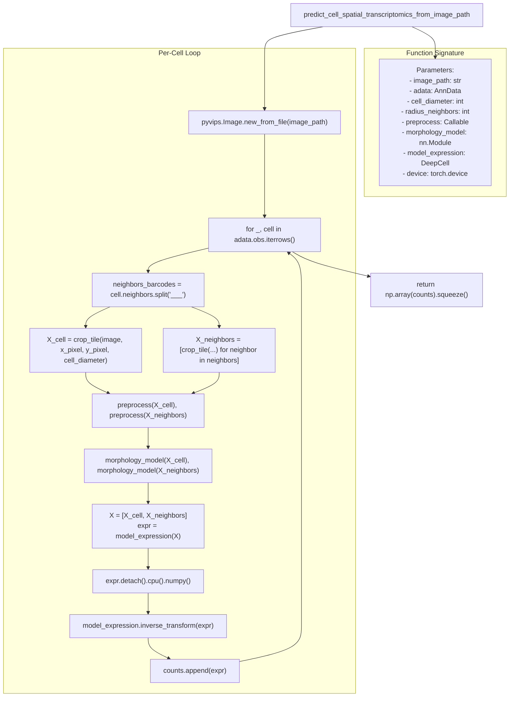
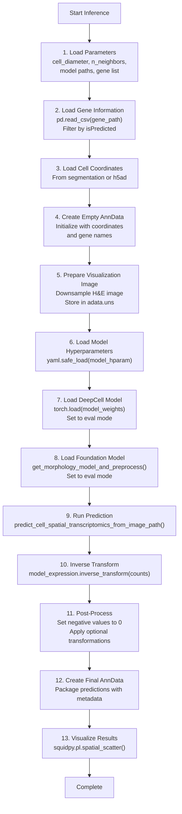

# Xenium Inference

<details>
<summary>Relevant source files</summary>

The following files were used as context for generating this wiki page:

- [deepspot/utils/utils_image.py](deepspot/utils/utils_image.py)
- [example_notebook/Xenium_single-cell_example/GettingStartedWithDeepCell_1_preprocessing.ipynb](example_notebook/Xenium_single-cell_example/GettingStartedWithDeepCell_1_preprocessing.ipynb)
- [example_notebook/Xenium_single-cell_example/GettingStartedWithDeepCell_2_training_xenium.ipynb](example_notebook/Xenium_single-cell_example/GettingStartedWithDeepCell_2_training_xenium.ipynb)
- [example_notebook/Xenium_single-cell_example/GettingStartedWithDeepCell_3_inference_xenium.ipynb](example_notebook/Xenium_single-cell_example/GettingStartedWithDeepCell_3_inference_xenium.ipynb)

</details>


This page describes the process of running inference with trained DeepCell models on new Xenium single-cell spatial transcriptomics data. It covers loading trained model weights, processing H&E images, generating predictions at cell-level resolution (~20μm), and producing AnnData outputs compatible with scanpy/squidpy visualization tools.

For training DeepCell models, see [Xenium Training](#7.2.2). For the preprocessing steps required before training or inference, see [Xenium Preprocessing](#7.2.1). For the general concept of cell-level predictions, see [DeepCell Model](#5.1).

---

## Overview

Xenium inference generates single-cell gene expression predictions from H&E whole-slide images using pre-trained DeepCell models. Unlike Visium spot-level inference which operates at ~55μm resolution, Xenium inference predicts gene expression for individual cells at ~20μm resolution without requiring mini-tile decomposition.

The inference pipeline requires:
- A trained DeepCell model (`.pkl` weights file)
- Model hyperparameters (`.yaml` file)
- An H&E image (WSI format or standard image formats)
- Cell spatial coordinates (x_pixel, y_pixel)
- Gene list used during training

**Sources:** [example_notebook/Xenium_single-cell_example/GettingStartedWithDeepCell_3_inference_xenium.ipynb:1-11]()

---

## Inference Architecture



**Diagram: Complete Xenium Inference Pipeline**

The inference workflow processes each cell individually by extracting its tile from the H&E image, computing its neighbors, extracting features using a foundation model, and predicting gene expression using the trained DeepCell model. The predictions are inverse-transformed to the original scale and assembled into an AnnData object for downstream analysis.

**Sources:** [example_notebook/Xenium_single-cell_example/GettingStartedWithDeepCell_3_inference_xenium.ipynb:1-373](), [deepspot/utils/utils_image.py:295-356]()

---

## Input Parameters

The inference configuration must match the training configuration to ensure compatibility. Key parameters are typically defined at the start of the inference workflow:

| Parameter | Type | Description | Example Value |
|-----------|------|-------------|---------------|
| `out_folder` | str | Parent directory containing preprocessed data | `"example_data"` |
| `image_feature_model` | str | Foundation model name | `"inception"` |
| `cell_diameter` | int | Cell patch size in pixels | `20` |
| `n_neighbors` | int | Number of neighbors for context | `45` |
| `downsample_factor` | int | Image downsampling for visualization | `10` |
| `model_weights` | str | Path to trained model weights | `"pretrained_model_weights/example_model/weights_Xenium.pkl"` |
| `model_hparam` | str | Path to model hyperparameters | `"pretrained_model_weights/example_model/hparam_Xenium.yaml"` |
| `gene_path` | str | Path to gene list CSV | `"{out_folder}/data/info_highly_variable_genes_Xenium.csv"` |
| `sample` | str | Sample identifier | `"NCBI858"` |
| `image_path` | str | Path to H&E image | `"example_data/data/image/{sample}.jpg"` |

These parameters must be consistent with those used during preprocessing and training to avoid dimension mismatches or incorrect neighbor computation.

**Sources:** [example_notebook/Xenium_single-cell_example/GettingStartedWithDeepCell_3_inference_xenium.ipynb:82-96]()

---

## Model Loading

### Loading Trained DeepCell Weights

The trained DeepCell model is loaded from a `.pkl` file using PyTorch's serialization mechanism:

```python
model_expression = torch.load(model_weights, map_location=device)
model_expression.to(device)
model_expression.eval()
```

The model must be set to evaluation mode (`.eval()`) to disable dropout and ensure deterministic predictions. The `scaler` attribute preserved in the model is critical for inverse-transforming predictions back to the original gene expression scale.

**Sources:** [example_notebook/Xenium_single-cell_example/GettingStartedWithDeepCell_3_inference_xenium.ipynb:232-235]()

### Loading Foundation Model

The morphology foundation model is loaded using `get_morphology_model_and_preprocess()`:

```python
morphology_model, preprocess, feature_dim = get_morphology_model_and_preprocess(
    model_name=image_feature_model, 
    device=device
)
morphology_model.to(device)
morphology_model.eval()
```

This function returns three components:
- `morphology_model`: The neural network for feature extraction
- `preprocess`: Preprocessing function for image tiles
- `feature_dim`: Output dimensionality (e.g., 2048 for Inception)

The foundation model must match the one used during training to ensure feature compatibility.

**Sources:** [example_notebook/Xenium_single-cell_example/GettingStartedWithDeepCell_3_inference_xenium.ipynb:245-248](), [deepspot/utils/utils_image.py:36-177]()

---

## Cell Coordinates and Spatial Context

### Coordinate Input

Cell coordinates specify the pixel locations of each cell in the H&E image. These coordinates can be obtained through:

1. **Cell segmentation algorithms** (e.g., CellPose, StarDist, Mesmer) applied to the H&E image
2. **Reusing existing coordinates** from Xenium ground truth data (for validation purposes)

The coordinates must be stored in a DataFrame with columns `x_pixel` and `y_pixel`:

```python
coord = sc.read_h5ad(f"example_data/data/h5ad/{sample}.h5ad").obs[["x_pixel", "y_pixel"]].copy()
```

**Note:** Cell segmentation is not performed by the inference notebook - coordinates are assumed to be available. In production workflows, cell segmentation is a prerequisite step.

**Sources:** [example_notebook/Xenium_single-cell_example/GettingStartedWithDeepCell_3_inference_xenium.ipynb:133-145]()

### Neighbor Computation

Neighbors are computed during inference using scikit-learn's `NearestNeighbors` with a radius-based approach:

```python
from sklearn.neighbors import NearestNeighbors
neigh = NearestNeighbors(radius=radius_neighbors)
neigh.fit(adata.obs[["x_pixel", "y_pixel"]].values)
neighbors = neigh.radius_neighbors(adata.obs[["x_pixel", "y_pixel"]].values,
                                   return_distance=True, sort_results=True)[1]
neighbors = [n[1:] for n in neighbors]  # remove the cell itself
```

The neighbor list is stored as a string of formatted cell IDs separated by `"___"`:

```python
adata.obs["neighbors"] = [
    "___".join(f"{cell_ids[cell_id]}" for cell_id in neigh_ids)
    for neigh_ids in neighbors
]
```

This format allows efficient lookup during the per-cell prediction loop.

**Sources:** [deepspot/utils/utils_image.py:303-316]()

---

## Prediction Function

### predict_cell_spatial_transcriptomics_from_image_path

The core inference function processes each cell sequentially, extracting features and generating predictions:



**Diagram: predict_cell_spatial_transcriptomics_from_image_path Execution Flow**

The function implementation is located at [deepspot/utils/utils_image.py:295-356](). Key features include:

1. **Mixed precision inference:** Uses `torch.autocast` with `dtype=torch.float16` for faster computation
2. **Inference mode:** Uses `torch.inference_mode()` to disable gradient computation
3. **Per-cell processing:** Iterates through cells individually (batch size = 1)
4. **Neighbor handling:** If a cell has no neighbors, uses a zero-filled tensor of shape `(1, *X_cell.shape)`

**Sources:** [deepspot/utils/utils_image.py:295-356]()

### Usage Example

```python
counts = predict_cell_spatial_transcriptomics_from_image_path(
    image_path, 
    adata,
    cell_diameter,
    n_neighbors,
    preprocess, 
    morphology_model, 
    model_expression, 
    device
)
```

The function returns a NumPy array of shape `(n_cells, n_genes)` containing predicted gene expression values in the transformed space.

**Sources:** [example_notebook/Xenium_single-cell_example/GettingStartedWithDeepCell_3_inference_xenium.ipynb:258-266]()

---

## Inverse Transformation and Post-Processing

### Rescaling Predictions

The DeepCell model outputs predictions in the normalized space used during training (e.g., StandardScaler with mean=0, std=1). These predictions must be inverse-transformed back to the original gene expression scale:

```python
counts = model_expression.inverse_transform(counts)
```

The `inverse_transform()` method uses the `scaler` attribute stored in the DeepCell model (set during training via [deepspot/cell:DeepCell]()):

- **StandardScaler:** Reverses z-score normalization: `X_original = X_scaled * std + mean`
- **Other scalers:** Depends on the scaler type used during training

**Important:** This step is **not** performed automatically by `predict_cell_spatial_transcriptomics_from_image_path()` and must be called manually.

**Sources:** [example_notebook/Xenium_single-cell_example/GettingStartedWithDeepCell_3_inference_xenium.ipynb:273-292]()

### Optional Post-Processing

Additional transformations can be applied to improve prediction quality:

```python
# Set negative predictions to zero
counts[counts < 0] = 0

# Other optional transformations:
# - Log transformation: np.log1p(counts)
# - Quantile normalization
# - Gene-specific thresholds
```

These transformations are dataset-specific and should be validated against ground truth data when available.

**Sources:** [example_notebook/Xenium_single-cell_example/GettingStartedWithDeepCell_3_inference_xenium.ipynb:300-310]()

---

## Creating Output AnnData

The predictions are packaged into an AnnData object compatible with scanpy and squidpy:

```python
adata_predicted = ad.AnnData(
    counts, 
    var=adata.var,
    obs=adata.obs, 
    uns=adata.uns, 
    obsm=adata.obsm
).copy()
```

This structure includes:

- **X:** Gene expression count matrix (n_cells × n_genes)
- **obs:** Cell metadata (coordinates, sample ID, barcode)
- **var:** Gene metadata (gene names, variability ranks)
- **obsm['spatial']:** Spatial coordinates for plotting
- **uns['spatial']:** Downsampled H&E image for visualization

The downsampled image is created for efficient visualization:

```python
img_downsample = whole_slide_image.resize((new_w, new_h), PIL.Image.BILINEAR)
adata.uns['spatial']['library_id']['images']['hires'] = np.array(img_downsample)
```

Coordinates are adjusted to match the downsampled image dimensions:

```python
adata.obsm['spatial'] = adata.obs[["y_pixel", "x_pixel"]].values / downsample_factor
```

**Sources:** [example_notebook/Xenium_single-cell_example/GettingStartedWithDeepCell_3_inference_xenium.ipynb:174-202](), [example_notebook/Xenium_single-cell_example/GettingStartedWithDeepCell_3_inference_xenium.ipynb:320-326]()

---

## Visualization

Spatial gene expression patterns are visualized using squidpy:

```python
sq.pl.spatial_scatter(
    adata_predicted, 
    color=['CCL18', 'POSTN', 'PGC', 'LAMP3'], 
    wspace=0,
    ncols=2,
    size=1
)
```

This generates spatial scatter plots overlaying gene expression values on the H&E image, enabling visual validation of prediction quality and identification of spatial patterns.

**Sources:** [example_notebook/Xenium_single-cell_example/GettingStartedWithDeepCell_3_inference_xenium.ipynb:335-341]()

---

## Performance Considerations

### Computational Efficiency

Current implementation processes cells sequentially with batch size = 1:

```python
for _, cell in tqdm(adata.obs.iterrows(), total=len(adata.obs)):
    # Process single cell
```

**Optimization opportunities:**
- Batch multiple cells during feature extraction
- Pre-extract features for all cells before prediction
- Use DataLoader for parallel processing

The notebook notes: *"The current implementation preprocesses a single cell per batch, but extending it to multiple cells might offer additional speed improvements. Contributions are welcome."*

**Sources:** [example_notebook/Xenium_single-cell_example/GettingStartedWithDeepCell_3_inference_xenium.ipynb:218-223]()

### Memory Management

- **Mixed precision inference:** Reduces GPU memory usage by ~50% using `torch.float16`
- **Inference mode:** Disables gradient computation via `torch.inference_mode()`
- **Sequential processing:** Avoids loading all tiles into memory simultaneously

For large images (>10,000 cells), consider:
- Processing cells in batches
- Using `pyvips` for memory-efficient image streaming
- Saving intermediate results to disk

**Sources:** [deepspot/utils/utils_image.py:322-323](), [example_notebook/Xenium_single-cell_example/GettingStartedWithDeepCell_3_inference_xenium.ipynb:255]()

---

## Comparison with Visium Inference

| Aspect | Xenium Inference | Visium Inference |
|--------|------------------|------------------|
| Resolution | ~20μm (single-cell) | ~55μm (spot, 1-10 cells) |
| Coordinates | Cell centroids from segmentation | Pre-defined spot array |
| Mini-tiles | Not used | 3×3 grid per spot |
| Prediction function | `predict_cell_spatial_transcriptomics_from_image_path` | `predict_spot_spatial_transcriptomics_from_image_path` |
| Context modes | `cell` or `cell_neighbors` | `spot`, `subspot`, `neighbors`, `full` |
| Default neighbors | 45 (radius-based) | radius=1 (grid-based) |
| Typical gene count | 500 HVGs | 300-800 HVGs |
| Model class | `DeepCell` | `DeepSpot` |

Both workflows share the same foundation models and Phi-Rho architecture but differ in spatial granularity and tiling strategy.

**Sources:** [example_notebook/Xenium_single-cell_example/GettingStartedWithDeepCell_3_inference_xenium.ipynb:1-373](), [deepspot/utils/utils_image.py:241-293]()

---

## Complete Inference Workflow



**Diagram: Complete Xenium Inference Workflow Steps**

This sequential workflow ensures that all components are properly initialized before prediction and that outputs are correctly formatted for downstream analysis.

**Sources:** [example_notebook/Xenium_single-cell_example/GettingStartedWithDeepCell_3_inference_xenium.ipynb:1-373]()

---

## Key Implementation Details

### Gene List Consistency

The gene list must exactly match the training configuration:

```python
genes = pd.read_csv(gene_path)
selected_genes_bool = genes.isPredicted.values
genes_to_predict = genes[selected_genes_bool]
```

Mismatched gene lists will cause dimension errors during model forward pass. The `highly_variable_rank` column indicates gene importance.

**Sources:** [example_notebook/Xenium_single-cell_example/GettingStartedWithDeepCell_3_inference_xenium.ipynb:106-110]()

### Empty Neighbor Handling

When a cell has no neighbors (e.g., at tissue boundaries), the function creates a zero-filled tensor:

```python
if len(X_neighbors) == 0:
    X_neighbors = np.zeros((1, *X_cell.shape))
```

This ensures the model receives inputs of consistent shape without crashing on isolated cells.

**Sources:** [deepspot/utils/utils_image.py:334-335]()

### Barcode Format

Cell barcodes are formatted as `{original_barcode}_{sample_id}` to ensure uniqueness across multiple samples:

```python
adata.obs.index = [f"{b}_{sample}" for b in adata.obs.index]
```

This convention must be maintained throughout preprocessing, training, and inference.

**Sources:** [example_notebook/Xenium_single-cell_example/GettingStartedWithDeepCell_1_preprocessing.ipynb:194]()

---