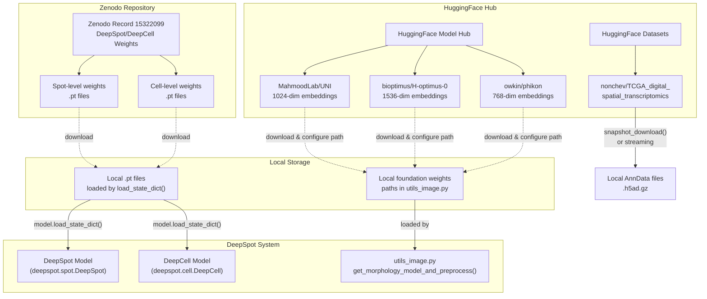
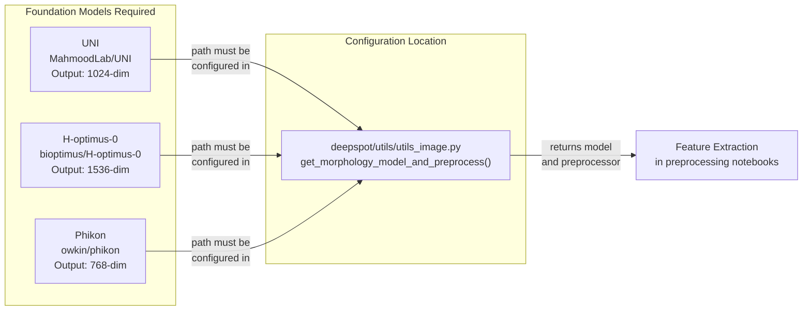
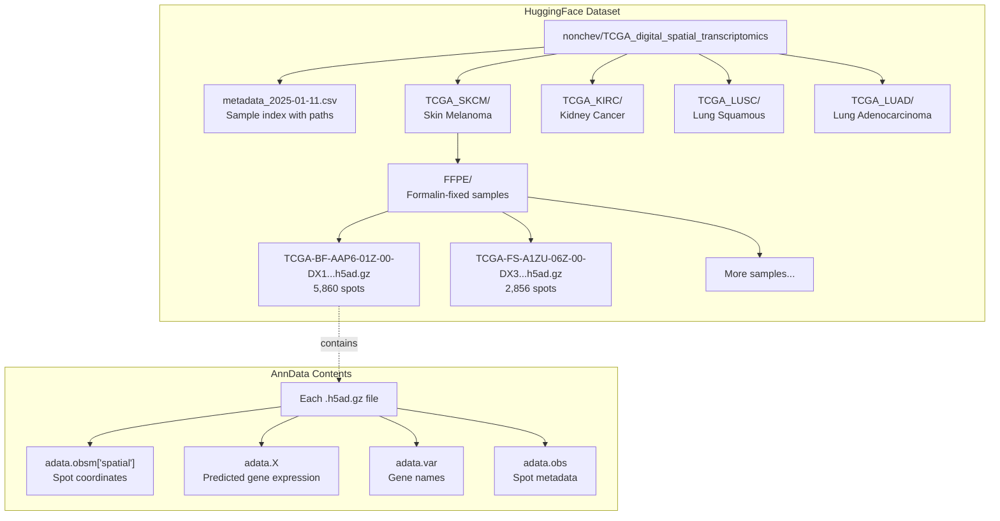
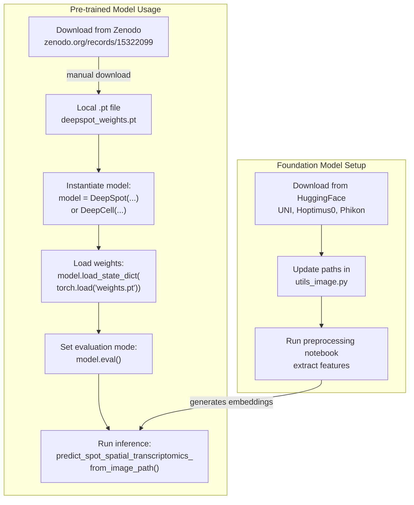

# Pre-trained Models & Datasets

<details>
<summary>Relevant source files</summary>

The following files were used as context for generating this wiki page:

- [README.md](README.md)

</details>


## Purpose and Scope

This page provides an overview of external resources available for DeepSpot: pre-trained model weights and large-scale predicted datasets. It explains what resources exist, where they are hosted, and their role in the DeepSpot ecosystem.

For detailed download instructions, see [Downloading Pre-trained Weights](#8.1). For in-depth usage of the TCGA dataset, see [TCGA Spatial Transcriptomics Dataset](#8.2). For inference workflows using pre-trained models, see [Visium Inference](#7.1.3) and [Xenium Inference](#7.2.3).

---

## Overview of Available Resources

DeepSpot provides two categories of external resources:

1. **Pre-trained Model Weights**: Trained DeepSpot and DeepCell models ready for inference or fine-tuning
2. **Foundation Model Weights**: Pathology foundation models (UNI, Hoptimus0, Phikon) required for feature extraction
3. **TCGA Spatial Transcriptomics Dataset**: Pre-computed predictions on 3,780 TCGA samples (~8TB)

### Resource Hosting Architecture



**Sources**: [README.md:75-90]()

---

## Pre-trained Model Weights

### DeepSpot and DeepCell Weights

The primary trained model weights are hosted on Zenodo and include models trained on both Visium (spot-level) and Xenium (cell-level) datasets. These weights capture learned relationships between H&E morphology and gene expression patterns.

| Model Type | Resolution | Training Data | Use Case |
|------------|------------|---------------|----------|
| DeepSpot | Spot (~55μm) | Visium datasets | Predict spot-level spatial transcriptomics |
| DeepCell | Cell (~20μm) | Xenium datasets | Predict single-cell spatial transcriptomics |

**Zenodo Repository**: `https://zenodo.org/records/15322099`

These weights can be loaded using PyTorch's standard state dict mechanism:

```python
from deepspot.spot import DeepSpot
model = DeepSpot(...)
model.load_state_dict(torch.load('path/to/deepspot_weights.pt'))
```

**Sources**: [README.md:75-78]()

### Foundation Model Weights

Foundation models are pre-trained pathology models that extract morphological features from H&E image tiles. Unlike DeepSpot/DeepCell weights, these must be downloaded separately and their paths configured in the codebase.



**Configuration Requirement**: After downloading foundation model weights from HuggingFace, update the file paths in `deepspot/utils/utils_image.py` before running preprocessing or inference.

| Model | HuggingFace Repository | Output Dimension | License Requirements |
|-------|------------------------|------------------|----------------------|
| UNI | `MahmoodLab/UNI` | 1024 | Yes - terms & conditions |
| H-optimus-0 | `bioptimus/H-optimus-0` | 1536 | Yes - terms & conditions |
| Phikon | `owkin/phikon` | 768 | Yes - terms & conditions |

**Sources**: [README.md:80-86]()

---

## TCGA Spatial Transcriptomics Dataset

### Dataset Overview

DeepSpot provides the largest publicly available predicted spatial transcriptomics dataset, containing predictions across 3,780 TCGA samples spanning four cancer types.

**Dataset Characteristics**:
- **Size**: ~8 TB (7-8 TB compressed)
- **Total Spots**: 56,317,393
- **Total Samples**: 3,780
- **Cancer Types**: 4 (LUSC, LUAD, SKCM, KIRC)
- **Repository**: `nonchev/TCGA_digital_spatial_transcriptomics` on HuggingFace Datasets

### Dataset Structure



**Sources**: [README.md:23-27](), [README.md:88-164]()

### Metadata Structure

The dataset includes a metadata CSV file indexing all samples:

| Column | Description | Example |
|--------|-------------|---------|
| `dataset` | Cancer type | `TCGA_SKCM` |
| `slide_type` | Tissue preparation | `FFPE` |
| `sample_id` | Unique sample identifier | `TCGA-BF-AAP6-01Z-00-DX1...` |
| `n_spots` | Number of spots in sample | `5860` |
| `file_path` | Relative path to .h5ad.gz file | `TCGA_SKCM/FFPE/TCGA-BF-AAP6...h5ad.gz` |

**Sources**: [README.md:126-131]()

### Access Patterns

The dataset supports two access patterns via HuggingFace Datasets API:

1. **Single Sample Download**: Download specific samples using `snapshot_download()` with `allow_patterns`
2. **Full Dataset Download**: Download entire ~8TB dataset (requires substantial storage)
3. **Streaming**: Access samples without downloading via HuggingFace streaming (not shown in README but supported by HF)

### Data Quality Notes

- **Background Filtering**: Tiles with mean RGB > 200 (near white) were excluded to remove background
- **Format**: All files are gzip-compressed AnnData objects (`.h5ad.gz`)
- **Compatibility**: Compatible with `scanpy` and `squidpy` for analysis and visualization
- **Additional Preprocessing**: Users may apply additional filtering for image artifacts

**Sources**: [README.md:164]()

---

## Integration with DeepSpot Workflows

### Loading Pre-trained Weights in Code



**Code References**:
- Pre-trained model loading: Used in inference notebooks at [example_notebook/Visium_spot_example/GettingStartedWithDeepSpot_3.1_inference_pretrained_models.ipynb]()
- Foundation model configuration: [deepspot/utils/utils_image.py]()
- Feature extraction with foundation models: [example_notebook/Visium_spot_example/GettingStartedWithDeepSpot_1_preprocessing.ipynb]()

**Sources**: [README.md:65-73]()

---

## Use Cases and Applications

### Pre-trained Model Use Cases

| Use Case | Model Type | Workflow Reference |
|----------|------------|-------------------|
| Predict spatial transcriptomics on new Visium slides | DeepSpot pre-trained weights | [Visium Inference](#7.1.3) |
| Predict single-cell spatial transcriptomics on Xenium | DeepCell pre-trained weights | [Xenium Inference](#7.2.3) |
| Fine-tune on institution-specific data | DeepSpot/DeepCell weights as initialization | [Model Fine-tuning](#10.1) |
| Generate features for downstream analysis | Foundation model weights | [Image Utilities](#6.1) |

### TCGA Dataset Use Cases

| Use Case | Description |
|----------|-------------|
| Large-scale spatial analysis | Analyze spatial gene expression patterns across thousands of cancer samples |
| Biomarker discovery | Identify spatially-resolved biomarkers across cancer types |
| Validation dataset | Use as external validation for new spatial transcriptomics methods |
| Training data augmentation | Combine with own data for larger training datasets |

**Sources**: [README.md:88-91]()

---

## Summary Table: External Resources

| Resource | Type | Size | Location | Purpose |
|----------|------|------|----------|---------|
| DeepSpot Weights | `.pt` files | ~100-500 MB each | Zenodo `15322099` | Pre-trained spot-level models |
| DeepCell Weights | `.pt` files | ~100-500 MB each | Zenodo `15322099` | Pre-trained cell-level models |
| UNI | Model weights | ~400 MB | HuggingFace `MahmoodLab/UNI` | 1024-dim feature extraction |
| H-optimus-0 | Model weights | ~600 MB | HuggingFace `bioptimus/H-optimus-0` | 1536-dim feature extraction |
| Phikon | Model weights | ~300 MB | HuggingFace `owkin/phikon` | 768-dim feature extraction |
| TCGA Dataset | `.h5ad.gz` files | ~8 TB | HuggingFace `nonchev/TCGA_digital_spatial_transcriptomics` | Pre-computed predictions on 3,780 samples |

**Sources**: [README.md:75-90]()

---

## Next Steps

- For step-by-step download instructions, see [Downloading Pre-trained Weights](#8.1)
- For detailed TCGA dataset usage examples, see [TCGA Spatial Transcriptomics Dataset](#8.2)
- For using pre-trained models in inference, see [Visium Inference](#7.1.3) or [Xenium Inference](#7.2.3)
- For fine-tuning pre-trained models, see [Model Fine-tuning](#10.1)

---