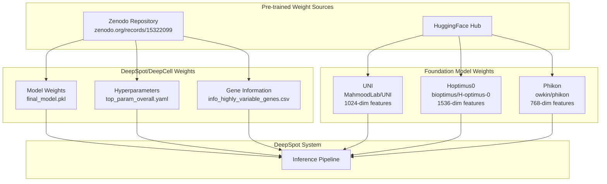
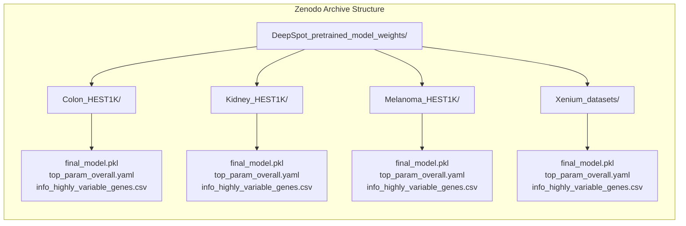
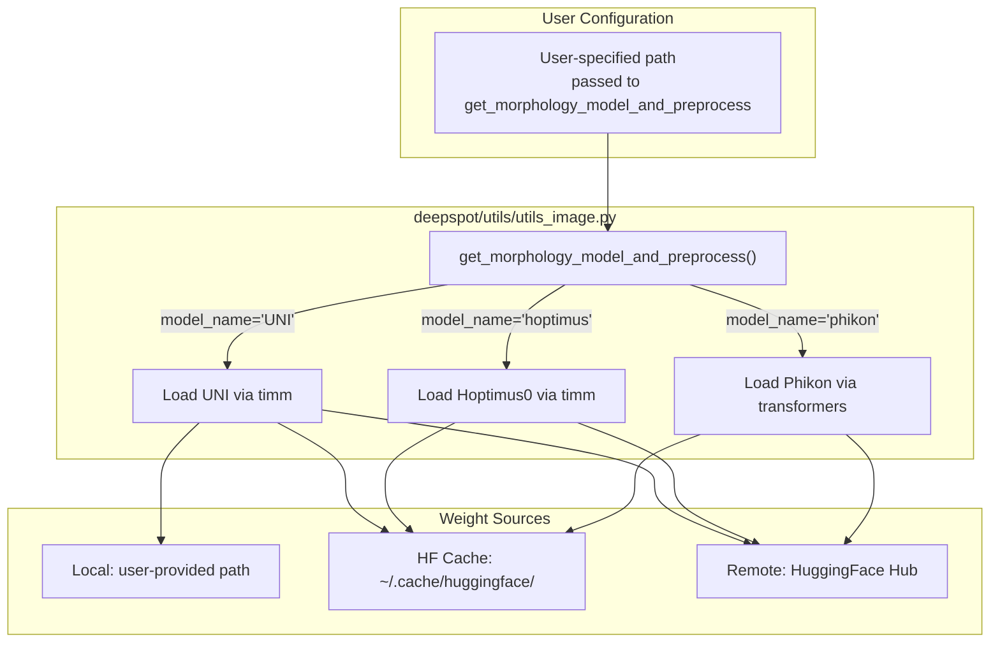
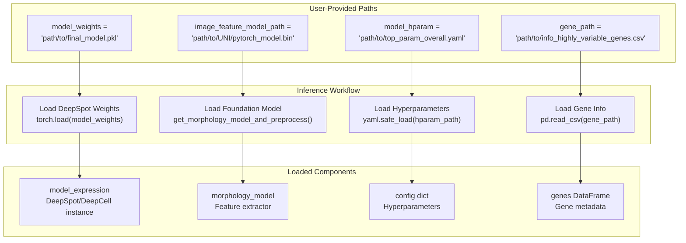

# Downloading Pre-trained Weights

<details>
<summary>Relevant source files</summary>

The following files were used as context for generating this wiki page:

- [README.md](README.md)
- [example_notebook/Visium_spot_example/GettingStartedWithDeepSpot_3.1_inference_pretrained_models.ipynb](example_notebook/Visium_spot_example/GettingStartedWithDeepSpot_3.1_inference_pretrained_models.ipynb)

</details>


## Purpose and Scope

This page provides instructions for downloading and configuring pre-trained model weights required by the DeepSpot system. Two categories of weights are needed: (1) DeepSpot/DeepCell model weights for trained gene expression predictors, and (2) pathology foundation model weights for image feature extraction. This page covers where to obtain these weights, how to download them, and how to configure file paths in the codebase.

For information about using pre-trained weights during inference, see [Visium Inference](#7.1.3) and [Xenium Inference](#7.2.3). For details about the foundation models themselves, see [Foundation Models](#3.3).

---

## Weight Dependencies Overview

The DeepSpot system requires two types of pre-trained weights:



**Sources**: [README.md:75-86]()

---

## DeepSpot Pre-trained Model Weights

### Zenodo Repository

Pre-trained DeepSpot and DeepCell model weights are hosted on Zenodo at record ID `15322099`. These weights were trained on various spatial transcriptomics datasets and used to generate predictions for TCGA samples.

**Repository URL**: https://zenodo.org/records/15322099

### Downloading from Zenodo

**Using wget (recommended for automated downloads)**:

```bash
wget -c https://zenodo.org/records/15322099/files/DeepSpot_pretrained_model_weights.zip?download=1
unzip DeepSpot_pretrained_model_weights.zip
```

**Using browser**:
1. Navigate to https://zenodo.org/records/15322099
2. Download `DeepSpot_pretrained_model_weights.zip`
3. Extract the archive to your working directory

### Weight Package Contents

Each pre-trained model includes three essential files:

| File | Purpose | Used By |
|------|---------|---------|
| `final_model.pkl` | Serialized PyTorch model with trained Phi/Rho weights | `torch.load()` for inference |
| `top_param_overall.yaml` | Hyperparameters used during training (dimensions, dropout, etc.) | Model initialization |
| `info_highly_variable_genes.csv` | Gene names, selection criteria, and prediction order | Creating output AnnData |

### Available Pre-trained Models

The Zenodo repository contains models trained on multiple datasets:



**Sources**: [README.md:75-78](), [example_notebook/Visium_spot_example/GettingStartedWithDeepSpot_3.1_inference_pretrained_models.ipynb:33-46]()

---

## Pathology Foundation Model Weights

### Required Foundation Models

DeepSpot leverages pre-trained pathology foundation models for extracting morphological features from H&E image tiles. Three models are supported, each requiring separate weight downloads:

| Model | Repository | Feature Dimension | Notes |
|-------|------------|-------------------|-------|
| **UNI** | `MahmoodLab/UNI` | 1024 | Vision Transformer, requires HuggingFace authentication |
| **Hoptimus0** | `bioptimus/H-optimus-0` | 1536 | Vision Transformer, requires acceptance of terms |
| **Phikon** | `owkin/phikon` | 768 | Vision Transformer, requires acceptance of terms |

### Downloading Foundation Model Weights

**Step 1: Create HuggingFace Account**
- Register at https://huggingface.co
- Generate access token at https://huggingface.co/settings/tokens

**Step 2: Accept Model Terms**

Each model repository requires acceptance of terms and conditions:
- UNI: Visit https://huggingface.co/MahmoodLab/UNI and accept license
- Hoptimus0: Visit https://huggingface.co/bioptimus/H-optimus-0 and accept terms
- Phikon: Visit https://huggingface.co/owkin/phikon and accept terms

**Step 3: Download Weights**

Foundation model weights are automatically downloaded by the HuggingFace `transformers` and `timm` libraries on first use. However, for production environments or offline usage, manual download is recommended:

```python
from huggingface_hub import snapshot_download

# Download UNI weights
snapshot_download(
    repo_id="MahmoodLab/UNI",
    local_dir="./foundation_models/UNI",
    token="YOUR_HF_TOKEN"
)

# Download Hoptimus0 weights
snapshot_download(
    repo_id="bioptimus/H-optimus-0",
    local_dir="./foundation_models/Hoptimus0",
    token="YOUR_HF_TOKEN"
)

# Download Phikon weights
snapshot_download(
    repo_id="owkin/phikon",
    local_dir="./foundation_models/Phikon",
    token="YOUR_HF_TOKEN"
)
```

### Weight Loading Mechanism



**Sources**: [README.md:80-86]()

---

## Configuring Weight Paths in Code

### Method 1: Pass Path at Runtime (Recommended)

The recommended approach is to pass the model path directly when calling inference functions:

```python
from deepspot.utils.utils_image import get_morphology_model_and_preprocess

# Specify path to downloaded UNI weights
image_feature_model_path = "/path/to/foundation_models/UNI/pytorch_model.bin"

# Load model with explicit path
morphology_model, preprocess, feature_dim = get_morphology_model_and_preprocess(
    model_name='UNI',
    device=device,
    model_path=image_feature_model_path
)
```

### Method 2: Update Default Paths in utils_image.py

For convenience, you can update default paths in the codebase. The `get_morphology_model_and_preprocess()` function in `deepspot/utils/utils_image.py` contains model loading logic that can be modified to point to your downloaded weights.

**Note**: The exact implementation details for path configuration should be verified in [deepspot/utils/utils_image.py]() as the function may attempt automatic downloads if paths are not specified.

### Weight Path Configuration Flow



**Sources**: [example_notebook/Visium_spot_example/GettingStartedWithDeepSpot_3.1_inference_pretrained_models.ipynb:120-172]()

---

## File Organization Best Practices

### Recommended Directory Structure

```
project_root/
├── DeepSpot/                          # DeepSpot repository clone
│   ├── deepspot/
│   └── example_notebook/
├── weights/
│   ├── deepspot_models/
│   │   ├── Colon_HEST1K/
│   │   │   ├── final_model.pkl
│   │   │   ├── top_param_overall.yaml
│   │   │   └── info_highly_variable_genes.csv
│   │   ├── Kidney_HEST1K/
│   │   └── Melanoma_HEST1K/
│   └── foundation_models/
│       ├── UNI/
│       │   └── pytorch_model.bin
│       ├── Hoptimus0/
│       └── Phikon/
└── data/
    ├── images/
    └── spatial_transcriptomics/
```

### Storage Considerations

| Component | Typical Size | Notes |
|-----------|-------------|-------|
| DeepSpot model weights | 50-200 MB per model | Depends on gene count and ensemble size |
| UNI weights | ~400 MB | Vision Transformer weights |
| Hoptimus0 weights | ~600 MB | Larger transformer model |
| Phikon weights | ~300 MB | Smaller transformer model |
| Hyperparameter files | <1 KB | YAML configuration files |
| Gene information | <100 KB | CSV metadata files |

**Total estimated storage**: 1.5-2 GB for complete weight collection

---

## Verification and Testing

### Verifying DeepSpot Weight Downloads

After downloading, verify the weight package structure:

```bash
ls -l DeepSpot_pretrained_model_weights/Colon_HEST1K/
# Expected output:
# final_model.pkl
# top_param_overall.yaml
# info_highly_variable_genes.csv
```

### Testing Weight Loading

```python
import torch
import yaml
import pandas as pd

# Test DeepSpot weight loading
model_weights = 'DeepSpot_pretrained_model_weights/Colon_HEST1K/final_model.pkl'
model = torch.load(model_weights, map_location='cpu')
print(f"Model loaded: {type(model)}")

# Test hyperparameter loading
hparam_path = 'DeepSpot_pretrained_model_weights/Colon_HEST1K/top_param_overall.yaml'
with open(hparam_path, 'r') as f:
    config = yaml.safe_load(f)
print(f"Hyperparameters loaded: {list(config.keys())}")

# Test gene information loading
gene_path = 'DeepSpot_pretrained_model_weights/Colon_HEST1K/info_highly_variable_genes.csv'
genes = pd.read_csv(gene_path)
print(f"Gene info loaded: {len(genes)} genes")
```

### Testing Foundation Model Loading

```python
from deepspot.utils.utils_image import get_morphology_model_and_preprocess

device = torch.device('cuda' if torch.cuda.is_available() else 'cpu')

# Test UNI loading
morphology_model, preprocess, feature_dim = get_morphology_model_and_preprocess(
    model_name='UNI',
    device=device,
    model_path='/path/to/UNI/pytorch_model.bin'
)
print(f"UNI loaded: feature_dim={feature_dim}")
```

**Sources**: [example_notebook/Visium_spot_example/GettingStartedWithDeepSpot_3.1_inference_pretrained_models.ipynb:124-172](), [example_notebook/Visium_spot_example/GettingStartedWithDeepSpot_3.1_inference_pretrained_models.ipynb:338-360]()

---

## Troubleshooting

### Common Issues

| Issue | Cause | Solution |
|-------|-------|----------|
| `FileNotFoundError` when loading weights | Incorrect path specification | Verify file paths and use absolute paths |
| HuggingFace authentication error | Missing or invalid token | Generate token at https://huggingface.co/settings/tokens |
| Model loading fails with dimension mismatch | Wrong foundation model for trained DeepSpot weights | Check `top_param_overall.yaml` for `image_feature_model` parameter |
| Out of memory during weight loading | Insufficient system RAM/VRAM | Use `map_location='cpu'` for initial loading, then move to GPU |
| Permission denied when downloading | Restrictive file permissions | Ensure write permissions in target directory |

### Checking Foundation Model Compatibility

The hyperparameter file specifies which foundation model was used during training:

```python
import yaml

with open('path/to/top_param_overall.yaml', 'r') as f:
    config = yaml.safe_load(f)

required_model = config['image_feature_model']
print(f"This model requires: {required_model}")
# Must match the foundation model you download
```

**Sources**: [example_notebook/Visium_spot_example/GettingStartedWithDeepSpot_3.1_inference_pretrained_models.ipynb:138-151]()

---