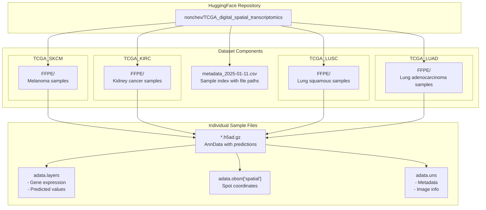
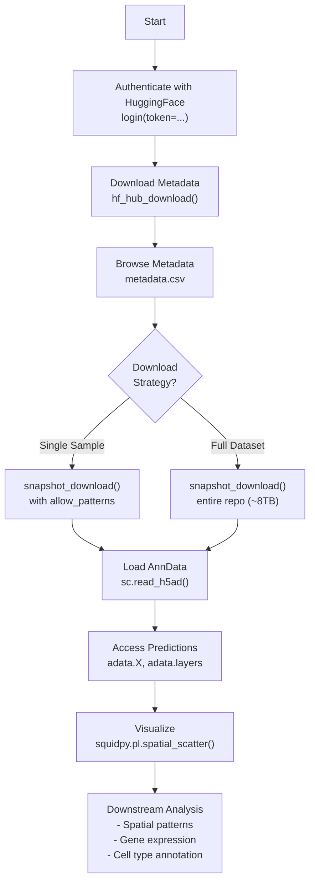
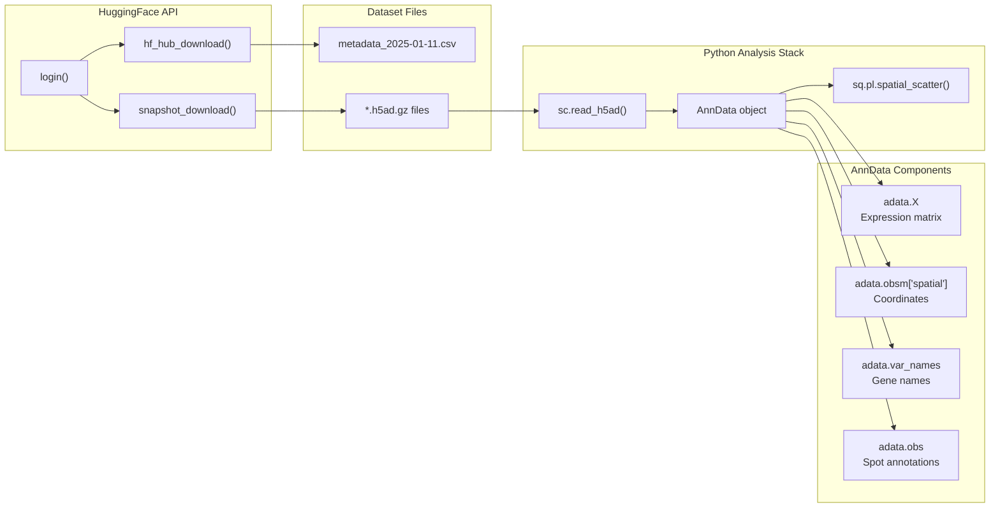

# TCGA Spatial Transcriptomics Dataset

<details>
<summary>Relevant source files</summary>

The following files were used as context for generating this wiki page:

- [README.md](README.md)

</details>


## Purpose and Scope

This page documents how to access and work with the large-scale TCGA spatial transcriptomics dataset generated by DeepSpot. This dataset contains predictions for over 56 million spots across 3,780 TCGA patient samples, totaling approximately 8 TB of data hosted on HuggingFace Datasets.

For information about training DeepSpot models that generated these predictions, see [Visium Training](#7.1.2). For information about making your own predictions on new images, see [Visium Inference](#7.1.3).

**Sources:** [README.md:23-27](), [README.md:88-164]()

---

## Dataset Overview

The TCGA spatial transcriptomics dataset contains DeepSpot predictions for whole-slide images from The Cancer Genome Atlas program. These predictions provide virtual spatial transcriptomics data for large cohorts without requiring physical spatial transcriptomics assays.

### Dataset Statistics

| Metric | Value |
|--------|-------|
| Total Samples | 3,780 |
| Total Spots | 56,317,393 |
| Cancer Types | 4 (LUSC, LUAD, SKCM, KIRC) |
| Total Size | ~8 TB |
| File Format | `.h5ad.gz` (compressed AnnData) |
| Host Platform | HuggingFace Datasets |

### Cancer Types Included

- **TCGA-SKCM**: Skin Cutaneous Melanoma
- **TCGA-KIRC**: Kidney Renal Clear Cell Carcinoma  
- **TCGA-LUSC**: Lung Squamous Cell Carcinoma
- **TCGA-LUAD**: Lung Adenocarcinoma

**Sources:** [README.md:23-27](), [README.md:88-90]()

---

## Dataset Structure

The following diagram illustrates the hierarchical organization of the TCGA dataset:



**Sources:** [README.md:113-131](), [README.md:136-141]()

---

## Installation and Authentication

### Required Packages

Before accessing the dataset, install the HuggingFace `datasets` library:

```bash
pip install datasets
```

### Authentication

Authentication with HuggingFace is required to access the dataset. Obtain a HuggingFace access token and authenticate:

```python
from huggingface_hub import login
login(token="YOUR_HUGGINGFACE_TOKEN")
```

**Sources:** [README.md:95-108]()

---

## Loading Metadata

The metadata file provides an index of all samples in the dataset, including file paths and spot counts.

### Metadata Structure

```python
from huggingface_hub import hf_hub_download
import pandas as pd

# Download metadata file
repo_id = "nonchev/TCGA_digital_spatial_transcriptomics"
filename = "metadata_2025-01-11.csv"  # Check for latest version

file_path = hf_hub_download(
    repo_id=repo_id, 
    filename=filename, 
    repo_type="dataset"
)

# Load metadata
metadata = pd.read_csv(file_path)
```

### Metadata Schema

| Column | Type | Description |
|--------|------|-------------|
| `dataset` | string | Cancer type (TCGA_SKCM, TCGA_KIRC, etc.) |
| `slide_type` | string | Slide preparation method (FFPE) |
| `sample_id` | string | Unique TCGA sample identifier |
| `n_spots` | integer | Number of spots in the sample |
| `file_path` | string | Relative path to `.h5ad.gz` file |

Example metadata rows:

```
   dataset  slide_type                                          sample_id  n_spots
0  TCGA_SKCM      FFPE  TCGA-BF-AAP6-01Z-00-DX1.EFF1D6E1-CDBC-4401-A10...     5860
1  TCGA_SKCM      FFPE  TCGA-FS-A1ZU-06Z-00-DX3.0C477EE6-C085-42BE-8BA...     2856
```

**Sources:** [README.md:110-131]()

---

## Downloading Data

### Single Sample Download

To download a specific sample, use `snapshot_download` with `allow_patterns`:

```python
from huggingface_hub import snapshot_download

local_dir = 'TCGA_data'

snapshot_download(
    "nonchev/TCGA_digital_spatial_transcriptomics", 
    local_dir=local_dir,
    allow_patterns="TCGA_SKCM/FFPE/TCGA-D9-A3Z3-06Z-00-DX1.C4820632-C64D-4661-94DD-9F27F75519C3.h5ad.gz",
    repo_type="dataset"
)
```

### Full Dataset Download

⚠️ **Warning**: The full dataset is approximately 8 TB. Ensure adequate storage before downloading.

```python
snapshot_download(
    "nonchev/TCGA_digital_spatial_transcriptomics", 
    local_dir=local_dir,
    repo_type="dataset"
)
```

**Sources:** [README.md:133-162]()

---

## Data Access Workflow

The following diagram shows the complete workflow for accessing and using TCGA predictions:



**Sources:** [README.md:95-162]()

---

## Working with Downloaded Data

### Loading AnnData Files

Once downloaded, load the compressed AnnData files using scanpy:

```python
import scanpy as sc
import squidpy as sq

# Load compressed h5ad file
adata = sc.read_h5ad("path/to/sample.h5ad.gz")
```

### AnnData Structure

Each `.h5ad.gz` file contains:

| Component | Location | Content |
|-----------|----------|---------|
| Gene Expression Matrix | `adata.X` | Predicted gene expression values |
| Spot Coordinates | `adata.obsm['spatial']` | (x, y) coordinates for each spot |
| Gene Names | `adata.var_names` | List of predicted genes |
| Sample Metadata | `adata.obs` | Spot-level annotations (e.g., `predicted_label`) |
| Image Information | `adata.uns` | H&E image metadata |

### Visualization Example

```python
# Visualize spatial gene expression
sq.pl.spatial_scatter(
    adata, 
    color=["SOX10", "CD37", "COL1A1", "predicted_label"],
    size=20, 
    img_alpha=0.8, 
    ncols=2
)
```

**Sources:** [README.md:144-149]()

---

## Data Integration with Code

The following diagram maps dataset components to code entities used for accessing and processing the data:



**Sources:** [README.md:95-149]()

---

## Technical Details

### Preprocessing and Quality Control

According to the dataset documentation:

> To distinguish in-tissue spots from the background, tiles with a mean RGB value above 200 (near white) were discarded. Additional preprocessing can remove potential image artifacts.

Users should be aware that:
- Spots with near-white backgrounds (mean RGB > 200) are excluded
- Some image artifacts may remain and require additional filtering
- Each sample may have different numbers of spots depending on tissue size

### Spot-Level Resolution

All predictions in the TCGA dataset are at **spot-level resolution** (~55μm diameter), matching the Visium spatial transcriptomics platform. Each spot captures the aggregate gene expression of approximately 1-10 cells.

For single-cell resolution predictions, see [DeepCell Model](#5.1) and [Xenium Cell Workflow](#7.2).

**Sources:** [README.md:164]()

---

## Use Cases

### Research Applications

The TCGA spatial transcriptomics dataset enables:

1. **Cross-Cancer Analysis**: Compare spatial gene expression patterns across cancer types
2. **Biomarker Discovery**: Identify spatially-resolved prognostic markers in large cohorts
3. **Tumor Microenvironment Studies**: Analyze spatial organization of immune and stromal cells
4. **Method Benchmarking**: Validate computational methods for spatial transcriptomics prediction
5. **Data Augmentation**: Supplement experimental datasets with large-scale predictions

### Example Query Workflow

```python
# Filter metadata for specific cancer type and spot count
skcm_samples = metadata[
    (metadata['dataset'] == 'TCGA_SKCM') & 
    (metadata['n_spots'] > 5000)
]

# Download filtered samples
for file_path in skcm_samples['file_path']:
    snapshot_download(
        "nonchev/TCGA_digital_spatial_transcriptomics",
        local_dir=local_dir,
        allow_patterns=file_path,
        repo_type="dataset"
    )
```

**Sources:** [README.md:88-90](), [README.md:113-131]()

---

## Related Resources

- **Pre-trained Models**: For the DeepSpot weights used to generate these predictions, see [Downloading Pre-trained Weights](#8.1)
- **Making New Predictions**: To generate predictions for your own slides, see [Visium Inference](#7.1.3)
- **Model Architecture**: To understand how predictions are generated, see [DeepSpot Model](#5.2)
- **Paper Results**: For reproduction code, see the [he2st repository](https://github.com/ratschlab/he2st)

**Sources:** [README.md:75-78](), [README.md:182]()

---