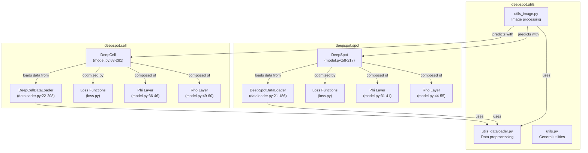
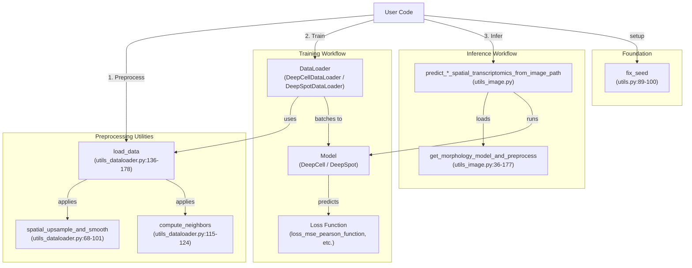
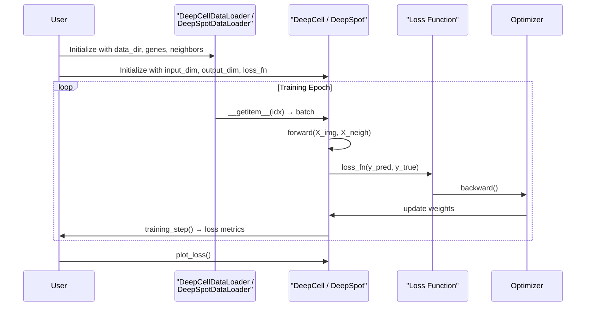
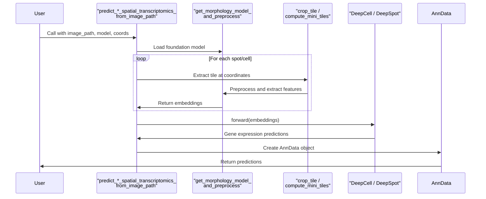

# API Reference

Relevant source files

The following files were used as context for generating this wiki page:

- [.codeboarding/on_boarding.md](.codeboarding/on_boarding.md)
- [deepspot/cell/__init__.py](deepspot/cell/__init__.py)

This page provides comprehensive API documentation for all public classes and functions in the DeepSpot codebase. The API is organized into three main modules: `deepspot.cell` (cell-level prediction components), `deepspot.spot` (spot-level prediction components), and `deepspot.utils` (shared utilities for data processing and image handling).

For detailed workflow examples using these APIs, see [Visium Spot Workflow](#7.1) and [Xenium Cell Workflow](#7.2). For conceptual explanations of the architecture, see [Model Architecture](#5).

## API Organization

The DeepSpot API follows a modular structure where cell-level and spot-level components are separated but share common architectural patterns:

**Sources:** [.codeboarding/on_boarding.md:1-125](), [deepspot/cell/__init__.py:1-3]()

## Module Overview

| Module | Purpose | Key Components | Primary Use Cases |
|--------|---------|----------------|-------------------|
| `deepspot.cell` | Cell-level spatial transcriptomics | `DeepCell`, `DeepCellDataLoader`, cell loss functions | Xenium single-cell predictions (~20μm resolution) |
| `deepspot.spot` | Spot-level spatial transcriptomics | `DeepSpot`, `DeepSpotDataLoader`, spot loss functions | Visium spot predictions (~55μm resolution) |
| `deepspot.utils` | Shared utilities | Data loading, image processing, reproducibility | Preprocessing, feature extraction, inference |

**Sources:** [.codeboarding/on_boarding.md:22-121]()

## API Component Relationships

**Sources:** [.codeboarding/on_boarding.md:1-125]()

---

## Quick Reference Tables

### Core Classes

| Class | Module | File | Purpose | Line Reference |
|-------|--------|------|---------|----------------|
| `DeepCell` | `deepspot.cell` | `model.py` | Cell-level prediction model with Phi-Rho architecture | [63-281]() |
| `DeepSpot` | `deepspot.spot` | `model.py` | Spot-level prediction model with Phi-Rho architecture | [58-217]() |
| `DeepCellDataLoader` | `deepspot.cell` | `dataloader.py` | Batches cell-level data with neighbor context | [22-208]() |
| `DeepSpotDataLoader` | `deepspot.spot` | `dataloader.py` | Batches spot-level data with subspot and neighbor context | [21-186]() |
| `Phi` | `deepspot.cell` / `deepspot.spot` | `model.py` | Feature transformation ensemble (10 modules) | cell:[36-46](), spot:[31-41]() |
| `Rho` | `deepspot.cell` / `deepspot.spot` | `model.py` | Prediction aggregation ensemble (10 modules) | cell:[49-60](), spot:[44-55]() |

**Sources:** [.codeboarding/on_boarding.md:30-77]()

### Key Functions by Category

#### Data Loading Functions

| Function | Module | Purpose | File Reference |
|----------|--------|---------|----------------|
| `load_data` | `deepspot.utils.utils_dataloader` | Load gene expression and image features | [136-178]() |
| `load_multiple_pickles` | `deepspot.utils.utils_dataloader` | Load features from multiple pickle files | [127-128]() |
| `get_balanced_index` | `deepspot.utils.utils_dataloader` | Balance training data indices | [20-26]() |

#### Spatial Processing Functions

| Function | Module | Purpose | File Reference |
|----------|--------|---------|----------------|
| `spatial_upsample_and_smooth` | `deepspot.utils.utils_dataloader` | Spatially upsample and smooth gene expression | [68-101]() |
| `compute_neighbors` | `deepspot.utils.utils_dataloader` | Compute spatial neighbors for spots/cells | [115-124]() |
| `add_zero_padding` | `deepspot.utils.utils_dataloader` | Add zero padding to data arrays | [104-112]() |
| `log1p_normalization` | `deepspot.utils.utils_dataloader` | Apply log1p normalization | [131-133]() |

#### Normalization Functions

| Function | Module | Purpose | File Reference |
|----------|--------|---------|----------------|
| `run_default` | `deepspot.utils.utils_dataloader` | Default StandardScaler normalization | [29-37]() |
| `run_aestetik` | `deepspot.utils.utils_dataloader` | Custom aesthetic normalization | [40-65]() |

#### Image Processing Functions

| Function | Module | Purpose | File Reference |
|----------|--------|---------|----------------|
| `get_morphology_model_and_preprocess` | `deepspot.utils.utils_image` | Load foundation model and preprocessing transform | [36-177]() |
| `crop_tile` | `deepspot.utils.utils_image` | Crop image tile at coordinates | [190-198]() |
| `compute_mini_tiles` | `deepspot.utils.utils_image` | Compute 3×3 mini-tiles for spots | [201-234]() |
| `detach_and_convert` | `deepspot.utils.utils_image` | Convert PyTorch tensors to NumPy arrays | [237-238]() |

#### Prediction Functions

| Function | Module | Purpose | File Reference |
|----------|--------|---------|----------------|
| `predict_spot_spatial_transcriptomics_from_image_path` | `deepspot.utils.utils_image` | Predict spot-level expression from H&E image | [241-292]() |
| `predict_cell_spatial_transcriptomics_from_image_path` | `deepspot.utils.utils_image` | Predict cell-level expression from H&E image | [295-356]() |

#### Utility Functions

| Function | Module | Purpose | File Reference |
|----------|--------|---------|----------------|
| `fix_seed` | `deepspot.utils.utils` | Fix random seeds for reproducibility | [89-100]() |

**Sources:** [.codeboarding/on_boarding.md:39-121]()

### Loss Functions

#### Cell Loss Functions

| Function | Module | Combines | File Reference |
|----------|--------|----------|----------------|
| `loss_mse_pearson_function` | `deepspot.cell.loss` | MSE + Pearson correlation | [73-77]() |
| `loss_mse_cosine_function` | `deepspot.cell.loss` | MSE + Cosine similarity | [80-84]() |
| `loss_l1_cosine_function` | `deepspot.cell.loss` | L1 + Cosine similarity | [87-91]() |
| `loss_huber_cosine_function` | `deepspot.cell.loss` | Huber + Cosine similarity | [94-98]() |
| `loss_cosine_function` | `deepspot.cell.loss` | Cosine similarity only | [4-6]() |
| `loss_mse_function` | `deepspot.cell.loss` | MSE only | [40-42]() |
| `loss_l1_function` | `deepspot.cell.loss` | L1 only | [45-48]() |
| `loss_huber_function` | `deepspot.cell.loss` | Huber only | [51-63]() |

#### Spot Loss Functions

| Function | Module | Combines | File Reference |
|----------|--------|----------|----------------|
| `loss_mse_pearson_function` | `deepspot.spot.loss` | MSE + Pearson correlation | [31-35]() |
| `loss_mse_cosine_function` | `deepspot.spot.loss` | MSE + Cosine similarity | [38-42]() |
| `loss_cosine_function` | `deepspot.spot.loss` | Cosine similarity only | [4-6]() |
| `loss_mse_function` | `deepspot.spot.loss` | MSE only | [19-21]() |

**Sources:** [.codeboarding/on_boarding.md:79-97]()

---

## API Usage Patterns

### Training Pattern

**Sources:** [.codeboarding/on_boarding.md:50-77]()

### Inference Pattern

**Sources:** [.codeboarding/on_boarding.md:99-112]()

---

## Detailed API Sections

The following subsections provide detailed API documentation for each module:

- **[9.1 deepspot.cell](#9.1)**: Cell-level prediction components including `DeepCell` model, `DeepCellDataLoader`, and cell-specific loss functions
- **[9.2 deepspot.spot](#9.2)**: Spot-level prediction components including `DeepSpot` model, `DeepSpotDataLoader`, and spot-specific loss functions  
- **[9.3 deepspot.utils](#9.3)**: Shared utility functions for data loading, image processing, spatial operations, and general utilities

Each subsection documents class signatures, method parameters, return types, and usage examples with precise file and line number references.

**Sources:** [.codeboarding/on_boarding.md:1-125]()

---