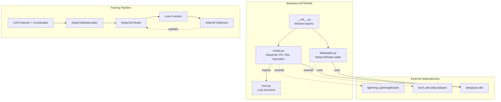
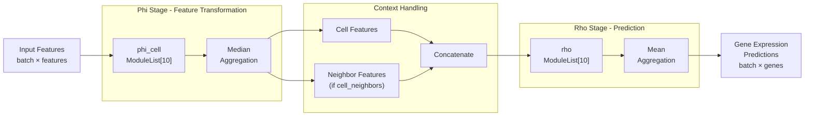
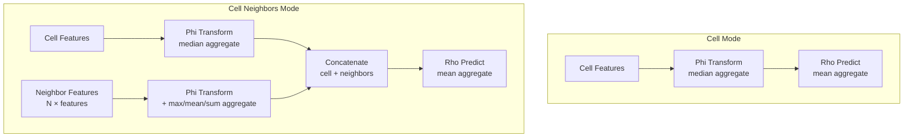
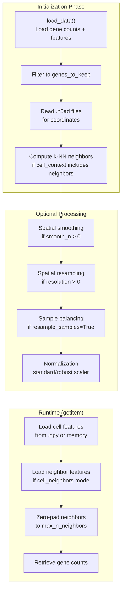
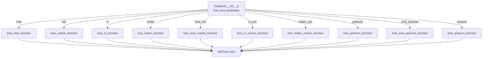

# deepspot.cell

<details>
<summary>Relevant source files</summary>

The following files were used as context for generating this wiki page:

- [deepspot/cell/__init__.py](deepspot/cell/__init__.py)
- [deepspot/cell/dataloader.py](deepspot/cell/dataloader.py)
- [deepspot/cell/loss.py](deepspot/cell/loss.py)
- [deepspot/cell/model.py](deepspot/cell/model.py)

</details>


This page provides API reference documentation for the cell-level components of the DeepSpot system. The `deepspot.cell` module implements single-cell resolution spatial transcriptomics prediction for technologies like Xenium. For spot-level components (Visium), see [deepspot.spot](#9.2). For complete workflow examples, see [Xenium Cell Workflow](#7.2).

## Module Overview

The `deepspot.cell` module consists of three primary components:

1. **DeepCell**: PyTorch Lightning model for cell-level gene expression prediction
2. **DeepCellDataLoader**: PyTorch Dataset for batching and preprocessing cell-level data
3. **Loss Functions**: Collection of differentiable loss functions for training



**Sources:** [deepspot/cell/__init__.py:1-3](), [deepspot/cell/model.py:1-282](), [deepspot/cell/dataloader.py:1-209](), [deepspot/cell/loss.py:1-99]()

## DeepCell Model

### Class Definition

```python
class DeepCell(L.LightningModule)
```

The `DeepCell` class implements a deep-set neural network for predicting cell-level gene expression from histology image features. It extends PyTorch Lightning's `LightningModule` for streamlined training and validation.

**Location:** [deepspot/cell/model.py:63-282]()

### Initialization Parameters

| Parameter | Type | Default | Description |
|-----------|------|---------|-------------|
| `input_size` | int | Required | Dimensionality of input features (e.g., 1024 for UNI, 1536 for Hoptimus0) |
| `output_size` | int | Required | Number of genes to predict |
| `loss_func` | str | `"mse"` | Loss function name: `"mse"`, `"cos"`, `"pearson"`, `"l1"`, `"huber"`, `"mse_cos"`, `"l1_cos"`, `"huber_cos"`, `"mse_pearson"`, `"poisson"` |
| `lr` | float | `1e-4` | Learning rate for AdamW optimizer |
| `p` | float | `0.2` | Dropout probability (used if `p_phi` and `p_rho` not specified) |
| `p_phi` | float\|None | None | Dropout probability for Phi layers (overrides `p`) |
| `p_rho` | float\|None | None | Dropout probability for Rho layers (overrides `p`) |
| `n_ensemble` | int | `10` | Number of ensemble modules (used if `n_ensemble_phi` and `n_ensemble_rho` not specified) |
| `n_ensemble_phi` | int\|None | None | Number of Phi ensemble modules (overrides `n_ensemble`) |
| `n_ensemble_rho` | int\|None | None | Number of Rho ensemble modules (overrides `n_ensemble`) |
| `phi2rho_size` | int | `1024` | Intermediate feature dimension between Phi and Rho stages |
| `emb_size` | int | `1024` | Embedding size (deprecated parameter) |
| `weight_decay` | float | `1e-6` | L2 regularization strength for AdamW |
| `random_seed` | int | `2024` | Random seed for reproducibility |
| `agg_neighbors` | str | `"max"` | Neighbor aggregation: `"max"`, `"mean"`, or `"sum"` |
| `scaler` | object\|None | None | sklearn scaler for inverse transformation |
| `cell_context` | str | `"cell_neighbors"` | Context mode: `"cell"` or `"cell_neighbors"` |

**Sources:** [deepspot/cell/model.py:64-82]()

### Architecture Components



**Sources:** [deepspot/cell/model.py:125-128]()

### Cell Context Modes

The `DeepCell` model supports two spatial context configurations:

#### 1. Cell Mode (`cell_context="cell"`)

Processes individual cells without neighbor information. The Phi stage requires `1 × phi2rho_size` features, flowing through Rho to produce predictions.

**Forward method:** `_forward_cell()` [deepspot/cell/model.py:179-181]()

#### 2. Cell Neighbors Mode (`cell_context="cell_neighbors"`)

Processes cells with their spatial neighbors. Features from the cell and its neighbors are independently transformed by Phi, then concatenated before Rho. The Rho stage receives `2 × phi2rho_size` features (cell + aggregated neighbors).

**Forward method:** `_forward_cell_neighbors()` [deepspot/cell/model.py:183-188]()



**Sources:** [deepspot/cell/model.py:130-142](), [deepspot/cell/model.py:179-188]()

### Key Methods

#### forward()

```python
def forward(self, x: Union[torch.Tensor, List[torch.Tensor]]) -> torch.Tensor
```

Routes input to the appropriate forward function based on `cell_context`.

- **Input**: Single tensor (cell mode) or list of two tensors (cell_neighbors mode)
- **Output**: Predicted gene expression tensor of shape `(batch_size, output_size)`

**Location:** [deepspot/cell/model.py:170-172]()

#### training_step() / validation_step()

```python
def training_step(self, batch: Tuple[torch.Tensor, torch.Tensor], batch_idx: int) -> torch.Tensor
def validation_step(self, batch: Tuple[torch.Tensor, torch.Tensor], batch_idx: int) -> torch.Tensor
```

PyTorch Lightning lifecycle methods that compute loss and log metrics.

**Location:** [deepspot/cell/model.py:164-168]()

#### configure_optimizers()

```python
def configure_optimizers(self) -> dict
```

Returns AdamW optimizer configuration with specified learning rate and weight decay.

**Location:** [deepspot/cell/model.py:216-218]()

#### inverse_transform()

```python
def inverse_transform(self, x) -> torch.Tensor
```

Applies inverse transformation using the scaler (if provided during initialization) to convert normalized predictions back to original scale.

**Location:** [deepspot/cell/model.py:174-177]()

#### plot_loss()

```python
def plot_loss(self)
```

Generates matplotlib visualization of training and validation loss curves with exponential smoothing.

**Location:** [deepspot/cell/model.py:235-281]()

**Sources:** [deepspot/cell/model.py:144-218]()

## DeepCellDataLoader

### Class Definition

```python
class DeepCellDataLoader(torch.utils.data.Dataset)
```

PyTorch Dataset implementation for loading and preprocessing cell-level spatial transcriptomics data. Handles image feature loading, spatial neighbor computation, normalization, and data augmentation.

**Location:** [deepspot/cell/dataloader.py:22-209]()

### Initialization Parameters

| Parameter | Type | Default | Description |
|-----------|------|---------|-------------|
| `out_folder` | str | Required | Output folder containing preprocessed data |
| `samples` | list | Required | List of sample IDs to load |
| `genes_to_keep` | array-like | Required | Indices of genes to include in predictions |
| `morphology_model_name` | str | Required | Name of foundation model used for feature extraction |
| `cell_diameter` | int | Required | Cell diameter in pixels for feature extraction |
| `target_sum` | int | `10000` | Normalization target for gene counts |
| `resolution` | int | `0` | Spatial resampling resolution (0=disabled) |
| `cell_context` | str | `"cell_neighbors"` | Context mode: `"cell"` or `"cell_neighbors"` |
| `n_neighbors` | int | `0` | Number of spatial neighbors to compute |
| `augmentation` | str | `"default"` | Augmentation strategy for spatial processing |
| `normalize` | str\|None | None | Normalization: `"standard"`, `"robust"`, or None |
| `scaler` | object\|None | None | Pre-fitted sklearn scaler |
| `resample_samples` | bool | False | Whether to balance sample sizes |
| `load_image_features_in_memory` | bool | False | Load all features into RAM (faster but memory-intensive) |
| `smooth_n` | int | `0` | Number of neighbors for spatial smoothing (0=disabled) |

**Sources:** [deepspot/cell/dataloader.py:23-38]()

### Data Processing Pipeline



**Sources:** [deepspot/cell/dataloader.py:56-167]()

### Data Loading Modes

#### In-Memory Loading

When `load_image_features_in_memory=True`, all image features are loaded into a dictionary during initialization for faster access during training.

**Implementation:** [deepspot/cell/dataloader.py:66-68]()

#### On-Disk Loading

When `load_image_features_in_memory=False` (default), features are loaded from `.npy` files on demand via `_load_patch()` method.

**Implementation:** [deepspot/cell/dataloader.py:173-178]()

### Neighbor Computation

For `cell_context="cell_neighbors"`, the dataloader computes k-nearest neighbors using sklearn's `NearestNeighbors`:

1. Fits k-NN model on cell coordinates `(x_pixel, y_pixel)`
2. Queries `n_neighbors` nearest cells for each cell
3. Stores neighbor IDs as concatenated strings in format `"cellID1_sample___cellID2_sample___..."`
4. Tracks `max_n_neighbors` across all samples for zero-padding

**Implementation:** [deepspot/cell/dataloader.py:85-100]()

### Key Methods

#### __getitem__()

```python
def __getitem__(self, idx: int) -> Tuple[Union[torch.Tensor, Tuple[torch.Tensor, torch.Tensor]], torch.Tensor]
```

Returns a single training example:

- **Cell mode**: Returns `(X_cell, y)` where `X_cell` is shape `(1, feature_dim)`
- **Cell neighbors mode**: Returns `((X_cell, X_neighbors), y)` where `X_neighbors` is shape `(max_n_neighbors, feature_dim)` with zero-padding

**Location:** [deepspot/cell/dataloader.py:180-208]()

#### __len__()

```python
def __len__(self) -> int
```

Returns total number of cells across all samples.

**Location:** [deepspot/cell/dataloader.py:169-171]()

**Sources:** [deepspot/cell/dataloader.py:169-208]()

## Loss Functions

The `deepspot.cell.loss` module provides differentiable loss functions for training. All functions accept tensors `y` (ground truth) and `y_hat` (predictions) and return scalar loss values.

### Basic Loss Functions

| Function | Description | Formula/Implementation |
|----------|-------------|----------------------|
| `loss_mse_function(y, y_hat)` | Mean Squared Error | `torch.nn.functional.mse_loss(y, y_hat)` |
| `loss_l1_function(y, y_hat)` | Mean Absolute Error | `torch.nn.functional.l1_loss(y, y_hat)` |
| `loss_huber_function(y, y_hat, delta=1.0)` | Huber Loss | `torch.nn.functional.huber_loss(y, y_hat, delta=delta)` |
| `loss_cosine_function(y, y_hat)` | Cosine Similarity Loss | `(1 - cosine_similarity(y, y_hat, dim=0)).mean()` |
| `loss_pearson_function(y, y_hat, eps=1e-8)` | Pearson Correlation Loss | `mean(1 - pearson_corr)` computed per feature |
| `loss_poisson_function(y, y_hat)` | Poisson Negative Log-Likelihood | `poisson_nll_loss(exp(y), y_hat)` |

**Sources:** [deepspot/cell/loss.py:4-71]()

### Composite Loss Functions

These functions combine multiple loss terms:

#### loss_mse_pearson_function()

```python
def loss_mse_pearson_function(y, y_hat, mse_w=0.1)
```

Combines MSE and Pearson correlation loss:
```
loss = mse_w * pearson_loss + mse_loss
```

**Note:** Despite the parameter name `mse_w`, the implementation uses `loss_cosine_function` instead of Pearson (line 74). This appears to be a naming inconsistency.

**Location:** [deepspot/cell/loss.py:73-77]()

#### loss_mse_cosine_function()

```python
def loss_mse_cosine_function(y, y_hat)
```

Combines MSE and cosine similarity loss with equal weighting:
```
loss = cosine_loss + mse_loss
```

**Location:** [deepspot/cell/loss.py:80-84]()

#### loss_l1_cosine_function()

```python
def loss_l1_cosine_function(y, y_hat)
```

Combines L1 and cosine similarity loss:
```
loss = cosine_loss + l1_loss
```

**Location:** [deepspot/cell/loss.py:87-91]()

#### loss_huber_cosine_function()

```python
def loss_huber_cosine_function(y, y_hat)
```

Combines Huber and cosine similarity loss:
```
loss = cosine_loss + huber_loss
```

**Location:** [deepspot/cell/loss.py:94-98]()

### Loss Function Selection

Loss functions are selected in `DeepCell.__init__()` by string name via the `loss_func` parameter:



**Sources:** [deepspot/cell/model.py:88-107]()

## Helper Classes

### Phi Layer

```python
class Phi(nn.Module)
```

Feature transformation module used in ensemble architecture. Applies linear transformation, dropout, and ReLU activation.

**Architecture:**
```
Linear(input_size → output_size) → Dropout(p) → ReLU
```

**Location:** [deepspot/cell/model.py:36-46]()

### Rho Layer

```python
class Rho(nn.Module)
```

Prediction module used in ensemble architecture. Applies dropout, ReLU, linear transformation, and final dropout.

**Architecture:**
```
Dropout(p) → ReLU → Linear(input_size → output_size) → Dropout(0.1)
```

**Location:** [deepspot/cell/model.py:49-60]()

### Operation Enum

```python
class Operation(str, Enum)
```

Defines aggregation operations for neighbor features:

- `Operation.SUM = "sum"`: Sum across neighbors
- `Operation.MAX = "max"`: Max-pooling across neighbors
- `Operation.MEAN = "mean"`: Average across neighbors
- `Operation.NONE = "none"`: No aggregation (used for single cell)

**Location:** [deepspot/cell/model.py:29-33]()

**Sources:** [deepspot/cell/model.py:29-60]()

## Usage Example

```python
from deepspot.cell import DeepCell, DeepCellDataLoader

# Initialize dataloader
dataloader = DeepCellDataLoader(
    out_folder="path/to/output",
    samples=["sample1", "sample2"],
    genes_to_keep=range(500),
    morphology_model_name="uni",
    cell_diameter=20,
    cell_context="cell_neighbors",
    n_neighbors=45,
    normalize="standard"
)

# Initialize model
model = DeepCell(
    input_size=1024,          # UNI embedding dimension
    output_size=500,          # Number of genes
    loss_func="mse_pearson",
    lr=1e-4,
    cell_context="cell_neighbors",
    agg_neighbors="max"
)

# Training handled by PyTorch Lightning Trainer
# See Xenium Training workflow for complete example
```

For complete training workflows, see [Xenium Training](#7.2.2).

**Sources:** [deepspot/cell/model.py:63-128](), [deepspot/cell/dataloader.py:22-60]()

---