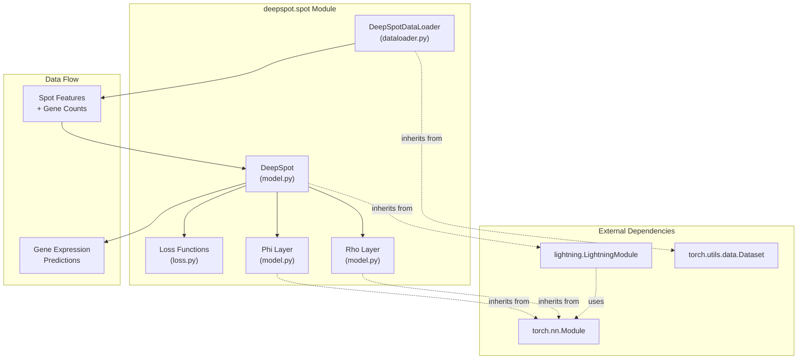
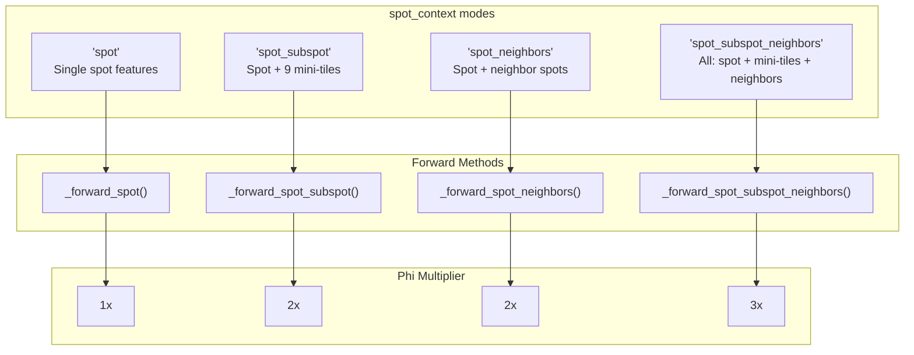
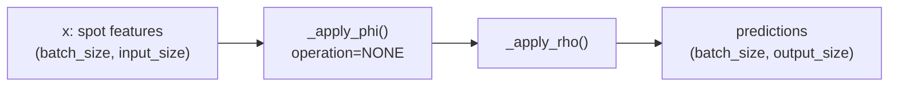
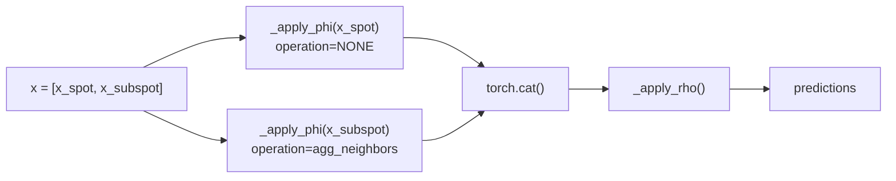
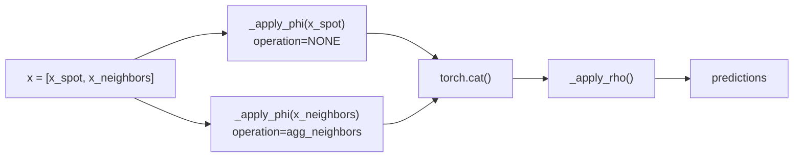
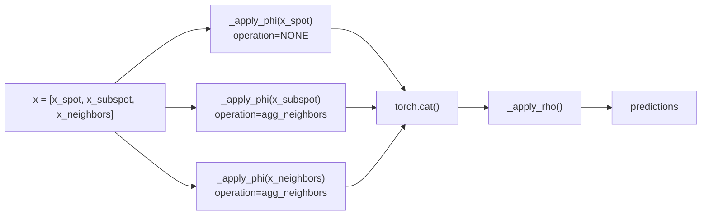
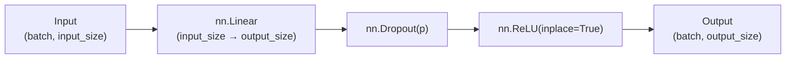
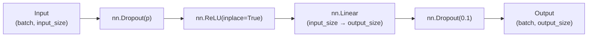
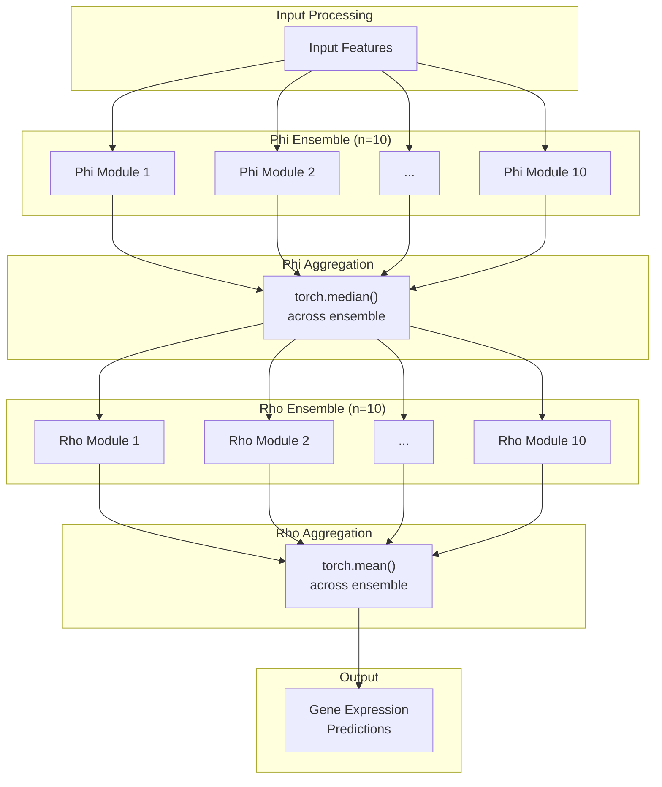

# deepspot.spot

<details>
<summary>Relevant source files</summary>

The following files were used as context for generating this wiki page:

- [.codeboarding/DeepSpot Models.md](.codeboarding/DeepSpot Models.md)
- [deepspot/cell/model.py](deepspot/cell/model.py)

</details>


## Purpose and Scope

This page provides API-level reference documentation for the `deepspot.spot` module, which contains all components for spot-level spatial transcriptomics prediction. The module includes:

- `DeepSpot` - the main neural network model for spot-level predictions
- `DeepSpotDataLoader` - data loader for batching spot features and gene counts
- Loss functions - various loss functions for training spot models
- `Phi` and `Rho` - neural network building blocks used in the DeepSpot architecture

For comprehensive workflow guides using these components, see [Visium Spot Workflow](#7.1). For conceptual explanations of the deep-set architecture, see [Deep-Set Architecture](#3.2). For detailed model architecture discussion, see [DeepSpot Model](#5.2).

**Sources:** [deepspot/cell/model.py:1-282](), [.codeboarding/DeepSpot Models.md:1-113]()

---

## Module Overview

The following diagram shows the relationship between components in the `deepspot.spot` module:



**Figure 1: deepspot.spot Module Components**

The module follows a layered architecture where `DeepSpot` orchestrates training and inference, `Phi` and `Rho` layers provide the core neural transformations, `DeepSpotDataLoader` handles data batching, and loss functions quantify prediction quality.

**Sources:** [deepspot/cell/model.py:1-282](), [.codeboarding/DeepSpot Models.md:43-62]()

---

## DeepSpot Model Class

### Class Definition

The `DeepSpot` class is the main model for spot-level spatial transcriptomics prediction, inheriting from `lightning.LightningModule`.

**Location:** [deepspot/spot/model.py:58-217]()

### Initialization Parameters

The `DeepSpot.__init__` method accepts the following parameters:

| Parameter | Type | Default | Description |
|-----------|------|---------|-------------|
| `input_size` | `int` | - | Dimension of input features (e.g., 1024 for UNI embeddings) |
| `output_size` | `int` | - | Number of genes to predict |
| `loss_func` | `str` | `"mse"` | Loss function name: `"mse"`, `"pearson"`, `"cos"`, `"l1"`, `"huber"`, `"mse_cos"`, `"l1_cos"`, `"huber_cos"`, `"mse_pearson"`, `"poisson"` |
| `lr` | `float` | `1e-4` | Learning rate for AdamW optimizer |
| `p` | `float` | `0.2` | Default dropout probability |
| `p_phi` | `float` | `None` | Dropout probability for Phi layers (overrides `p` if set) |
| `p_rho` | `float` | `None` | Dropout probability for Rho layers (overrides `p` if set) |
| `n_ensemble` | `int` | `10` | Default number of ensemble modules |
| `n_ensemble_phi` | `int` | `None` | Number of Phi ensemble modules (overrides `n_ensemble` if set) |
| `n_ensemble_rho` | `int` | `None` | Number of Rho ensemble modules (overrides `n_ensemble` if set) |
| `phi2rho_size` | `int` | `1024` | Hidden dimension size between Phi and Rho stages |
| `emb_size` | `int` | `1024` | Embedding size (deprecated parameter) |
| `weight_decay` | `float` | `1e-6` | Weight decay for AdamW optimizer |
| `random_seed` | `int` | `2024` | Random seed for reproducibility |
| `agg_neighbors` | `str` | `"max"` | Aggregation operation for neighbor features: `"max"`, `"mean"`, `"sum"` |
| `scaler` | `object` | `None` | Optional sklearn scaler for inverse transformation |
| `spot_context` | `str` | `"spot_subspot_neighbors"` | Spot context mode (see Spot Context Modes section) |

**Sources:** [deepspot/spot/model.py:59-108](), [deepspot/cell/model.py:64-128]()

### Spot Context Modes

The `DeepSpot` model supports four spot context modes, each using different spatial information:



**Figure 2: Spot Context Modes and Their Forward Methods**

The context mode determines:
1. Which forward method is called during inference
2. The Phi multiplier, which affects the size of the concatenated feature vector passed to Rho layers

**Sources:** [deepspot/spot/model.py:110-126](), [.codeboarding/DeepSpot Models.md:54-57]()

### Forward Pass Methods

Each spot context mode has a corresponding forward method:

#### `_forward_spot(x)`
**Location:** [deepspot/spot/model.py:163-165]()

Processes a single spot's features without spatial context.



#### `_forward_spot_subspot(x)`
**Location:** [deepspot/spot/model.py:167-172]()

Processes spot features plus 9 mini-tiles (3×3 grid) within the spot.



#### `_forward_spot_neighbors(x)`
**Location:** [deepspot/spot/model.py:174-179]()

Processes spot features plus neighboring spots' features.



#### `_forward_spot_subspot_neighbors(x)`
**Location:** [deepspot/spot/model.py:181-187]()

Processes spot features, mini-tiles, and neighboring spots (full spatial context).



**Sources:** [deepspot/spot/model.py:163-187](), [.codeboarding/DeepSpot Models.md:54-57]()

### Training Lifecycle Methods

The following methods manage the training and validation loop:

#### `training_step(batch, batch_idx)`
**Location:** [deepspot/spot/model.py:148-149]()

Called by Lightning for each training batch. Delegates to `loop_step()` with `stage="train"`.

#### `validation_step(batch, batch_idx)`
**Location:** [deepspot/spot/model.py:151-152]()

Called by Lightning for each validation batch. Delegates to `loop_step()` with `stage="val"`.

#### `loop_step(batch, stage)`
**Location:** [deepspot/spot/model.py:128-146]()

Core training/validation logic:
1. Unpacks batch into features `X` and labels `y`
2. Converts to float tensors
3. Performs forward pass: `y_hat = self(X)`
4. Computes loss: `loss = self.loss_func(y_hat, y)`
5. Logs loss and appends to `training_loss` or `validation_loss` lists

#### `configure_optimizers()`
Returns AdamW optimizer configured with `lr` and `weight_decay` parameters.

**Sources:** [deepspot/spot/model.py:128-152](), [deepspot/cell/model.py:144-218]()

### Core Processing Methods

#### `_apply_phi(x, phi_modules, operation)`
**Location:** [deepspot/spot/model.py:189-208]()

Applies ensemble of Phi layers to input features:

1. Reshapes input to `(batch_size * sample_size, input_size)`
2. Applies all Phi modules in parallel: `[phi(x) for phi in phi_modules]`
3. Takes median across ensemble: `torch.median(..., dim=1)`
4. Reshapes back to `(batch_size, sample_size, phi2rho_size)`
5. Applies aggregation operation:
   - `Operation.SUM`: sums across sample dimension
   - `Operation.MEAN`: averages across sample dimension
   - `Operation.MAX`: takes maximum across sample dimension
   - `Operation.NONE`: flattens to `(batch_size, sample_size * phi2rho_size)`

#### `_apply_rho(x_phi)`
**Location:** [deepspot/spot/model.py:210-213]()

Applies ensemble of Rho layers to Phi outputs:

1. Applies all Rho modules in parallel: `[rho(x_phi) for rho in self.rho]`
2. Takes mean across ensemble: `torch.mean(..., dim=1)`
3. Returns final predictions: `(batch_size, output_size)`

**Sources:** [deepspot/spot/model.py:189-213](), [deepspot/cell/model.py:190-214]()

---

## DeepSpotDataLoader Class

The `DeepSpotDataLoader` is a PyTorch `Dataset` subclass for loading and preprocessing spot-level data.

**Location:** [deepspot/spot/dataloader.py]()

### Key Responsibilities

1. **Data Loading**: Loads gene expression matrices and image feature embeddings
2. **Spatial Processing**: Applies upsampling, smoothing, and normalization
3. **Neighbor Computation**: Identifies neighboring spots based on spatial coordinates
4. **Batching**: Returns batches of features and labels for training/validation

For detailed documentation of parameters and methods, see [DeepSpotDataLoader](#4.4).

**Sources:** [deepspot/cell/model.py:1-282]() (by analogy with DeepCellDataLoader)

---

## Loss Functions

The `deepspot.spot.loss` module provides various loss functions for training:

### Available Loss Functions

| Function Name | Location | Description |
|---------------|----------|-------------|
| `loss_mse_function` | [deepspot/spot/loss.py:19-21]() | Mean Squared Error |
| `loss_pearson_function` | [deepspot/spot/loss.py]() | Negative Pearson correlation |
| `loss_cosine_function` | [deepspot/spot/loss.py]() | Cosine similarity loss |
| `loss_l1_function` | [deepspot/spot/loss.py]() | L1 (MAE) loss |
| `loss_huber_function` | [deepspot/spot/loss.py]() | Huber loss (smooth L1) |
| `loss_poisson_function` | [deepspot/spot/loss.py]() | Poisson negative log-likelihood |
| `loss_mse_pearson_function` | [deepspot/spot/loss.py]() | Combined MSE + Pearson |
| `loss_mse_cosine_function` | [deepspot/spot/loss.py]() | Combined MSE + cosine |
| `loss_l1_cosine_function` | [deepspot/spot/loss.py]() | Combined L1 + cosine |
| `loss_huber_cosine_function` | [deepspot/spot/loss.py]() | Combined Huber + cosine |

### Loss Function Selection

Loss functions are selected by passing the appropriate string to `DeepSpot.__init__`:

```python
model = DeepSpot(
    input_size=1024,
    output_size=500,
    loss_func="mse_pearson"  # Uses combined MSE + Pearson loss
)
```

The mapping from string to function occurs in the `__init__` method via conditional logic similar to [deepspot/cell/model.py:88-107]().

For detailed discussion of when to use each loss function, see [Loss Functions](#5.4).

**Sources:** [.codeboarding/DeepSpot Models.md:93-100](), [deepspot/cell/model.py:88-107]()

---

## Phi and Rho Neural Layers

### Phi Layer

**Location:** [deepspot/spot/model.py:31-41]()

The `Phi` class is a neural network module for feature transformation:



**Figure 3: Phi Layer Architecture**

**Constructor Parameters:**
- `input_size` (int): Input feature dimension
- `output_size` (int): Output feature dimension (typically `phi2rho_size`)
- `p` (float): Dropout probability (default 0.0)

Multiple Phi modules are instantiated as an ensemble (default 10 modules), and their outputs are aggregated via median operation.

### Rho Layer

**Location:** [deepspot/spot/model.py:44-55]()

The `Rho` class is a neural network module for final prediction:



**Figure 4: Rho Layer Architecture**

**Constructor Parameters:**
- `input_size` (int): Input feature dimension (typically `phi2rho_size * phi_multiplier`)
- `output_size` (int): Output dimension (number of genes)
- `p` (float): Dropout probability for first dropout layer (default 0.0)

Multiple Rho modules are instantiated as an ensemble (default 10 modules), and their outputs are aggregated via mean operation.

**Sources:** [deepspot/spot/model.py:31-55](), [.codeboarding/DeepSpot Models.md:74-82](), [deepspot/cell/model.py:36-60]()

---

## Ensemble Architecture

The following diagram illustrates how Phi and Rho ensembles combine:



**Figure 5: Complete Phi-Rho Ensemble Pipeline**

**Key Design Choices:**
- **Phi uses median aggregation**: More robust to outliers in ensemble predictions
- **Rho uses mean aggregation**: Smoother final predictions by averaging
- **Default ensemble size of 10**: Balances model capacity with computational cost

**Sources:** [deepspot/cell/model.py:190-214](), [deepspot/spot/model.py:189-213]()

---

## Usage Patterns

### Basic Instantiation

```python
from deepspot.spot.model import DeepSpot

# Create model for 500 genes using UNI features (1024-dim)
model = DeepSpot(
    input_size=1024,
    output_size=500,
    loss_func="mse_pearson",
    lr=1e-4,
    spot_context="spot_subspot_neighbors"
)
```

### Training with Lightning

```python
import lightning as L
from deepspot.spot.dataloader import DeepSpotDataLoader

# Create data loaders
train_loader = DeepSpotDataLoader(...)
val_loader = DeepSpotDataLoader(...)

# Train with Lightning Trainer
trainer = L.Trainer(max_epochs=100, accelerator="gpu")
trainer.fit(model, train_loader, val_loader)
```

### Inference

```python
# Load trained model
model = DeepSpot.load_from_checkpoint("path/to/checkpoint.ckpt")
model.eval()

# Make predictions
with torch.no_grad():
    predictions = model(spot_features)
```

For complete workflow examples, see [Visium Training](#7.1.2) and [Visium Inference](#7.1.3).

**Sources:** [deepspot/cell/model.py:1-282]()

---

## Key Implementation Details

### Phi Multiplier Calculation

The `_get_phi_multiplier()` method determines the size of the feature vector passed to Rho layers based on spot context:

| Spot Context | Phi Multiplier | Rho Input Size |
|--------------|----------------|----------------|
| `"spot"` | 1 | `phi2rho_size` |
| `"spot_subspot"` | 2 | `phi2rho_size * 2` |
| `"spot_neighbors"` | 2 | `phi2rho_size * 2` |
| `"spot_subspot_neighbors"` | 3 | `phi2rho_size * 3` |

**Location:** [deepspot/spot/model.py:110-117]()

### Forward Function Dispatch

The `_get_forward_function()` method maps spot context strings to forward methods:

**Location:** [deepspot/spot/model.py:119-126]()

This mapping is established during `__init__` and stored as `self._forward_fn`, which is called by the main `forward()` method.

**Sources:** [deepspot/spot/model.py:110-126](), [deepspot/cell/model.py:130-142]()

---

## Comparison with DeepCell

The following table summarizes key differences between `deepspot.spot` and `deepspot.cell`:

| Aspect | DeepSpot (Spot) | DeepCell (Cell) |
|--------|-----------------|-----------------|
| **Resolution** | ~55μm (Visium spots) | ~20μm (single cells) |
| **Context Modes** | 4 modes: spot, spot_subspot, spot_neighbors, spot_subspot_neighbors | 2 modes: cell, cell_neighbors |
| **Mini-tiles** | Supports 3×3 sub-tiles per spot | No sub-tiles (cells too small) |
| **Typical Gene Count** | 300-800 highly variable genes | 500 highly variable genes |
| **Module Location** | [deepspot/spot/model.py]() | [deepspot/cell/model.py]() |

Both models share the same Phi-Rho ensemble architecture and loss function options, differing primarily in spatial context handling.

**Sources:** [.codeboarding/DeepSpot Models.md:1-113](), [deepspot/cell/model.py:1-282]()

---