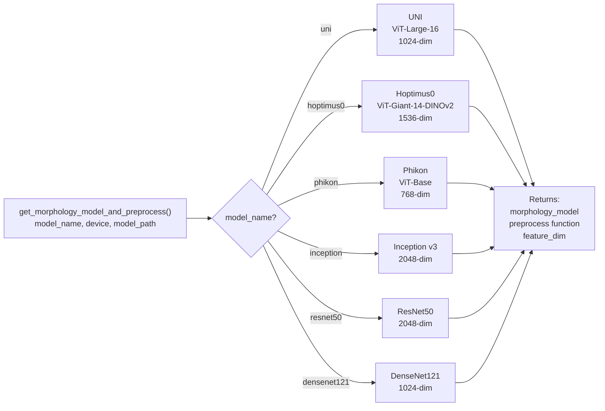
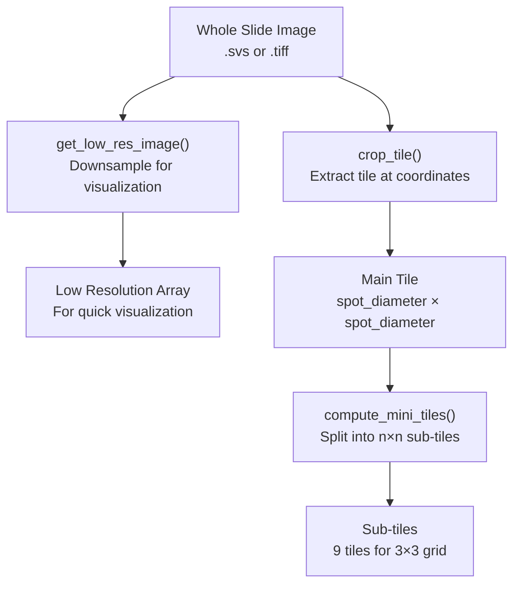
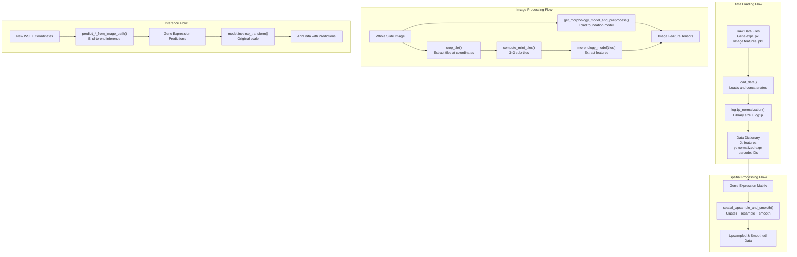

# deepspot.utils

<details>
<summary>Relevant source files</summary>

The following files were used as context for generating this wiki page:

- [deepspot/utils/utils.py](deepspot/utils/utils.py)
- [deepspot/utils/utils_dataloader.py](deepspot/utils/utils_dataloader.py)
- [deepspot/utils/utils_image.py](deepspot/utils/utils_image.py)

</details>


The `deepspot.utils` module provides utility functions for data loading, image processing, spatial transcriptomics preprocessing, and model training/inference. This module is divided into three submodules:

- `deepspot.utils.utils_dataloader` - Functions for loading gene expression data, computing spatial neighbors, upsampling, and smoothing
- `deepspot.utils.utils_image` - Functions for loading foundation models, preprocessing images, extracting tiles, and running inference from image paths
- `deepspot.utils.utils` - General utilities for model fine-tuning, inference, seeding, and visualization

For model-specific data loaders, see [deepspot.cell](#9.1) and [deepspot.spot](#9.2). For high-level workflow documentation, see [Visium Spot Workflow](#7.1) and [Xenium Cell Workflow](#7.2).

---

## Module Organization

```mermaid
graph TB
    subgraph "deepspot.utils"
        DataLoader["utils_dataloader.py<br/>Data Loading & Spatial Processing"]
        Image["utils_image.py<br/>Image Processing & Inference"]
        General["utils.py<br/>Training & General Utilities"]
    end
    
    subgraph "Core Functions: utils_dataloader.py"
        LoadData["load_data()<br/>Load gene expr & image features"]
        SpatialUpSample["spatial_upsample_and_smooth()<br/>Augment and smooth data"]
        ComputeNeighbors["compute_neighbors()<br/>Find spatial neighbors"]
        Log1p["log1p_normalization()<br/>Normalize counts"]
    end
    
    subgraph "Core Functions: utils_image.py"
        GetModel["get_morphology_model_and_preprocess()<br/>Load foundation models"]
        CropTile["crop_tile()<br/>Extract image tiles"]
        ComputeMini["compute_mini_tiles()<br/>Split tiles into sub-tiles"]
        PredictSpot["predict_spot_spatial_transcriptomics_from_image_path()<br/>Spot-level inference"]
        PredictCell["predict_cell_spatial_transcriptomics_from_image_path()<br/>Cell-level inference"]
    end
    
    subgraph "Core Functions: utils.py"
        FineTune["model_fine_tune()<br/>Fine-tune pretrained models"]
        RunInference["run_inference_from_dataloader()<br/>Batch inference"]
        FixSeed["fix_seed()<br/>Set random seeds"]
        PlotLoss["plot_loss_values()<br/>Visualize training"]
    end
    
    DataLoader --> LoadData
    DataLoader --> SpatialUpSample
    DataLoader --> ComputeNeighbors
    DataLoader --> Log1p
    
    Image --> GetModel
    Image --> CropTile
    Image --> ComputeMini
    Image --> PredictSpot
    Image --> PredictCell
    
    General --> FineTune
    General --> RunInference
    General --> FixSeed
    General --> PlotLoss
```



**Sources:** [deepspot/utils/utils_dataloader.py](), [deepspot/utils/utils_image.py](), [deepspot/utils/utils.py]()

---

## deepspot.utils.utils_dataloader

This module provides functions for loading spatial transcriptomics data, performing spatial upsampling and smoothing, computing spatial neighbors, and preprocessing gene expression counts.

### load_data

```python
def load_data(
    samples,
    out_folder,
    feature_model=None,
    cell_diameter=None,
    load_image_features=True,
    factor=10000,
    raw_counts=False
)
```

Loads gene expression data and optionally image features from pickle files organized by sample.

**Parameters:**
- `samples` (list of str): List of sample identifiers
- `out_folder` (str): Base directory containing `data/inputX/` and `data/image_features/` subdirectories
- `feature_model` (str, optional): Name of the foundation model used for feature extraction (e.g., "uni", "hoptimus0", "phikon")
- `cell_diameter` (int, optional): Diameter in pixels used during feature extraction (used for cell-level data)
- `load_image_features` (bool): Whether to load pre-extracted image features
- `factor` (int): Normalization factor for log1p normalization (default: 10000)
- `raw_counts` (bool): If True, skip log1p normalization

**Returns:**
- `dict`: Dictionary with keys:
  - `"y"` (np.ndarray): Gene expression matrix (log-normalized unless `raw_counts=True`)
  - `"X"` (pd.DataFrame): Image features (if `load_image_features=True`)
  - `"barcode"` (np.ndarray): Cell/spot barcodes

**Expected Directory Structure:**
```
out_folder/
├── data/
│   ├── inputX/
│   │   ├── sample1.pkl
│   │   └── sample2.pkl
│   └── image_features/
│       ├── uni/
│       │   ├── sample1.pkl
│       │   └── sample2.pkl
│       └── hoptimus0_40/
│           ├── sample1.pkl
│           └── sample2.pkl
```

**Sources:** [deepspot/utils/utils_dataloader.py:132-174]()

---

### spatial_upsample_and_smooth

```python
def spatial_upsample_and_smooth(
    counts,
    obs,
    barcode,
    resolution,
    smooth_n=0,
    augmentation="default"
)
```

Performs spatial upsampling through clustering-based resampling and optionally smooths gene expression using k-nearest neighbors.

**Parameters:**
- `counts` (np.ndarray): Gene expression matrix (spots/cells × genes)
- `obs` (pd.DataFrame): Observation metadata with spatial coordinates
- `barcode` (np.ndarray): Cell/spot identifiers formatted as `prefix_sampleID_suffix`
- `resolution` (float): Leiden clustering resolution; if 0, no upsampling is performed
- `smooth_n` (int): Number of nearest neighbors for smoothing; if 0, no smoothing
- `augmentation` (str): Clustering method - "default" (PCA + Leiden) or "aestetik" (AESTETIK spatial clustering)

**Returns:**
- `tuple`:
  - `resampled_barcodes` (np.ndarray): Upsampled barcode list
  - `transcriptomics_smooth` (np.ndarray): Smoothed expression matrix

**Workflow:**
1. Groups data by sample (extracted from barcode format)
2. Runs PCA and Leiden clustering at specified resolution
3. Balances cluster sizes by resampling from each cluster
4. Optionally smooths expression by averaging k-nearest neighbors in latent space

**Sources:** [deepspot/utils/utils_dataloader.py:65-98]()

---

### compute_neighbors

```python
def compute_neighbors(row, coordinates, radius=1)
```

Finds spatial neighbors within a square radius for a given spot/cell.

**Parameters:**
- `row` (pd.Series): Row from coordinates DataFrame containing `x_array`, `y_array`, `sampleID`, and `barcode`
- `coordinates` (pd.DataFrame): DataFrame with columns `x_array`, `y_array`, `sampleID`, `barcode` for all spots/cells
- `radius` (int): Square radius for neighbor search (default: 1, which creates a 3×3 grid)

**Returns:**
- `str`: Neighbor barcodes joined by "___" separator (excludes the query cell/spot itself)

**Query Logic:**
The function constructs a pandas query that finds neighbors where:
- `(x_array - radius) <= query_x <= (x_array + radius)`
- `(y_array - radius) <= query_y <= (y_array + radius)`
- Same `sampleID` but different `barcode`

**Sources:** [deepspot/utils/utils_dataloader.py:112-121]()

---

### log1p_normalization

```python
def log1p_normalization(arr, factor=10000, eps=1e-12)
```

Applies standard single-cell RNA-seq normalization: library size normalization followed by log1p transformation.

**Parameters:**
- `arr` (np.ndarray): Raw count matrix (spots/cells × genes)
- `factor` (int): Scaling factor (default: 10000)
- `eps` (float): Small constant to avoid division by zero

**Returns:**
- `np.ndarray`: Normalized matrix

**Formula:**
```
log1p((arr / (sum(arr, axis=1) + eps)) * factor)
```

**Sources:** [deepspot/utils/utils_dataloader.py:128-129]()

---

### Supporting Functions

| Function | Purpose | Source |
|----------|---------|--------|
| `get_balanced_index()` | Randomly samples cells/spots from each cluster to balance sizes | [utils_dataloader.py:20-26]() |
| `run_default()` | Runs PCA + Leiden clustering | [utils_dataloader.py:29-37]() |
| `run_aestetik()` | Runs AESTETIK spatial clustering | [utils_dataloader.py:40-62]() |
| `add_zero_padding()` | Pads arrays with zeros to desired size | [utils_dataloader.py:101-109]() |
| `load_multiple_pickles()` | Loads and concatenates multiple pickle files | [utils_dataloader.py:124-125]() |

**Sources:** [deepspot/utils/utils_dataloader.py]()

---

## deepspot.utils.utils_image

This module handles image processing tasks including loading foundation models, extracting image tiles, computing mini-tiles for sub-spot analysis, and running end-to-end inference from image paths.

### Foundation Model Loading



**Sources:** [deepspot/utils/utils_image.py:36-177]()

---

### get_morphology_model_and_preprocess

```python
def get_morphology_model_and_preprocess(model_name, device, model_path=None)
```

Loads a pathology foundation model or classical CNN with appropriate preprocessing transforms.

**Parameters:**
- `model_name` (str): Model identifier - "uni", "hoptimus0", "phikon", "phikonv2", "inception", "resnet50", "densenet121"
- `device` (torch.device): Device for model loading
- `model_path` (str, optional): Path to model weights (required for "uni", "hoptimus0", "phikon", "phikonv2")

**Returns:**
- `tuple`:
  - `morphology_model` (torch.nn.Module): Loaded model in eval mode
  - `preprocess` (callable): Preprocessing function for input images
  - `feature_dim` (int): Output feature dimension

**Model Details:**

| Model Name | Architecture | Feature Dim | Normalization Mean | Normalization Std |
|------------|--------------|-------------|-------------------|-------------------|
| uni | ViT-Large-16-224 | 1024 | (0.485, 0.456, 0.406) | (0.229, 0.224, 0.225) |
| hoptimus0 | ViT-Giant-14-DINOv2 | 1536 | (0.707, 0.579, 0.704) | (0.212, 0.230, 0.178) |
| phikon | ViT-Base | 768 | HuggingFace AutoProcessor | HuggingFace AutoProcessor |
| phikonv2 | ViT-Base | 1024 | HuggingFace AutoProcessor | HuggingFace AutoProcessor |
| inception | Inception v3 | 2048 | ImageNet default | ImageNet default |
| resnet50 | ResNet-50 | 2048 | ImageNet default | ImageNet default |
| densenet121 | DenseNet-121 | 1024 | ImageNet default | ImageNet default |

**Usage Example:**
```python
model, preprocess, feature_dim = get_morphology_model_and_preprocess(
    model_name="uni",
    device=torch.device("cuda"),
    model_path="/path/to/uni_weights.pth"
)
```

**Sources:** [deepspot/utils/utils_image.py:36-177]()

---

### Image Tile Extraction



**Sources:** [deepspot/utils/utils_image.py:180-234]()

---

### crop_tile

```python
def crop_tile(image, x_pixel, y_pixel, cell_diameter)
```

Extracts a square tile centered at specified pixel coordinates from a pyvips image.

**Parameters:**
- `image` (pyvips.Image): Opened whole-slide image
- `x_pixel` (int): X-coordinate of tile center
- `y_pixel` (int): Y-coordinate of tile center
- `cell_diameter` (int): Side length of square tile in pixels

**Returns:**
- `np.ndarray`: RGB image tile of shape `(cell_diameter, cell_diameter, 3)`

**Implementation Details:**
- Converts center coordinates to top-left corner: `x = x_pixel - (cell_diameter // 2)`
- Uses pyvips crop for memory-efficient extraction
- Truncates to 3 channels (RGB) if image has more

**Sources:** [deepspot/utils/utils_image.py:190-198]()

---

### compute_mini_tiles

```python
def compute_mini_tiles(image, n_tiles, super_resolution_mode=False)
```

Splits a square image into n×n smaller tiles for sub-spot analysis.

**Parameters:**
- `image` (np.ndarray): Square image of shape `(D, D, 3)`
- `n_tiles` (int): Total number of tiles (must be perfect square, typically 9 for 3×3 grid)
- `super_resolution_mode` (bool): If True, extracts only the center tile

**Returns:**
- `list` of `np.ndarray`: List of sub-tile images

**Typical Usage:**
- For Visium spots: `n_tiles=9` creates a 3×3 grid, capturing sub-spot heterogeneity
- For super-resolution: extracts center region only

**Sources:** [deepspot/utils/utils_image.py:201-234]()

---

### get_low_res_image

```python
def get_low_res_image(image_path, downsample_factor)
```

Loads a downsampled version of a whole-slide image for quick visualization.

**Parameters:**
- `image_path` (str): Path to whole-slide image
- `downsample_factor` (float): Downsampling factor (e.g., 32 for 32×32 reduction)

**Returns:**
- `np.ndarray`: Downsampled RGB image

**Sources:** [deepspot/utils/utils_image.py:180-187]()

---

### Inference from Image Paths

These functions provide end-to-end inference pipelines that load images, extract features on-the-fly, and predict gene expression without requiring pre-extracted features.

### predict_spot_spatial_transcriptomics_from_image_path

```python
def predict_spot_spatial_transcriptomics_from_image_path(
    image_path,
    adata,
    spot_diameter,
    n_mini_tiles,
    preprocess,
    morphology_model,
    model_expression,
    device,
    super_resolution=False,
    neighbor_radius=1
)
```

Performs spot-level spatial transcriptomics prediction directly from an H&E image path.

**Parameters:**
- `image_path` (str): Path to whole-slide image
- `adata` (AnnData): AnnData object with `.obs` containing `x_pixel`, `y_pixel`, `barcode`, `sampleID` columns
- `spot_diameter` (int): Spot diameter in pixels
- `n_mini_tiles` (int): Number of sub-tiles (typically 9)
- `preprocess` (callable): Preprocessing function from `get_morphology_model_and_preprocess()`
- `morphology_model` (torch.nn.Module): Foundation model for feature extraction
- `model_expression` (DeepSpot): Trained DeepSpot model
- `device` (torch.device): Computation device
- `super_resolution` (bool): If True, uses only center sub-tile
- `neighbor_radius` (int): Radius for neighbor search (default: 1)

**Returns:**
- `np.ndarray`: Predicted gene expression matrix of shape `(n_spots, n_genes)`

**Workflow:**
1. Opens image with pyvips for memory efficiency
2. For each spot in `adata.obs`:
   - Extracts main spot tile at `(x_pixel, y_pixel)`
   - Computes `n_mini_tiles` sub-tiles
   - Finds neighbor spots within `neighbor_radius`
   - Extracts tiles for each neighbor
3. Applies preprocessing to all tiles
4. Passes through `morphology_model` to extract features
5. Feeds features to `model_expression` for gene prediction
6. Inverse-transforms predictions to original scale

**Performance Optimizations:**
- Uses `torch.autocast` for mixed precision (FP16)
- Uses `torch.inference_mode()` for faster inference
- Processes one spot at a time to manage memory

**Sources:** [deepspot/utils/utils_image.py:241-292]()

---

### predict_cell_spatial_transcriptomics_from_image_path

```python
def predict_cell_spatial_transcriptomics_from_image_path(
    image_path,
    adata,
    cell_diameter,
    radius_neighbors,
    preprocess,
    morphology_model,
    model_expression,
    device
)
```

Performs cell-level spatial transcriptomics prediction directly from an H&E image path.

**Parameters:**
- `image_path` (str): Path to whole-slide image
- `adata` (AnnData): AnnData object with `.obs` containing `x_pixel`, `y_pixel`, `barcode` columns
- `cell_diameter` (int): Cell diameter in pixels
- `radius_neighbors` (float): Radius in pixels for neighbor search (e.g., 45 for Xenium)
- `preprocess` (callable): Preprocessing function from `get_morphology_model_and_preprocess()`
- `morphology_model` (torch.nn.Module): Foundation model for feature extraction
- `model_expression` (DeepCell): Trained DeepCell model
- `device` (torch.device): Computation device

**Returns:**
- `np.ndarray`: Predicted gene expression matrix of shape `(n_cells, n_genes)`

**Workflow:**
1. Computes neighbors using `sklearn.neighbors.NearestNeighbors` with radius search
2. Stores neighbor lists in `adata.obs["neighbors"]` as "___"-separated strings
3. For each cell:
   - Extracts main cell tile
   - Extracts tiles for all neighbors within radius
   - Applies preprocessing and feature extraction
   - Predicts gene expression
4. Returns predictions in original scale

**Differences from Spot Prediction:**
- No sub-tile computation (cells are smaller than spots)
- Uses radius-based neighbor search instead of grid-based
- Typically more neighbors per cell (e.g., 45-pixel radius for Xenium)

**Sources:** [deepspot/utils/utils_image.py:295-356]()

---

### Inference Pipeline Comparison

| Aspect | Spot Inference | Cell Inference |
|--------|---------------|----------------|
| Function | `predict_spot_spatial_transcriptomics_from_image_path()` | `predict_cell_spatial_transcriptomics_from_image_path()` |
| Model Type | DeepSpot | DeepCell |
| Sub-tiles | Yes (3×3 grid = 9 tiles) | No |
| Neighbor Search | Grid-based with radius | Distance-based with radius |
| Typical Neighbor Count | ~8 (for radius=1) | ~45 (for radius=45 pixels) |
| Input Components | [spot_tile, sub_tiles, neighbor_tiles] | [cell_tile, neighbor_tiles] |

**Sources:** [deepspot/utils/utils_image.py:241-356]()

---

## deepspot.utils.utils

This module provides general utilities for model training, inference, reproducibility, and visualization.

### model_fine_tune

```python
def model_fine_tune(
    model,
    dataloader,
    rho=False,
    gene_expression=True,
    max_epochs=10
)
```

Fine-tunes specific layers of a pre-trained model while keeping other layers frozen.

**Parameters:**
- `model` (DeepSpot or DeepCell): Pre-trained model to fine-tune
- `dataloader` (DataLoader): Training data loader
- `rho` (bool): If True, unfreeze and train the `rho` ensemble layers
- `gene_expression` (bool): If True, unfreeze and train the final `gene_expression` layer
- `max_epochs` (int): Number of training epochs

**Workflow:**
1. Freezes all model parameters
2. Selectively unfreezes specified layers (`rho`, `gene_expression`)
3. Creates AdamW optimizer with only trainable parameters
4. Sets model to eval mode, but unfrozen layers to train mode
5. Trains using PyTorch Lightning trainer

**Typical Usage:**
Fine-tune only the final prediction layer when adapting to a new dataset:
```python
model_fine_tune(model, train_loader, rho=False, gene_expression=True, max_epochs=10)
```

**Sources:** [deepspot/utils/utils.py:20-48]()

---

### run_inference_from_dataloader

```python
def run_inference_from_dataloader(model, dataloader, device)
```

Runs batch inference on a dataset using a data loader.

**Parameters:**
- `model` (torch.nn.Module): Trained model
- `dataloader` (DataLoader): Data loader yielding batches
- `device` (torch.device): Device for computation

**Returns:**
- `np.ndarray`: Concatenated predictions from all batches

**Workflow:**
1. Moves model to specified device and sets to eval mode
2. Iterates through batches with `torch.no_grad()`
3. Handles both single-tensor and list-of-tensors inputs
4. Moves predictions to CPU and converts to NumPy
5. Concatenates all batch predictions

**Sources:** [deepspot/utils/utils.py:51-69]()

---

### fix_seed

```python
def fix_seed(seed)
```

Sets random seeds for all libraries to ensure reproducible results.

**Parameters:**
- `seed` (int): Random seed value

**Libraries Configured:**
- Python's built-in `random` module
- NumPy random generator
- PyTorch CPU and CUDA random generators
- CuDNN deterministic mode
- CUBLAS workspace configuration

**Environment Variables Set:**
- `PYTHONHASHSEED`: Python hash randomization
- `CUBLAS_WORKSPACE_CONFIG`: CUDA deterministic algorithms

**Usage:**
```python
fix_seed(42)  # Ensures reproducible training and inference
```

**Note:** Enabling deterministic mode may impact performance. See [Reproducibility & Seeding](#10.3) for details.

**Sources:** [deepspot/utils/utils.py:89-100]()

---

### plot_loss_values

```python
def plot_loss_values(train_losses, val_losses=None)
```

Visualizes training and optionally validation loss curves.

**Parameters:**
- `train_losses` (list or np.ndarray): Training loss values per iteration
- `val_losses` (list or np.ndarray, optional): Validation loss values (recorded less frequently than training)

**Plot Details:**
- X-axis: Iteration/epoch
- Y-axis: Loss value
- Blue line: Training loss
- Red line: Validation loss (if provided)
- Automatically aligns validation points based on frequency difference

**Sources:** [deepspot/utils/utils.py:72-86]()

---

## Data Flow Through Utilities



**Sources:** [deepspot/utils/utils_dataloader.py](), [deepspot/utils/utils_image.py](), [deepspot/utils/utils.py]()

---

## Function Reference Summary

### utils_dataloader.py Functions

| Function | Purpose | Key Parameters | Returns |
|----------|---------|----------------|---------|
| `load_data()` | Load gene expr & image features | `samples`, `out_folder`, `feature_model` | Dict with X, y, barcode |
| `spatial_upsample_and_smooth()` | Augment data through clustering | `counts`, `resolution`, `smooth_n` | Resampled barcodes, smoothed counts |
| `compute_neighbors()` | Find spatial neighbors | `row`, `coordinates`, `radius` | Neighbor barcodes string |
| `log1p_normalization()` | Normalize gene counts | `arr`, `factor` | Normalized array |
| `get_balanced_index()` | Balance cluster sizes | `barcode`, `labels`, `n_count` | Resampled barcodes |
| `run_default()` | PCA + Leiden clustering | `adata`, `resolution` | Clustered AnnData |
| `run_aestetik()` | AESTETIK spatial clustering | `adata`, `window_size`, `resolution` | Clustered AnnData |
| `add_zero_padding()` | Pad arrays with zeros | `original_array`, `desired_padding` | Padded array |
| `load_multiple_pickles()` | Load and concatenate pickles | `files` | Concatenated DataFrame |

**Sources:** [deepspot/utils/utils_dataloader.py]()

---

### utils_image.py Functions

| Function | Purpose | Key Parameters | Returns |
|----------|---------|----------------|---------|
| `get_morphology_model_and_preprocess()` | Load foundation models | `model_name`, `device`, `model_path` | model, preprocess, feature_dim |
| `crop_tile()` | Extract image tile | `image`, `x_pixel`, `y_pixel`, `cell_diameter` | RGB tile array |
| `compute_mini_tiles()` | Split into sub-tiles | `image`, `n_tiles`, `super_resolution_mode` | List of sub-tiles |
| `get_low_res_image()` | Downsample image | `image_path`, `downsample_factor` | Downsampled array |
| `predict_spot_spatial_transcriptomics_from_image_path()` | Spot inference from WSI | `image_path`, `adata`, `spot_diameter`, `model_expression` | Predicted gene matrix |
| `predict_cell_spatial_transcriptomics_from_image_path()` | Cell inference from WSI | `image_path`, `adata`, `cell_diameter`, `model_expression` | Predicted gene matrix |
| `detach_and_convert()` | Convert tensors for model input | `data` | Detached float tensor |

**Sources:** [deepspot/utils/utils_image.py]()

---

### utils.py Functions

| Function | Purpose | Key Parameters | Returns |
|----------|---------|----------------|---------|
| `model_fine_tune()` | Fine-tune pretrained models | `model`, `dataloader`, `rho`, `gene_expression`, `max_epochs` | None (modifies model) |
| `run_inference_from_dataloader()` | Batch inference | `model`, `dataloader`, `device` | Prediction array |
| `fix_seed()` | Set random seeds | `seed` | None (sets global state) |
| `plot_loss_values()` | Visualize training curves | `train_losses`, `val_losses` | None (displays plot) |

**Sources:** [deepspot/utils/utils.py]()

---

## Related Pages

- [deepspot.cell](#9.1) - Cell-level model and data loader API reference
- [deepspot.spot](#9.2) - Spot-level model and data loader API reference
- [Data Management & Preprocessing](#4) - High-level data preprocessing concepts
- [Image Processing](#6) - Detailed image processing workflows
- [Visium Spot Workflow](#7.1) - Complete Visium preprocessing, training, and inference workflow
- [Xenium Cell Workflow](#7.2) - Complete Xenium preprocessing, training, and inference workflow

---