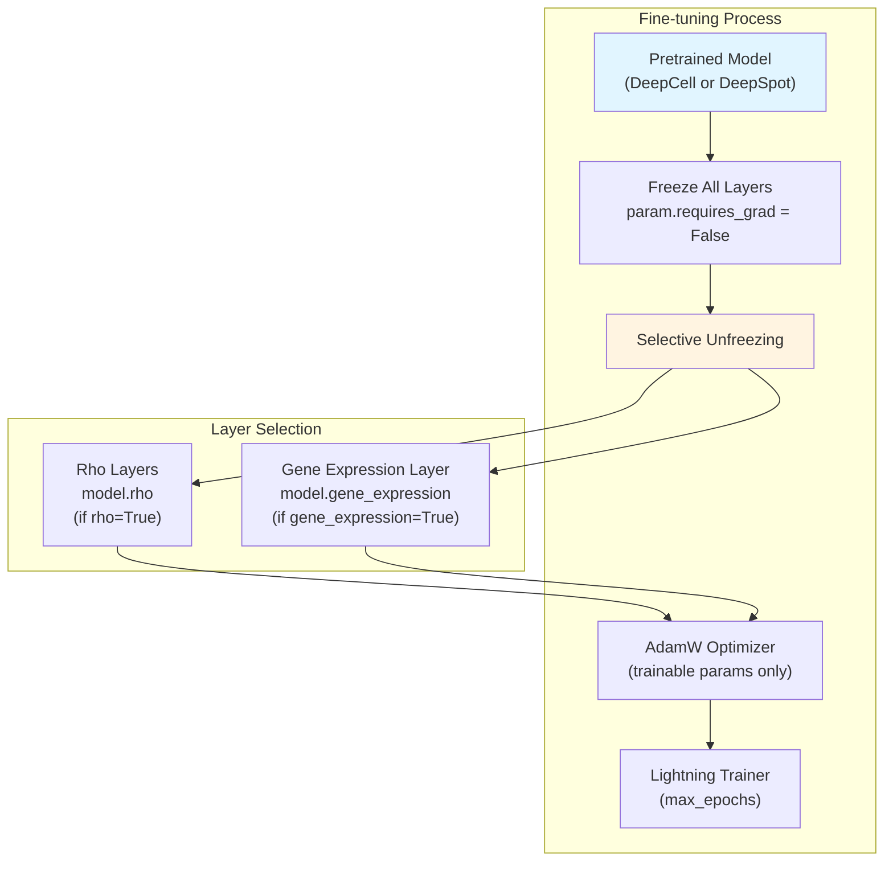
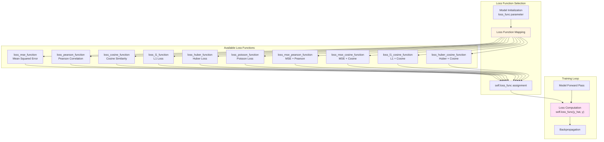
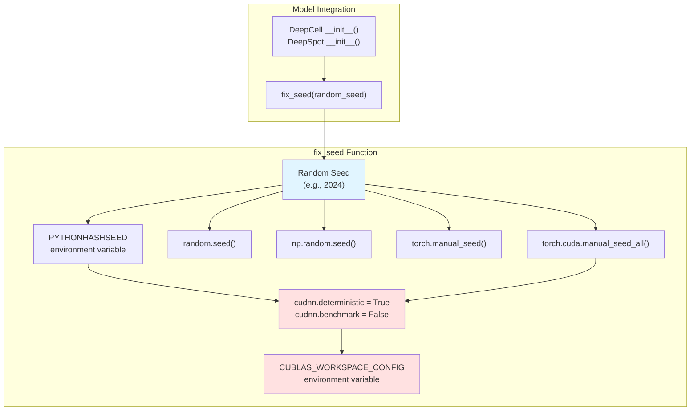

# Advanced Topics

<details>
<summary>Relevant source files</summary>

The following files were used as context for generating this wiki page:

- [deepspot/cell/model.py](deepspot/cell/model.py)
- [deepspot/utils/utils.py](deepspot/utils/utils.py)

</details>


This page covers advanced usage patterns, customization strategies, and best practices for the DeepSpot system. These topics are intended for users who have completed basic workflows and want to optimize performance, ensure reproducibility, or extend the system with custom components.

For basic model training workflows, see [Visium Training](#7.1.2) and [Xenium Training](#7.2.2). For comprehensive model architecture documentation, see [Model Architecture](#5).

---

## Model Fine-tuning

DeepSpot and DeepCell models can be fine-tuned on new datasets by selectively unfreezing specific layers while keeping pretrained weights frozen in other parts of the network. This approach is particularly useful when adapting models trained on one tissue type to another, or when working with limited training data.

### Fine-tuning Architecture

The `model_fine_tune` function [deepspot/utils/utils.py:20-48]() implements layer-selective fine-tuning by controlling gradient flow through the model:



**Sources**: [deepspot/utils/utils.py:20-48]()

### Function Signature

```python
model_fine_tune(model, dataloader, rho=False, gene_expression=True, max_epochs=10)
```

| Parameter | Type | Default | Description |
|-----------|------|---------|-------------|
| `model` | `L.LightningModule` | Required | Pretrained DeepCell or DeepSpot model |
| `dataloader` | `DataLoader` | Required | Fine-tuning dataset loader |
| `rho` | `bool` | `False` | Unfreeze Rho ensemble layers for training |
| `gene_expression` | `bool` | `True` | Unfreeze gene expression prediction layer |
| `max_epochs` | `int` | `10` | Number of fine-tuning epochs |

### Implementation Details

The fine-tuning process operates in four stages:

1. **Global Freeze** [deepspot/utils/utils.py:22-23](): All model parameters are frozen by setting `requires_grad=False`

2. **Selective Unfreeze** [deepspot/utils/utils.py:25-32](): Target layers are unfrozen based on flags:
   - `rho=True`: Unfreezes `model.rho` (the Rho ensemble modules)
   - `gene_expression=True`: Unfreezes `model.gene_expression` layer (if present)

3. **Optimizer Reconfiguration** [deepspot/utils/utils.py:35-38](): A new AdamW optimizer is created with filtered parameters that only includes trainable layers

4. **Targeted Training** [deepspot/utils/utils.py:39-48](): Model is set to eval mode globally, but unfrozen layers are explicitly set to train mode before fitting

### Usage Pattern

```python
# Load pretrained model
from deepspot.cell.model import DeepCell
model = DeepCell.load_from_checkpoint("pretrained_weights.ckpt")

# Prepare fine-tuning dataloader
from deepspot.cell.dataloader import DeepCellDataLoader
fine_tune_loader = DeepCellDataLoader(...)

# Fine-tune only the Rho layers
from deepspot.utils.utils import model_fine_tune
model_fine_tune(
    model=model,
    dataloader=fine_tune_loader,
    rho=True,
    gene_expression=False,
    max_epochs=5
)
```

### Recommended Fine-tuning Strategies

| Scenario | Rho Setting | Gene Expression Setting | Rationale |
|----------|-------------|------------------------|-----------|
| New tissue type, same genes | `True` | `True` | Adapt aggregation and final prediction |
| Similar tissue, different staining | `False` | `True` | Only adjust final gene mapping |
| Limited training data | `True` | `False` | Fine-tune aggregation, preserve gene weights |
| Domain adaptation | `True` | `True` | Full fine-tuning of prediction layers |

**Sources**: [deepspot/utils/utils.py:20-48]()

---

## Custom Loss Functions

DeepSpot supports multiple loss functions for training, each optimizing different aspects of gene expression prediction. Custom loss functions can be implemented by following the established patterns in the codebase.

### Loss Function Architecture



**Sources**: [deepspot/cell/model.py:88-107](), [deepspot/cell/loss.py]()

### Loss Function Selection in DeepCell

The loss function is specified during model initialization [deepspot/cell/model.py:64-82]() and mapped to the corresponding implementation [deepspot/cell/model.py:88-107]():

| String Identifier | Function Name | Use Case |
|-------------------|---------------|----------|
| `"mse"` | `loss_mse_function` | Standard regression, penalizes large errors quadratically |
| `"cos"` | `loss_cosine_function` | Pattern matching, ignores magnitude differences |
| `"l1"` | `loss_l1_function` | Robust to outliers, penalizes errors linearly |
| `"huber"` | `loss_huber_function` | Hybrid approach, quadratic near zero, linear for large errors |
| `"mse_cos"` | `loss_mse_cosine_function` | Combined magnitude and pattern matching |
| `"l1_cos"` | `loss_l1_cosine_function` | Outlier-robust pattern matching |
| `"huber_cos"` | `loss_huber_cosine_function` | Robust hybrid with pattern matching |
| `"pearson"` | `loss_pearson_function` | Correlation-based, scale-invariant |
| `"mse_pearson"` | `loss_mse_pearson_function` | Combined magnitude and correlation |
| `"poisson"` | `loss_poisson_function` | Count data modeling, assumes Poisson distribution |

### Implementing Custom Loss Functions

To implement a custom loss function:

1. **Create Loss Function**: Define a function that accepts `y_hat` (predictions) and `y` (ground truth) tensors and returns a scalar loss

2. **Import in Model**: Add the import statement to [deepspot/cell/model.py:13-24]() or [deepspot/spot/model.py]()

3. **Add to Mapping**: Extend the conditional mapping in model initialization [deepspot/cell/model.py:88-107]()

4. **Specify During Training**: Pass the new identifier string when instantiating the model

Example custom loss function structure:

```python
def loss_custom_function(y_hat: torch.Tensor, y: torch.Tensor) -> torch.Tensor:
    """
    Custom loss function implementation.
    
    Args:
        y_hat: Predicted gene expression [batch_size, n_genes]
        y: Ground truth gene expression [batch_size, n_genes]
    
    Returns:
        Scalar loss value
    """
    # Implementation here
    loss = custom_computation(y_hat, y)
    return loss
```

### Loss Function Combination Patterns

Combined loss functions are implemented as weighted sums of individual components. For example, `loss_mse_cosine_function` combines:
- MSE component: Penalizes magnitude errors
- Cosine component: Penalizes pattern mismatches

This dual optimization encourages predictions that are both accurate in absolute value and maintain correct gene expression patterns.

**Sources**: [deepspot/cell/model.py:13-24](), [deepspot/cell/model.py:88-107]()

---

## Reproducibility & Seeding

Ensuring reproducible results is critical for scientific validation and debugging. DeepSpot implements comprehensive seeding through the `fix_seed` function.

### Reproducibility Components



**Sources**: [deepspot/utils/utils.py:89-100](), [deepspot/cell/model.py:26](), [deepspot/cell/model.py:86]()

### Fix Seed Implementation

The `fix_seed` function [deepspot/utils/utils.py:89-100]() configures all random number generators to ensure deterministic behavior:

| Component | Configuration | Purpose |
|-----------|---------------|---------|
| **Python Hash** | `PYTHONHASHSEED=str(seed)` | Deterministic hash-based operations |
| **Python Random** | `random.seed(seed)` | Standard library random module |
| **NumPy** | `np.random.seed(seed)` | NumPy array operations |
| **PyTorch CPU** | `torch.manual_seed(seed)` | CPU tensor operations |
| **PyTorch GPU (single)** | `torch.cuda.manual_seed(seed)` | Single GPU operations |
| **PyTorch GPU (multi)** | `torch.cuda.manual_seed_all(seed)` | Multi-GPU operations |
| **cuDNN Determinism** | `cudnn.deterministic=True` | Disable non-deterministic algorithms |
| **cuDNN Benchmark** | `cudnn.benchmark=False` | Disable auto-tuning (non-deterministic) |
| **CUBLAS Workspace** | `CUBLAS_WORKSPACE_CONFIG=:4096:8` | Deterministic CUBLAS operations |

### Automatic Seeding in Models

Models automatically call `fix_seed` during initialization [deepspot/cell/model.py:86]():

```python
def __init__(self, ..., random_seed: int = 2024, ...):
    super().__init__()
    self.save_hyperparameters()
    fix_seed(random_seed)
    # ... rest of initialization
```

The default seed is `2024`, but can be overridden during model instantiation.

### Reproducibility Best Practices

1. **Set Seed Before Training**: The seed is automatically set during model initialization
2. **Disable Workers**: For perfect reproducibility, set `num_workers=0` in DataLoader
3. **Single GPU**: Multi-GPU training may introduce non-determinism even with seeding
4. **Document Seeds**: Save the `random_seed` hyperparameter with model checkpoints
5. **Environment Variables**: Ensure `PYTHONHASHSEED` and `CUBLAS_WORKSPACE_CONFIG` are set before Python starts

### Performance Trade-offs

Enabling full determinism has performance implications:

| Setting | Impact | Severity |
|---------|--------|----------|
| `cudnn.deterministic=True` | Disables faster non-deterministic algorithms | Moderate (10-30% slower) |
| `cudnn.benchmark=False` | Prevents kernel auto-tuning | Minor (5-10% slower) |
| `CUBLAS_WORKSPACE_CONFIG` | Uses deterministic workspace for CUBLAS | Minor (< 5% slower) |
| `num_workers=0` | Disables multi-process data loading | Severe (can be 2-5x slower) |

For production inference where reproducibility is less critical, consider disabling deterministic mode by not calling `fix_seed` or setting `cudnn.benchmark=True` manually.

**Sources**: [deepspot/utils/utils.py:89-100](), [deepspot/cell/model.py:86]()

---

## Performance Optimization

Optimizing training and inference performance involves careful configuration of batching, memory management, and hardware utilization.

### Training Performance Pipeline

```mermaid
graph LR
    subgraph "Data Loading Stage"
        Disk["Preprocessed Features<br/>.npy files on disk"]
        Loader["DataLoader<br/>num_workers, batch_size"]
        Prefetch["Prefetching<br/>pin_memory=True"]
    end
    
    subgraph "Model Forward Stage"
        GPU["GPU Transfer"]
        PhiEnsemble["Phi Ensemble<br/>n=10 parallel modules<br/>median aggregation"]
        RhoEnsemble["Rho Ensemble<br/>n=10 parallel modules<br/>mean aggregation"]
    end
    
    subgraph "Optimization Stage"
        Loss["Loss Computation"]
        Backward["Backward Pass"]
        Optimizer["AdamW Optimizer<br/>weight_decay, lr"]
    end
    
    Disk --> Loader
    Loader --> Prefetch
    Prefetch --> GPU
    GPU --> PhiEnsemble
    PhiEnsemble --> RhoEnsemble
    RhoEnsemble --> Loss
    Loss --> Backward
    Backward --> Optimizer
    
    style Loader fill:#fff4e1
    style GPU fill:#ffe1e1
    style PhiEnsemble fill:#e1f5ff
```



**Sources**: [deepspot/cell/model.py:125-127](), [deepspot/cell/model.py:190-214]()

### Batch Size Configuration

Optimal batch size depends on GPU memory and model size:

| Model Type | Input Size | Typical Batch Size | GPU Memory |
|------------|------------|-------------------|------------|
| DeepCell (UNI) | 1024-dim | 32-64 | 8GB |
| DeepCell (Hoptimus0) | 1536-dim | 16-32 | 8GB |
| DeepSpot (neighbors) | Variable | 16-32 | 8GB |
| DeepSpot (subspot) | 9 × feature_dim | 8-16 | 8GB |

Larger batch sizes generally improve GPU utilization but require more memory. Monitor GPU memory usage with `nvidia-smi` during training.

### DataLoader Workers

The `num_workers` parameter in DataLoader controls multi-process data loading:

```python
dataloader = DataLoader(
    dataset,
    batch_size=32,
    num_workers=4,        # 4 parallel workers
    pin_memory=True,      # Enable for GPU training
    persistent_workers=True  # Keep workers alive between epochs
)
```

| Configuration | Use Case | Trade-off |
|---------------|----------|-----------|
| `num_workers=0` | Debugging, reproducibility | Slow data loading |
| `num_workers=2-4` | Small datasets, fast SSDs | Balanced |
| `num_workers=4-8` | Large datasets, slow disks | Maximum throughput, high CPU usage |
| `pin_memory=True` | GPU training | Faster CPU→GPU transfer, more memory |
| `persistent_workers=True` | Multi-epoch training | Faster epoch transitions, persistent memory |

### Memory Management Strategies

1. **Gradient Accumulation**: Simulate larger batch sizes with limited memory
   ```python
   accumulation_steps = 4
   for i, batch in enumerate(dataloader):
       loss = model.training_step(batch, i)
       loss = loss / accumulation_steps
       loss.backward()
       
       if (i + 1) % accumulation_steps == 0:
           optimizer.step()
           optimizer.zero_grad()
   ```

2. **Mixed Precision Training**: Use PyTorch Lightning's `precision` flag
   ```python
   trainer = L.Trainer(
       precision="16-mixed",  # or "bf16-mixed" for newer GPUs
       max_epochs=100
   )
   ```

3. **Gradient Checkpointing**: Trade computation for memory (not implemented in current version)

### Inference Optimization

The `run_inference_from_dataloader` function [deepspot/utils/utils.py:51-69]() provides efficient batch inference:

```python
from deepspot.utils.utils import run_inference_from_dataloader

# Efficient batch inference
predictions = run_inference_from_dataloader(
    model=model,
    dataloader=inference_loader,
    device='cuda'
)
```

Key optimizations:
- **Batch Processing**: Processes multiple samples simultaneously
- **No Gradient Computation**: Uses `torch.no_grad()` to disable gradient tracking
- **Device Management**: Handles CPU↔GPU transfers automatically
- **Progress Tracking**: Uses `tqdm` for progress visualization

### Ensemble Configuration

Models use ensemble architectures [deepspot/cell/model.py:118-127]() with configurable sizes:

| Parameter | Default | Range | Impact |
|-----------|---------|-------|--------|
| `n_ensemble` | 10 | 1-20 | Overall ensemble size (if not overridden) |
| `n_ensemble_phi` | `n_ensemble` | 1-20 | Number of Phi modules, improves feature robustness |
| `n_ensemble_rho` | `n_ensemble` | 1-20 | Number of Rho modules, improves prediction stability |

Reducing ensemble size decreases model parameters and speeds up training/inference:
- `n_ensemble=5`: ~50% faster, slightly lower accuracy
- `n_ensemble=10`: Default balance
- `n_ensemble=15`: ~50% slower, marginal accuracy improvement

### Hardware-Specific Optimizations

| GPU Type | Recommended Settings |
|----------|---------------------|
| **V100/A100** | `precision="16-mixed"`, `num_workers=8`, batch_size=64 |
| **RTX 3090/4090** | `precision="bf16-mixed"`, `num_workers=4`, batch_size=32 |
| **GTX 1080 Ti** | `precision=32`, `num_workers=2`, batch_size=16 |
| **CPU Only** | `num_workers=4-8`, batch_size=8, use smaller ensembles |

### Monitoring Performance

Use Lightning's built-in profiler to identify bottlenecks:

```python
from lightning.pytorch.profilers import SimpleProfiler

profiler = SimpleProfiler(filename="profile.txt")
trainer = L.Trainer(profiler=profiler)
trainer.fit(model, dataloader)
```

Key metrics to monitor:
- **Data loading time**: Should be < 10% of step time
- **GPU utilization**: Target 80-95% during training
- **Memory usage**: Leave 10-20% headroom to prevent OOM errors

**Sources**: [deepspot/utils/utils.py:51-69](), [deepspot/cell/model.py:118-127](), [deepspot/cell/model.py:216-218]()

---