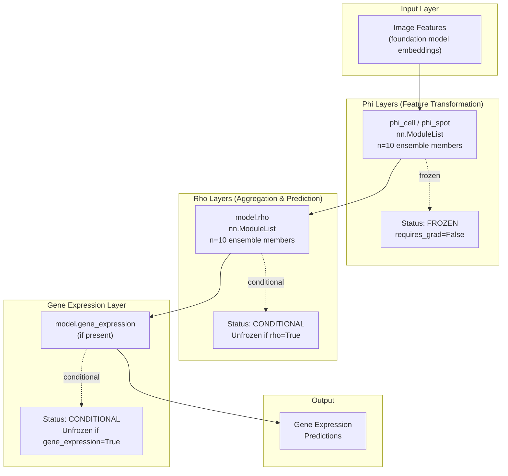
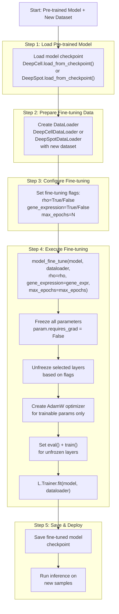
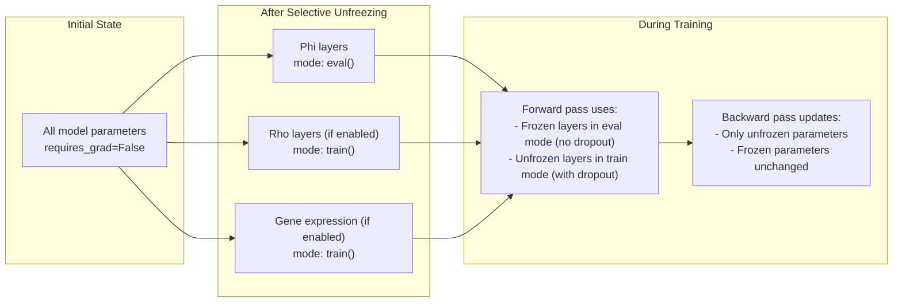
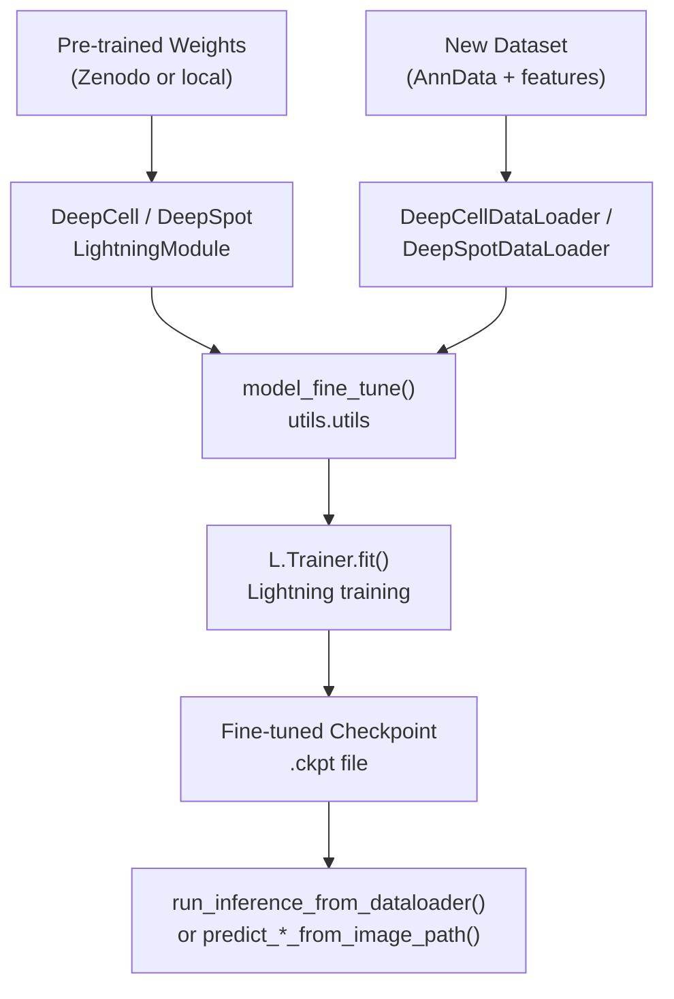

# Model Fine-tuning

<details>
<summary>Relevant source files</summary>

The following files were used as context for generating this wiki page:

- [deepspot/cell/model.py](deepspot/cell/model.py)
- [deepspot/utils/utils.py](deepspot/utils/utils.py)

</details>


## Purpose and Scope

This document describes how to fine-tune pre-trained DeepSpot and DeepCell models on new datasets using the `model_fine_tune` function. Fine-tuning allows you to adapt models trained on one dataset to perform better on a different but related dataset by selectively retraining specific layers while keeping others frozen. This approach leverages transfer learning to achieve better performance with less training time and data compared to training from scratch.

For information about training models from scratch, see [Visium Training](#7.1.2) and [Xenium Training](#7.2.2). For downloading and using pre-trained weights, see [Downloading Pre-trained Weights](#8.1).

---

## What is Fine-tuning?

Fine-tuning is a transfer learning technique where a pre-trained model is adapted to a new dataset by:

1. **Freezing** most model parameters to preserve learned features
2. **Unfreezing** specific layers (typically the final prediction layers) to allow adaptation
3. **Training** only the unfrozen layers on the new dataset with a smaller learning rate

In the DeepSpot architecture, fine-tuning is particularly useful when:
- You have a pre-trained model on one tissue type and want to adapt it to a different tissue
- Your new dataset has fewer samples than the original training set
- You want to preserve morphological features learned by the Phi layers while adapting the final predictions

Sources: [deepspot/utils/utils.py:20-49]()

---

## The `model_fine_tune` Function

The primary interface for fine-tuning is the `model_fine_tune` function located in [deepspot/utils/utils.py:20-49]().

### Function Signature

```python
def model_fine_tune(model, dataloader, rho=False, gene_expression=True, max_epochs=10)
```

### Parameters

| Parameter | Type | Default | Description |
|-----------|------|---------|-------------|
| `model` | `DeepCell` or `DeepSpot` | Required | The pre-trained model to fine-tune |
| `dataloader` | `DataLoader` | Required | PyTorch DataLoader containing the new training data |
| `rho` | `bool` | `False` | If `True`, unfreeze and train the `rho` layers (final aggregation modules) |
| `gene_expression` | `bool` | `True` | If `True`, unfreeze and train the `gene_expression` layer |
| `max_epochs` | `int` | `10` | Number of epochs to train the unfrozen layers |

### Behavior

The function implements selective layer training by:

1. **Freezing all parameters** by setting `requires_grad=False` for all model parameters
2. **Selectively unfreezing** based on flags:
   - If `rho=True`: Unfreezes all parameters in `model.rho` modules
   - If `gene_expression=True`: Unfreezes all parameters in `model.gene_expression` layer
3. **Creating a filtered optimizer** that only updates trainable parameters using AdamW
4. **Setting training modes**: Model is set to `eval()` except for unfrozen layers which are set to `train()`
5. **Training via Lightning**: Uses `L.Trainer` with logging and checkpointing disabled

Sources: [deepspot/utils/utils.py:20-49]()

---

## Fine-tuning Architecture

The following diagram illustrates which components can be fine-tuned in the DeepCell/DeepSpot architecture:



**Layer Freezing Strategy**: The Phi layers remain frozen during fine-tuning to preserve morphological feature extraction learned from the original dataset. The Rho layers and gene expression layer can be selectively unfrozen to adapt the final predictions to the new dataset's gene expression patterns.

Sources: [deepspot/utils/utils.py:20-49](), [deepspot/cell/model.py:125-127]()

---

## Fine-tuning Workflow

The following diagram shows the complete fine-tuning process from loading a pre-trained model to obtaining predictions on new data:



Sources: [deepspot/utils/utils.py:20-49]()

---

## Code Example

Here is a typical fine-tuning workflow:

### Step 1: Load Pre-trained Model

```python
from deepspot.cell.model import DeepCell

# Load pre-trained model
model = DeepCell.load_from_checkpoint(
    "path/to/pretrained_checkpoint.ckpt",
    input_size=1024,
    output_size=500
)
```

### Step 2: Prepare Fine-tuning DataLoader

```python
from deepspot.cell.dataloader import DeepCellDataLoader

# Create dataloader with new dataset
finetune_loader = DeepCellDataLoader(
    adata=new_adata,
    image_features_path="path/to/new_features",
    batch_size=32,
    n_hops=1,
    neighbor_context=45,
    split_type="train"
)
```

### Step 3: Execute Fine-tuning

```python
from deepspot.utils.utils import model_fine_tune

# Fine-tune only the rho layers for 10 epochs
model_fine_tune(
    model=model,
    dataloader=finetune_loader,
    rho=True,
    gene_expression=False,
    max_epochs=10
)
```

### Step 4: Save Fine-tuned Model

```python
# Save the fine-tuned checkpoint
trainer.save_checkpoint("path/to/finetuned_checkpoint.ckpt")
```

Sources: [deepspot/utils/utils.py:20-49]()

---

## Layer Selection Strategy

The choice of which layers to fine-tune depends on your use case:

| Scenario | `rho` | `gene_expression` | Rationale |
|----------|-------|-------------------|-----------|
| **New tissue type, similar morphology** | `True` | `True` | Adapt final predictions while keeping feature extraction |
| **Different gene panel** | `False` | `True` | Only adapt gene-specific output layer |
| **Same genes, different protocol** | `True` | `False` | Adapt aggregation but keep gene mappings |
| **Maximum adaptation** | `True` | `True` | Unfreeze all prediction layers |

### Rho Layers

The `rho` layers ([deepspot/cell/model.py:126-127]()) are ensemble modules that aggregate transformed features and produce intermediate representations. Unfreezing these layers allows the model to learn new aggregation patterns specific to your dataset.

```python
# Rho module structure (from DeepCell.__init__)
self.rho = nn.ModuleList([
    Rho(phi2rho_size * self._get_phi_multiplier(cell_context),
        output_size, self.p_rho) 
    for _ in range(self.n_ensemble_rho)
])
```

### Gene Expression Layer

The `gene_expression` layer is the final output layer that maps from the Rho output space to individual gene predictions. This layer is dataset-specific and typically should be fine-tuned when adapting to new data.

Sources: [deepspot/cell/model.py:126-127](), [deepspot/utils/utils.py:25-32]()

---

## Optimizer Configuration

During fine-tuning, the function creates a new optimizer that only operates on trainable parameters:

```python
# From model_fine_tune
optimizer = torch.optim.AdamW(
    filter(lambda p: p.requires_grad, model.parameters()),
    lr=model.hparams.lr, 
    weight_decay=model.hparams.weight_decay
)
```

This uses:
- **AdamW optimizer**: Same optimizer as used during initial training
- **Filtered parameters**: Only parameters with `requires_grad=True` are included
- **Inherited hyperparameters**: Learning rate and weight decay from the original model's `hparams`

The learning rate from the original model is reused, which is typically appropriate for fine-tuning. If you need a different learning rate, modify `model.hparams.lr` before calling `model_fine_tune`.

Sources: [deepspot/utils/utils.py:35-38]()

---

## Training Mode Management

The function carefully manages PyTorch training modes to ensure proper behavior:



The dual-mode approach ensures:
1. **Frozen layers** use `eval()` mode to disable dropout and batch normalization updates
2. **Unfrozen layers** use `train()` mode to enable dropout for regularization
3. **Gradients** only flow through unfrozen layers during backpropagation

Sources: [deepspot/utils/utils.py:39-45]()

---

## Lightning Trainer Configuration

The fine-tuning process uses PyTorch Lightning's `Trainer` with specific configurations:

```python
trainer = L.Trainer(
    max_epochs=max_epochs, 
    logger=False, 
    enable_checkpointing=False
)
trainer.fit(model, dataloader)
```

### Configuration Details

| Parameter | Value | Purpose |
|-----------|-------|---------|
| `max_epochs` | User-specified (default: 10) | Controls training duration |
| `logger` | `False` | Disables automatic logging (simplified fine-tuning) |
| `enable_checkpointing` | `False` | Disables automatic checkpoint saving |

This minimal configuration is designed for quick fine-tuning experiments. For production fine-tuning with logging and checkpointing, you may want to create your own `Trainer` instance instead of using the convenience function.

Sources: [deepspot/utils/utils.py:47-48]()

---

## Best Practices

### 1. Start with Fewer Epochs

Fine-tuning typically requires fewer epochs than training from scratch. Start with `max_epochs=5-10` and monitor for overfitting.

### 2. Validate on Hold-out Data

Since the convenience function doesn't provide validation monitoring, manually evaluate on a validation set:

```python
# Fine-tune on training data
model_fine_tune(model, train_loader, rho=True, max_epochs=10)

# Evaluate on validation data
from deepspot.utils.utils import run_inference_from_dataloader
val_predictions = run_inference_from_dataloader(model, val_loader, device="cuda")
```

### 3. Consider Layer Selection

- **Conservative approach**: Start with `gene_expression=True, rho=False` to minimize changes
- **Aggressive approach**: Use `gene_expression=True, rho=True` for maximum adaptation
- **Never unfreeze Phi**: The Phi layers contain morphological features that generalize well across datasets

### 4. Monitor for Overfitting

The DeepCell model tracks losses internally. After fine-tuning, visualize the training progression:

```python
model.plot_loss()  # Available from DeepCell.plot_loss()
```

### 5. Preserve Original Model

Always save your pre-trained model before fine-tuning, as the function modifies the model in-place:

```python
# Save original before fine-tuning
import torch
torch.save(model.state_dict(), "pretrained_backup.pth")

# Now fine-tune
model_fine_tune(model, dataloader, rho=True, max_epochs=10)
```

Sources: [deepspot/utils/utils.py:20-49](), [deepspot/cell/model.py:235-281]()

---

## Limitations and Considerations

### Parameter Filtering

The function uses `filter(lambda p: p.requires_grad, model.parameters())` to identify trainable parameters. This means:
- Only explicitly unfrozen parameters will be updated
- Any custom layers not covered by the `rho` or `gene_expression` flags will remain frozen
- If your model has additional custom layers, you'll need to unfreeze them manually

### No Validation Loop

The function trains without validation monitoring. For production use, consider implementing your own fine-tuning loop with:
- Validation data
- Early stopping based on validation loss
- Learning rate scheduling
- Checkpoint saving

### Fixed Learning Rate

The function reuses the learning rate from `model.hparams.lr`. For fine-tuning, you may want to use a lower learning rate (e.g., 10-100x smaller than the original training rate).

### Gene Expression Layer Dependency

The `gene_expression` flag assumes the model has a `model.gene_expression` attribute. Verify your model architecture includes this layer before setting `gene_expression=True`.

Sources: [deepspot/utils/utils.py:20-49]()

---

## Relationship to Other Components

Fine-tuning integrates with several other DeepSpot components:



**Integration Points:**
- **Input**: Requires a pre-trained model loaded via `DeepCell.load_from_checkpoint()` or `DeepSpot.load_from_checkpoint()`
- **Data**: Uses standard `DeepCellDataLoader` or `DeepSpotDataLoader` instances (see [#4.3](#4.3) and [#4.4](#4.4))
- **Output**: Produces a modified model that can be saved and used with standard inference functions (see [#6.3](#6.3))
- **Loss tracking**: Leverages the model's built-in `training_loss` and `validation_loss` attributes (see [deepspot/cell/model.py:121-122]())

Sources: [deepspot/utils/utils.py:20-49](), [deepspot/utils/utils.py:51-69]()

---