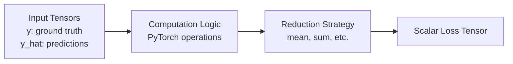
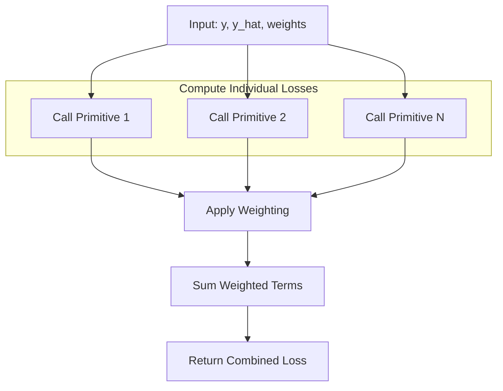
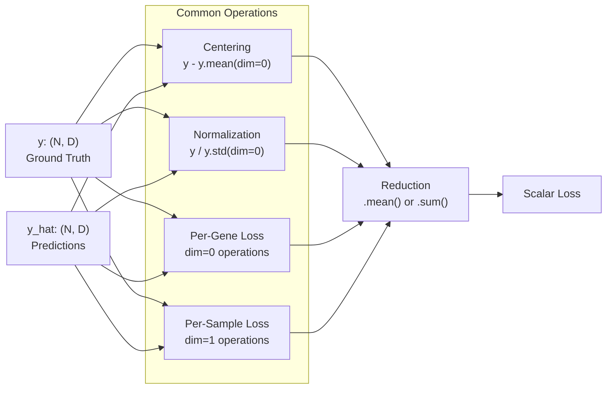
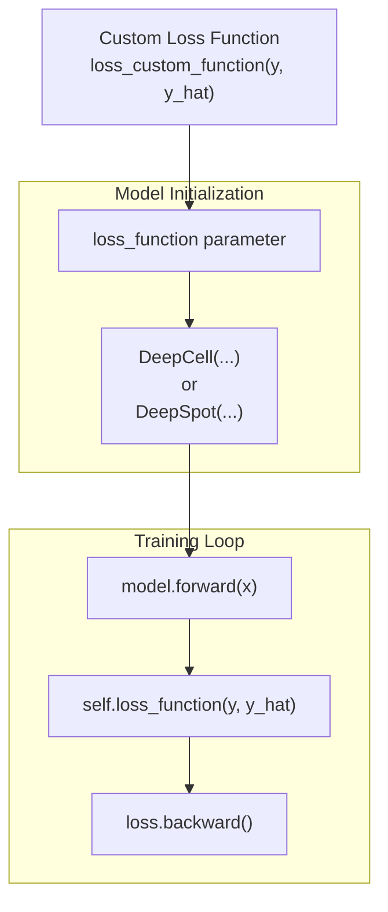
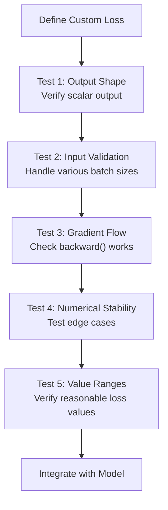

# Custom Loss Functions

<details>
<summary>Relevant source files</summary>

The following files were used as context for generating this wiki page:

- [.codeboarding/Loss Functions.md](.codeboarding/Loss Functions.md)
- [deepspot/cell/loss.py](deepspot/cell/loss.py)

</details>


## Purpose and Scope

This document explains how to create and use custom loss functions for specific prediction tasks in DeepSpot. While the built-in loss functions (documented in [Loss Functions](#5.4)) cover common use cases, custom loss functions enable optimization for domain-specific objectives such as emphasizing rare genes, incorporating biological constraints, or combining multiple evaluation metrics.

This guide covers the architecture pattern for loss functions, how to implement custom primitives and combinations, and how to integrate them into training workflows for both DeepCell and DeepSpot models.

---

## Loss Function Architecture

DeepSpot organizes loss functions into two categories: **primitive loss functions** (atomic building blocks) and **combined loss functions** (weighted compositions of primitives). This separation exists for both cell-level and spot-level prediction tasks, with implementations in separate modules.

### Architecture Overview

```mermaid
graph TB
    subgraph "Cell-Level Loss Functions"
        CellPrimitives["Primitive Loss Functions<br/>deepspot.cell.loss"]
        CellCombiners["Combined Loss Functions<br/>deepspot.cell.loss"]
    end
    
    subgraph "Spot-Level Loss Functions"
        SpotPrimitives["Primitive Loss Functions<br/>deepspot.spot.loss"]
        SpotCombiners["Combined Loss Functions<br/>deepspot.spot.loss"]
    end
    
    subgraph "Primitive Building Blocks"
        Cosine["loss_cosine_function"]
        Pearson["loss_pearson_function"]
        MSE["loss_mse_function"]
        L1["loss_l1_function"]
        Huber["loss_huber_function"]
        Poisson["loss_poisson_function"]
    end
    
    subgraph "Combined Losses"
        MSEPearson["loss_mse_pearson_function"]
        MSECosine["loss_mse_cosine_function"]
        L1Cosine["loss_l1_cosine_function"]
        HuberCosine["loss_huber_cosine_function"]
    end
    
    subgraph "Model Training"
        DeepCell["DeepCell.training_step"]
        DeepSpot["DeepSpot.training_step"]
    end
    
    CellPrimitives --> Cosine
    CellPrimitives --> Pearson
    CellPrimitives --> MSE
    CellPrimitives --> L1
    CellPrimitives --> Huber
    CellPrimitives --> Poisson
    
    SpotPrimitives --> Cosine
    SpotPrimitives --> Pearson
    SpotPrimitives --> MSE
    SpotPrimitives --> Poisson
    
    CellCombiners --> MSEPearson
    CellCombiners --> MSECosine
    CellCombiners --> L1Cosine
    CellCombiners --> HuberCosine
    
    SpotCombiners --> MSEPearson
    SpotCombiners --> MSECosine
    
    MSEPearson -.->|"uses"| Pearson
    MSEPearson -.->|"uses"| MSE
    MSECosine -.->|"uses"| Cosine
    MSECosine -.->|"uses"| MSE
    L1Cosine -.->|"uses"| Cosine
    L1Cosine -.->|"uses"| L1
    HuberCosine -.->|"uses"| Cosine
    HuberCosine -.->|"uses"| Huber
    
    CellCombiners --> DeepCell
    CellPrimitives --> DeepCell
    SpotCombiners --> DeepSpot
    SpotPrimitives --> DeepSpot
```



**Sources:** [.codeboarding/Loss Functions.md:1-66](), [deepspot/cell/loss.py:1-99]()

### Primitive vs Combined Loss Functions

| Category | Purpose | Examples | Implementation Pattern |
|----------|---------|----------|----------------------|
| **Primitive** | Single metric computation | `loss_mse_function`, `loss_pearson_function` | Direct computation from `y` and `y_hat` |
| **Combined** | Weighted composition of metrics | `loss_mse_pearson_function`, `loss_l1_cosine_function` | Call primitives and apply weights |

All loss functions follow the signature: `loss_function(y, y_hat, **kwargs) -> torch.Tensor`, where `y` is ground truth and `y_hat` is model prediction.

**Sources:** [deepspot/cell/loss.py:1-99](), [.codeboarding/Loss Functions.md:12-62]()

---

## Creating Custom Primitive Loss Functions

Primitive loss functions compute a single metric between predictions and ground truth. They serve as reusable building blocks for more complex loss combinations.

### Implementation Pattern



**Sources:** [deepspot/cell/loss.py:4-70]()

### Example: Custom Weighted MSE

To create a custom loss that weights genes differently:

```python
def loss_weighted_mse_function(y, y_hat, gene_weights=None):
    """
    Compute weighted MSE loss where different genes have different importance.
    
    Args:
        y (torch.Tensor): Ground truth of shape (N, D)
        y_hat (torch.Tensor): Predictions of shape (N, D)
        gene_weights (torch.Tensor): Optional weights of shape (D,)
    
    Returns:
        torch.Tensor: Scalar loss value
    """
    squared_errors = (y - y_hat) ** 2
    
    if gene_weights is not None:
        squared_errors = squared_errors * gene_weights.unsqueeze(0)
    
    return squared_errors.mean()
```

This pattern follows the same structure as [deepspot/cell/loss.py:40-42](), adding optional per-gene weighting.

### Example: Custom Correlation-Based Loss

To create a loss that emphasizes preserving gene-gene correlations:

```python
def loss_correlation_structure_function(y, y_hat):
    """
    Compute loss based on preserving correlation structure between genes.
    
    Args:
        y (torch.Tensor): Ground truth of shape (N, D)
        y_hat (torch.Tensor): Predictions of shape (N, D)
    
    Returns:
        torch.Tensor: Scalar loss value
    """
    # Compute correlation matrices
    y_centered = y - y.mean(dim=0)
    y_hat_centered = y_hat - y_hat.mean(dim=0)
    
    corr_true = torch.mm(y_centered.T, y_centered) / (y.shape[0] - 1)
    corr_pred = torch.mm(y_hat_centered.T, y_hat_centered) / (y.shape[0] - 1)
    
    # MSE between correlation matrices
    return torch.nn.functional.mse_loss(corr_true, corr_pred)
```

This approach is inspired by the Pearson correlation logic in [deepspot/cell/loss.py:9-37]() but operates on correlation matrices.

**Sources:** [deepspot/cell/loss.py:4-70]()

---

## Creating Custom Combined Loss Functions

Combined loss functions compose multiple primitive losses with configurable weights, enabling multi-objective optimization.

### Implementation Pattern



**Sources:** [deepspot/cell/loss.py:73-98]()

### Example: MSE + Pearson Combination

The built-in `loss_mse_pearson_function` demonstrates the pattern:

[deepspot/cell/loss.py:73-77]()

To create a custom variant with different weighting:

```python
def loss_mse_pearson_custom_function(y, y_hat, mse_weight=0.5, pearson_weight=0.5):
    """
    Custom MSE + Pearson loss with configurable weights.
    
    Args:
        y: Ground truth
        y_hat: Predictions
        mse_weight: Weight for MSE term (default 0.5)
        pearson_weight: Weight for Pearson term (default 0.5)
    """
    loss_pearson = loss_pearson_function(y, y_hat)
    loss_mse = loss_mse_function(y, y_hat)
    loss = pearson_weight * loss_pearson + mse_weight * loss_mse
    return loss
```

### Example: Three-Way Combination

To create a loss combining MSE, Pearson correlation, and L1 regularization:

```python
def loss_mse_pearson_l1_function(y, y_hat, mse_w=0.4, pearson_w=0.4, l1_w=0.2):
    """
    Combine MSE, Pearson, and L1 losses with configurable weights.
    """
    loss_mse = loss_mse_function(y, y_hat)
    loss_pearson = loss_pearson_function(y, y_hat)
    loss_l1 = loss_l1_function(y, y_hat)
    
    loss = mse_w * loss_mse + pearson_w * loss_pearson + l1_w * loss_l1
    return loss
```

This follows the pattern established in [deepspot/cell/loss.py:80-98]() but extends to three components.

**Sources:** [deepspot/cell/loss.py:73-98]()

---

## Function Signature and Tensor Shapes

All loss functions must conform to specific input/output requirements for compatibility with model training.

### Required Signature

| Parameter | Type | Shape | Description |
|-----------|------|-------|-------------|
| `y` | `torch.Tensor` | `(N, D)` | Ground truth gene expression values |
| `y_hat` | `torch.Tensor` | `(N, D)` | Model predictions |
| `**kwargs` | various | - | Optional parameters (weights, hyperparameters) |
| **Returns** | `torch.Tensor` | scalar | Loss value for backpropagation |

Where:
- `N` = batch size (number of spots/cells)
- `D` = number of genes being predicted

### Tensor Operations



The Pearson loss implementation [deepspot/cell/loss.py:9-37]() demonstrates centering and per-gene operations, while cosine loss [deepspot/cell/loss.py:4-6]() shows per-sample computation.

**Sources:** [deepspot/cell/loss.py:9-37](), [deepspot/cell/loss.py:4-6]()

---

## Using Custom Loss Functions in Training

Custom loss functions integrate into the training workflow by specifying them when initializing DeepCell or DeepSpot models.

### Integration with Model Classes



**Sources:** [deepspot/cell/loss.py:1-99]()

### Example: Using Custom Loss with DeepCell

```python
from deepspot.cell import DeepCell

# Define custom loss
def my_custom_loss(y, y_hat):
    # Implementation here
    return loss_value

# Initialize model with custom loss
model = DeepCell(
    feature_dim=1024,
    target_dim=500,
    loss_function=my_custom_loss,  # Pass function reference
    learning_rate=1e-4
)

# Training proceeds normally
trainer.fit(model, dataloader)
```

The model's `training_step` method will automatically call your custom loss function when computing gradients.

### Example: Using Custom Loss with DeepSpot

```python
from deepspot.spot import DeepSpot

# Define custom combined loss
def loss_custom_combination(y, y_hat, alpha=0.7):
    from deepspot.spot.loss import loss_mse_function, loss_pearson_function
    return alpha * loss_mse_function(y, y_hat) + (1-alpha) * loss_pearson_function(y, y_hat)

# Initialize model
model = DeepSpot(
    feature_dim=1536,
    target_dim=300,
    loss_function=lambda y, y_hat: loss_custom_combination(y, y_hat, alpha=0.7),
    learning_rate=5e-4
)
```

Note the use of `lambda` to bind hyperparameters when passing the loss function.

**Sources:** [deepspot/cell/loss.py:1-99]()

---

## Creating Cell vs Spot Loss Functions

While the implementation patterns are identical, cell-level and spot-level loss functions reside in separate modules due to different characteristics of the prediction tasks.

### Key Differences

| Aspect | Cell Loss Functions | Spot Loss Functions |
|--------|-------------------|-------------------|
| Module | `deepspot.cell.loss` | `deepspot.spot.loss` |
| Typical Batch Size | Larger (100-1000 cells) | Smaller (10-100 spots) |
| Target Resolution | Single-cell (~20μm) | Multi-cell spot (~55μm) |
| Available Primitives | MSE, Pearson, Cosine, L1, Huber, Poisson | MSE, Pearson, Cosine, Poisson |
| Gene Count | ~500 genes | ~300-800 genes |

### Implementation Location

When creating custom loss functions:

1. **For cell-level tasks**: Add to `deepspot/cell/loss.py` or define in training script
2. **For spot-level tasks**: Add to `deepspot/spot/loss.py` or define in training script

The architectural pattern remains the same, but implementations may differ based on scale and resolution characteristics.

**Sources:** [deepspot/cell/loss.py:1-99](), [.codeboarding/Loss Functions.md:1-66]()

---

## Best Practices

### 1. Numerical Stability

Ensure loss functions handle edge cases to prevent NaN or infinite gradients:

```python
def loss_safe_pearson_function(y, y_hat, eps=1e-8):
    """Pearson loss with epsilon for numerical stability."""
    y_pred_centered = y_hat - torch.mean(y_hat, dim=0)
    y_true_centered = y - torch.mean(y, dim=0)
    
    covariance = torch.sum(y_pred_centered * y_true_centered, dim=0)
    
    # Add epsilon to prevent division by zero
    std_pred = torch.sqrt(torch.sum(y_pred_centered ** 2, dim=0) + eps)
    std_true = torch.sqrt(torch.sum(y_true_centered ** 2, dim=0) + eps)
    
    pearson_corr = covariance / (std_pred * std_true)
    return torch.mean(1 - pearson_corr)
```

This pattern is demonstrated in [deepspot/cell/loss.py:9-37]() with the `eps` parameter.

### 2. Loss Component Balancing

When combining multiple loss functions, ensure components are on similar scales:

| Loss Type | Typical Range | Scaling Recommendation |
|-----------|--------------|----------------------|
| MSE | 0.1 - 10.0 | Use as-is or reduce weight |
| Pearson | 0.0 - 2.0 | Use as-is |
| Cosine | 0.0 - 2.0 | Use as-is |
| L1 | 0.1 - 5.0 | Use as-is or reduce weight |
| Huber | 0.1 - 5.0 | Use as-is |

Monitor individual loss components during training to identify imbalances.

### 3. Gradient Flow

Verify that custom losses provide meaningful gradients:

```python
# Test gradient flow
y = torch.randn(10, 500, requires_grad=True)
y_hat = torch.randn(10, 500, requires_grad=True)

loss = loss_custom_function(y, y_hat)
loss.backward()

# Check for NaN or zero gradients
assert not torch.isnan(y_hat.grad).any(), "NaN gradients detected"
assert (y_hat.grad.abs() > 1e-10).any(), "Zero gradients detected"
```

### 4. Documentation Standards

Document custom loss functions with:
- Mathematical formulation
- Input tensor shapes and types
- Hyperparameter effects
- Typical value ranges
- Gradient behavior

Example from [deepspot/cell/loss.py:51-63]():

```python
def loss_huber_function(y, y_hat, delta=1.0):
    """Calculates the Huber Loss between y and y_hat.

    Args:
        y (torch.Tensor): Ground truth values.
        y_hat (torch.Tensor): Predicted values.
        delta (float): The threshold at which to change between L1 and L2 loss.

    Returns:
        torch.Tensor: The calculated Huber loss.
    """
    huber_loss = torch.nn.functional.huber_loss(y, y_hat, delta=delta)
    return huber_loss
```

**Sources:** [deepspot/cell/loss.py:9-37](), [deepspot/cell/loss.py:51-63]()

---

## Common Patterns and Templates

### Template: Weighted Loss Function

```python
def loss_weighted_template(y, y_hat, weights):
    """
    Template for creating weighted loss functions.
    
    Args:
        y: Ground truth (N, D)
        y_hat: Predictions (N, D)
        weights: Per-gene weights (D,) or per-sample weights (N,)
    """
    # Compute base loss (per-element)
    element_loss = (y - y_hat) ** 2  # or any other metric
    
    # Apply weights
    if weights.dim() == 1 and weights.shape[0] == y.shape[1]:
        # Per-gene weighting
        weighted_loss = element_loss * weights.unsqueeze(0)
    elif weights.dim() == 1 and weights.shape[0] == y.shape[0]:
        # Per-sample weighting
        weighted_loss = element_loss * weights.unsqueeze(1)
    
    return weighted_loss.mean()
```

### Template: Adaptive Loss Function

```python
def loss_adaptive_template(y, y_hat, iteration, max_iterations):
    """
    Template for losses that change behavior during training.
    
    Args:
        y: Ground truth
        y_hat: Predictions
        iteration: Current training iteration
        max_iterations: Total training iterations
    """
    # Early training: emphasize correlation
    # Late training: emphasize accuracy
    alpha = iteration / max_iterations
    
    loss_correlation = loss_pearson_function(y, y_hat)
    loss_accuracy = loss_mse_function(y, y_hat)
    
    return (1 - alpha) * loss_correlation + alpha * loss_accuracy
```

### Template: Per-Gene Type Loss

```python
def loss_per_gene_type_template(y, y_hat, gene_types):
    """
    Template for applying different losses to different gene categories.
    
    Args:
        y: Ground truth
        y_hat: Predictions
        gene_types: List of gene type labels (e.g., ['marker', 'housekeeping', ...])
    """
    total_loss = 0.0
    gene_type_weights = {'marker': 2.0, 'housekeeping': 0.5, 'other': 1.0}
    
    for gene_type, weight in gene_type_weights.items():
        mask = [gt == gene_type for gt in gene_types]
        if any(mask):
            y_subset = y[:, mask]
            y_hat_subset = y_hat[:, mask]
            loss_subset = loss_mse_function(y_subset, y_hat_subset)
            total_loss += weight * loss_subset
    
    return total_loss
```

**Sources:** [deepspot/cell/loss.py:1-99]()

---

## Debugging Custom Loss Functions

### Verification Checklist



### Example Debugging Code

```python
def test_custom_loss():
    """Test suite for custom loss function."""
    import torch
    
    # Test 1: Output shape
    y = torch.randn(32, 500)
    y_hat = torch.randn(32, 500)
    loss = loss_custom_function(y, y_hat)
    assert loss.dim() == 0, "Loss must be scalar"
    
    # Test 2: Different batch sizes
    for batch_size in [1, 16, 64, 128]:
        y = torch.randn(batch_size, 500)
        y_hat = torch.randn(batch_size, 500)
        loss = loss_custom_function(y, y_hat)
        assert not torch.isnan(loss), f"NaN loss at batch_size={batch_size}"
    
    # Test 3: Gradient flow
    y_hat = torch.randn(32, 500, requires_grad=True)
    loss = loss_custom_function(y, y_hat)
    loss.backward()
    assert y_hat.grad is not None, "No gradients computed"
    
    # Test 4: Identical inputs (should give zero or minimal loss)
    y = torch.randn(32, 500)
    loss = loss_custom_function(y, y.clone())
    print(f"Loss for identical inputs: {loss.item()}")
    
    # Test 5: Value range
    y = torch.randn(100, 500)
    y_hat = torch.randn(100, 500)
    losses = []
    for _ in range(10):
        y_hat = torch.randn(100, 500)
        losses.append(loss_custom_function(y, y_hat).item())
    print(f"Loss range: {min(losses):.4f} - {max(losses):.4f}")
    
    print("All tests passed!")

# Run tests
test_custom_loss()
```

**Sources:** [deepspot/cell/loss.py:9-37]()

---

## Summary

Custom loss functions in DeepSpot follow a consistent architectural pattern:

1. **Primitive functions** compute individual metrics between predictions and ground truth
2. **Combined functions** compose primitives with configurable weights
3. Both cell and spot loss functions use identical patterns but reside in separate modules
4. Integration requires passing the loss function to model initialization
5. Best practices emphasize numerical stability, gradient flow, and proper documentation

For information about the built-in loss functions available in DeepSpot, see [Loss Functions](#5.4). For general model training workflows, see [Visium Training](#7.1.2) or [Xenium Training](#7.2.2).

**Sources:** [deepspot/cell/loss.py:1-99](), [.codeboarding/Loss Functions.md:1-66]()

---