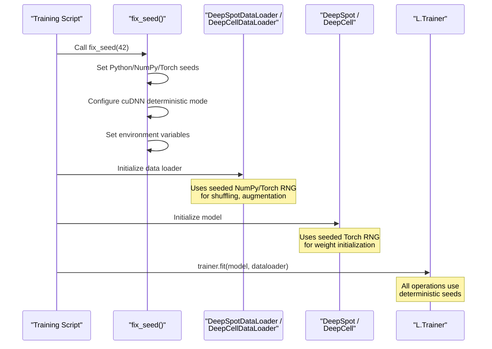
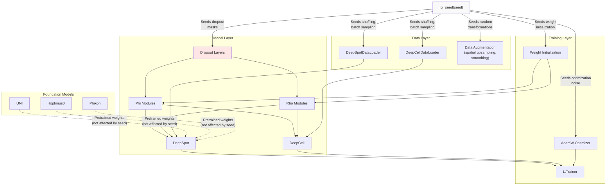
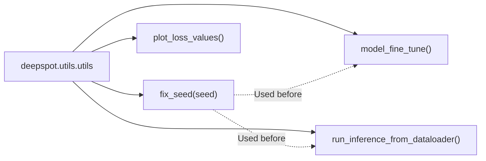

# Reproducibility & Seeding

<details>
<summary>Relevant source files</summary>

The following files were used as context for generating this wiki page:

- [.codeboarding/Core Utilities.md](.codeboarding/Core Utilities.md)
- [deepspot/utils/utils.py](deepspot/utils/utils.py)

</details>


This document explains how to ensure reproducible results when training and running inference with DeepSpot and DeepCell models. It covers the `fix_seed` utility function, deterministic configurations, and best practices for achieving consistent outputs across multiple runs.

For information about model training workflows, see [Visium Training](#7.1.2) and [Xenium Training](#7.2.2). For general performance optimization strategies, see [Performance Optimization](#10.4).

---

## Purpose and Scope

Reproducibility in deep learning requires careful control of random number generation across multiple libraries and hardware backends. DeepSpot provides the `fix_seed` function to configure deterministic behavior across Python, NumPy, PyTorch (CPU and CUDA), and cuDNN. This page documents:

- The `fix_seed` function and its implementation
- What random sources are controlled and how
- Environment variable configurations for deterministic operations
- Usage patterns in training and inference workflows
- Known limitations of deterministic mode

---

## The fix_seed Function

The `fix_seed` function is the primary entry point for configuring reproducible random number generation across the DeepSpot system. It sets seeds for all major randomness sources used during model training and inference.

### Function Signature

```python
fix_seed(seed: int)
```

**Parameters:**
- `seed`: Integer seed value to use across all random number generators

**Location:** [deepspot/utils/utils.py:89-100]()

### Core Seeding Operations

The function performs seeding operations in a specific sequence to ensure all random sources are properly initialized:

```mermaid
graph TB
    FixSeed["fix_seed(seed)"]
    
    subgraph "Python Environment"
        PythonHash["PYTHONHASHSEED = str(seed)"]
        PythonRandom["random.seed(seed)"]
    end
    
    subgraph "NumPy"
        NumpyRandom["np.random.seed(seed)"]
    end
    
    subgraph "PyTorch CPU"
        TorchManual["torch.manual_seed(seed)"]
    end
    
    subgraph "PyTorch CUDA"
        CUDAManual["torch.cuda.manual_seed(seed)"]
        CUDAAll["torch.cuda.manual_seed_all(seed)"]
    end
    
    subgraph "cuDNN Backend"
        CUDNNDet["cudnn.deterministic = True"]
        CUDNNBench["cudnn.benchmark = False"]
    end
    
    subgraph "CUDA Operations"
        CUBLASConfig["CUBLAS_WORKSPACE_CONFIG = ':4096:8'"]
    end
    
    FixSeed --> PythonHash
    FixSeed --> PythonRandom
    FixSeed --> NumpyRandom
    FixSeed --> TorchManual
    FixSeed --> CUDAManual
    FixSeed --> CUDAAll
    FixSeed --> CUDNNDet
    FixSeed --> CUDNNBench
    FixSeed --> CUBLASConfig
```



**Diagram: Seeding Operations Performed by fix_seed**

Sources: [deepspot/utils/utils.py:89-100]()

---

## Randomness Sources Controlled

The `fix_seed` function controls randomness across multiple layers of the software stack. Understanding what each seeding operation affects is critical for debugging reproducibility issues.

### Python Standard Library

| Operation | Code | Purpose |
|-----------|------|---------|
| Hash randomization | `os.environ['PYTHONHASHSEED'] = str(seed)` | Ensures deterministic hash functions for dictionaries and sets |
| Random module | `random.seed(seed)` | Controls Python's built-in `random` module |

### NumPy

| Operation | Code | Purpose |
|-----------|------|---------|
| NumPy RNG | `np.random.seed(seed)` | Seeds NumPy's random number generator for array operations |

### PyTorch

| Operation | Code | Purpose |
|-----------|------|---------|
| CPU operations | `torch.manual_seed(seed)` | Seeds PyTorch's CPU random number generator |
| Single GPU | `torch.cuda.manual_seed(seed)` | Seeds the current CUDA device |
| All GPUs | `torch.cuda.manual_seed_all(seed)` | Seeds all available CUDA devices |

### cuDNN Backend

| Operation | Code | Purpose |
|-----------|------|---------|
| Deterministic mode | `cudnn.deterministic = True` | Forces cuDNN to use deterministic algorithms (may reduce performance) |
| Benchmark disable | `cudnn.benchmark = False` | Disables cuDNN's auto-tuning, which can introduce non-determinism |

### CUDA Linear Algebra

| Operation | Code | Purpose |
|-----------|------|---------|
| Workspace config | `CUBLAS_WORKSPACE_CONFIG = ':4096:8'` | Configures CUBLAS to use deterministic algorithms with specific workspace size |

Sources: [deepspot/utils/utils.py:89-100]()

---

## Integration with Model Training

The `fix_seed` function should be called early in training scripts, before any model initialization or data loading occurs. This ensures all subsequent operations use the configured seed.



**Diagram: Seeding Flow in Training Pipeline**

Sources: [deepspot/utils/utils.py:89-100](), [deepspot/cell/model.py:63-281](), [deepspot/spot/model.py:58-217]()

---

## Usage Examples

### Basic Training Script

```python
from deepspot.utils.utils import fix_seed
from deepspot.spot.model import DeepSpot
from deepspot.spot.dataloader import DeepSpotDataLoader
import lightning as L

# Set seed before any other operations
fix_seed(42)

# Initialize data loader (will use seeded RNG for shuffling)
dataloader = DeepSpotDataLoader(
    adata=adata,
    batch_size=32,
    shuffle=True,  # Shuffling will be deterministic
    # ... other parameters
)

# Initialize model (weight initialization will be deterministic)
model = DeepSpot(
    morphology_features_size=1024,
    hidden_layer_size=512,
    n_genes=300,
    # ... other parameters
)

# Train model
trainer = L.Trainer(
    max_epochs=100,
    deterministic=True,  # Enable Lightning's deterministic mode
    # ... other parameters
)

trainer.fit(model, dataloader)
```

### Inference Script

```python
from deepspot.utils.utils import fix_seed

# Set seed before loading model for consistent inference
fix_seed(42)

# Load pretrained model
model = DeepSpot.load_from_checkpoint("path/to/checkpoint.ckpt")

# Run inference (dropout layers will use seeded RNG if enabled)
predictions = predict_spot_spatial_transcriptomics_from_image_path(
    image_path=image_path,
    spot_coords=spot_coords,
    model=model,
    # ... other parameters
)
```

### Fine-tuning with Reproducibility

```python
from deepspot.utils.utils import fix_seed, model_fine_tune

# Ensure reproducible fine-tuning
fix_seed(42)

# Fine-tune pretrained model
model_fine_tune(
    model=pretrained_model,
    dataloader=finetuning_dataloader,
    rho=True,
    gene_expression=True,
    max_epochs=10
)
```

Sources: [deepspot/utils/utils.py:89-100](), [deepspot/utils/utils.py:20-48]()

---

## Deterministic Configuration Details

### cuDNN Deterministic Mode

Setting `cudnn.deterministic = True` forces cuDNN to use deterministic algorithms instead of potentially faster non-deterministic ones. This affects:

- Convolutional layers
- Pooling operations
- Batch normalization
- Recurrent layers

**Performance Impact:** Deterministic mode can reduce training speed by 10-30% depending on model architecture and hardware.

**Location:** [deepspot/utils/utils.py:96]()

### cuDNN Benchmark Disable

Setting `cudnn.benchmark = False` disables cuDNN's auto-tuning, which selects the fastest algorithm for each convolution configuration. Auto-tuning can introduce non-determinism when multiple algorithms have similar performance.

**When to keep benchmark enabled:**
- When reproducibility is not critical
- When running many training runs and averaging results
- When performance is the primary concern

**Location:** [deepspot/utils/utils.py:97]()

### CUBLAS Workspace Configuration

The environment variable `CUBLAS_WORKSPACE_CONFIG = ':4096:8'` configures CUBLAS to allocate deterministic workspace memory. This affects:

- Matrix multiplication operations
- Linear layers
- Attention mechanisms in transformers

The format `:4096:8` specifies workspace sizes (in bytes) for different algorithms. PyTorch requires this configuration when using deterministic mode for certain CUDA operations.

**Location:** [deepspot/utils/utils.py:100]()

Sources: [deepspot/utils/utils.py:89-100]()

---

## Component Interaction Map

This diagram shows how `fix_seed` affects different components in the DeepSpot system:



**Diagram: fix_seed Impact on DeepSpot Components**

Sources: [deepspot/utils/utils.py:89-100](), [deepspot/spot/dataloader.py](), [deepspot/cell/dataloader.py](), [deepspot/spot/model.py:31-55](), [deepspot/cell/model.py:36-60]()

---

## Limitations and Caveats

### Known Sources of Non-Determinism

Despite using `fix_seed`, some operations may still introduce non-determinism:

| Source | Description | Mitigation |
|--------|-------------|------------|
| Floating-point operations | GPU floating-point operations may not be bit-exact across runs due to hardware parallelism | Use `torch.use_deterministic_algorithms(True)` for stricter control |
| Multi-threading | Python's threading and multiprocessing can introduce race conditions | Set `num_workers=0` in DataLoader |
| CUDA atomics | Atomic operations on GPU are inherently non-deterministic | Already mitigated by `cudnn.deterministic = True` |
| Hash randomization | Python dictionary ordering can vary | Already mitigated by `PYTHONHASHSEED` |

### When Reproducibility May Fail

1. **Different hardware:** Results may vary between different GPU architectures (e.g., V100 vs A100) even with the same seed
2. **Different CUDA versions:** Different CUDA toolkit versions may use different algorithms
3. **Different PyTorch versions:** Algorithm implementations change between PyTorch versions
4. **Different operating systems:** Low-level system libraries may behave differently

### Performance Trade-offs

Using deterministic mode introduces performance penalties:

- **Training speed:** 10-30% slower due to deterministic algorithms
- **Memory usage:** CUBLAS workspace configuration may increase memory usage
- **GPU utilization:** Deterministic operations may not fully utilize GPU parallel capabilities

Sources: [deepspot/utils/utils.py:89-100]()

---

## Best Practices

### 1. Call fix_seed Early

Always call `fix_seed` at the beginning of your script, before importing models or data loaders:

```python
# Good
from deepspot.utils.utils import fix_seed
fix_seed(42)
from deepspot.spot.model import DeepSpot

# Bad - model imports may trigger random operations
from deepspot.spot.model import DeepSpot
from deepspot.utils.utils import fix_seed
fix_seed(42)
```

### 2. Document Seed Values

Keep track of seed values used in experiments for reproducibility:

```python
# Document seed in experiment logs
SEED = 42
print(f"Using seed: {SEED}")
fix_seed(SEED)
```

### 3. Use Lightning's Deterministic Flag

When training with Lightning, enable its deterministic mode:

```python
trainer = L.Trainer(
    max_epochs=100,
    deterministic=True,  # Enables additional deterministic checks
    # ... other parameters
)
```

### 4. Record Full Environment

For complete reproducibility, record:
- Seed value
- PyTorch version
- CUDA version
- cuDNN version
- GPU model
- Operating system
- Python version

### 5. Test Reproducibility

Verify that your training is reproducible by running the same script twice:

```python
fix_seed(42)
model1 = train_model()
loss1 = model1.training_losses

fix_seed(42)
model2 = train_model()
loss2 = model2.training_losses

assert np.allclose(loss1, loss2), "Training is not reproducible!"
```

### 6. Disable Unnecessary Randomness

For inference, consider disabling dropout and other stochastic layers:

```python
model.eval()  # Disables dropout
with torch.no_grad():  # Disables gradient computation
    predictions = model(input)
```

Sources: [deepspot/utils/utils.py:89-100](), [deepspot/utils/utils.py:51-69]()

---

## Related Utilities

The `fix_seed` function is part of the broader utilities module that includes other training helpers:



**Diagram: Utilities Module Organization**

- **`fix_seed`**: Configures reproducible random number generation (lines 89-100)
- **`model_fine_tune`**: Fine-tunes pretrained models with frozen layers (lines 20-48)
- **`run_inference_from_dataloader`**: Runs batch inference from a DataLoader (lines 51-69)
- **`plot_loss_values`**: Visualizes training and validation losses (lines 72-86)

Sources: [deepspot/utils/utils.py:1-101]()

---

## Summary Table

| Aspect | Details |
|--------|---------|
| **Function** | `fix_seed(seed)` |
| **Location** | [deepspot/utils/utils.py:89-100]() |
| **Purpose** | Configure deterministic random number generation across Python, NumPy, PyTorch, and CUDA |
| **Libraries seeded** | `random`, `numpy`, `torch`, `torch.cuda`, `cudnn` |
| **Environment variables** | `PYTHONHASHSEED`, `CUBLAS_WORKSPACE_CONFIG` |
| **Performance impact** | 10-30% slower training |
| **Usage timing** | Call before any model/data initialization |
| **Complete reproducibility** | Guaranteed within same hardware/software environment only |

Sources: [deepspot/utils/utils.py:89-100]()

---