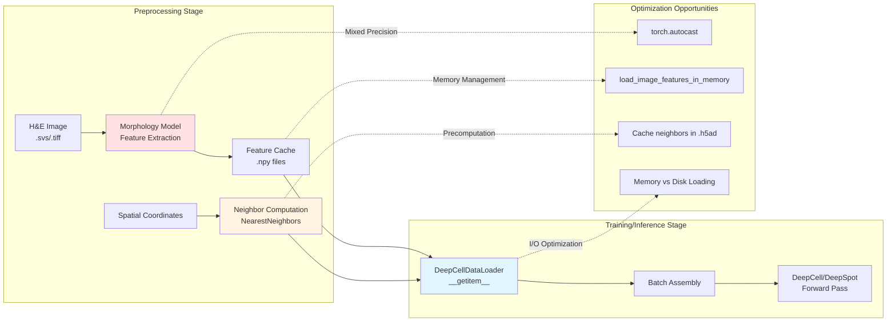
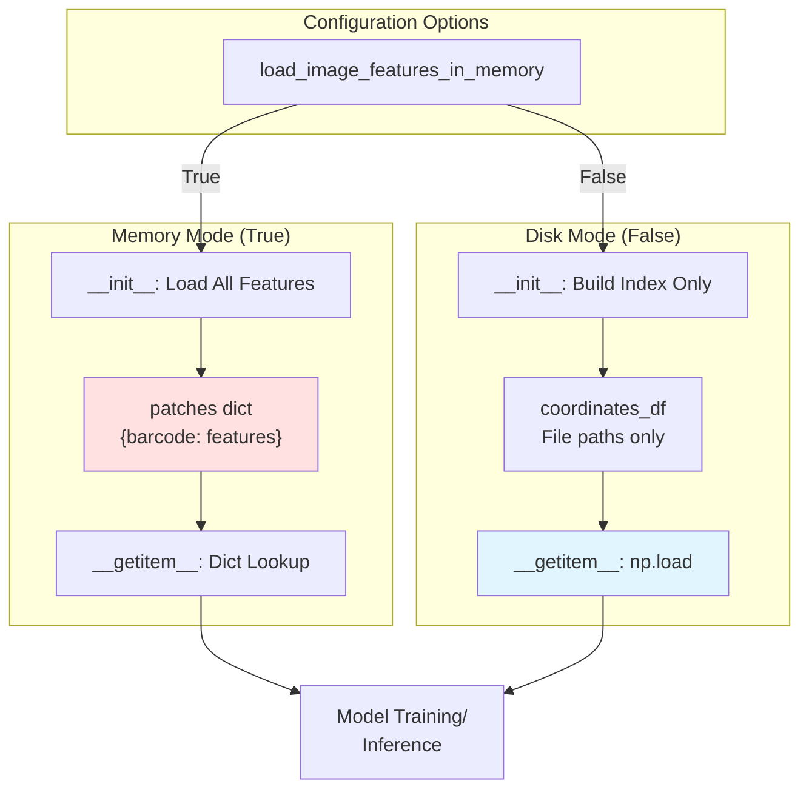
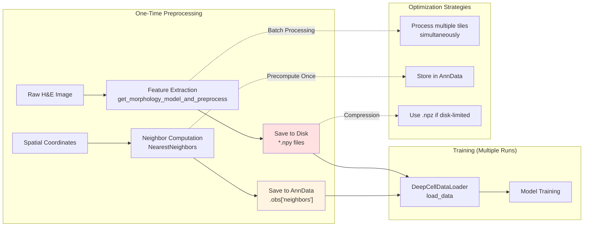
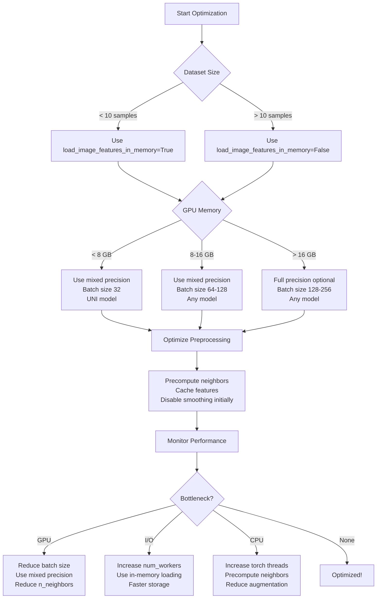

# Performance Optimization

<details>
<summary>Relevant source files</summary>

The following files were used as context for generating this wiki page:

- [deepspot/cell/dataloader.py](deepspot/cell/dataloader.py)
- [deepspot/utils/utils_image.py](deepspot/utils/utils_image.py)

</details>


## Purpose and Scope

This document provides strategies for optimizing training and inference performance in DeepSpot. It covers mixed precision computation, memory management, batching strategies, preprocessing optimization, and hardware considerations. These techniques are critical for handling large-scale spatial transcriptomics datasets and whole-slide images efficiently.

For model configuration details, see [Model Architecture](#5). For data preprocessing workflows, see [Data Management & Preprocessing](#4).

---

## Performance Bottleneck Overview

The DeepSpot system has three primary computational bottlenecks:

| **Bottleneck** | **Location** | **Impact** | **Optimization Strategy** |
|----------------|--------------|------------|---------------------------|
| Image Feature Extraction | Morphology model inference | High GPU memory usage, I/O latency | Mixed precision, batch processing, feature caching |
| Neighbor Computation | Spatial graph construction | CPU-intensive for large datasets | Precomputation, efficient indexing |
| Gene Expression Data Loading | Training data pipeline | I/O bottleneck, memory pressure | In-memory loading, preprocessing |

**Diagram: Performance Bottleneck Flow**



Sources: [deepspot/utils/utils_image.py:241-356](), [deepspot/cell/dataloader.py:22-209]()

---

## Mixed Precision Training and Inference

Mixed precision computation uses `torch.float16` for forward passes while maintaining `torch.float32` for model weights and gradient computations, reducing memory usage by ~50% and increasing throughput on modern GPUs.

### Inference with Mixed Precision

The prediction functions in `utils_image.py` implement mixed precision using `torch.autocast`:

```python
# From predict_spot_spatial_transcriptomics_from_image_path
with torch.autocast(device_type="cuda", dtype=torch.float16):
    with torch.inference_mode():
        # Feature extraction and prediction
        X_spot = morphology_model(X_spot[None, ])
        expr = model_expression(X)
```

**Key Components:**

| **Component** | **Implementation** | **File Location** |
|---------------|-------------------|-------------------|
| Spot Inference | `torch.autocast(device_type="cuda", dtype=torch.float16)` | [utils_image.py:255]() |
| Cell Inference | `torch.autocast(device_type="cuda", dtype=torch.float16)` | [utils_image.py:322]() |
| Inference Mode | `torch.inference_mode()` - disables gradient computation | [utils_image.py:256, 323]() |

### Training with Mixed Precision

For training, use PyTorch Lightning's native mixed precision support by setting the `precision` argument:

```python
# Example training configuration (not in codebase, but recommended)
trainer = pl.Trainer(
    precision="16-mixed",  # or "bf16-mixed" for bfloat16
    # ... other arguments
)
```

**Performance Impact:**

- **Memory Usage**: ~50% reduction in activation memory
- **Throughput**: 1.5-3x faster on V100/A100 GPUs
- **Numerical Stability**: Generally stable for gene expression prediction tasks

Sources: [deepspot/utils/utils_image.py:255-256](), [deepspot/utils/utils_image.py:322-323]()

---

## Memory Management Strategies

DeepSpot provides configurable memory management for image features, trading disk I/O for RAM usage.

**Diagram: Memory Management Architecture**



### In-Memory Feature Loading

When `load_image_features_in_memory=True`, all features are loaded into a dictionary at initialization:

**Implementation in DeepCellDataLoader:**

```python
# Initialization parameter
self.load_image_features_in_memory = load_image_features_in_memory

# Loading features into memory dictionary
if self.load_image_features_in_memory:
    patches = pd.DataFrame(data["X"], index=data["barcode"])
    self.patches = {b:e.values for b,e in patches.iterrows()}

# Fast retrieval during training
def _load_patch(self, sampleID, cell_id):
    if self.load_image_features_in_memory:
        X = self.patches[f"{cell_id}_{sampleID}"]
    else:
        X = np.load(f"{self.image_feature_source}_{self.cell_diameter}/{sampleID}/{cell_id}.npy")
```

### Memory vs Disk Trade-offs

| **Mode** | **Memory Usage** | **I/O Latency** | **Best For** |
|----------|------------------|-----------------|--------------|
| In-Memory (`True`) | High (~1-10 GB per sample) | Zero (dict lookup) | Small datasets, fast training |
| Disk-Based (`False`) | Low (~100 MB) | High (~1-5ms per load) | Large datasets, limited RAM |

**Memory Estimation:**

- **Feature Dimensions**: 768-2048 per spot/cell (model-dependent)
- **Storage per Sample**: ~1024 features × 4 bytes × N spots
- **Example**: 10,000 spots × 1024 dims × 4 bytes ≈ 40 MB per sample

Sources: [deepspot/cell/dataloader.py:37](), [deepspot/cell/dataloader.py:55-68](), [deepspot/cell/dataloader.py:173-178]()

---

## Batching Strategies

Efficient batching is critical for GPU utilization. The system uses PyTorch DataLoader for automatic batching.

### Batch Size Selection

**Recommended Batch Sizes:**

| **Hardware** | **Feature Dimension** | **Context Mode** | **Recommended Batch Size** |
|--------------|----------------------|------------------|----------------------------|
| 8GB GPU | 1024 (UNI) | `cell` | 64-128 |
| 8GB GPU | 1536 (Hoptimus0) | `cell_neighbors` | 32-64 |
| 16GB GPU | 1024 (UNI) | `cell` | 128-256 |
| 16GB GPU | 1536 (Hoptimus0) | `cell_neighbors` | 64-128 |
| 24GB GPU | 2048 (Inception) | `spot_subspot_neighbors` | 32-64 |

### Neighbor Padding Overhead

When using neighbor contexts, the dataloader pads neighbor arrays to the maximum neighbor count:

```python
# Maximum neighbor count computed during initialization
max_n_neighbors = coordinates["neighbors"].apply(lambda x: len(x.split("___"))).max()
self.max_n_neighbors = max_n_neighbors

# Zero-padding to uniform size
X_neighbors = add_zero_padding(X_neighbors, self.max_n_neighbors)
```

**Memory Impact of Padding:**
- With `n_neighbors=45` and `feature_dim=1024`: ~180 KB per sample
- Batch of 64: ~11.5 MB just for neighbor features
- Consider reducing `n_neighbors` if memory is constrained

Sources: [deepspot/cell/dataloader.py:99-100](), [deepspot/cell/dataloader.py:202]()

---

## Preprocessing Optimization

Preprocessing is the most time-consuming stage but only needs to be performed once per dataset.

**Diagram: Preprocessing Pipeline Optimization**



### Feature Extraction Optimization

Feature extraction is GPU-intensive. Optimize by:

1. **Batch Processing**: Extract features for multiple spots/cells simultaneously
2. **Model Selection**: Balance accuracy vs speed (UNI: 1024-dim, Hoptimus0: 1536-dim)
3. **Image Loading**: Use `pyvips` for efficient large image streaming

### Neighbor Precomputation

Neighbor computation happens during dataloader initialization and can be expensive for large datasets:

**Neighbor Computation in DeepCellDataLoader:**

```python
# Performed once per sample during __init__
neigh = NearestNeighbors(n_neighbors=self.n_neighbors)
neigh.fit(coordinates[["x_pixel", "y_pixel"]].values)
neighbors = neigh.kneighbors(
    coordinates[["x_pixel", "y_pixel"]].values, return_distance=True)[1]
```

**Optimization Strategy:**
- Precompute neighbors during preprocessing and store in AnnData `.obs['neighbors']`
- Use `radius_neighbors` instead of `kneighbors` for Xenium (variable density)
- Consider spatial indexing structures (KD-tree) for very large datasets

Sources: [deepspot/cell/dataloader.py:86-100](), [deepspot/utils/utils_image.py:304-316]()

---

## Spatial Processing Optimization

Spatial upsampling and smoothing add computational overhead but improve prediction quality.

### Upsampling and Smoothing

**Configuration Parameters:**

| **Parameter** | **Default** | **Effect** | **Performance Impact** |
|---------------|-------------|------------|------------------------|
| `resolution` | 0 (disabled) | Spatial resolution multiplier | Linear increase in data size |
| `smooth_n` | 0 (disabled) | Number of neighbors for smoothing | Increases preprocessing time |

**Implementation:**

```python
if self.smooth_n > 0 or self.resolution > 0:
    res = self.resolution if self.resolution > 0 else 1
    resampled_idx, transcriptomics_smooth = spatial_upsample_and_smooth(
        transcriptomics.values,
        self.coordinates_df,
        transcriptomics.index,
        res,
        self.smooth_n,
        self.augmentation)
```

**Recommendations:**
- Use `smooth_n=0` for initial experiments (faster training)
- Enable smoothing only after hyperparameter tuning
- Avoid `resolution > 1` unless specifically needed for super-resolution tasks

Sources: [deepspot/cell/dataloader.py:109-130]()

---

## Hardware Considerations

### GPU Requirements

**Minimum Requirements:**

| **Task** | **GPU Memory** | **CUDA Compute** | **Notes** |
|----------|----------------|------------------|-----------|
| Training (UNI) | 8 GB | 7.0+ | Batch size 32-64 |
| Training (Hoptimus0) | 12 GB | 7.0+ | Larger feature dimension |
| Inference | 4 GB | 6.0+ | Mixed precision reduces memory |
| TCGA Processing | 16 GB+ | 7.0+ | Large-scale predictions |

### CPU Optimization

Some operations remain CPU-bound:

- **Image Loading**: `pyvips` uses efficient streaming but still CPU-intensive
- **Neighbor Search**: `sklearn.neighbors.NearestNeighbors` is CPU-only
- **Data Augmentation**: Spatial resampling happens on CPU

**Multi-threading Configuration:**

```python
# Set for DataLoader
DataLoader(dataset, num_workers=4, pin_memory=True)

# Set PyTorch threads
torch.set_num_threads(8)
```

Sources: [deepspot/utils/utils_image.py:180-188](), [deepspot/cell/dataloader.py:86-100]()

---

## Performance Monitoring

### Key Metrics to Track

| **Metric** | **Tool** | **Target** |
|------------|----------|-----------|
| GPU Utilization | `nvidia-smi` | >80% during training |
| GPU Memory Usage | `torch.cuda.memory_allocated()` | <90% of available |
| Data Loading Time | PyTorch profiler | <10% of iteration time |
| Feature Extraction FPS | Custom timer | >100 spots/sec |

### Profiling Example

```python
# Profile inference performance
import time
start = time.time()
counts = predict_spot_spatial_transcriptomics_from_image_path(...)
elapsed = time.time() - start
print(f"Processed {len(counts)} spots in {elapsed:.2f}s")
print(f"Throughput: {len(counts)/elapsed:.2f} spots/sec")
```

---

## Best Practices Summary

**Diagram: Optimization Decision Tree**



**Priority Order:**
1. ✅ Enable mixed precision (2-3x speedup)
2. ✅ Preprocess and cache features once
3. ✅ Choose appropriate batch size for GPU
4. ✅ Use `load_image_features_in_memory=True` for small datasets
5. ✅ Disable spatial smoothing during hyperparameter search
6. ✅ Optimize DataLoader `num_workers` (typically 2-4)

Sources: [deepspot/utils/utils_image.py:255-256](), [deepspot/cell/dataloader.py:22-209]()

---