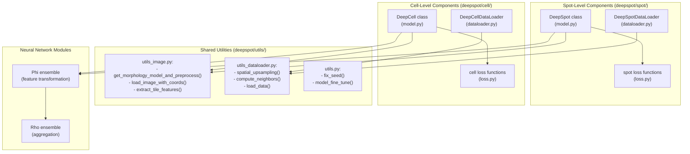
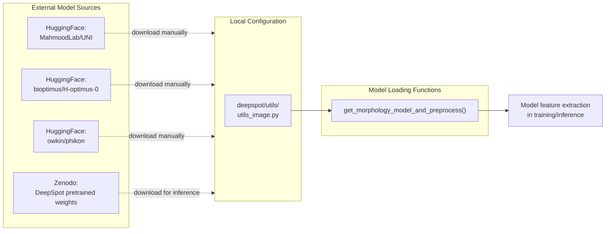
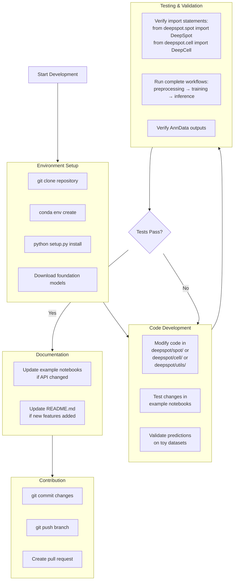

# Contributing & Development

<details>
<summary>Relevant source files</summary>

The following files were used as context for generating this wiki page:

- [LICENSE](LICENSE)
- [README.md](README.md)

</details>


This page provides information for developers who want to contribute to the DeepSpot project, including development environment setup, project organization, coding standards, and contribution guidelines. For information about installing DeepSpot for end-user usage, see [Installation](#2.1). For API documentation, see [API Reference](#9).

---

## Purpose and Scope

This documentation covers the development infrastructure for the DeepSpot codebase, including:
- Setting up a development environment
- Understanding the project structure and module organization
- Development workflow and best practices
- Contribution guidelines
- Licensing information

---

## Development Environment Setup

### Prerequisites

The DeepSpot project requires a conda-based Python environment with several scientific computing and deep learning dependencies.

**Required System Components:**
- Conda or Miniconda
- Git for version control
- CUDA-capable GPU (recommended for training)
- `pyvips` system libraries

### Installation Steps

1. **Clone the repository:**
```bash
git clone https://github.com/ratschlab/DeepSpot
cd DeepSpot
```

2. **Create conda environment:**
```bash
conda env create --file=environment.yaml
conda activate deepspot
```

3. **Install pyvips (if needed):**
```bash
conda install conda-forge::pyvips
```

4. **Install DeepSpot in development mode:**
```bash
python setup.py install
```

5. **Install Jupyter kernel (for notebook development):**
```bash
python -m ipykernel install --user --name deepspot --display-name "deepspot"
```

**Sources:** [README.md:40-58]()

---

## Project Structure

### Directory Organization

The DeepSpot codebase is organized into a modular structure separating spot-level and cell-level prediction systems, with shared utilities.

```mermaid
graph TB
    Root["DeepSpot/<br/>(root directory)"]
    
    Root --> DeepSpotPkg["deepspot/<br/>(main package)"]
    Root --> Examples["example_notebook/<br/>(tutorial notebooks)"]
    Root --> Config["setup.py<br/>environment.yaml<br/>LICENSE<br/>README.md"]
    Root --> Figures["figures/<br/>(documentation images)"]
    
    DeepSpotPkg --> SpotModule["spot/<br/>(spot-level components)"]
    DeepSpotPkg --> CellModule["cell/<br/>(cell-level components)"]
    DeepSpotPkg --> UtilsModule["utils/<br/>(shared utilities)"]
    
    SpotModule --> SpotModel["model.py<br/>(DeepSpot class)"]
    SpotModule --> SpotLoader["dataloader.py<br/>(DeepSpotDataLoader)"]
    SpotModule --> SpotLoss["loss.py<br/>(spot loss functions)"]
    SpotModule --> SpotInit["__init__.py"]
    
    CellModule --> CellModel["model.py<br/>(DeepCell class)"]
    CellModule --> CellLoader["dataloader.py<br/>(DeepCellDataLoader)"]
    CellModule --> CellLoss["loss.py<br/>(cell loss functions)"]
    CellModule --> CellInit["__init__.py"]
    
    UtilsModule --> UtilsImage["utils_image.py<br/>(image processing)"]
    UtilsModule --> UtilsData["utils_dataloader.py<br/>(spatial processing)"]
    UtilsModule --> UtilsGeneral["utils.py<br/>(general utilities)"]
    
    Examples --> VisiumEx["Visium_spot_example/<br/>(spot workflow notebooks)"]
    Examples --> XeniumEx["Xenium_single-cell_example/<br/>(cell workflow notebooks)"]
    
    VisiumEx --> VPreproc["GettingStartedWithDeepSpot_1_preprocessing.ipynb"]
    VisiumEx --> VTrain["GettingStartedWithDeepSpot_2_training.ipynb"]
    VisiumEx --> VInfer["GettingStartedWithDeepSpot_3_inference.ipynb"]
    VisiumEx --> VInferPre["GettingStartedWithDeepSpot_3.1_inference_pretrained_models.ipynb"]
    
    XeniumEx --> XPreproc["GettingStartedWithDeepCell_1_preprocessing.ipynb"]
    XeniumEx --> XTrain["GettingStartedWithDeepCell_2_training.ipynb"]
    XeniumEx --> XInfer["GettingStartedWithDeepCell_3_inference.ipynb"]
```



**Sources:** [README.md:1-189]()

### Module Organization

The codebase follows a clear separation between spot-level and cell-level components:

| Module | Purpose | Key Classes | Import Pattern |
|--------|---------|-------------|----------------|
| `deepspot.spot` | Spot-level predictions (Visium) | `DeepSpot`, `DeepSpotDataLoader` | `from deepspot.spot import DeepSpot` |
| `deepspot.cell` | Cell-level predictions (Xenium) | `DeepCell`, `DeepCellDataLoader` | `from deepspot.cell import DeepCell` |
| `deepspot.utils` | Shared utilities | Image processing, data loading, spatial operations | `from deepspot.utils import utils_image` |

**Sources:** [README.md:20-22]()

---

## Core Components and Their Responsibilities

### Model Architecture Components



**Component Descriptions:**

| Component | File Location | Key Methods/Functions | Purpose |
|-----------|--------------|----------------------|---------|
| `DeepSpot` | `deepspot/spot/model.py` | `_forward_spot()`, `_forward_spot_subspot()`, `_forward_spot_neighbors()`, `_forward_spot_subspot_neighbors()` | Spot-level prediction model with four context modes |
| `DeepCell` | `deepspot/cell/model.py` | `_forward_cell()`, `_forward_cell_neighbors()` | Cell-level prediction model with two context modes |
| `DeepSpotDataLoader` | `deepspot/spot/dataloader.py` | `__init__()`, `__getitem__()` | Data loading and batching for spot-level data |
| `DeepCellDataLoader` | `deepspot/cell/dataloader.py` | `__init__()`, `__getitem__()` | Data loading and batching for cell-level data |
| Phi modules | Within model classes | Feature transformation | Ensemble of neural networks for feature processing |
| Rho modules | Within model classes | Prediction generation | Ensemble of neural networks for final predictions |

**Sources:** [README.md:20-22]()

---

## External Dependencies Management

### Foundation Model Integration

DeepSpot integrates with several pathology foundation models that must be manually downloaded and configured.



**Configuration Requirements:**

1. **Download foundation model weights** from HuggingFace:
   - UNI: `https://huggingface.co/MahmoodLab/UNI`
   - Hoptimus0: `https://huggingface.co/bioptimus/H-optimus-0`
   - Phikon: `https://huggingface.co/owkin/phikon`

2. **Update file paths** in `deepspot/utils/utils_image.py` to point to downloaded weights

3. **Accept terms and conditions** for each model as required by the providers

**Sources:** [README.md:80-86]()

### Key Dependencies

| Category | Libraries | Purpose |
|----------|-----------|---------|
| Deep Learning | `torch`, `pytorch-lightning`, `torchvision`, `timm`, `transformers` | Model training and inference |
| Single-Cell Analysis | `scanpy`, `squidpy`, `anndata` | Spatial transcriptomics data handling |
| Image Processing | `pyvips`, `openslide`, `PIL` | Large image I/O and manipulation |
| Scientific Computing | `numpy`, `pandas`, `scikit-learn` | Data processing and utilities |

**Sources:** [README.md:42-53]()

---

## Development Workflow

### Typical Development Cycle



**Sources:** [README.md:40-58](), [README.md:62-73]()

---

## Code Organization Principles

### Separation of Concerns

The codebase maintains clear boundaries between different components:

| Layer | Components | Responsibility |
|-------|-----------|----------------|
| **Model Layer** | `DeepSpot`, `DeepCell` | Neural network architectures, forward passes, training logic |
| **Data Layer** | `DeepSpotDataLoader`, `DeepCellDataLoader` | Batching, preprocessing, spatial operations |
| **Image Processing Layer** | `utils_image.py` | Foundation model loading, tile extraction, feature computation |
| **Spatial Processing Layer** | `utils_dataloader.py` | Upsampling, smoothing, neighbor computation, normalization |
| **Utility Layer** | `utils.py` | General utilities (seeding, fine-tuning, etc.) |

### Import Conventions

The module structure changed in the May 2025 version to provide clearer separation:

**New import structure:**
```python
from deepspot.spot import DeepSpot
from deepspot.cell import DeepCell
```

**Previous import structure** (deprecated):
```python
# Old style - no longer used
from deepspot import DeepSpot
```

**Sources:** [README.md:15-27]()

---

## Notebook-Driven Development

### Example Notebooks as Test Cases

The `example_notebook/` directory serves dual purposes:
1. User-facing tutorials
2. Integration test cases for developers

```mermaid
graph TB
    subgraph VisiumWorkflow["Visium Spot Workflow"]
        VP1["GettingStartedWithDeepSpot_1_preprocessing.ipynb<br/>Tests: data loading, feature extraction"]
        VP2["GettingStartedWithDeepSpot_2_training.ipynb<br/>Tests: DeepSpot training pipeline"]
        VP3["GettingStartedWithDeepSpot_3_inference.ipynb<br/>Tests: prediction generation"]
        VP4["GettingStartedWithDeepSpot_3.1_inference_pretrained_models.ipynb<br/>Tests: pretrained model loading"]
    end
    
    subgraph XeniumWorkflow["Xenium Cell Workflow"]
        XP1["GettingStartedWithDeepCell_1_preprocessing.ipynb<br/>Tests: single-cell data loading"]
        XP2["GettingStartedWithDeepCell_2_training.ipynb<br/>Tests: DeepCell training pipeline"]
        XP3["GettingStartedWithDeepCell_3_inference.ipynb<br/>Tests: cell-level predictions"]
    end
    
    subgraph CoreModules["Core Modules Tested"]
        SpotMod["deepspot/spot/"]
        CellMod["deepspot/cell/"]
        UtilsMod["deepspot/utils/"]
    end
    
    VP1 -.->|"validates"| UtilsMod
    VP2 -.->|"validates"| SpotMod
    VP3 -.->|"validates"| SpotMod
    VP4 -.->|"validates"| SpotMod
    
    XP1 -.->|"validates"| UtilsMod
    XP2 -.->|"validates"| CellMod
    XP3 -.->|"validates"| CellMod
```



**Development Practice:**
- When modifying core modules, run corresponding notebooks to verify functionality
- Update notebook outputs if API changes affect them
- Use notebooks to document expected behavior for new features

**Sources:** [README.md:62-73]()

---

## Coding Standards

### General Guidelines

1. **Module Structure:**
   - Keep spot-level and cell-level components separated
   - Place shared utilities in `deepspot/utils/`
   - Maintain consistent API patterns between `DeepSpot` and `DeepCell`

2. **Documentation:**
   - Use docstrings for all public classes and functions
   - Document expected tensor shapes in neural network methods
   - Include usage examples in docstrings

3. **Naming Conventions:**
   - Use descriptive variable names
   - Prefix private methods with underscore (e.g., `_forward_spot()`)
   - Use snake_case for functions and variables
   - Use PascalCase for class names

4. **Type Hints:**
   - Use type hints for function parameters and return values
   - Specify tensor dimensions in comments where applicable

### Model Development Standards

When developing or modifying model architectures:

| Aspect | Requirement |
|--------|-------------|
| Forward methods | All forward variants (`_forward_spot()`, `_forward_cell()`, etc.) must be implemented |
| Input validation | Validate tensor shapes at method entry |
| Device handling | Support both CPU and GPU execution |
| Ensemble architecture | Maintain Phi/Rho ensemble pattern for consistency |
| Loss functions | Support multiple loss types (MSE, Pearson, Cosine, etc.) |

---

## Data and Model Versioning

### Pretrained Weights

Pretrained DeepSpot models are hosted on Zenodo with version tracking:
- Location: `https://zenodo.org/records/15322099`
- Use versioned releases for reproducibility
- Document which weights were used in experiments

**Sources:** [README.md:75-78]()

### TCGA Dataset

Large-scale predictions are hosted on HuggingFace Datasets:
- Repository: `nonchev/TCGA_digital_spatial_transcriptomics`
- ~8TB total size (56M+ spots, 3,780 samples)
- Access requires HuggingFace token and login

**Sources:** [README.md:88-162]()

---

## Testing Considerations

### Manual Testing Checklist

Due to the computational nature of the project, testing primarily occurs through:

1. **Import Verification:**
   ```python
   from deepspot.spot import DeepSpot
   from deepspot.cell import DeepCell
   # Verify no import errors
   ```

2. **Preprocessing Pipeline:**
   - Run preprocessing notebooks on toy datasets
   - Verify `.npy` files are generated correctly
   - Check AnnData object structure

3. **Training Pipeline:**
   - Verify data loaders produce correct batch shapes
   - Check loss computation
   - Validate model checkpointing

4. **Inference Pipeline:**
   - Test predictions on new images
   - Verify AnnData output format
   - Check visualization compatibility with squidpy

### Validation Datasets

Use small toy examples for development testing:
- Located in `example_notebook/` directories
- Quick iteration without requiring full-scale datasets
- Verify end-to-end workflows complete successfully

---

## Computational Environment Notes

### Resource Requirements

The project was developed on specific infrastructure:

| Aspect | Specification |
|--------|--------------|
| Computing Platform | Leonhard Med secure research environment (ETH Zurich) |
| GPU Requirements | CUDA-capable GPU for training |
| Memory | Sufficient for large whole-slide images (several GB) |
| Storage | Large storage for TCGA datasets (~8TB for full dataset) |

**Important Note:** "Computational data analysis was performed at Leonhard Med (https://sis.id.ethz.ch/services/sensitiveresearchdata/) secure trusted research environment at ETH Zurich. Our pipeline aligns with the specific cluster requirements and resources."

**Sources:** [README.md:188]()

---

## Contributing Guidelines

### How to Contribute

1. **Fork and Clone:**
   ```bash
   git clone https://github.com/YOUR_USERNAME/DeepSpot
   ```

2. **Create Feature Branch:**
   ```bash
   git checkout -b feature/your-feature-name
   ```

3. **Make Changes:**
   - Follow coding standards above
   - Update relevant notebooks if API changes
   - Test with toy datasets

4. **Commit and Push:**
   ```bash
   git commit -m "Descriptive commit message"
   git push origin feature/your-feature-name
   ```

5. **Create Pull Request:**
   - Describe changes clearly
   - Reference any related issues
   - Include example usage if adding new features

### Contact

For questions or discussions about contributions, contact:
- Primary contact: Kalin Nonchev (ETH Zurich BMI)
- Project page: https://github.com/ratschlab/DeepSpot

**Sources:** [README.md:184-186]()

---

## License

DeepSpot is released under the MIT License, which permits:
- Commercial use
- Modification
- Distribution
- Private use

**Requirements:**
- Include copyright notice and license text in distributions
- No warranty provided

**Full License Text:** [LICENSE:1-21]()

---

## Project Roadmap and Recent Updates

### Recent Milestones

| Date | Milestone |
|------|-----------|
| May 2025 | Major version update with DeepCell for single-cell resolution |
| April 2025 | 1st place in Autoimmune ML Challenge (Broad Institute/CrunchDAO) |
| January 2026 | Invited talk at 10x Genomics Symposium |
| December 2025 | NeurIPS 2025 Workshop presentation |

### Current Features (May 2025 Version)

- **DeepCell** for single-cell resolution spatial transcriptomics
- New tutorial notebooks in `example_notebook/`
- Modular structure: `deepspot.spot` and `deepspot.cell`
- 8TB TCGA spatial transcriptomics predictions (4 cancer types, 3,780 samples)
- Additional pretrained models on Zenodo

**Sources:** [README.md:7-27]()

---

## Related Documentation

- For installation instructions: see [Installation](#2.1)
- For model architecture details: see [Model Architecture](#5)
- For API documentation: see [API Reference](#9)
- For complete workflows: see [Workflows](#7)