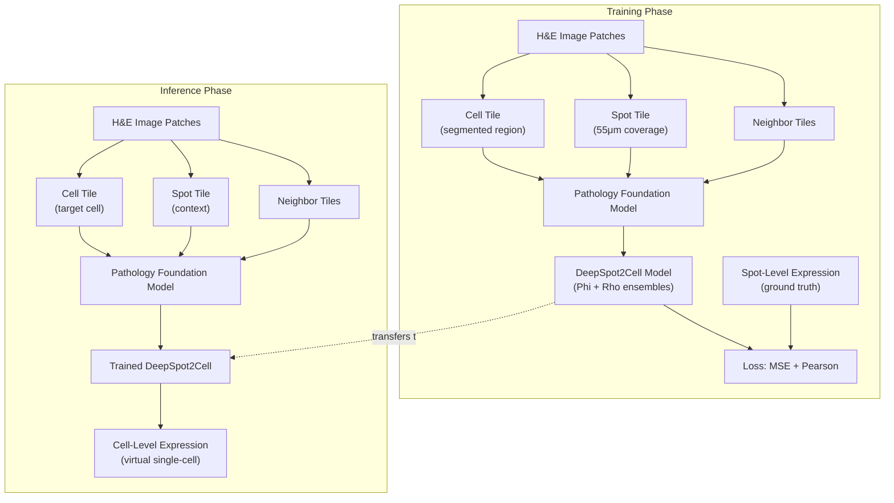
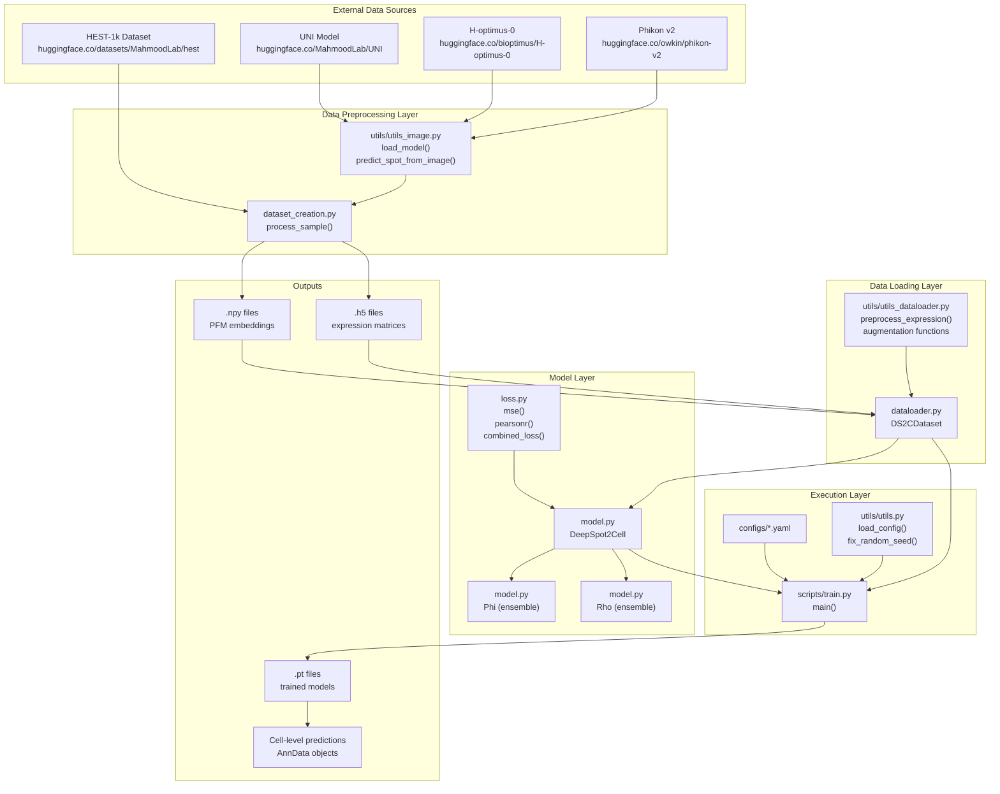
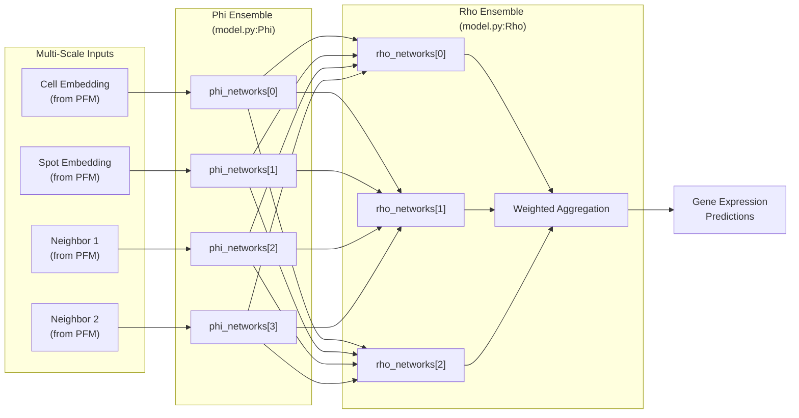

# Overview

Relevant source files

The following files were used as context for generating this wiki page:

- [README.md](README.md)

## Purpose and Scope

This page introduces DeepSpot2Cell, a deep learning system that predicts virtual single-cell spatial transcriptomics from H&E histology images using spot-level supervision. It explains the system's purpose, key innovation, high-level architecture, and core components.

For detailed installation and setup instructions, see [Installation and Setup](#2.1). For step-by-step usage guides, see [Tutorials](#3). For technical details on specific components, see [Core Components](#4).

**Sources:** [README.md:1-9]()

## What is DeepSpot2Cell?

DeepSpot2Cell is a computational framework that generates cell-level gene expression predictions from standard H&E-stained tissue images. The system addresses a fundamental challenge in spatial transcriptomics: existing technologies like Visium provide gene expression measurements at spot resolution (~55μm diameter, containing multiple cells), but biological insights often require single-cell resolution.

The framework consists of three main phases:

1. **Data Preprocessing**: Extracts multi-scale morphological features from H&E images using pathology foundation models (PFMs)
2. **Model Training**: Trains neural networks to predict spot-level gene expression from morphological features
3. **Inference**: Applies trained models to predict cell-level gene expression

**Key characteristics:**
- **Input**: H&E histology images with cell segmentation masks
- **Training supervision**: Spot-level spatial transcriptomics data (e.g., HEST-1k dataset)
- **Output**: Virtual single-cell gene expression profiles
- **Foundation models**: Compatible with UNI, H-optimus-0, and Phikon v2

**Sources:** [README.md:1-9]()

## Key Innovation: Resolution Transfer

The core innovation of DeepSpot2Cell is its ability to predict at finer resolution than its training supervision. The system is trained on spot-level gene expression (aggregated from multiple cells) but predicts at individual cell level during inference.

**Diagram: Training vs Inference Resolution Transfer**

This resolution transfer works because:
- **Training** learns morphology-expression relationships at spot level with abundant supervision
- **Inference** applies these relationships to individual cells using their specific morphological features
- **Multi-scale context** (cell + spot + neighbors) provides spatial information at both phases

**Sources:** [README.md:9-10]()

## System Architecture Overview

The DeepSpot2Cell system is organized into distinct layers, each implemented in specific Python modules:

**Diagram: System Architecture with Code Entities**

The architecture is organized as follows:

| Layer | Purpose | Key Components |
|-------|---------|----------------|
| **External Data Sources** | Raw inputs | HEST-1k dataset, PFM weights |
| **Preprocessing Layer** | Feature extraction | `dataset_creation.py`, `utils_image.py` |
| **Data Loading Layer** | Training data pipeline | `DS2CDataset`, `utils_dataloader.py` |
| **Model Layer** | Neural network architecture | `DeepSpot2Cell`, `Phi`, `Rho`, loss functions |
| **Execution Layer** | Training orchestration | `train.py`, config management, utilities |
| **Outputs** | Artifacts | Embeddings, expressions, checkpoints, predictions |

**Sources:** [README.md:16-52]()

## Core Components

### Model Architecture

The `DeepSpot2Cell` class ([deepspot2cell/model.py]()) implements the main prediction model using an ensemble architecture:

- **Phi ensemble**: Multiple small networks that process individual input sources (cell, spot, neighbors)
- **Rho ensemble**: Meta-learner that aggregates Phi predictions using attention-like weighting

**Diagram: DeepSpot2Cell Ensemble Architecture**

**Sources:** [README.md:7-9]()

### Dataset and Data Loading

The `DS2CDataset` class ([deepspot2cell/dataloader.py]()) handles:
- Loading precomputed embeddings from `.npy` files
- Loading expression data from `.h5` files
- Applying normalization and preprocessing
- Managing spatial neighbor relationships
- Handling padding and masking for variable numbers of neighbors

**Sources:** [README.md:24-33]()

### Loss Functions

The `loss.py` module ([deepspot2cell/loss.py]()) provides:
- **MSE**: Mean squared error for basic regression
- **Pearson correlation**: Measures gene expression pattern similarity
- **Combined loss**: Weighted combination of MSE and Pearson
- **Safe Pearson**: Numerically stable correlation computation for evaluation

**Sources:** [README.md:1-9]()

## Data Flow Pipeline

The complete data flow from raw inputs to predictions:

| Stage | Input | Process | Output | Implementation |
|-------|-------|---------|--------|----------------|
| **1. Data Acquisition** | HEST-1k dataset | Download from HuggingFace | Raw H&E images, ST data, segmentations | External |
| **2. Preprocessing** | Raw images, ST data | Extract tiles, compute PFM embeddings | `.npy` embeddings, `.h5` expressions | `dataset_creation.py` |
| **3. Data Loading** | Preprocessed files | Load, normalize, augment | Batched tensors | `DS2CDataset`, `DataLoader` |
| **4. Training** | Data batches | Forward/backward passes | Trained model checkpoint | `train.py`, `DeepSpot2Cell` |
| **5. Inference** | New H&E images, trained model | Extract features, predict | Cell-level expression predictions | Tutorial 3 |

**Sources:** [README.md:24-33]()

## Usage Modes

DeepSpot2Cell supports three primary usage workflows:

### 1. Training from Scratch

Users provide:
- HEST-1k dataset or compatible spatial transcriptomics data
- Configuration files specifying model and data parameters
- PFM weights for feature extraction

The system:
1. Preprocesses data using `dataset_creation.py`
2. Trains model using `scripts/train.py`
3. Outputs trained checkpoint files

**See:** [Tutorial 1: Data Preprocessing](#3.1), [Tutorial 2: Model Training](#3.2)

### 2. Inference with Pre-trained Models

Users provide:
- Trained DeepSpot2Cell checkpoint
- New H&E images with cell segmentation masks
- PFM for feature extraction

The system:
1. Extracts multi-scale tiles around each cell
2. Computes PFM embeddings
3. Predicts cell-level gene expression

**See:** [Tutorial 3: Inference and Prediction](#3.3)

### 3. Fine-tuning on New Datasets

Users can:
- Start from a pre-trained checkpoint
- Fine-tune on tissue-specific or disease-specific data
- Adjust gene panel or spatial parameters

**See:** [Training Configuration](#6.2)

**Sources:** [README.md:24-33]()

## Supported Foundation Models

DeepSpot2Cell is compatible with multiple pathology foundation models:

| Model | Source | Configuration Parameter |
|-------|--------|------------------------|
| **UNI** | [MahmoodLab/UNI](https://huggingface.co/MahmoodLab/UNI) | `model: "UNI"` |
| **H-optimus-0** | [bioptimus/H-optimus-0](https://huggingface.co/bioptimus/H-optimus-0) | `model: "Hoptimus0"` |
| **Phikon v2** | [owkin/phikon-v2](https://huggingface.co/owkin/phikon-v2) | `model: "phikon_v2"` |

The PFM choice affects:
- Feature dimensionality
- Preprocessing requirements
- Computational requirements
- Prediction quality (model-dependent)

Users must download PFM weights separately and configure paths in dataset configuration files.

**See:** [Pathology Foundation Models](#10.2)

**Sources:** [README.md:35-45]()

## HEST-1k Dataset Integration

DeepSpot2Cell is designed to work with the HEST-1k dataset, a collection of aligned H&E images and spatial transcriptomics data from human tissue samples. The dataset provides:

- Whole slide images (WSI) in standard formats
- Spot-level gene expression matrices
- Cell segmentation masks
- Spatial coordinates and metadata
- Quality control metrics

The `dataset_creation.py` module includes specific functionality for processing HEST-1k data format.

**See:** [HEST-1k Dataset](#10.1)

**Sources:** [README.md:47-51]()

## Next Steps

To begin using DeepSpot2Cell:

1. **Installation**: Follow [Installation and Setup](#2.1) to create the environment
2. **Quick Start**: Try the example with [Quick Start with Example Data](#2.2)
3. **Tutorials**: Work through the three tutorial notebooks:
   - [Tutorial 1: Data Preprocessing](#3.1)
   - [Tutorial 2: Model Training](#3.2)
   - [Tutorial 3: Inference and Prediction](#3.3)

For detailed component documentation, see:
- [Core Components](#4) - Model, dataset, loss functions
- [Configuration](#6) - YAML configuration files
- [API Reference](#9) - Complete API documentation

**Sources:** [README.md:16-33]()

---