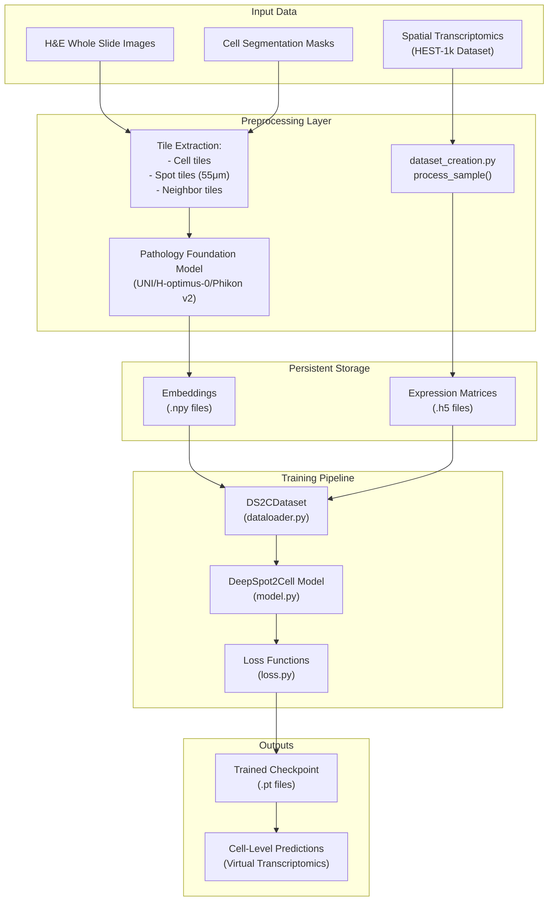
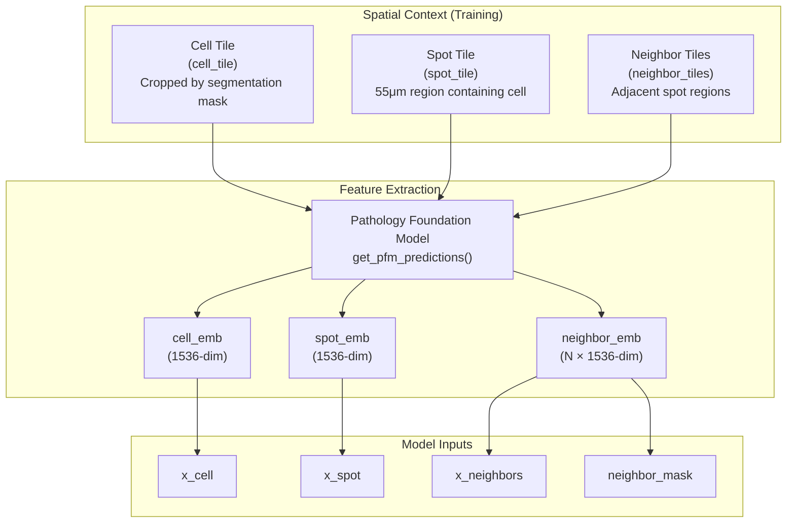
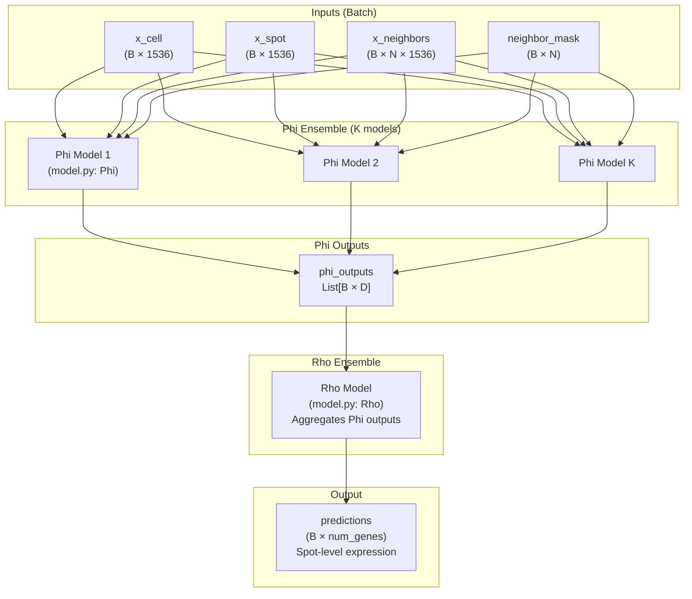
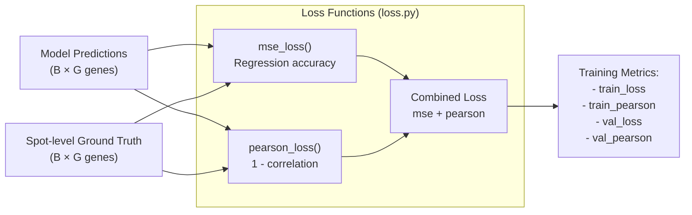
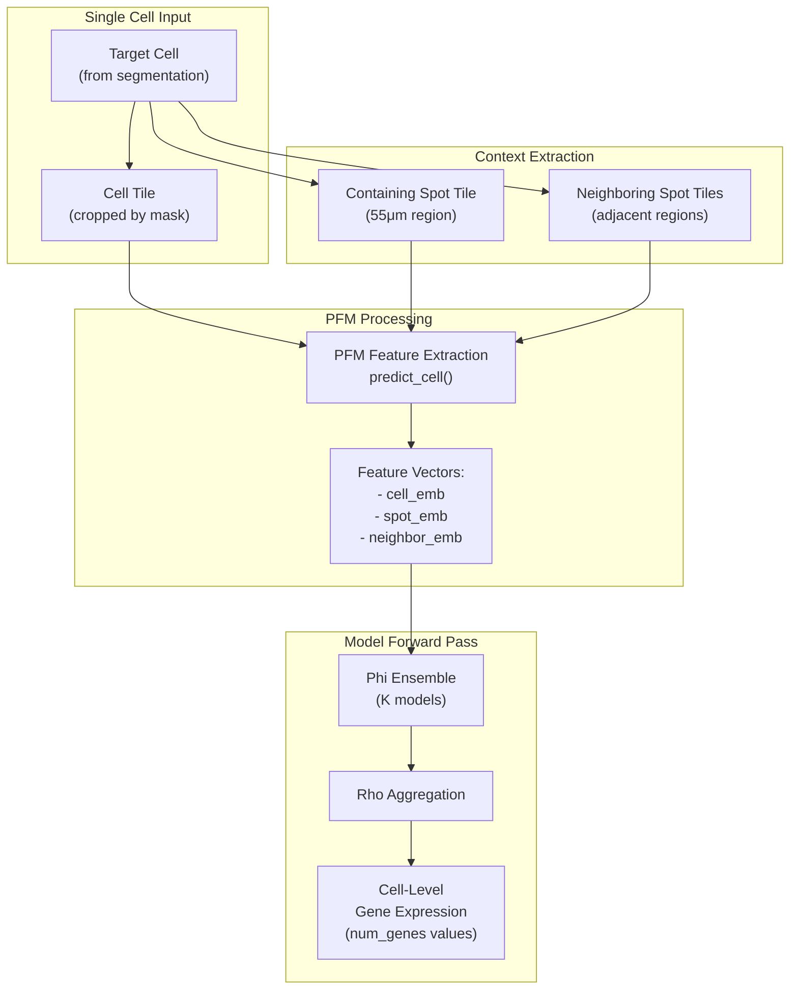
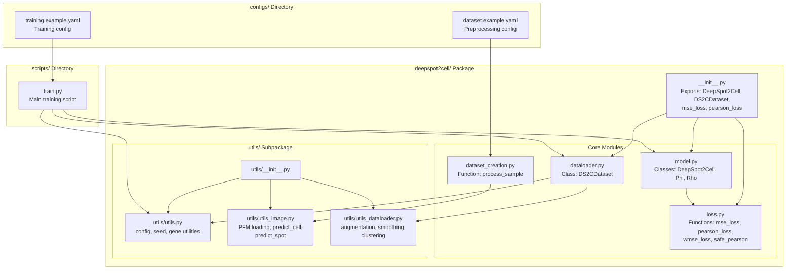
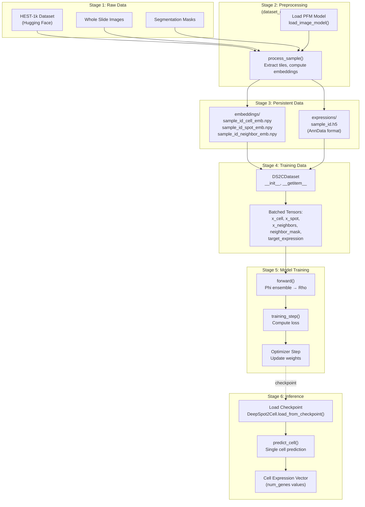

# System Architecture

<details>
<summary>Relevant source files</summary>

The following files were used as context for generating this wiki page:

- [README.md](README.md)
- [figures/architecture.jpg](figures/architecture.jpg)

</details>


## Purpose and Scope

This document provides a detailed technical explanation of the DeepSpot2Cell system architecture, including:

- The distinction between training mode (spot-level supervision) and inference mode (cell-level prediction)
- Multi-scale image processing using cell tiles, spot tiles, and neighboring tiles
- The resolution transfer mechanism that enables cell-level predictions from spot-level training
- Data flow through the system components
- Module organization and dependencies

For conceptual definitions and terminology, see [Key Concepts and Terminology](#1.2). For implementation details of specific components, see [DeepSpot2Cell Model Architecture](#4.1), [DS2CDataset and Data Loading](#4.2), and [Dataset Creation](#5.1).

---

## Architectural Overview

DeepSpot2Cell is designed around a key innovation: training with readily available spot-level spatial transcriptomics data (55μm resolution) to enable predictions at the cellular level during inference. The system architecture reflects this dual-mode operation.

### System Components

The DeepSpot2Cell system consists of three primary layers:

| Layer | Components | Purpose |
|-------|-----------|---------|
| **Data Preparation** | `dataset_creation.py`, `dataloader.py` | Process raw HEST data, extract tiles, compute PFM embeddings, load training batches |
| **Model Layer** | `model.py` (DeepSpot2Cell, Phi, Rho), `loss.py` | Multi-scale feature aggregation, ensemble prediction, loss computation |
| **Execution Layer** | `scripts/train.py`, `utils/*` | Training orchestration, configuration management, utilities |

Sources: [README.md:1-70]()

### High-Level Data Flow



Sources: [deepspot2cell/dataset_creation.py](), [deepspot2cell/dataloader.py](), [deepspot2cell/model.py](), [deepspot2cell/loss.py](), [scripts/train.py]()

---

## Training Architecture

During training, DeepSpot2Cell learns to predict spot-level gene expression from multi-scale morphological features. The model is supervised with measurements from 55μm diameter spots that aggregate signals from multiple cells.

### Multi-Scale Input Processing

Training uses three types of image tiles extracted around each cell:



**Tile Types:**

| Tile Type | Variable Name | Dimensions | Purpose |
|-----------|--------------|------------|---------|
| Cell Tile | `cell_tile` | Varies (segmentation-based) | Captures individual cell morphology |
| Spot Tile | `spot_tile` | 55μm diameter | Provides local tissue context |
| Neighbor Tiles | `neighbor_tiles` | 55μm diameter each | Captures spatial neighborhood information |

Sources: [deepspot2cell/dataloader.py](), [deepspot2cell/utils/utils_image.py]()

### Model Components

The DeepSpot2Cell model architecture consists of ensemble components that process multi-scale features:



**Component Details:**

- **`Phi` class** ([deepspot2cell/model.py]()): Individual ensemble member that processes multi-scale inputs
  - Aggregates cell, spot, and neighbor embeddings
  - Uses attention mechanism for neighbor pooling (when `neighbor_mask` is provided)
  - Produces intermediate predictions
  
- **`Rho` class** ([deepspot2cell/model.py]()): Meta-learner that combines Phi outputs
  - Takes concatenated Phi predictions as input
  - Produces final gene expression predictions
  
- **`DeepSpot2Cell` class** ([deepspot2cell/model.py]()): Main model coordinating the ensemble
  - Manages K Phi models and 1 Rho model
  - Handles training/validation steps
  - Implements PyTorch Lightning interface

Sources: [deepspot2cell/model.py]()

### Loss Computation

Training optimizes a combination of Mean Squared Error (MSE) and Pearson correlation:



**Loss Functions:**

| Function | File Location | Purpose |
|----------|--------------|---------|
| `mse_loss()` | [deepspot2cell/loss.py]() | Standard MSE between predictions and targets |
| `pearson_loss()` | [deepspot2cell/loss.py]() | Returns `1 - correlation` to minimize negative correlation |
| `safe_pearson()` | [deepspot2cell/loss.py]() | Robust correlation computation with numerical stability |
| `wmse_loss()` | [deepspot2cell/loss.py]() | Weighted MSE for gene-specific importance |

Sources: [deepspot2cell/loss.py](), [deepspot2cell/model.py:90-150]()

---

## Inference Architecture

During inference, the same model architecture is applied to individual cells to produce cell-level transcriptomic predictions. This is the resolution transfer: spot-supervised training enables cell-level inference.

### Cell-Level Prediction Mode



**Key Inference Functions:**

| Function | File Location | Purpose |
|----------|--------------|---------|
| `predict_cell()` | [deepspot2cell/utils/utils_image.py]() | Predicts expression for a single cell from image path |
| `get_pfm_predictions()` | [deepspot2cell/utils/utils_image.py]() | Extracts PFM features for tiles |
| `forward()` | [deepspot2cell/model.py]() | Main model forward pass (shared between training/inference) |

Sources: [deepspot2cell/utils/utils_image.py](), [deepspot2cell/model.py]()

### Training vs Inference Comparison

| Aspect | Training Mode | Inference Mode |
|--------|--------------|----------------|
| **Supervision** | Spot-level expression (55μm aggregate) | No supervision (prediction only) |
| **Input** | Cell + spot + neighbors from training data | Cell + spot + neighbors from any image |
| **Output** | Spot-level predictions (for loss computation) | Cell-level predictions (virtual transcriptomics) |
| **Model State** | `model.train()`, gradients enabled | `model.eval()`, gradients disabled |
| **Batch Processing** | `DS2CDataset` batches via DataLoader | Single cell or custom batching |
| **Code Entry Point** | `scripts/train.py` → `trainer.fit()` | `utils/utils_image.py` → `predict_cell()` |

Sources: [scripts/train.py](), [deepspot2cell/utils/utils_image.py](), [deepspot2cell/model.py]()

---

## Resolution Transfer Mechanism

The core architectural innovation is the resolution transfer from spot-level training to cell-level inference. This is achieved through the multi-scale input design:

```mermaid
graph TB
    subgraph Training["Training Phase (Spot-Level Supervision)"]
        TR_CELL["Cell Morphology<br/>(high resolution)"]
        TR_SPOT["Spot Context<br/>(55μm tissue region)"]
        TR_NEIGH["Spatial Neighbors<br/>(surrounding spots)"]
        TR_LABEL["Ground Truth:<br/>Spot Expression<br/>(aggregated from cells)"]
        
        TR_LEARN["Model Learns:<br/>morphology → expression<br/>+ spatial patterns"]
    end
    
    subgraph Inference["Inference Phase (Cell-Level Prediction)"]
        INF_CELL["Cell Morphology<br/>(same resolution)"]
        INF_SPOT["Spot Context<br/>(same 55μm region)"]
        INF_NEIGH["Spatial Neighbors<br/>(same structure)"]
        
        INF_APPLY["Apply Learned Patterns:<br/>Individual cell features<br/>+ learned spatial context"]
        
        INF_OUT["Output:<br/>Cell-Level Expression<br/>(disaggregated)"]
    end
    
    TR_CELL --> TR_LEARN
    TR_SPOT --> TR_LEARN
    TR_NEIGH --> TR_LEARN
    TR_LABEL --> TR_LEARN
    
    TR_LEARN -.."learned weights".-> INF_APPLY
    
    INF_CELL --> INF_APPLY
    INF_SPOT --> INF_APPLY
    INF_NEIGH --> INF_APPLY
    INF_APPLY --> INF_OUT
```

**How Resolution Transfer Works:**

1. **Training**: The model learns to map morphological features (visible at cell resolution) to gene expression (measured at spot resolution). Even though the supervision is at spot level, the model sees individual cell morphologies within each spot.

2. **Key Insight**: The model learns fine-grained morphology-expression relationships because:
   - Cell tiles capture individual cell morphology
   - Spot tiles provide tissue context
   - Neighbor tiles encode spatial patterns
   - The combination allows the model to associate specific morphological patterns with transcriptional states

3. **Inference**: When predicting for an individual cell, the model applies learned patterns to that cell's morphology while incorporating the same contextual information (spot and neighbors), enabling cell-level predictions.

4. **Implementation**: The `forward()` method in `DeepSpot2Cell` is identical for training and inference—only the interpretation of the output changes (spot-level during training, cell-level during inference).

Sources: [README.md:1-10](), [deepspot2cell/model.py]()

---

## Module Organization

The codebase is organized into clear functional modules:



**Module Responsibilities:**

| Module | Primary Classes/Functions | Responsibility |
|--------|--------------------------|----------------|
| `model.py` | `DeepSpot2Cell`, `Phi`, `Rho` | Neural network architecture and training logic |
| `dataloader.py` | `DS2CDataset` | Data loading, preprocessing, batching |
| `loss.py` | `mse_loss()`, `pearson_loss()` | Loss function implementations |
| `dataset_creation.py` | `process_sample()` | Preprocessing HEST data, extracting embeddings |
| `utils/utils.py` | `load_config()`, `fix_seed()` | Configuration and general utilities |
| `utils/utils_image.py` | `predict_cell()`, `get_pfm_predictions()` | Image processing and PFM inference |
| `utils/utils_dataloader.py` | `smooth_expression()`, `cluster_spots()` | Data augmentation and processing |
| `scripts/train.py` | `main()` | Training orchestration and CLI |

Sources: [deepspot2cell/__init__.py](), [deepspot2cell/model.py](), [deepspot2cell/dataloader.py](), [deepspot2cell/loss.py](), [deepspot2cell/dataset_creation.py](), [deepspot2cell/utils/](), [scripts/train.py]()

---

## Data Flow Through Components

The complete data flow from raw inputs to predictions:



**Processing Stages:**

1. **Stage 1-2**: [Dataset Creation](#5.1) - One-time preprocessing to generate embeddings
2. **Stage 3**: Persistent storage in `.npy` and `.h5` formats for reuse
3. **Stage 4**: [DS2CDataset](#4.2) - Dynamic loading and augmentation during training
4. **Stage 5**: [Model Training](#8.1) - Iterative optimization using PyTorch Lightning
5. **Stage 6**: [Inference](#8.2) - Apply trained model to new cells

Sources: [deepspot2cell/dataset_creation.py](), [deepspot2cell/dataloader.py](), [deepspot2cell/model.py](), [scripts/train.py](), [deepspot2cell/utils/utils_image.py]()

---