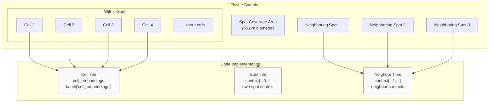
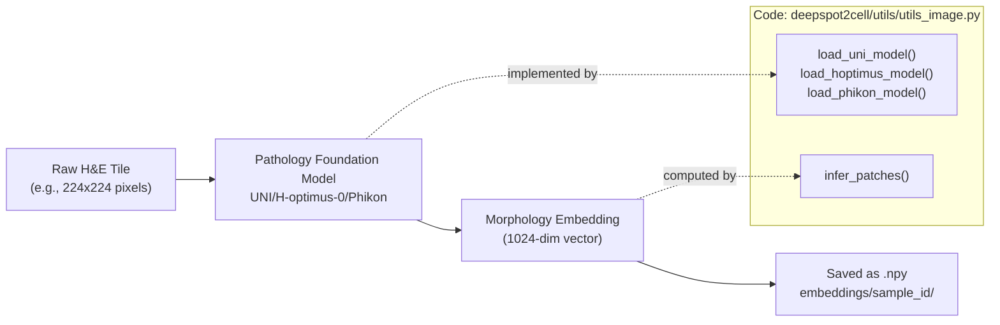
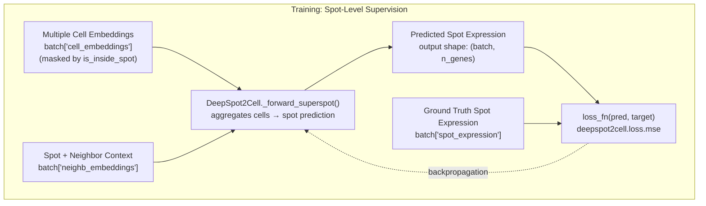
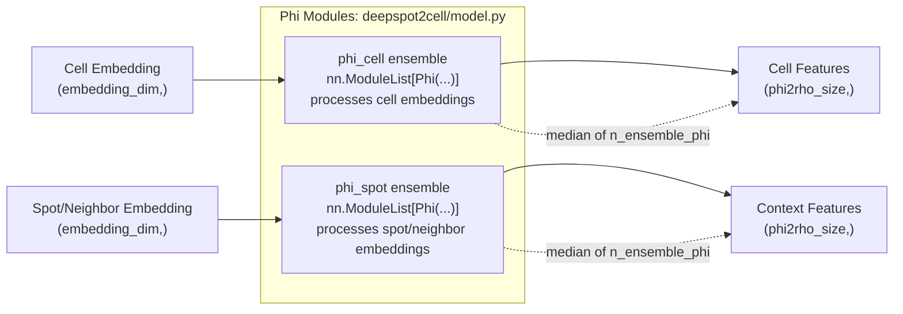
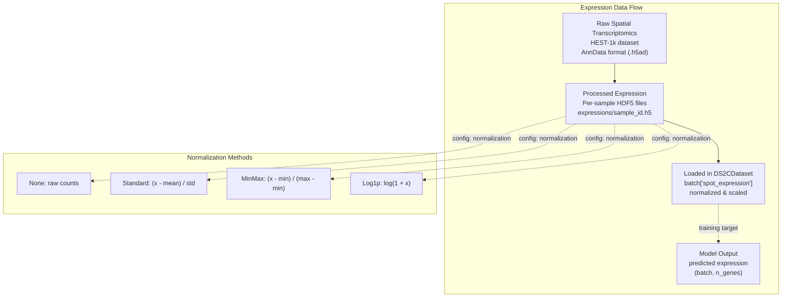
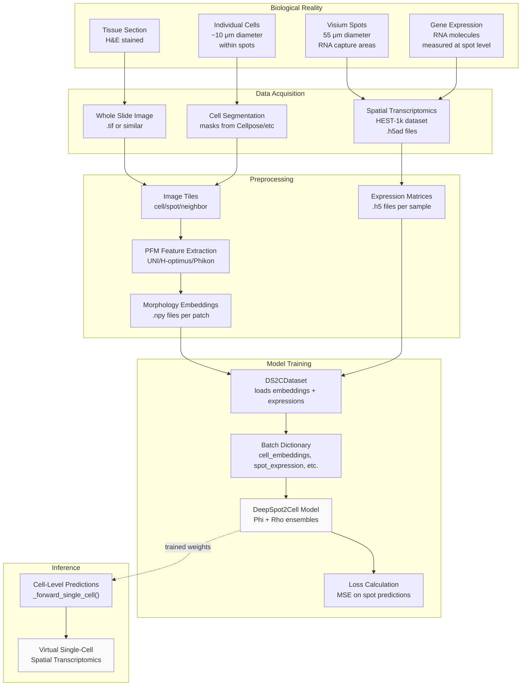

# Key Concepts and Terminology

Relevant source files

The following files were used as context for generating this wiki page:

- [README.md](README.md)
- [deepspot2cell/model.py](deepspot2cell/model.py)

## Purpose and Scope

This page defines the key concepts and terminology used throughout the DeepSpot2Cell system. It explains both biological and technical terms, providing the foundational knowledge needed to understand the system architecture, data processing pipeline, and model operation. 

For detailed architectural information, see [System Architecture](#1.1). For practical usage guidance, see the tutorials starting at [Tutorial 1: Data Preprocessing](#3.1).

---

## Core Biological Concepts

### Spatial Transcriptomics

**Spatial transcriptomics** is a technology that measures gene expression (RNA abundance) while preserving spatial location information within tissue samples. Traditional spatial transcriptomics technologies like Visium measure expression at defined capture locations called **spots**.

| Concept | Definition | Typical Size |
|---------|------------|--------------|
| **Gene Expression** | Quantitative measurement of RNA molecules for specific genes | N/A (count-based) |
| **Spot** | A circular capture area on a Visium array where RNA molecules are captured and sequenced | ~55 μm diameter |
| **Cell** | Individual biological cell within tissue | ~5-20 μm diameter |
| **Tissue Section** | Thin slice of tissue mounted on a slide, stained with H&E | 5-10 μm thickness |

The fundamental challenge addressed by DeepSpot2Cell is that **spots contain multiple cells** (typically 5-20 cells per spot), providing only aggregate expression measurements rather than single-cell resolution.

Sources: [README.md:1-9]()

### Virtual Single-Cell Spatial Transcriptomics

**Virtual single-cell spatial transcriptomics** refers to computationally predicted gene expression profiles at the individual cell level, derived from H&E histology images. Unlike true single-cell spatial transcriptomics (which requires expensive technologies like MERFISH or Xenium), virtual profiles are generated by training models on more accessible spot-level data.

DeepSpot2Cell generates these virtual single-cell profiles by:
1. Training on spot-level expression (aggregate measurement)
2. Learning morphology-to-expression relationships at cellular resolution
3. Predicting expression for individual cells during inference

Sources: [README.md:1-9]()

---

## Spatial Scales and Multi-Resolution Tiles

DeepSpot2Cell processes tissue images at three distinct spatial scales to capture both local cellular morphology and broader tissue context.

### Tile Types

Sources: [README.md:9](), [deepspot2cell/model.py:84-137]()

#### Cell Tile

A cropped image region centered on an individual cell, defined by the cell's segmentation mask. This captures fine-grained cellular morphology.

- **Code representation**: `batch['cell_embeddings']` after PFM processing
- **Shape**: `(batch_size, max_cells_per_spot, embedding_dim)`
- **Masking**: `batch['cell_mask']` indicates valid vs. padded cells

Sources: [deepspot2cell/model.py:149-159]()

#### Spot Tile

The full circular region corresponding to a Visium spot (~55 μm diameter), which may contain multiple cells. This provides immediate spatial context.

- **Code representation**: `context[:, 0, :]` (first context in the neighbor embeddings)
- **Shape**: `(batch_size, embedding_dim)`
- **Processing**: Passed through `phi_spot` ensemble in model

Sources: [deepspot2cell/model.py:119](), [deepspot2cell/model.py:93]()

#### Neighboring Tiles

Image regions from spots adjacent to the target spot. These provide broader tissue microenvironment context.

- **Code representation**: `context[:, 1:, :]` (contexts after the first one)
- **Shape**: `(batch_size, n_neighbors, embedding_dim)`
- **Masking**: `context_mask[:, 1:]` indicates valid vs. padded neighbors
- **Aggregation**: Averaged after masking to create mean neighbor context

Sources: [deepspot2cell/model.py:95-106](), [deepspot2cell/model.py:121-129]()

---

## Pathology Foundation Models (PFMs)

**Pathology Foundation Models** are large pre-trained neural networks that extract meaningful feature representations from histopathology images. DeepSpot2Cell uses PFMs to convert raw image tiles into fixed-dimensional embeddings.

### Supported Models

| Model | Description | Embedding Dimension |
|-------|-------------|---------------------|
| **UNI** | Universal pathology foundation model from Mahmood Lab | Typically 1024 |
| **H-optimus-0** | Bioptimus pathology foundation model | Configurable |
| **Phikon v2** | Owkin's pathology vision model | Typically 768 |

These models are **not trained** by DeepSpot2Cell—they are used as frozen feature extractors during preprocessing.

**Configuration**: PFM selection is specified in dataset configuration files via the `model_name` parameter.

Sources: [README.md:35-45]()

### Feature Extraction Process

Sources: [README.md:35-45]()

**Note**: PFM inference is computationally expensive and performed once during preprocessing (see [Tutorial 1: Data Preprocessing](#3.1)). The resulting embeddings are saved and reused during training.

---

## Training Paradigm: Spot-Level Supervision for Cell-Level Prediction

The core innovation of DeepSpot2Cell is **resolution transfer**: training with spot-level expression targets to enable cell-level predictions.

### Spot-Level Supervision

During training, the model is supervised with **spot-level gene expression** measurements—the aggregate RNA counts from all cells within a spot.

- **Target variable**: `batch['spot_expression']` in training/validation
- **Loss computation**: MSE between predicted and measured spot expression
- **Spatial scale**: ~55 μm diameter spots containing multiple cells

Sources: [deepspot2cell/model.py:148-192]()

### Cell-Level Prediction

During inference, the same trained model predicts **cell-level gene expression** for individual cells.

- **Input**: Single cell embedding + spot/neighbor context
- **Forward pass**: `_forward_single_cell()` instead of `_forward_superspot()`
- **Output**: Gene expression profile for one cell

The model generalizes from spot-level training to cell-level inference because:
1. Cell morphology features are captured at cellular resolution during training
2. Spatial context (spot + neighbors) is consistently provided at both scales
3. The model learns cell-type-specific morphology-expression relationships

Sources: [README.md:9](), [deepspot2cell/model.py:88-112]()

### Inside vs. Outside Cells

The model distinguishes between cells **inside** the spot (which contribute to the measured spot expression) and cells **outside** the spot (which fall within the spot tile image but not the capture area).

- **Inside cells**: `batch['is_inside_spot'] == 1`, used for training
- **Outside cells**: `batch['is_inside_spot'] == 0`, masked out during training
- **Masking logic**: `cell_emb_masked = cell_emb * is_inside.unsqueeze(-1)` at [deepspot2cell/model.py:159]()

During validation, predictions for both inside and outside cells are evaluated separately to assess model generalization.

Sources: [deepspot2cell/model.py:158-190](), [deepspot2cell/model.py:203-232]()

---

## Model Architecture Components

### Phi Ensemble

The **Phi** modules are the first stage of the DeepSpot2Cell architecture, processing individual embeddings (cells or spots) into intermediate representations.

Sources: [deepspot2cell/model.py:11-24](), [deepspot2cell/model.py:75-80]()

**Implementation details**:
- Class: `Phi` at [deepspot2cell/model.py:11-24]()
- Ensemble size: `n_ensemble_phi` (default 10)
- Aggregation: Median across ensemble at [deepspot2cell/model.py:140](), [deepspot2cell/model.py:143]()
- Architecture: Two linear layers with ReLU and dropout

### Rho Ensemble

The **Rho** module is the second stage, combining processed features from all sources (cells, spot, neighbors) to predict gene expression.

**Implementation details**:
- Class: `Rho` at [deepspot2cell/model.py:27-40]()
- Ensemble size: `n_ensemble_rho` (default 10)
- Input size: `phi2rho_size * 3` (concatenated cell + spot + neighbor features)
- Aggregation: Mean across ensemble at [deepspot2cell/model.py:146]()
- Output: Gene expression predictions `(n_genes,)`

Sources: [deepspot2cell/model.py:27-40](), [deepspot2cell/model.py:79-80]()

### Superspot vs. Single-Cell Mode

The model has two forward pass modes:

| Mode | Method | Use Case | Input Shape |
|------|--------|----------|-------------|
| **Superspot** | `_forward_superspot()` | Training/validation | `(batch, n_cells, embed_dim)` |
| **Single-cell** | `_forward_single_cell()` | Inference for individual cells | `(n_cells, embed_dim)` or `(embed_dim,)` |

**Superspot mode** aggregates predictions across all cells in a spot:
- Processes all cells in parallel
- Applies masking to exclude invalid/outside cells
- Sums cell-level features before final prediction
- Implementation: [deepspot2cell/model.py:114-137]()

**Single-cell mode** predicts for one or more individual cells:
- No aggregation across cells
- Each cell gets independent prediction
- Implementation: [deepspot2cell/model.py:88-112]()

Sources: [deepspot2cell/model.py:84-137]()

---

## Data Representations

### Expression Data

Gene expression measurements are stored and processed in multiple formats throughout the pipeline.

Sources: [README.md:47-51]()

**Storage format**: 
- **Preprocessing output**: HDF5 files at `expressions/{sample_id}.h5`
- **Keys in HDF5**: Gene names, expression matrix, spatial coordinates, metadata
- **Loading**: DS2CDataset reads these files and applies normalization

### Morphology Embeddings

Image features extracted by PFMs are stored as NumPy arrays.

**Storage format**:
- **Location**: `embeddings/{sample_id}/{model_name}/`
- **File naming**: One `.npy` file per patch/spot
- **Array shape**: `(embedding_dim,)` for single embedding
- **Typical dimension**: 1024 (UNI), 768 (Phikon v2), varies by PFM

**Loading**: DS2CDataset loads these embeddings on-demand, with optional caching for performance.

Sources: Referenced implicitly in preprocessing documentation

### Batch Dictionary Structure

The `DS2CDataset` class returns batches with the following structure:

| Key | Shape | Type | Description |
|-----|-------|------|-------------|
| `cell_embeddings` | `(batch, max_cells, embed_dim)` | float | PFM embeddings for cells in spot |
| `cell_mask` | `(batch, max_cells)` | float | 1.0 for valid cells, 0.0 for padding |
| `is_inside_spot` | `(batch, max_cells)` | float | 1.0 for cells inside spot area, 0.0 for outside |
| `spot_expression` | `(batch, n_genes)` | float | Ground truth spot-level expression |
| `cell_expressions` | `(batch, max_cells, n_genes)` | float | Ground truth cell-level expression (if available) |
| `neighb_embeddings` | `(batch, 1+n_neighbors, embed_dim)` | float | Spot context (index 0) + neighbor contexts |
| `neighb_masks` | `(batch, 1+n_neighbors)` | bool | True for padding, False for valid |

Sources: [deepspot2cell/model.py:149-155](), [deepspot2cell/model.py:196-202]()

---

## HEST-1k Dataset

**HEST** (Histology-Expression Spatial Transcriptomics) is a curated collection of spatially resolved transcriptomics datasets with aligned histology images.

**HEST-1k** is the version containing approximately 1,000 tissue samples from multiple organs and conditions, providing:
- H&E whole slide images (WSIs)
- Visium spatial transcriptomics data
- Cell segmentation masks
- Spatial alignment information

DeepSpot2Cell uses HEST-1k as its primary data source for both training and evaluation.

**Configuration**: HEST data paths are specified in dataset configuration files under the `data_dir` parameter.

Sources: [README.md:47-51]()

---

## Technical Terminology

### Ensemble Learning

DeepSpot2Cell uses **ensemble methods** extensively:

- **Phi ensembles**: Multiple Phi networks (default 10) with median aggregation
- **Rho ensemble**: Multiple Rho networks (default 10) with mean aggregation
- **Purpose**: Reduces prediction variance and improves robustness

Configuration: `n_ensemble_phi` and `n_ensemble_rho` hyperparameters in model initialization.

Sources: [deepspot2cell/model.py:46-60]()

### Padding and Masking

Because spots contain variable numbers of cells, batching requires **padding** to a fixed size:

- **Cell padding**: Filled with zeros up to `max_cells_per_spot`
- **Cell mask**: Indicates which cells are real (`1.0`) vs. padded (`0.0`)
- **Neighbor padding**: Filled for spots with fewer neighbors than `max_neighbors`
- **Neighbor mask**: Boolean mask (True = padding, False = valid)

Masked values are excluded from aggregation operations using element-wise multiplication or masked fill operations.

Sources: [deepspot2cell/model.py:101-106](), [deepspot2cell/model.py:126-134]()

### Safe Pearson Correlation

The **safe_pearson** metric computes Pearson correlation between predictions and targets with numerical stability handling:

- Handles cases with zero variance
- Returns NaN for invalid correlations (which are filtered during averaging)
- Used for validation metrics: `train_cell_inside_pearson`, `val_cell_outside_pearson`, etc.

Implementation: `deepspot2cell.loss.safe_pearson`

Sources: [deepspot2cell/model.py:242-243](), [deepspot2cell/model.py:263]()

### Gene Ordering

Gene expression predictions must follow a consistent ordering. The **gene list** defines:

- Which genes to predict
- The order of genes in output vectors
- Filtering of low-expression or uninformative genes

Configuration: Specified via `gene_list` parameter in dataset configuration, typically using highly variable genes or cancer hallmark genes.

Sources: Referenced implicitly in configuration documentation

---

## Relationship Between Concepts

Sources: [README.md:1-51](), [deepspot2cell/model.py:1-281]()

This diagram shows how biological concepts flow through data acquisition, preprocessing, training, and inference to produce virtual single-cell spatial transcriptomics predictions.

---