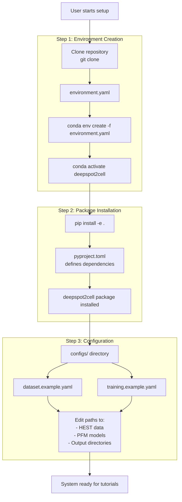
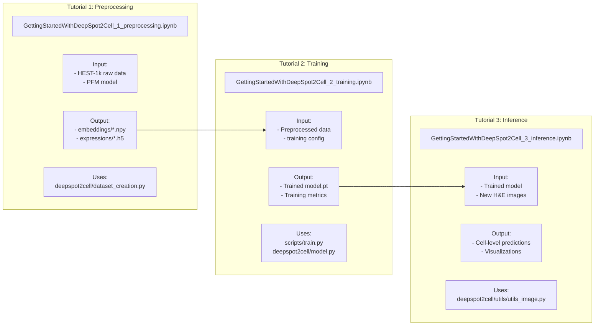
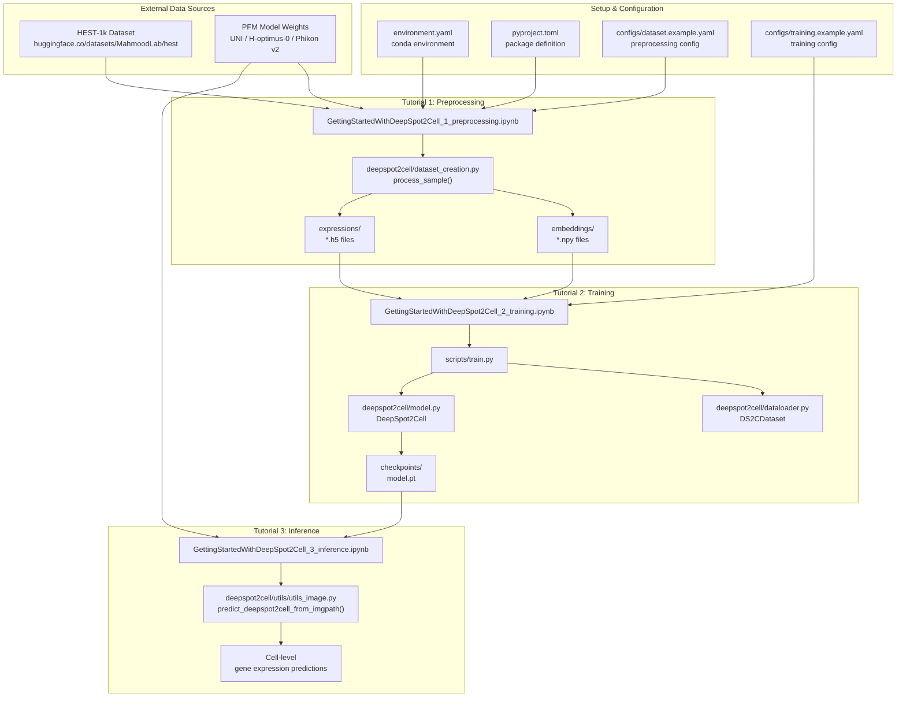

# Getting Started

<details>
<summary>Relevant source files</summary>

The following files were used as context for generating this wiki page:

- [README.md](README.md)
- [environment.yaml](environment.yaml)
- [pyproject.toml](pyproject.toml)

</details>


## Purpose and Scope

This page provides an overview of the initial setup process for DeepSpot2Cell and introduces the tutorial workflow. It covers system requirements, the high-level installation process, and the three-part tutorial series that will guide you from data preprocessing through model training to inference.

For detailed installation instructions, see [Installation and Setup](#2.1). For a walkthrough with example data, see [Quick Start with Example Data](#2.2). For in-depth tutorial documentation, see [Tutorials](#3).

---

## Prerequisites

DeepSpot2Cell requires the following:

| Requirement | Specification |
|-------------|---------------|
| **Operating System** | Linux (tested) or macOS |
| **Python Version** | 3.10 (specified in [environment.yaml:9]()) |
| **GPU** | CUDA-compatible GPU recommended for training and PFM feature extraction |
| **Disk Space** | ~50GB+ for HEST-1k data, PFM models, and preprocessed embeddings |
| **Memory** | 32GB+ RAM recommended for processing whole slide images |

### External Dependencies

Before using DeepSpot2Cell, you should have access to:

1. **HEST-1k Dataset**: Spatial transcriptomics data available at [Hugging Face](https://huggingface.co/datasets/MahmoodLab/hest). See [HEST-1k Dataset](#10.1) for details.

2. **Pathology Foundation Model (PFM)**: At least one of the following:
   - UNI ([Hugging Face](https://huggingface.co/MahmoodLab/UNI))
   - H-optimus-0 ([Hugging Face](https://huggingface.co/bioptimus/H-optimus-0))
   - Phikon v2 ([Hugging Face](https://huggingface.co/owkin/phikon-v2))
   
   See [Pathology Foundation Models](#10.2) for details on obtaining and configuring PFMs.

**Sources**: [README.md:1-70](), [environment.yaml:1-32](), [pyproject.toml:1-48]()

---

## Setup Overview

The setup process involves three main steps:

### Setup Workflow



### 1. Environment Creation

Create the conda environment using the provided specification file:

```bash
conda env create -f environment.yaml
conda activate deepspot2cell
```

The [environment.yaml:1-32]() file defines all conda-managed dependencies including:
- Python 3.10
- PyTorch with CUDA support
- Scientific computing libraries (numpy, pandas, scipy)
- Spatial biology tools (anndata, scanpy, squidpy)
- Image processing libraries (pyvips, opencv)

### 2. Package Installation

Install DeepSpot2Cell in editable mode:

```bash
pip install -e .
```

This installs the package and its pip-managed dependencies defined in [pyproject.toml:1-48](), including:
- PyTorch Lightning for training orchestration
- timm and transformers for PFM support
- HEST library for spatial transcriptomics data access
- Additional dependencies listed in requirements.txt

### 3. Configuration

After installation, configure paths in the YAML files located in the `configs/` directory:
- Dataset configuration: paths to HEST data, PFM models, output directories
- Training configuration: experiment settings, hyperparameters

See [Configuration](#6) for detailed documentation of all configuration parameters.

**Sources**: [README.md:16-22](), [environment.yaml:1-32](), [pyproject.toml:1-48]()

---

## Tutorial Series Overview

DeepSpot2Cell provides a three-part tutorial series that guides you through the complete workflow:

### Tutorial Progression



### Tutorial 1: Data Preprocessing

**Notebook**: `tutorials/GettingStartedWithDeepSpot2Cell_1_preprocessing.ipynb`

This tutorial covers:
- Accessing HEST-1k dataset samples
- Configuring PFM models for feature extraction
- Running `dataset_creation.py` to generate embeddings and expression files
- Understanding the output data structure

**Key module**: `deepspot2cell.dataset_creation`

See [Tutorial 1: Data Preprocessing](#3.1) for detailed documentation.

### Tutorial 2: Model Training

**Notebook**: `tutorials/GettingStartedWithDeepSpot2Cell_2_training.ipynb`

This tutorial covers:
- Configuring training parameters in YAML files
- Loading preprocessed datasets with `DS2CDataset`
- Initializing the `DeepSpot2Cell` model
- Running training with PyTorch Lightning
- Monitoring training progress and metrics

**Key modules**: `scripts.train`, `deepspot2cell.model`, `deepspot2cell.dataloader`

See [Tutorial 2: Model Training](#3.2) for detailed documentation.

### Tutorial 3: Inference and Prediction

**Notebook**: `tutorials/GettingStartedWithDeepSpot2Cell_3_inference.ipynb`

This tutorial covers:
- Loading trained model checkpoints
- Preparing new H&E images for inference
- Generating cell-level gene expression predictions
- Visualizing virtual single-cell spatial transcriptomics

**Key modules**: `deepspot2cell.utils.utils_image`

See [Tutorial 3: Inference and Prediction](#3.3) for detailed documentation.

**Sources**: [README.md:24-33]()

---

## Complete Workflow Diagram

This diagram shows how the main components, configuration files, and data flow through the entire DeepSpot2Cell pipeline:



**Sources**: [README.md:1-70](), [environment.yaml:1-32](), [pyproject.toml:1-48]()

---

## Installation Command Reference

Here is a quick reference of the commands needed to set up DeepSpot2Cell:

```bash
# Clone the repository
git clone https://github.com/ratschlab/DeepSpot2Cell.git
cd DeepSpot2Cell

# Create conda environment
conda env create -f environment.yaml

# Activate environment
conda activate deepspot2cell

# Install package in editable mode
pip install -e .

# Verify installation
python -c "import deepspot2cell; print('DeepSpot2Cell installed successfully')"
```

### Configuration File Editing

Before running the tutorials, you need to edit configuration files to point to your local paths:

**Dataset configuration** (`configs/dataset.example.yaml`):
- `hest_dir`: Path to HEST-1k dataset
- `model_name`: PFM to use (UNI, H-optimus-0, or Phikon-v2)
- `model_dir`: Path to PFM weights
- `output_embeddings_dir`: Where to save embeddings
- `output_expressions_dir`: Where to save expression data

**Training configuration** (`configs/training.example.yaml`):
- `experiment_name`: Name for your training run
- `checkpoint_dir`: Where to save model checkpoints
- `embeddings_dir`: Path to preprocessed embeddings
- `expressions_dir`: Path to preprocessed expressions

See [Dataset Configuration](#6.1) and [Training Configuration](#6.2) for complete parameter documentation.

**Sources**: [README.md:16-22]()

---

## Next Steps

After completing the setup:

1. **Verify your installation** by importing the package in Python
2. **Configure paths** in the YAML files in `configs/` directory
3. **Follow Tutorial 1** to preprocess example data from HEST-1k
4. **Follow Tutorial 2** to train a model on the preprocessed data
5. **Follow Tutorial 3** to run inference and generate predictions

For detailed installation instructions including troubleshooting, see [Installation and Setup](#2.1).

For a quick walkthrough with example data, see [Quick Start with Example Data](#2.2).

For comprehensive tutorial documentation, see [Tutorials](#3).

**Sources**: [README.md:24-52]()

---