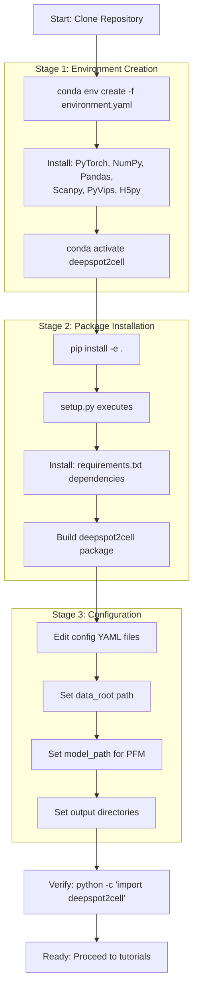
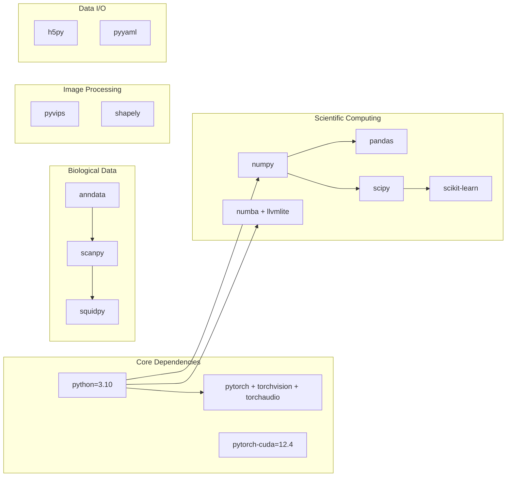
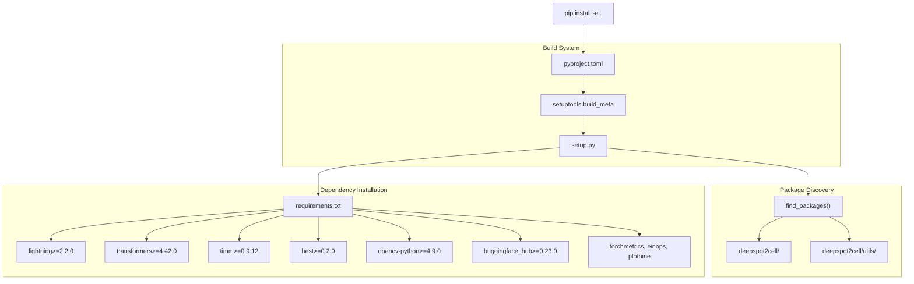
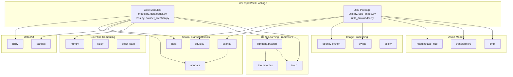

# Installation and Setup

<details>
<summary>Relevant source files</summary>

The following files were used as context for generating this wiki page:

- [README.md](README.md)
- [environment.yaml](environment.yaml)
- [pyproject.toml](pyproject.toml)
- [requirements.txt](requirements.txt)
- [setup.py](setup.py)

</details>


This page provides detailed instructions for installing DeepSpot2Cell and configuring your environment. It covers creating the conda environment, installing the package and its dependencies, and setting up configuration files for data paths and model selection.

For guidance on running your first example after installation, see [Quick Start with Example Data](#2.2). For detailed information about all configuration parameters, see [Dataset Configuration](#6.1) and [Training Configuration](#6.2).

---

## Prerequisites

DeepSpot2Cell requires the following system prerequisites:

| Requirement | Version | Purpose |
|-------------|---------|---------|
| Python | 3.9+ (3.10 recommended) | Core runtime |
| CUDA | 12.4+ (optional) | GPU acceleration |
| Conda/Mamba | Latest | Environment management |
| Git | Any | Repository cloning |

**Hardware Recommendations:**
- GPU: NVIDIA GPU with 16GB+ VRAM for training
- RAM: 32GB+ system memory
- Storage: 100GB+ free space for HEST-1k data and models

Sources: [environment.yaml:9](), [pyproject.toml:11]()

---

## Installation Workflow

The installation process follows three sequential stages: environment creation, package installation, and configuration.



Sources: [README.md:18-22]()

---

## Step 1: Clone the Repository

Clone the DeepSpot2Cell repository from GitHub:

```bash
git clone https://github.com/ratschlab/DeepSpot2Cell.git
cd DeepSpot2Cell
```

Sources: [README.md:1]()

---

## Step 2: Create Conda Environment

DeepSpot2Cell uses a conda environment defined in `environment.yaml` to manage core dependencies.

### Environment Creation

```bash
conda env create -f environment.yaml
conda activate deepspot2cell
```

The `environment.yaml` file specifies three conda channels and installs packages from both conda and pip:

| Channel | Purpose |
|---------|---------|
| conda-forge | General scientific packages |
| pytorch | PyTorch deep learning framework |
| nvidia | CUDA toolkit for GPU support |

### Core Conda Dependencies

The following packages are installed via conda:



**CPU-Only Installation:** Remove the `pytorch-cuda=12.4` line from [environment.yaml:14]() if you do not have a CUDA-compatible GPU.

Sources: [environment.yaml:1-32]()

---

## Step 3: Install DeepSpot2Cell Package

After creating the conda environment, install the `deepspot2cell` package in editable mode:

```bash
pip install -e .
```

### Installation Process

The installation uses `setup.py` and `pyproject.toml` to define the package structure:



### Key Dependencies from requirements.txt

The `pip install -e .` command installs additional dependencies from [requirements.txt:1-28]():

| Package | Version | Purpose |
|---------|---------|---------|
| `lightning` | ≥2.2.0 | PyTorch Lightning training framework |
| `transformers` | ≥4.42.0 | Hugging Face transformers for PFM loading |
| `timm` | ≥0.9.12 | PyTorch image models library |
| `hest` | ≥0.2.0 | HEST-1k dataset loading |
| `opencv-python` | ≥4.9.0 | Image processing operations |
| `huggingface_hub` | ≥0.23.0 | Downloading PFM weights |
| `torchmetrics` | ≥1.3.0 | Metric computation |
| `einops` | ≥0.7.0 | Tensor operations |
| `plotnine` | ≥0.12.0 | Visualization |

**Editable Mode:** The `-e` flag installs the package in editable/development mode, allowing you to modify source files without reinstalling.

Sources: [setup.py:1-20](), [pyproject.toml:1-48](), [requirements.txt:1-28]()

---

## Step 4: Configuration Setup

After installation, configure DeepSpot2Cell by creating and editing YAML configuration files. The repository includes example configurations in the `configs/` directory.

### Configuration File Types

```mermaid
graph TB
    subgraph "Configuration Files"
        DATASET["configs/dataset.example.yaml"]
        TRAINING["configs/training.example.yaml"]
    end
    
    subgraph "Dataset Configuration Parameters"
        DATA_ROOT["data_root:<br/>Path to HEST data"]
        MODEL_PATH["model_path:<br/>Path to PFM weights"]
        MODEL_NAME["model_name:<br/>uni/hoptimus0/phikon_v2"]
        EMBED_DIR["embedding_save_dir:<br/>Output embeddings"]
        EXPR_DIR["expression_save_dir:<br/>Output expressions"]
        GENES["genes_file:<br/>Gene list"]
    end
    
    subgraph "Training Configuration Parameters"
        EXP_NAME["experiment_name:<br/>Run identifier"]
        EMBED_LOAD["embeddings_path:<br/>Input embeddings"]
        EXPR_LOAD["expressions_path:<br/>Input expressions"]
        NEIGHBORS["num_neighbors:<br/>Spatial context"]
        PHI_HIDDEN["phi_hidden_dims:<br/>Model architecture"]
        RHO_HIDDEN["rho_hidden_dims:<br/>Model architecture"]
    end
    
    DATASET --> DATA_ROOT
    DATASET --> MODEL_PATH
    DATASET --> MODEL_NAME
    DATASET --> EMBED_DIR
    DATASET --> EXPR_DIR
    DATASET --> GENES
    
    TRAINING --> EXP_NAME
    TRAINING --> EMBED_LOAD
    TRAINING --> EXPR_LOAD
    TRAINING --> NEIGHBORS
    TRAINING --> PHI_HIDDEN
    TRAINING --> RHO_HIDDEN
```



### Creating Your Configuration Files

1. **Copy example configurations:**
   ```bash
   cp configs/dataset.example.yaml configs/dataset.yaml
   cp configs/training.example.yaml configs/training.yaml
   ```

2. **Edit `configs/dataset.yaml` with your paths:**
   - `data_root`: Path to HEST-1k dataset root directory
   - `model_path`: Path to downloaded PFM weights (UNI, H-optimus-0, or Phikon v2)
   - `model_name`: PFM identifier (`uni`, `hoptimus0`, or `phikon_v2`)
   - `embedding_save_dir`: Directory where embeddings will be saved
   - `expression_save_dir`: Directory where expression files will be saved

3. **Edit `configs/training.yaml` with your paths:**
   - `embeddings_path`: Path to preprocessed embedding files
   - `expressions_path`: Path to preprocessed expression files
   - `experiment_name`: Name for your training run

### Pathology Foundation Model Setup

DeepSpot2Cell requires access to pre-trained PFM weights. Download one of the supported models:

| Model | Hugging Face Repository | Config `model_name` |
|-------|-------------------------|---------------------|
| UNI | `MahmoodLab/UNI` | `uni` |
| H-optimus-0 | `bioptimus/H-optimus-0` | `hoptimus0` |
| Phikon v2 | `owkin/phikon-v2` | `phikon_v2` |

**Example download using Hugging Face CLI:**
```bash
huggingface-cli download MahmoodLab/UNI --local-dir /path/to/models/uni
```

Then set `model_path: /path/to/models/uni` in your configuration.

Sources: [README.md:35-45]()

### HEST-1k Dataset Setup

The HEST-1k dataset must be downloaded and configured:

1. **Access the dataset:** Available at `MahmoodLab/hest` on Hugging Face
2. **Set `data_root`:** Point to the HEST-1k root directory containing sample folders
3. **Directory structure expected:**
   ```
   data_root/
   ├── sample_001/
   │   ├── tissue_image.tif
   │   ├── spatial_coords.csv
   │   └── expression_matrix.h5
   └── sample_002/
       └── ...
   ```

Sources: [README.md:47-51]()

---

## Step 5: Verify Installation

After installation and configuration, verify that DeepSpot2Cell is correctly installed:

### Import Test

```bash
python -c "import deepspot2cell; print(deepspot2cell.__file__)"
```

This should print the path to the installed `deepspot2cell` package without errors.

### Component Import Test

```bash
python -c "from deepspot2cell import DeepSpot2Cell, DS2CDataset; print('Success')"
```

This verifies that core components can be imported.

### Check Dependencies

```bash
python -c "import torch; print(f'PyTorch {torch.__version__}'); print(f'CUDA available: {torch.cuda.is_available()}')"
```

This confirms PyTorch installation and GPU availability.

Sources: [pyproject.toml:6]()

---

## Dependency Architecture

The following diagram shows the hierarchical dependency structure of DeepSpot2Cell:



Sources: [requirements.txt:1-28](), [environment.yaml:8-31]()

---

## Installation Validation Checklist

After completing all installation steps, verify the following:

| Component | Verification Command | Expected Result |
|-----------|---------------------|-----------------|
| Environment | `conda info --envs \| grep deepspot2cell` | Environment listed |
| Package | `pip show deepspot2cell` | Package info displayed |
| Core Import | `python -c "import deepspot2cell"` | No errors |
| PyTorch | `python -c "import torch; print(torch.__version__)"` | Version ≥2.2.0 |
| Lightning | `python -c "import lightning; print(lightning.__version__)"` | Version ≥2.2.0 |
| HEST | `python -c "import hest; print(hest.__version__)"` | Version ≥0.2.0 |
| GPU (optional) | `python -c "import torch; print(torch.cuda.is_available())"` | `True` if GPU available |

Sources: [pyproject.toml:12-41]()

---

## Common Installation Issues

### Issue: CUDA Version Mismatch

**Symptom:** PyTorch cannot detect GPU despite CUDA being installed.

**Solution:** Ensure `pytorch-cuda` version in [environment.yaml:14]() matches your system CUDA version:
```bash
nvidia-smi  # Check CUDA version
# Edit environment.yaml to match, e.g., pytorch-cuda=11.8
conda env update -f environment.yaml
```

### Issue: PyVips Installation Failure

**Symptom:** Error during `conda env create` related to `pyvips`.

**Solution:** PyVips requires libvips system library:
```bash
# Ubuntu/Debian
sudo apt-get install libvips-dev

# macOS
brew install vips

# Then retry environment creation
```

### Issue: Out of Memory During Installation

**Symptom:** Installation fails with memory errors.

**Solution:** Use mamba instead of conda for faster, memory-efficient installation:
```bash
conda install mamba -c conda-forge
mamba env create -f environment.yaml
```

### Issue: Editable Install Not Working

**Symptom:** Code changes not reflected without reinstall.

**Solution:** Verify editable mode installation:
```bash
pip show -f deepspot2cell | grep Location
# Should show local repository path, not site-packages
```

Sources: [environment.yaml:1-32](), [setup.py:9-20]()

---

## Next Steps

After successful installation and configuration:

1. **Quick Start:** Follow [Quick Start with Example Data](#2.2) to run DeepSpot2Cell on provided data
2. **Data Preprocessing:** See [Tutorial 1: Data Preprocessing](#3.1) to preprocess your own HEST data
3. **Training:** See [Tutorial 2: Model Training](#3.2) to train a model
4. **Configuration Details:** Consult [Dataset Configuration](#6.1) and [Training Configuration](#6.2) for all available parameters

Sources: [README.md:24-33]()

---